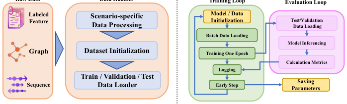

# SSLRec: A Self-Supervised Learning Framework for Recommendation (面向推荐的自监督学习统一框架)

- **会议/期刊**: WSDM 2024 (Oral)
- **作者与机构**: Xubin Ren, Lianghao Xia, Yuhao Yang, Wei Wei, Tianle Wang, Xuheng Cai, Chao Huang; 香港大学
- **推荐链路定位**: 召回/排序统一评测（非单一模型）
- **研究方向**: 自监督对比学习与交互去噪 / 图神经网络与知识图谱推荐
- **论文原文**: [https://arxiv.org/abs/2308.05697v3](https://arxiv.org/abs/2308.05697v3)
- **开源代码**: [https://github.com/HKUDS/SSLRec](https://github.com/HKUDS/SSLRec)

## TL;DR (1分钟核心速览)

针对 SSL 推荐算法实现分散、数据格式与评测口径不一致、缺乏跨场景统一基准的痛点，SSLRec 以模块化架构封装数据增广、SSL 损失与标准接口，统一五大推荐场景约30个模型的训练、调参与全库排序评测；在 Gowalla、MovieLens-20M、Yelp、Alibaba、Retail-rocket 上复现并验证 AutoCF、DCRec、DSL、KGRec、CML 等相对对应基线的稳定增益。

## Background & Motivation (背景与核心矛盾)

- **主流范式**: 自监督推荐在通用 CF、序列、社交、KG、多行为场景中引入对比、生成或预测式辅助任务，以缓解交互稀疏与噪声。
- **前人局限**: 大量 SSL 模型缺少公开实现；即使开源，数据格式、调参和训练策略不一致，导致跨论文结果不可比；RecBole/SELFRec 等框架对 SSL 模块或推荐场景覆盖仍不完整。
- **核心洞察 (Key Insight)**: 不同场景的 SSL 推荐均可抽象为在观察数据 $\mathbf{X}$上构造两个增广视图并优化自监督目标，即$\min \mathcal{L}_{ssl}(\Delta_1(\mathbf{X}),\Delta_2(\mathbf{X}))$，因此增广与损失可模块化复用。
- **本文切入点**: 构建统一数据流、增广库、SSL 损失库、标准模型接口与自动调参的 benchmark，而非提出新的召回算子。

## Method (核心方法设计)

### 1. 整体框架 (Overall Architecture)

输入原始交互、序列、社交图、KG 或多行为数据后，DataHandler 统一完成过滤、k-core 与 train/validation/test 构造；Dataset/DataLoader 向场景编码器供数。每个模型仅实现 `forward`、`cal_loss`、`full_predict` 三接口，增广模块与 SSL 损失可插拔；Trainer 负责早停、日志、全库打分与 Recall/NDCG 计算，Configurator 通过 YAML 做网格搜索。该闭环将“模型实现”与“评测流程”解耦，使不同 SSL 算法在相同数据与调参预算下比较。

<figure class="paper-figure" markdown="span">
  <figcaption>图1：我们提出的 SSLRec 的整体框架。</figcaption>
</figure>

### 2. 关键设计拆解 (Key Designs)

1. **模块化增广与 SSL 目标解耦**：针对 SGL 随机丢边噪声大、SimGCL/NCL 依赖特征扰动或聚类中心的问题，框架统一抽象数据级增广（边/节点丢弃、序列裁剪/插入/重排、社交矩阵增强）与特征级增广（噪声、dropout、聚类中心），并封装 InfoNCE、对齐/均匀、KL/JS、CE、SCE 等损失。其直觉是：算法差异集中于 $\Delta_1,\Delta_2$与$\mathcal{L}_{ssl}$，便于公平替换与复现。
2. **标准化模型接口与统一执行流**：通过 `forward` 生成嵌入、`cal_loss` 计算推荐与 SSL 损失、`full_predict` 对全库物品打分，统一 Trainer/Evaluator/YAML 配置，消除数据格式、早停与调参差异。
3. **训练目标、负采样与推理效率**：总损失为 $\mathcal{L}=\mathcal{L}_{rec}+\lambda_{ssl}\mathcal{L}_{ssl}$；负采样依模型而定（in-batch、图负采样等），框架不强制统一；推理使用 `full_predict` 全库排序，开销随物品数线性增长。

## Experimental Setup & Evaluation Protocol (实验设置与评估协议)

- **数据集与预处理**: 统一采用低评分过滤与 k-core 正则；代表性统计如下：

| 场景/数据集 | #Users | #Items | #Interactions | 说明 |
| :--- | ---: | ---: | ---: | :--- |
| CF / Gowalla | 25,557 | 19,747 | 294,983 | 密度约 0.058% |
| Seq / MovieLens-20M | 96,726 | 10,154 | 193,452 | 保留时间戳序列 |
| Social / Yelp | 43,043 | 66,576 | 283,512 | 含用户社交边 |
| KG / Alibaba | 114,737 | 30,040 | 1,781,093 | 51 relations, 279,155 triplets |
| Multi / Retail-rocket | 2,174 | 30,113 | 75,374 view / 12,456 cart / 9,551 buy | 多行为 |

- **数据划分与防穿越**: 统一 train/validation/test；序列场景保留时间戳并按下一物品预测构造样本，其余场景按框架默认切分，正文未逐项展开比例。
- **排名评测协议**: 通过 `full_predict` 对全库未交互物品打分，报告 Recall@K 与 NDCG@K，属无偏 Full-Ranking；原文未报告采样负例比例。
- **对比基线与超参**: 覆盖 GNN、对比、生成、社交、KG、多行为基线；嵌入维度统一 $d=64$，序列 batch size=512，固定随机种子并用网格搜索调参；未报告显著性检验。

## Key Experimental Results (实验关键数据)

### 1. 主实验对比 (Main Results)

| 场景 | 方法 | R@10 | N@10 | 相对基线 |
| :--- | :--- | ---: | ---: | :--- |
| Gowalla | LightGCN | 0.1526 | 0.1230 | — |
| Gowalla | SGL | 0.1640 | 0.1321 | +7.5% / +7.4% |
| Gowalla | AutoCF | **0.1747** | 0.1407 | **+14.5%** / +14.4% |
| Gowalla | GFormer | 0.1730 | **0.1426** | +13.4% / **+15.9%** |
| MovieLens-20M | BERT4Rec | 0.2223 | 0.1237 | — |
| MovieLens-20M | DCRec | **0.2327** | **0.1311** | **+4.7%** / **+6.0%** |
| Yelp | KCGN | 0.0202 | 0.0094 | — |
| Yelp | SMIN | 0.0216 | 0.0103 | +6.9% / +9.6% |
| Yelp | DSL | **0.0335** | **0.0167** | **+65.8%** / **+77.7%** |
| Alibaba | KGIN | 0.1139 | 0.0711 | — |
| Alibaba | KGRec | **0.1188** | **0.0741** | **+4.3%** / **+4.2%** |
| Retail-rocket | MBGMN | 0.0405 | 0.0227 | — |
| Retail-rocket | CML | **0.0428** | **0.0241** | **+5.7%** / **+6.2%** |

### 2. 消融实验 (Ablation Study)

原文未做算法组件消融；以框架能力对比作为替代验证：

| 框架 | #SSL模型 | #场景 | SSL专用模块 | 自动调参 |
| :--- | ---: | ---: | :---: | :---: |
| SELFRec | 11 | 2 | ✓ | ✗ |
| RecBole | 11 | 9 | ✗ | ✓ |
| SSLRec | **25** | **5** | ✓ | ✓ |

### 3. 关键实验发现 (Key Findings)

1. 统一设置下 SSL 普遍优于监督基线：Gowalla 上 AutoCF 的 R@10 达 0.1747，较 LightGCN 提升 14.5%；GFormer 的 N@10 达 0.1426，提升 15.9%，说明图对比/生成式辅助信号有效。
2. 场景收益差异显著：Yelp 上 DSL 相对 KCGN 的 R@10 提升 65.8%、N@10 提升 77.7%，远高于 DCRec/KGRec 约 4%–6% 的增益，反映社交噪声去偏空间更大。
3. 统一 full-ranking 复现暴露可复现性差异：Retail-rocket 上 CML 与 KMCLR 的 R@10 均为 0.0428，CML 的 N@10 为 0.0241，略高于 KMCLR 的 0.0240；提示不能仅凭单指标宣称 SOTA 优势。

## Highlights & Limitations (亮点、对比与审稿批判)

- **与代表作对比 (vs. Prior Work)**: RecBole 覆盖广但 SSL 模块弱；SELFRec 专注 SSL 但仅覆盖 CF/序列；SSLRec 以 5 场景、25 个 SSL 模型、模块化增广/损失和自动调参补齐跨场景公平评测。
- **可迁移亮点**: 三接口 `forward/cal_loss/full_predict` 可直接迁移到新推荐框架；增广与 SSL 损失解耦便于快速组合新算法。
- **审稿级局限批判**: 其一，本文是 benchmark，方法新颖性有限且缺少理论分析；其二，各场景切分细节与显著性检验披露不足，且无在线 A/B/延迟评估；如 DCRec 在 Yelp 24GB GPU 上仍 OOM，说明大图场景工程开销需关注。

## Rating (四维评分)

- **方法创新性 (Novelty)**: ⭐⭐⭐ （核心贡献是统一基准与模块抽象，非新召回算子，但 SSL 范式抽象有实用价值）
- **评估协议与实验扎实度 (Protocol & Experiments)**: ⭐⭐⭐⭐ （覆盖 5 场景 13 数据集与全库排序，统一 $d=64$ 和网格搜索；但切分细节与显著性检验不足）
- **写作与数学规范度 (Clarity & Rigor)**: ⭐⭐⭐⭐ （接口、数据流与 SSL 目标定义清晰，公式简洁；各场景评测协议未完全展开）
- **工业落地与复现价值 (Industrial & Practical Value)**: ⭐⭐⭐⭐ （开源完整、模块化与自动调参利于复现；缺少在线延迟与大规模部署验证）

