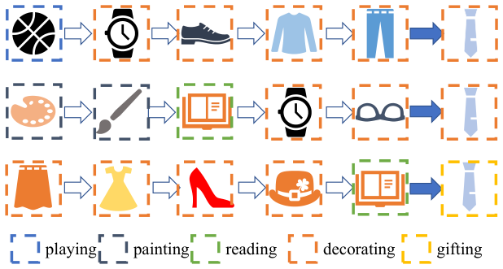
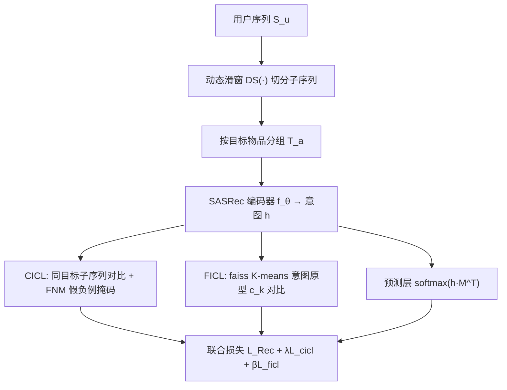
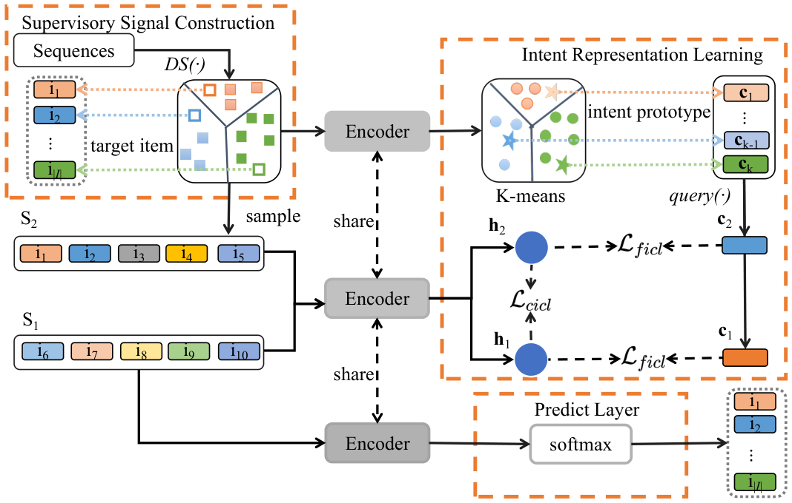

# Intent Contrastive Learning with Cross Subsequences for Sequential Recommendation (跨子序列意图对比学习的序列推荐)

- **会议/期刊**: WSDM 2024
- **作者与机构**: Xiuyuan Qin, Huanhuan Yuan, Pengpeng Zhao (苏州大学), Guanfeng Liu (麦考瑞大学), Fuzhen Zhuang (北航), Victor Sheng (德州理工)
- **推荐链路定位**: 召回 / 序列建模（Next-Item 预测）
- **研究方向**: 序列与会话推荐 / 自监督对比学习
- **论文原文**: [https://arxiv.org/abs/2310.14318v3](https://arxiv.org/abs/2310.14318v3)
- **开源代码**: [https://github.com/QinHsiu/ICSRec](https://github.com/QinHsiu/ICSRec)

## TL;DR (1分钟核心速览)

用户的隐式意图频繁变化且无标注，现有做法要么依赖稀疏辅助信息（类目/行为类型），要么用随机数据增广构造对比视图，后者会破坏序列中原有的意图。ICSRec 把一条序列按动态滑窗切成多个「历史子序列 + 同一目标物品」的片段，将**目标物品相同**的子序列视为同意图正样本做粗粒度对比（CICL），再用 K-means 意图原型做细粒度对比（FICL），并设计假负例掩码 FNM。在 5-core 过滤、Leave-One-Out 划分、无负采样全库排序协议下，四个数据集上 NDCG@20 相对最强基线提升 14.45%–44.39%。

## Background & Motivation (背景与核心矛盾)

- **主流范式**: 以 SASRec 类 Transformer 编码序列，再用 ICLRec/DSSRec/SINE 在隐空间通过聚类或随机掩码/裁剪增广来学习「意图原型」并加对比损失。
- **前人局限**: ① 辅助信息（下一物品类目、行为类型）稀疏且常缺失，并不等价于真实意图；② 数据增广（crop/mask/reorder）是**随机**的，会改变序列中隐藏的意图，尤其长序列的密集数据集上反而掉点（IOCRec 在 ML-1M 上不如 DuoRec）。
- **核心洞察 (Key Insight)**: 意图的监督信号其实藏在**跨用户子序列**里——不同用户在不同时刻购买同一物品，但其前序子序列可能高度相似（例如先买衬衫再买领带 vs. 先买书再买领带）；而同一物品在不同上下文中的购买意图又可能不同（领带作为礼物 vs. 装饰）。
- **本文切入点**: 不再「增广造视图」，而是直接从原始交互序列中「切」出正样本对，用目标物品作天然的弱标签，粗/细两个粒度同时约束意图表征。

<figure class="paper-figure" markdown="span">
  <figcaption>图1：示例展示同一目标物品的子序列可存在不同的交互序列。</figcaption>
</figure>

## Method (核心方法设计)

### 1. 整体框架 (Overall Architecture)

模型包含三部分：① 监督信号构造——对每条训练序列 $S_u$施加动态滑窗算子$DS(\cdot)$，切出若干长度不超过$n$的「子序列 + 目标物品」对，并把**目标物品相同**的子序列归入同一集合$T_a$；② 意图表征学习——子序列送入 SASRec 编码器$f_\theta$取末位向量$\mathbf{h}$作为粗粒度意图，执行 CICL（同目标物品子序列拉近）与 FICL（靠近 K-means 意图原型）；③ 预测层——用$\mathbf{h}$ 与物品嵌入内积做全库 softmax，三项损失联合优化。

<figure class="paper-figure" markdown="span">
  <figcaption>图2：ICSRec 的模型架构。其中 𝑆2 和 𝑆1 表示具有同一目标物品的两个子序列。h2 和 h1 表示通过编码器 𝑓𝜃(·) 得到的两个粗粒度意图。c2 和 c1 表示通过聚类得到的两个细粒度意图。</figcaption>
</figure>

### 2. 关键设计拆解 (Key Designs)

1. **跨子序列监督信号构造 (DS 滑窗切分)**：痛点是无标签可用来定义「同意图」；本文用长度 $n$的滑动窗口把序列展开成$|S_u|-n$个片段，每个片段以紧随其后的真实交互物品$i^u_k$作目标，从而把 1 条长序列放大成数十条弱标注样本：$DS(S_u)=\{DS(S_u^{n+1}),\dots,\{s^u_{|S_u|-n},\dots,i^u_{|S_u|}\}\}$。直觉是：**目标物品本身就是意图的离散化代理**，无需人工标注。
2. **粗/细粒度意图对比 + 假负例掩码 (CICL & FICL)**：CICL 从 $T_a$中随机采样另一子序列作正样本；但同 batch 内可能有多个子序列共享同一目标物品，直接套 InfoNCE 会产生假负例，故掩码集合$\mathcal{F}$：
$\mathcal{L}_{con}(\mathbf{x}_1,\mathbf{x}_2)=-\log\frac{e^{s(\mathbf{x}_1,\mathbf{x}_2)/\tau}}{e^{s(\mathbf{x}_1,\mathbf{x}_2)/\tau}+\sum_{\mathbf{x}\notin\mathcal{F}}e^{s(\mathbf{x}_1,\mathbf{x})/\tau}}$（对称项同理）。
FICL 则先对全部子序列表征做 K-means 得 $K$个原型$\mathbf{C}=\{\mathbf{c}_k\}$，取最近原型作细粒度意图$\mathbf{c}_1=query(\mathbf{h}_1,\mathbf{C})$，并约束$\mathcal{L}_{ficl}=\mathcal{L}_{con}(\mathbf{h}_1,\mathbf{c}_1)+\mathcal{L}_{con}(\mathbf{h}_2,\mathbf{c}_2)$。物理直觉：粗粒度负责「同物品同意图」的跨用户对齐，细粒度负责消解「同物品不同意图」的歧义。
3. **训练目标与推理开销**：$\mathcal{L}=\mathcal{L}_{Rec}+\lambda\mathcal{L}_{cicl}+\beta\mathcal{L}_{ficl}$，$\mathcal{L}_{Rec}$为全库 softmax 交叉熵，**不使用负采样**；推理时仅需一次编码器前向 + 内积检索，额外开销只在训练期（每 epoch 一次 faiss K-means）。最优$\lambda\in[0.1,0.3]$普遍大于$\beta=0.1$，说明粗粒度信号更关键。

## Experimental Setup & Evaluation Protocol (实验设置与评估协议)

- **数据集与预处理**: 全部按 `5-core` 过滤（用户/物品交互少于 5 次剔除），按时间戳升序聚合。

| 数据集 | #Users | #Items | #Interactions | 稀疏度 | 特征/场景说明 |
| :--- | :---: | :---: | :---: | :---: | :--- |
| Sports (Amazon) | 35,598 | 18,357 | 296,337 | 99.95% | 短序列，均长 8.3 |
| Beauty (Amazon) | 22,363 | 12,101 | 198,502 | 99.93% | 短序列，均长 8.8 |
| Toys (Amazon) | 19,412 | 11,924 | 167,597 | 99.93% | 短序列，均长 8.6 |
| ML-1M | 6,040 | 3,416 | 999,611 | 95.16% | 长序列，均长 165.4 |

- **数据划分与防穿越 (Splitting Strategy)**: 采用标准 `Leave-One-Out`（最后 1 项测试、倒数第 2 项验证、其余训练），序列内部严格按时间戳排序，无未来信息泄漏。
- **排名评测协议 (Ranking Protocol)**: 无偏 `Full-Ranking`（对全部未交互物品打分排序，**不做负采样**），指标 HR@{5,10,20} 与 NDCG@{5,10,20}。
- **对比基线与超参设置**: BPR、GRU4Rec、Caser、SASRec、BERT4Rec、S3-Rec_MIP、CL4SRec、CoSeRec、DuoRec、DSSRec、SINE、ICLRec、IOCRec 共 13 个基线；$d=64$，$n=50$，$\tau=1.0$，batch=256，2 层 2 头 self-attention，Adam，lr=$10^{-3}$，$K\in\{64,\dots,1024\}$；论文未报告显著性检验。

## Key Experimental Results (实验关键数据)

### 1. 主实验对比 (Main Results)

| 数据集 | 指标 | SASRec | BERT4Rec | CL4SRec | CoSeRec | DuoRec | ICLRec | IOCRec | **ICSRec** | Improv. |
| :--- | :---: | :---: | :---: | :---: | :---: | :---: | :---: | :---: | :---: | :---: |
| Sports | HR@20 | 0.0500 | 0.0604 | 0.0557 | 0.0636 | 0.0696 | 0.0610 | 0.0646 | **0.0794** | +14.10% |
| Sports | NDCG@20 | 0.0218 | 0.0251 | 0.0238 | 0.0293 | 0.0302 | 0.0255 | 0.0291 | **0.0393** | +30.13% |
| Beauty | HR@20 | 0.0894 | 0.0984 | 0.0974 | 0.1034 | 0.1228 | 0.0963 | 0.1146 | **0.1298** | +5.70% |
| Beauty | NDCG@20 | 0.0386 | 0.0391 | 0.0428 | 0.0487 | 0.0536 | 0.0384 | 0.0490 | **0.0663** | +23.69% |
| Toys | HR@20 | 0.0957 | 0.0760 | 0.0990 | 0.1037 | 0.1293 | 0.0957 | 0.1139 | **0.1368** | +5.80% |
| Toys | NDCG@20 | 0.0397 | 0.0368 | 0.0404 | 0.0513 | 0.0574 | 0.0386 | 0.0557 | **0.0736** | +28.22% |
| ML-1M | HR@20 | 0.2745 | 0.3354 | 0.2818 | 0.2950 | 0.4098 | 0.2705 | 0.3831 | **0.4518** | +10.25% |
| ML-1M | NDCG@20 | 0.1156 | 0.1384 | 0.1170 | 0.1247 | 0.2007 | 0.1066 | 0.1775 | **0.2297** | +14.45% |

### 2. 消融实验 (Ablation Study)

| 变体 | Sports NDCG@20 | Beauty NDCG@20 | Toys NDCG@20 | ML-1M NDCG@20 |
| :--- | :---: | :---: | :---: | :---: |
| (A) 完整 ICSRec | **0.0393** | **0.0663** | **0.0736** | **0.2297** |
| (B) w/o CICL ($\lambda=0$) | 0.0374 | 0.0627 | 0.0701 | 0.2174 |
| (C) w/o FICL ($\beta=0$) | 0.0368 | 0.0616 | 0.0716 | 0.2162 |
| (D) w/o FNM 假负例掩码 | 0.0384 | 0.0658 | 0.0718 | 0.2157 |
| (E) 仅 SASRec 骨干 | 0.0218 | 0.0386 | 0.0397 | 0.1156 |

### 3. 关键实验发现 (Key Findings)

1. **稀疏场景增益远大于密集场景**：Sports/Beauty/Toys 上 NDCG@20 相对提升 23.69%–44.39%，而 ML-1M 仅 14.45%；作者归因于 ML-1M 序列均长 165.4，用户意图更分散，同一目标物品对应的上下文差异更大，弱标签的「同意图」假设变粗。
2. **FNM 在长序列数据上不可或缺**：移除 FNM 使 ML-1M NDCG@20 从 0.2297 降至 0.2157（-0.0140），跌幅超过移除 CICL（-0.0123）与 FICL（-0.0135）；而在稀疏数据集上移除 FICL 损失最大（Sports 0.0393→0.0368），说明密集数据假负例多、稀疏数据更依赖细粒度原型去歧义。
3. **意图对比是骨干无关的通用增益**：换用 GRU4Rec 骨干后，Sports HR@20 从 0.0421 提至 0.0595（+41.3%），ML-1M 从 0.2081 提至 0.4045；且注入 10% 随机噪声时 ICSRec 仍优于其他模型的无噪水平，在 20% 噪声下 SASRec/DuoRec 在稀疏数据集上崩塌远快于 ICSRec。

## Highlights & Limitations (亮点、对比与审稿批判)

- **与代表作对比 (vs. Prior Work)**: 与 ICLRec 相比，本文不从**全序列整体**聚类的全局原型出发，而是用「同目标物品子序列」提供实例级正样本，监督信号更细；与 IOCRec/CL4SRec/CoSeRec 相比，本文完全不用随机增广，避免破坏序列原意，在长序列 ML-1M 上反超 DuoRec 14.45%；与 DSSRec/SINE 相比，本文无需额外辅助信息或 seq2seq 解码结构。
- **可迁移亮点**: ① 「目标物品相同的子序列即正样本」这一弱监督构造可直接套到任何 next-item 序列模型中作即插即用辅助任务（论文已验证 SASRec/GRU4Rec 双骨干）；② FNM 掩码思路可迁移到任何以物品 ID 为隐标签的对比学习（如跨域序列、多行为序列）。
- **审稿级局限批判**: ① 训练期每个 epoch 需对**全部**子序列（数量约为原序列长 $\times$用户数）重新编码并跑一次 faiss K-means，子序列膨胀带来显著显存/时间开销，论文未给出与 ICLRec 的绝对耗时对比；② 长尾物品的$T_a$集合极小甚至为 1，CICL 无法采样正样本、FNM 也失效，本文未做长尾分桶分析；③$K$与$\lambda/\beta$在四个数据集上最优值各异（$K$=256/256/1024/512），需要逐数据集网格搜索，工程调参成本偏高。

## Rating (四维评分)

- **方法创新性 (Novelty)**: ⭐⭐⭐⭐ （「跨子序列 + 同目标物品作弱标签」的思路简洁且此前无人用于意图建模，粗细双粒度与 FNM 组合合理，但本质仍是 InfoNCE 变体，缺乏理论/谱分析支撑）
- **评估协议与实验扎实度 (Protocol & Experiments)**: ⭐⭐⭐⭐ （4 个数据集 + 无偏全库排序 + 13 个基线 + 组件/骨干/噪声/超参四类分析，覆盖完整；不足是未报告显著性检验与长尾分桶）
- **写作与数学规范度 (Clarity & Rigor)**: ⭐⭐⭐⭐ （三模块公式定义清晰、损失与超参交代到位；但 Eq.(2) 的 $DS$递归写法符号略乱，$query(\cdot)$与假负例集合$\mathcal{F}$ 的定义偏简）
- **工业落地与复现价值 (Industrial & Practical Value)**: ⭐⭐⭐⭐ （代码已开源、可作为辅助 loss 直接挂到线上 SASRec 召回模型；但子序列膨胀与每 epoch 聚类带来的训练开销需在亿级行为日志上额外优化）

