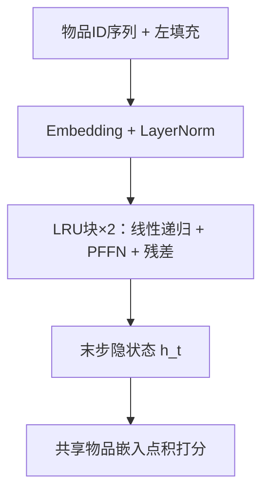
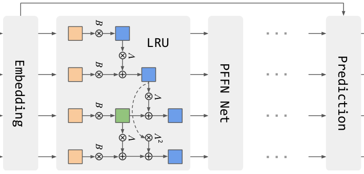
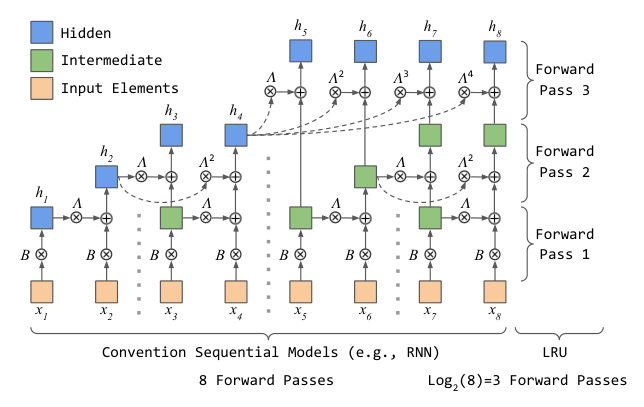

# Linear Recurrent Units for Sequential Recommendation (面向序列推荐的线性循环单元)

- **会议/期刊**: WSDM 2024
- **作者与机构**: Zhenrui Yue, Huimin Zeng, Dong Wang (UIUC)；Yueqi Wang (UC Berkeley)；Zhankui He, Julian McAuley (UCSD)
- **推荐链路定位**: 召回 / 精排（Next-Item 序列打分）
- **研究方向**: 序列与会话推荐
- **论文原文**: [论文原文链接](https://arxiv.org/abs/2310.02367v2)
- **开源代码**: [开源代码仓库链接](https://github.com/yueqirex/LRURec)

## TL;DR (1分钟核心速览)

针对 Transformer 序列推荐训练贵、推理需全序列重算的痛点，本文提出 LRURec：用线性递归单元 LRU 替代自注意力，配合递归并行化把训练前向降到 $O(\log L)$，并保留 RNN 式$O(1)$ 增量推理。在 6 个真实数据集、Leave-Last-Out 与全库排序协议下，NDCG@10/Recall@10 全面超基线，平均相对提升 4.39%，稀疏 Sports 上 NDCG@10 提升 17.43%。

## Background & Motivation (背景与核心矛盾)

- **主流范式**: SASRec/BERT4Rec 等自注意力模型以序列级 item-item 权重建模用户兴趣，训练可并行且精度高，是当前 SOTA。
- **前人局限**: 自注意力推理每来一个新交互都要重算整段序列，$O(L^2H)$ 级开销使实时推荐困难；RNN 虽可增量推理，却因非线性递归无法并行训练，且经验性能弱于 SAR。
- **核心洞察**: 线性递归在长序列建模中已证明有效；作者进一步发现，线性 RNN 推荐器可达到与非线性 RNN 相当的推荐精度，且递归天然强化近期 item 权重，契合推荐场景。
- **本文切入点**: 将线性递归单元引入序列推荐，用对角化复数参数化、PFFN/残差/LayerNorm 补足非线性，并以递归并行化同时拿到训练效率与推理效率。

## Method (核心方法设计)

### 1. 整体框架 (Overall Architecture)

LRURec 由嵌入层、两层 LRU Block 与预测层组成：物品 ID 序列左填充至 2 的幂后查表并 LayerNorm；每层先做线性递归 LRU，再经 LayerNorm、PFFN 与残差连接；末步隐状态 $h_t$与共享物品嵌入$E$ 点积打分。训练用交叉熵，推理只保留固定长度隐状态并逐步更新。

<figure class="paper-figure" markdown="span">
  <figcaption>图3：所提出的 LRURec 的总体架构。</figcaption>
</figure>

### 2. 关键设计拆解 (Key Designs)

1. **线性递归与复数对角化参数化**：痛点是非线性 RNN 不能并行、矩阵幂易数值溢出；本文去掉递归非线性，令 $h_k=\Lambda h_{k-1}+\exp(\gamma_{\log})\odot Bx_k,\ y_k=\Re(C h_k)+x_k$，其中$\Lambda=\mathrm{diag}(\exp(-\exp(\nu_{\log})+j\exp(\theta_{\log})))$。用$A=P\Lambda P^{-1}$将矩阵幂转为对角幂，并以极坐标约束$|\lambda_i|<1$，既稳定又高效。物理直觉是：$|\lambda|$控制历史记忆长度，学习到的较小$|\lambda|$ 自动偏向近期行为。
2. **递归并行化**：逐时刻递归是 $O(L)$串行；作者利用$h_t=\Lambda^{t-k}h_k+\sum_{i=k+1}^{t}\Lambda^{t-i}Bx_i$将序列递归二分，子序列并行计算后用$\Lambda^{t-k}$校正拼接，前向遍数从$L$降到$\log_2 L$，训练与全序列推理显著加速。
3. **训练目标、负采样与推理效率**：主实验用交叉熵 $\mathcal{L}_{\mathrm{CE}}=-\log p(y\mid x)$全 softmax 训练；XLong 为可扩展性训练采样 100 个负例。全序列训练时间$O(\log L\cdot H^2)$，增量推理仅$O(H^2)$，参数量约$O(|I|H+H^2)$，小于 Transformer 的序列相关开销。

<figure class="paper-figure" markdown="span">
  <figcaption>图2：LRURec 的递归并行化，我们展示了递归拆分与并行前向传播。</figcaption>
</figure>

## Experimental Setup & Evaluation Protocol (实验设置与评估协议)

- **数据集与预处理**: 统一过滤交互数少于 5 的用户/物品（5-core 思路）；ML-1M 最大长度 200，XLong 为 1000，其余为 50。

| 数据集 | #Users | #Items | #Interactions | 平均长度/密度 | 场景说明 |
| :--- | :---: | :---: | :---: | :---: | :--- |
| ML-1M | 6,040 | 3,416 | 1M | 165.5 / 5e-2 | 电影，稠密 |
| Beauty | 52,204 | 57,289 | 398K | 7.6 / 1e-4 | Amazon 美妆，稀疏 |
| Video | 31,013 | 23,715 | 287K | 9.3 / 4e-4 | Amazon 视频 |
| Sports | 83,970 | 83,728 | 596K | 7.1 / 8e-5 | Amazon 运动，稀疏 |
| Steam | 334,730 | 13,047 | 3.7M | 11.0 / 8e-4 | 游戏评论 |
| XLong | 69,691 | 2,122,932 | 66.8M | 958.8 / 5e-4 | 阿里长序列 |

- **数据划分与防穿越**: `Leave-Last-Out`；最后 1 个交互为测试、倒数第 2 个为验证，其余训练；测试输入含训练+验证序列。
- **排名评测协议**: 主实验为无偏 `Full-Ranking`（对全物品库排序）；XLong 因规模采样 10k 负例评测、训练采样 100 负例。
- **对比基线与超参**: 覆盖 MF/FISM/FPMC、GRU4Rec/NARM、SASRec/BERT4Rec/FMLP-Rec；隐藏维度 $d=64$，2 层 LRU，AdamW、学习率 1e-3，batch 128（XLong 32），Early Stopping。论文未报告显著性检验，仅报告相对提升。

## Key Experimental Results (实验关键数据)

### 1. 主实验对比 (Main Results)

下表保留 5 个代表性基线，报告 NDCG@10 与 Recall@10；`Improv.` 为相对最佳基线的提升。

| 数据集/指标 | FPMC | GRU4Rec | SASRec | BERT4Rec | FMLP-Rec | LRURec | Improv. |
| :--- | :---: | :---: | :---: | :---: | :---: | :---: | :---: |
| ML-1M N@10 | 0.1203 | 0.1594 | 0.1829 | 0.1638 | 0.1530 | **0.1907** | +4.22% |
| ML-1M R@10 | 0.2303 | 0.2832 | 0.3144 | 0.3089 | 0.2907 | **0.3240** | +3.06% |
| Beauty N@10 | 0.0209 | 0.0200 | 0.0292 | 0.0242 | 0.0252 | **0.0309** | +5.86% |
| Beauty R@10 | 0.0359 | 0.0338 | 0.0504 | 0.0468 | 0.0462 | **0.0528** | +4.78% |
| Video N@10 | 0.0432 | 0.0508 | 0.0583 | 0.0560 | 0.0529 | **0.0620** | +6.33% |
| Video R@10 | 0.0811 | 0.0951 | 0.1091 | 0.1125 | 0.1089 | **0.1134** | +0.76% |
| Sports N@10 | 0.0107 | 0.0100 | 0.0124 | 0.0146 | 0.0155 | **0.0182** | +17.43% |
| Sports R@10 | 0.0194 | 0.0188 | 0.0229 | 0.0288 | 0.0299 | **0.0315** | +5.39% |
| Steam N@10 | 0.0438 | 0.0651 | 0.0676 | 0.0643 | 0.0608 | **0.0693** | +2.59% |
| Steam R@10 | 0.0877 | 0.1220 | 0.1260 | 0.1219 | 0.1199 | **0.1283** | +1.86% |

长序列 XLong 上，LRURec 对最佳基线 SASRec 取得平均 8.53% 提升：NDCG@10 0.3487 vs 0.3095，Recall@10 0.5269 vs 0.4935。

### 2. 消融实验 (Ablation Study)

| 变体 | ML-1M N@10 | Video N@10 | Sports N@10 |
| :--- | :---: | :---: | :---: |
| LRURec | **0.1930** | **0.0620** | **0.0182** |
| w/o LayerNorm | 0.1924 | 0.0522 | 0.0107 |
| w/o Residual | 0.1804 | 0.0283 | 0.0058 |
| w/o PFFN | 0.1732 | 0.0602 | 0.0177 |
| LRU 1 层 | 0.1878 | 0.0602 | 0.0174 |
| Backbone: S4 | 0.1646 | 0.0504 | 0.0112 |
| Backbone: RWKV | 0.1594 | 0.0491 | 0.0166 |

### 3. 关键实验发现 (Key Findings)

1. **稀疏场景收益最大**：LRURec 在稠密 ML-1M 平均仅 +1.32%，但在稀疏 Sports 上平均 +10.48%，NDCG@10 单项 +17.43%，说明线性递归的近期加权与低参数量更适合稀疏短序列。
2. **排序质量提升高于召回覆盖**：全数据集平均 NDCG@10 提升 6.73%，而 Recall@10 仅 3.08%，表明收益主要来自把相关物品排得更靠前，而非单纯扩大候选命中。
3. **非线性补丁不可省且效率优势明显**：移除 PFFN 使 ML-1M 平均掉 11.24%；LayerNorm/Residual 在 Beauty 上分别贡献 82.07% 与 100%+ 平均增益；LRURec 约 23k 步收敛，快于 SASRec 的 50k+ 与 GRU4Rec 的 80k+，增量推理吞吐为 SASRec 的 7.3 倍。

## Highlights & Limitations (亮点、对比与审稿批判)

- **与代表作对比**: 相比 SASRec/BERT4Rec，LRURec 不用序列级自注意力，训练为 $O(\log L)$、推理可增量；相比 GRU4Rec/NARM，保留 RNN 式推理却可并行训练且精度更高；相比 FMLP-Rec，虽同为高效非注意力路线，但 LRU 的递归状态天然支持流式更新。
- **可迁移亮点**: 递归并行化的“二分+$\Lambda^{t-k}$ 校正”可迁移到其他线性 SSM/递归推荐；共享物品嵌入做预测层既降参又缓解过拟合；LayerNorm+残差对线性递归模型是刚需。
- **审稿级局限批判**: 递归并行化需补齐到 2 的幂并自定义 scan，工程实现复杂；主实验虽全库排序，但 XLong 采用采样评测，且未报告显著性检验/在线 A/B；dropout 在稠密与稀疏数据上最优值差异大（0.2 vs 0.6），超参敏感度仍需重视。

## Rating (四维评分)

- **方法创新性 (Novelty)**: ⭐⭐⭐⭐ （把线性递归/复数对角化与递归并行化系统落地到序列推荐，挑战自注意力必要性）
- **评估协议与实验扎实度 (Protocol & Experiments)**: ⭐⭐⭐⭐ （6 数据集、Leave-Last-Out、全库排序与充分消融；但 XLong 采样评测且缺显著性检验）
- **写作与数学规范度 (Clarity & Rigor)**: ⭐⭐⭐⭐ （LRU 参数化、复数空间与并行公式交代清晰，复杂度分析完整）
- **工业落地与复现价值 (Industrial & Practical Value)**: ⭐⭐⭐⭐ （开源代码、$O(1)$ 增量推理与低参数量适合实时推荐，但自定义并行 scan 有部署成本）

