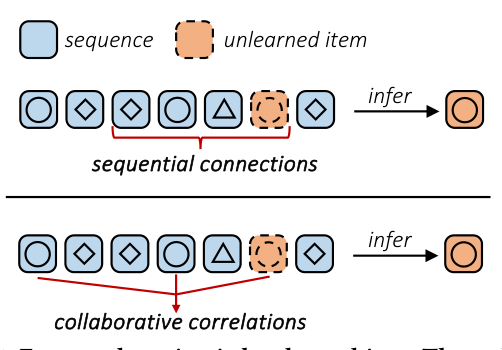
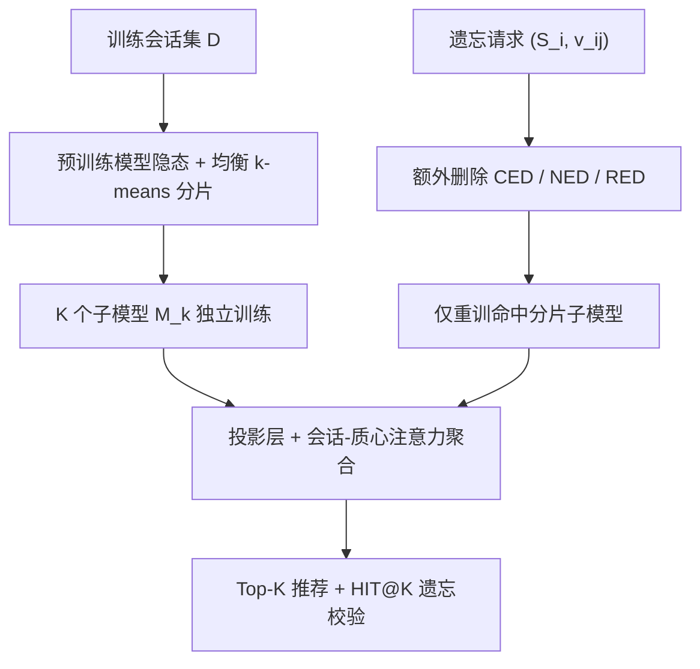
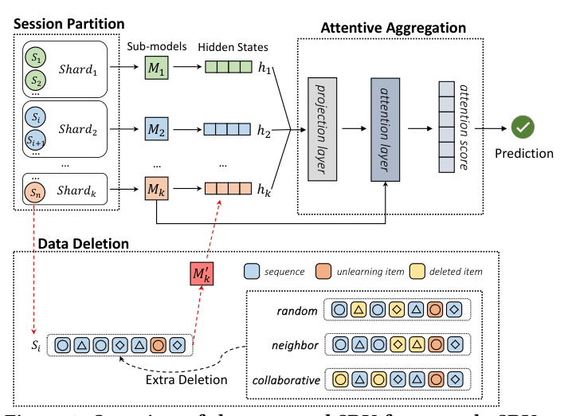

# On the Effectiveness of Unlearning in Session-Based Recommendation (会话推荐中遗忘的有效性研究)

- **会议/期刊**: WSDM 2024
- **作者与机构**: Xin Xin, Liu Yang, Ziqi Zhao, Pengjie Ren, Zhumin Chen, Jun Ma (山东大学), Zhaochun Ren (Leiden University)
- **推荐链路定位**: 召回 / 会话级 Next-Item 预测 + 训练后遗忘 (Post-hoc Unlearning)
- **研究方向**: 序列与会话推荐 / 去偏公平、可信隐私与工业架构
- **论文原文**: [https://arxiv.org/abs/2312.14447v1](https://arxiv.org/abs/2312.14447v1)
- **开源代码**: [https://github.com/shirryliu/SRU-code](https://github.com/shirryliu/SRU-code)

## TL;DR (1分钟核心速览)

会话推荐模型记忆了历史点击，但 GDPR/CCPA 场景下用户要求"撤销某条 item 点击"时，现有 SISA 类精确遗忘方法直接删样本重训，无法阻断会话内**协同相关**与**顺序连接**的推断通路，且从不评测"到底忘干净没有"。本文提出 SRU：用预训练隐态做均衡 k-means 把会话聚成语义分片，用会话-质心双源注意力聚合子模型隐态，并对遗忘 item 追加协同/邻居/随机删除；同时定义 HIT@K 成员推断式遗忘度量。在 Beauty/Games/Steam 三个数据集、GRU4Rec/SASRec/BERT4Rec 三骨干上，全量数据下 SRU 相比 SISA 的 NDCG@10 最高提升 27.4%，重训耗时从 368.99 分钟降至 99.31 分钟（3.71×），且 HIT@1 比 Retrain 更低。

## Background & Motivation (背景与核心矛盾)

- **主流范式**: 训练后遗忘以 SISA 为代表——随机等分数据、各分片独立训练子模型、推理时平均/投票聚合，遗忘请求只重训命中分片的子模型。RecEraser 把这套流程搬到非序列协同过滤。
- **前人局限**: ① 随机分片与"输出平均"破坏了会话推荐最关键的相似序列信号共享，SISA 在 Games 上 NDCG@10 掉至 0.0322（Retrain 0.0474）；② 会话内 item 高度耦合，删掉样本 ≠ 抹掉影响，"是否忘干净"从未被量化。
- **核心洞察 (Key Insight)**: 如图 1，被遗忘 item 仍可由同会话剩余 item 通过协同相关（共现分布）与顺序连接（前后文转移）**反推出来**；且即便全量 Retrain，Steam 上该 item 仍有 HIT@1 = 0.1581、HIT@10 = 0.5372 的概率被重新推荐。故会话推荐的"精确遗忘"在定义上就不可达：

$$\mathcal{M}_u(v\mid S'_i,\mathcal{D}\setminus S_i\cup S'_i)\neq \mathcal{M}_{\text{exact}}(v),\quad S'_i = S_i\setminus v_{ij}$$

- **本文切入点**: 放弃"删样本即遗忘"的假设，把遗忘做成"分片重训 + 主动切断推断通路 + 可度量校验"的三位一体框架。

<figure class="paper-figure" markdown="span">
  <figcaption>图1：精确遗忘难以实现。由于会话中项目之间的协同相关性和顺序连接，被遗忘项仍可能被推断出来。</figcaption>
</figure>

## Method (核心方法设计)

### 1. 整体框架 (Overall Architecture)

SRU 是一个与骨干无关的 wrapper。训练期：先用任一会话推荐模型在全体会话上预训练取隐态，据此做均衡 k-means，将会话划入 $K$个互斥分片并在每片训练一个子模型$M_k$；再训练聚合层，把各子模型隐态投影到公共空间并按"当前会话 × 分片质心"的相关性加权融合输出。遗忘期：给定会话$S_i$中的遗忘 item$v_{ij}$，先按 CED/NED/RED 策略在该会话内额外删掉$N$个 item 得到$S''_i$，然后**只重训命中分片的子模型与聚合层**，其余子模型参数冻结。推理阶段与普通会话推荐完全一致，遗忘校验则额外用 HIT@K 检测遗忘 item 是否仍被召回。

<figure class="paper-figure" markdown="span">
  <figcaption>图2：所提出的SRU框架概览。SRU由会话划分、注意力聚合和数据删除模块组成。</figcaption>
</figure>

### 2. 关键设计拆解 (Key Designs)

**1) 相似性会话均衡分片（把"随机切"换成"语义切"）**：随机分片会让相似序列散落各片，子模型各自只见过局部模式，聚合时相互冲突。SRU 以预训练隐态的欧氏距离做 k-means，并设单片上界 $\delta$：若最近质心所在片已满，则退到次近的可用片，保证$\bigcup_k \mathcal{D}_k=\mathcal{D}$、$\bigcap_k \mathcal{D}_k=\varnothing$ 且各片规模均衡。直觉：同片会话共享协同信号，子模型更像"专家"，分片带来的信息损失被簇内知识迁移补偿。

**2) 会话-质心双源注意力聚合（解决"子模型该信谁"）**：RecEraser 的注意力仅以单侧 user/item embedding 为查询，在无显式 user ID 的会话场景不可用，也无法反映"该子模型覆盖的会话模式与当前会话多像"。SRU 先做分片专属线性投影，再以 element-wise 交互 + ReLU + 内积生成打分：

$$\mathbf{h}'_k=\mathbf{W}_k\mathbf{h}_k+\mathbf{b}_k,\quad a_k=\mathrm{softmax}\big(\mathbf{g}^\top \mathrm{ReLU}(\mathbf{W}'\odot(\mathbf{h}'_k\odot\mathbf{c}'_k)+\mathbf{b}')\big),\quad \mathbf{h}_f=\sum_{k=1}^{K}a_k\mathbf{h}'_k$$

其中 $\mathbf{c}'_k$ 是该片数据质心经同一投影后的表示。双源点积相当于"会话—簇心"的双线性相似度，簇心越贴近当前会话的子模型权重越高，从而抑制语义不相关子模型的噪声投票（对比 SISA 的无权平均）。

**3) 额外删除 CED/NED/RED + 训练目标**：仅删 $v_{ij}$时，剩余 item 仍在向模型"泄露"它。CED 按预训练 item embedding 的欧氏距离删掉会话内最相似的$N$个 item（切断协同相关通路）；NED 删时间上紧邻$v_{ij}$的前$N$个 item（切断顺序转移通路）；RED 随机删$N$个作为对照。即$S''_i=S_i\setminus \mathrm{CED}(v_{ij})$，用$S''_i$ 替换原会话重训。聚合层以输出分布的交叉熵为损失，子模型沿用各自骨干的原损失；**无需负采样**（输出层 softmax 覆盖全 item 集），在线推理开销与单骨干相同，遗忘开销 ≈ 一个子模型 + 聚合层训练。

## Experimental Setup & Evaluation Protocol (实验设置与评估协议)

- **数据集与预处理**（沿用 SASRec 的过滤与切分口径）：

| 数据集 | #Users | #Items | #Interactions | 稀疏度/密度 | 特征/场景说明 |
| :--- | :---: | :---: | :---: | :---: | :--- |
| Amazon Beauty | 52,024 | 57,289 | 0.4M | 密度 ≈ 1.3e-4 | 美妆评论文本衍生会话，短会话为主 |
| Amazon Games | 31,013 | 23,715 | 0.3M | 密度 ≈ 4.1e-4 | 游戏品类，稀疏度低于 Beauty |
| Steam | 334,730 | 13,047 | 3.7M | 密度 ≈ 8.5e-4 | 游戏平台，item 少而交互密集 |

- **数据划分与防穿越**: `比例划分` 8:1:1（随机抽 80% 会话训练），**非全局时间戳切分**；测试时逐 item 喂入会话前缀预测下一真实 item。
- **排名评测协议**: 无偏 `Full-Ranking`（全 item 集排序，不做负采样）；指标 Recall@10/20、NDCG@10/20；遗忘有效性用新定义的 `HIT@K`（遗忘 item 是否落入 Top-K，越低越好，等价于成员推断攻击成功率）。
- **对比基线与超参**: Retrain（全量重训，精度上界/效率下界）、SISA，以及 SRU 的 RED/CED/NED 三变体；骨干为 GRU4Rec、SASRec、BERT4Rec。序列长度 Beauty=10、Games/Steam=20，batch 256，Adam，聚合层学习率 $\in[1e\text{-}3,1e\text{-}2]$，分片数$K=8$，额外删除数$N\in[1,5]$。未与 RecEraser 对比（其依赖显式 user ID 的分片方式不适用）。

## Key Experimental Results (实验关键数据)

### 1. 主实验对比 (Main Results)

无遗忘请求（全量训练数据）下的推荐精度 NDCG@10（原文 Table 3）：

| 方法 | Beauty-GRU | Beauty-SAS | Beauty-BERT | Steam-GRU | Steam-SAS | Steam-BERT | Games-GRU | Games-SAS | Games-BERT |
| :--- | :---: | :---: | :---: | :---: | :---: | :---: | :---: | :---: | :---: |
| Retrain（上界） | **0.0340** | **0.0419** | **0.0366** | **0.0490** | **0.0541** | **0.0613** | **0.0416** | **0.0493** | **0.0471** |
| SISA | 0.0309 | 0.0283 | 0.0271 | 0.0473 | 0.0463 | 0.0492 | 0.0330 | 0.0291 | 0.0329 |
| SRU | 0.0313 | 0.0296 | 0.0316 | 0.0474 | 0.0483 | 0.0575 | 0.0370 | 0.0348 | 0.0419 |
| Improv. vs SISA | +1.3% | +4.6% | +16.6% | +0.2% | +4.3% | +16.9% | +12.1% | +19.6% | **+27.4%** |

遗忘有效性 HIT@K（越低越好，原文 Table 4；Beauty 报 HIT@1，Steam 报 HIT@10）：

| 方法 | Beauty-GRU | Beauty-SAS | Beauty-BERT | Steam-GRU | Steam-SAS | Steam-BERT |
| :--- | :---: | :---: | :---: | :---: | :---: | :---: |
| Retrain | 0.0764 | 0.0619 | 0.0700 | 0.5372 | 0.4975 | 0.4701 |
| SISA | 0.0685 | 0.0681 | 0.0763 | 0.5349 | 0.4959 | 0.4668 |
| SRU-R (随机) | 0.0675 | 0.0625 | 0.0720 | 0.5319 | 0.5020 | 0.4282 |
| SRU-C (协同) | **0.0577** | 0.0593 | 0.0661 | 0.5241 | 0.5041 | 0.4407 |
| SRU-N (邻居) | 0.0643 | **0.0605** | **0.0638** | **0.5136** | **0.4422** | **0.4205** |

### 2. 消融实验 (Ablation Study)

额外删除策略消融（Beauty，GRU4Rec / BERT4Rec；"无额外删除"即仅删遗忘 item 的 SISA 式基线）：

| 变体 | NDCG@10 (GRU) | NDCG@10 (BERT) | HIT@1 (GRU) | HIT@1 (BERT) |
| :--- | :---: | :---: | :---: | :---: |
| SRU 无额外删除 | 0.0313 | 0.0316 | n/a（原文未单列） | n/a（原文未单列） |
| + RED ($N\in[1,5]$) | **0.0304** | 0.0292 | 0.0675 | 0.0720 |
| + CED | 0.0286 | **0.0293** | **0.0577** | 0.0661 |
| + NED | 0.0306 | 0.0291 | 0.0643 | **0.0638** |

超参敏感性（原文图 3–5）：分片数 $K$增大提升遗忘效率但推荐精度先升后降；相似性聚类划分优于随机划分；额外删除数$N$ 增大持续压低 HIT@K，但以 NDCG 小幅下降为代价。

### 3. 关键实验发现 (Key Findings)

1. **"精确遗忘"在本任务上是伪命题**：连全量 Retrain 都留下可观推断概率（Steam/SASRec HIT@10 = 0.4975，Beauty 各骨干 HIT@1 均 > 0.06），说明必须主动删除共现/邻接 item，而不仅是删除目标样本。
2. **语义分片可反哺精度**：SRU 在删掉**更多**训练数据的前提下仍稳定超过随机分片的 SISA，Games/BERT4Rec 上 NDCG@10 由 0.0329 升至 0.0419（+27.4%）；增益在稀疏度最低的 Games 最大，验证"相似会话同片"比"分片规模均衡"更关键。
3. **效率与遗忘存在清晰的权衡曲线**：Steam/SASRec 重训 368.99 min → 99.31 min（3.71×），Games/GRU4Rec 31.22 → 5.54 min（5.6×），且子模型可并行；CED 在 Beauty/GRU4Rec 把 HIT@1 从 SISA 的 0.0685 压到 0.0577（−15.8%），代价是 NDCG@10 降至 0.0286。

## Highlights & Limitations (亮点、对比与审稿批判)

- **与代表作对比**: vs **SISA**——随机等分 + 无权平均 → 语义聚类 + 双源注意力加权；vs **RecEraser**——依赖 user/item 单侧 embedding 的注意力且面向非序列 CF → 以会话表示与簇心交互，天然适配无 user ID 的匿名会话；vs **Retrain**——精度略低但速度快 3.7× 以上，且遗忘有效性反超。
- **可迁移亮点**: ① "隐态聚类分片 + 质心引导加权聚合"可直接搬到多场景/跨域推荐与联邦分片训练；② HIT@K 式的"遗忘后成员推断"度量，是把隐私承诺从口号变成可测指标的轻量方案。
- **审稿级局限批判**: ① 仅支持 item-level 单次请求，连续/批量遗忘请求下的再聚类成本与 $K$ 静态设定未评估，长期服务化开销存疑；② 额外删除会真实移除用户**未请求**删除的交互，与数据最小化原则存在张力，且 HIT 度量只是弱攻击代理，缺乏与差分隐私等可证明保证的对比；③ 评测采用随机 8:1:1 划分而非时间切分，存在未来信息泄露风险，线上分布漂移下的遗忘持久性未验证。

## Rating (四维评分)

- **方法创新性 (Novelty)**: ⭐⭐⭐⭐ （首个面向会话推荐的遗忘框架，把"会话内协同/顺序可推断性"这一领域特性转化为额外删除算子与 HIT 度量，思路新颖但组件多为 SISA 的针对性改造）
- **评估协议与实验扎实度 (Protocol & Experiments)**: ⭐⭐⭐⭐ （3 数据集 × 3 骨干 × 精度/有效性/效率三维度齐全，Full-Ranking 协议可信；但划分非时序、缺显著性检验与用户级置信区间）
- **写作与数学规范度 (Clarity & Rigor)**: ⭐⭐⭐⭐ （挑战形式化清晰、注意力公式与聚合流程交代完整；分片复杂度与 k-means 收敛性缺乏理论分析）
- **工业落地与复现价值 (Industrial & Practical Value)**: ⭐⭐⭐⭐ （代码开源、模型无关包装器可直接套在现有会话召回模型上，重训提速 3.7×；但需维护 $K$ 份子模型存储，工程成本需权衡）

