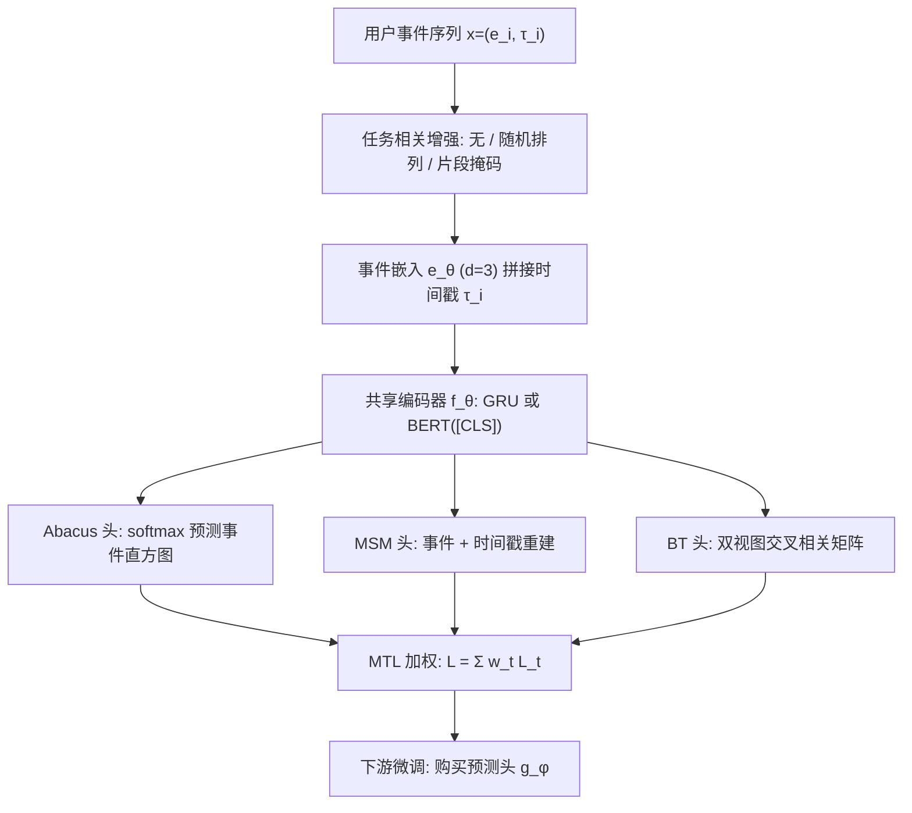
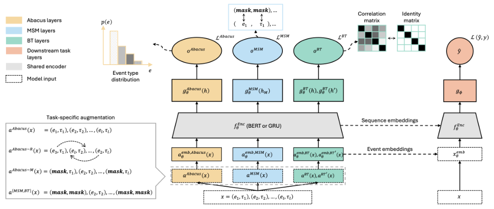

# Abacus: Self-Supervised Event Counting-Aligned Distributional Pretraining for Sequential User Modeling (Abacus：面向序列用户建模的事件计数对齐分布自监督预训练)

- **会议/期刊**: WSDM 2026
- **作者与机构**: Sullivan Castro, Artem Betlei, Thomas Di Martino, Nadir El Manouzi（Criteo AI Lab / École Nationale des Ponts et Chaussées）
- **推荐链路定位**: 精排（DSP 实时竞价前的用户级购买/转化概率预估）
- **研究方向**: CTR/CVR 预估与特征交叉 / 序列与会话推荐
- **论文原文**: [https://arxiv.org/abs/2512.16581v1](https://arxiv.org/abs/2512.16581v1)
- **开源代码**: [https://anonymous.4open.science/r/Abacus/](https://anonymous.4open.science/r/Abacus/)

## TL;DR (1分钟核心速览)

展示广告中购买正样本极稀疏、事件间隔不规则，线上系统长期依赖手工“计数器”特征（固定时间窗聚合），而深度序列模型只看逐令牌顺序信号，常打不过计数器。本文提出 **Abacus** 前置任务：让序列编码器预测该用户序列内各事件类型的**经验频率直方图**，并与掩码序列建模（MSM）、Barlow Twins（BT）做多任务联合预训练。在 Taobao 与 Criteo 私有日志上按时间切分、以 AUC 评估，混合目标对 BERT 提升 +5.49%/+3.15%，对 GRU 提升 +0.25%/+6.07%（相对 No-PT）。

## Background & Motivation (背景与核心矛盾)

- **主流范式**: 工业 DSP 依赖手工 `count`/`ratio` 类聚合特征刻画用户意图强度；学术侧用 GRU/LSTM 或 BERT4Rec 式双向 Transformer 直接建模 `(事件类型, 时间戳)` 序列。
- **前人局限**: ①计数器稳定但丢失细粒度时序演化；②序列模型敏感于顺序却在正样本极稀疏时方差大、易过拟合，在 DA 场景反而弱于聚合特征。
- **核心洞察 (Key Insight)**: 现有 SSL 前置任务（NEP、MSM、对比学习）都要求**逐令牌精确还原**，与下游“排序/概率预估”目标错位，放大曝光偏差与误差累积，产生负迁移；而驱动线上收益的恰恰是**全局计数统计**。
- **本文切入点**: 把“预测序列内事件构成”本身做成前置任务，用分布（而非绝对计数）作为稳定监督，与令牌级任务互补融合。

## Method (核心方法设计)

### 1. 整体框架 (Overall Architecture)

输入用户行为序列 $x=\{(e_i,\tau_i)\}_{i=1}^{l}$，$e_i\in\{1,\dots,K\}$、$\tau_i\in[0,1]$为归一化时间戳。先施加任务相关增强$a_t(x)$，事件嵌入$(e_\theta)_i\in\mathbb{R}^{d}$与$\tau_i$拼接后送入**共享编码器**$f_\theta^{\text{Enc}}$（GRU 或取末尾 `[CLS]` 的 BERT），得到序列向量$h$；三个任务头分别产出直方图预测、掩码重建、双视图交叉相关，按权重求和单次反向传播完成预训练；下游仅保留事件嵌入与编码器（微调），另训 MLP 头$g_\phi$ 输出购买概率。

<figure class="paper-figure" markdown="span">
  <figcaption>图1：所提出方法的示意图。在预训练中，Abacus、MSM和BT代理任务通过MTL联合学习。随后，事件嵌入和序列嵌入在下游任务上进行微调。</figcaption>
</figure>

### 2. 关键设计拆解 (Key Designs)

1. **Abacus：计数对齐的分布预测前置任务**：痛点是把计数器信息显式注入表征而不引入手工特征。取序列经验直方图 $p^{\text{Abacus}}=\frac{1}{l}\sum_{i=1}^{l}\text{one\_hot}(e_i)\in\Delta^{K-1}$作软标签，头输出$\hat{p}^{\text{Abacus}}=\text{softmax}(g_\theta^{\text{Abacus}}(h))$，最小化
 $\mathcal{L}_{\text{Abacus}}=-\sum_{k=1}^{K}p_k^{\text{Abacus}}\log\hat{p}_k^{\text{Abacus}}$。
 选**比例直方图而非绝对计数**是为获得长度不变性、跨用户可比；三种增强给出三个变体：无增强（学频率）、随机排列 Abacus-R（强制顺序不变）、分片事件掩码 Abacus-M（学习局部片段对全局构成的推断）。直觉上该目标只需“矩匹配”级别的近似即可，不要求精确计数，因而对稀疏与类别极不平衡鲁棒。
2. **MSM + BT 补足时序敏感度**：MSM 对连续片段 $M$ 同时掩事件与时间戳，
 $\mathcal{L}_{\text{MSM}}=-\frac{1}{|M|}\sum_{m\in M}\log\hat{p}^{\text{MSM}}_{e_m}+\frac{\lambda_{\text{MSM}}}{|M|}\sum_{m\in M}(\tau_m-\hat{\tau}_m)^2$（$\lambda_{\text{MSM}}=1$），强化短程上下文并充当去噪正则。BT 用两份独立掩码视图的标准化输出构造交叉相关
 $C_{ij}=\frac{\langle\tilde{z}_i,\tilde{z}'_j\rangle}{\|\tilde{z}_i\|\|\tilde{z}'_j\|}$，$\mathcal{L}_{\text{BT}}=\sum_i(1-C_{ii})^2+\lambda_{\text{BT}}\sum_{i}\sum_{j\neq i}C_{ij}^2$，免负采样地学不变表征。
3. **训练目标、权重与推理开销**：$\mathcal{L}_{\text{MTL}}=\sum_t w_t\mathcal{L}_t$，$\sum_t w_t=1$，同一 mini-batch 上共享样本、单次反传。最优权重按数据集/编码器网格给出：Taobao-GRU 用 0.6/0.4（Abacus-R/BT）、Taobao-BERT 用 0.5/0.25/0.25、Private 用 0.75/0.25 与 0.7/0.3。无额外负采样；预训练头在下游全部丢弃，线上推理仅多一次 GRU/BERT 前向，与 No-PT 同阶，但获得热启动（更早达到高验证 AUC、收敛更快）。

## Experimental Setup & Evaluation Protocol (实验设置与评估协议)

- **数据集与预处理**: 序列按时间切为“历史窗口 $x$”+“标签窗口”，窗口内出现购买即$y=1$；事件词汇极小（$K\sim 10$），序列长度 50–100。

| 数据集 | #Sequences | Seq. Len | Label Mean | PPL↑ | Gini-Simpson↑ | 场景说明 |
| :--- | :---: | :---: | :---: | :---: | :---: | :--- |
| Taobao | 1.0 M | 100 | 0.0131 | 1.57 | 0.20 | 8 天日志，click/cart/fav/purchase，极端稀疏 |
| Private (Criteo) | 1.7 M | 50 | 0.1014 | 4.43 | 0.71 | 某广告主 1 个月，9 类事件，分布更均衡 |

- **数据划分与防穿越 (Splitting Strategy)**: **全局时间戳切分**——历史段与标签段严格分离，比例 Taobao 60/20/20、Private 70/20/10（train/val/test），杜绝未来信息泄漏。
- **排名评测协议 (Ranking Protocol)**: 非全库排序，而是**序列级二分类 AUC**（测试集全部样本参与、无负采样），报告 3 个随机种子的 mean±std；模型选择依据验证集 AUC + early stopping（300 epoch 上限）。
- **对比基线与超参设置**: No-PT（仅微调）、NEP、NKEHP、MSM、BT、Abacus 三变体、Hybrid(MTL)。事件嵌入 $d_e=3$、序列嵌入$d_h=8$，batch$2^{14}$，AdamW，预训练 lr 0.01，微调 0.01（Private）/0.001（Taobao），2×V100 训练。

## Key Experimental Results (实验关键数据)

### 1. 主实验对比 (Main Results)

| 方法 | Taobao-GRU | Taobao-BERT | Private-GRU | Private-BERT |
| :--- | :---: | :---: | :---: | :---: |
| No-PT | 0.6423 | 0.6077 | 0.7094 | 0.7175 |
| NEP | 0.5927 | 0.6170 | 0.7215 | 0.7173 |
| NKEHP | 0.6342 | 0.6133 | 0.7003 | 0.7198 |
| MSM | 0.6409 | 0.6073 | 0.7076 | 0.7304 |
| Barlow Twins | 0.6423 | 0.6024 | 0.7258 | 0.7164 |
| Abacus | 0.6422 | 0.6347 | 0.7342 | 0.7324 |
| Abacus-R | 0.6437 | 0.6326 | **0.7358** | 0.7378 |
| **Hybrid (MTL)** | **0.6439** | **0.6411** | **0.7525** | **0.7401** |
| **Improv.%** | **+0.25** | **+5.49** | **+6.07** | **+3.15** |

### 2. 消融实验 (Ablation Study)

| 配置（逐任务剥离） | Taobao-BERT | Private-GRU |
| :--- | :---: | :---: |
| Full Hybrid (MTL) | **0.6411** | **0.7525** |
| 仅 Abacus-R（去 MSM & BT） | 0.6326 | 0.7358 |
| 仅 MSM | 0.6073 | 0.7076 |
| 仅 BT | 0.6024 | 0.7258 |
| Abacus-M 替换 Abacus-R | 0.6310 | 0.7101 |
| No-PT（无预训练） | 0.6077 | 0.7094 |

### 3. 关键实验发现 (Key Findings)

1. **分布目标 > 令牌重建**：Taobao-BERT 上 Abacus 达 +4.43%，而逐令牌的 MSM 为 −0.07%、NEP 在 GRU 上更跌至 −7.72%（典型负迁移）；说明全局统计目标与购买排序同构，重建/顺序预测则放大时间噪声与曝光偏差。
2. **顺序不变正则近乎“免费”**：Abacus-R 在 Private 上 GRU +3.72%、BERT +2.82%，均优于原版 Abacus（+3.49%/+2.08%）；反之 Abacus-M 在 Private-GRU 只剩 +0.09%，说明局部片段对全局构成的推断贡献有限，而排列不变性更利于泛化。
3. **MTL 互补且显著降方差**：Hybrid 在 Private-GRU 达 0.7525（+6.07%），种子标准差由单任务 Abacus-R 的 0.0171 降至 0.0036；Taobao-BERT 上亦 +5.49%，验证“聚合统计的稳定 + 序列编码的敏感”互补；且预训练模型验证 AUC 起点更高、收敛更快，但最终增益并非来自早期速度差。

## Highlights & Limitations (亮点、对比与审稿批判)

- **与代表作对比 (vs. Prior Work)**: 相较 PTUM/UserBERT 的掩码行为与 next-K 行为匹配，本文目标不含任何令牌级还原；相较 MSDP 预测**未来**行为分布，Abacus 刻画**当下**事件构成且显式顺序无关；相较 PinnerFormer 的 dense all-action 多未来行为联合预测，本文用直方图软标签进一步压掉了时间跨度与顺序建模负担。
- **可迁移亮点**: ①直方图/单纯形软标签可作为**辅助损失**直接挂到 DIN/DIEN 等现有精排网，低成本注入计数先验；②随机排列增强作为顺序不变正则可与任意序列主干组合；③用 PPL 与 Gini-Simpson 诊断数据集“事件分布是否足够丰富”，可作为该方法适用性的前置判据。
- **审稿级局限批判**: ①私有数据集不可复现，Taobao-GRU 上 +0.25% 与 No-PT 的 0.6423 几乎同值，难言实质增益；②仅报告 AUC，缺少校准（pCTR 偏差）、延迟与线上 A/B，而 DSP 场景校准与毫秒级预算同样关键；③MTL 权重对每个数据集/编码器手工搜索，泛化到新场景需重建网格，且 $d_e=3,d_h=8$ 的极小维度未做敏感性分析。

## Rating (四维评分)

- **方法创新性 (Novelty)**: ⭐⭐⭐⭐ （把“计数器”显式升格为自监督分布目标，视角新颖但数学上仍是直方图上交叉熵，理论刻画偏薄）
- **评估协议与实验扎实度 (Protocol & Experiments)**: ⭐⭐⭐ （时间切分与 3 种子方差报告规范、两种编码器交叉验证充分，但仅 AUC、缺线上验证与私有数据复现）
- **写作与数学规范度 (Clarity & Rigor)**: ⭐⭐⭐⭐ （符号与三个前置任务定义清晰、复杂度与损失权重交代完整，增强变体命名略繁）
- **工业落地与复现价值 (Industrial & Practical Value)**: ⭐⭐⭐⭐ （推理开销与 No-PT 同阶、无额外负采样、代码已匿名开源，但需自备含时间戳的事件日志才能复现收益）

