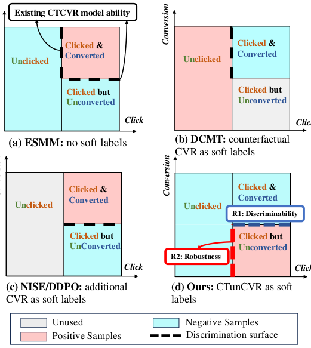
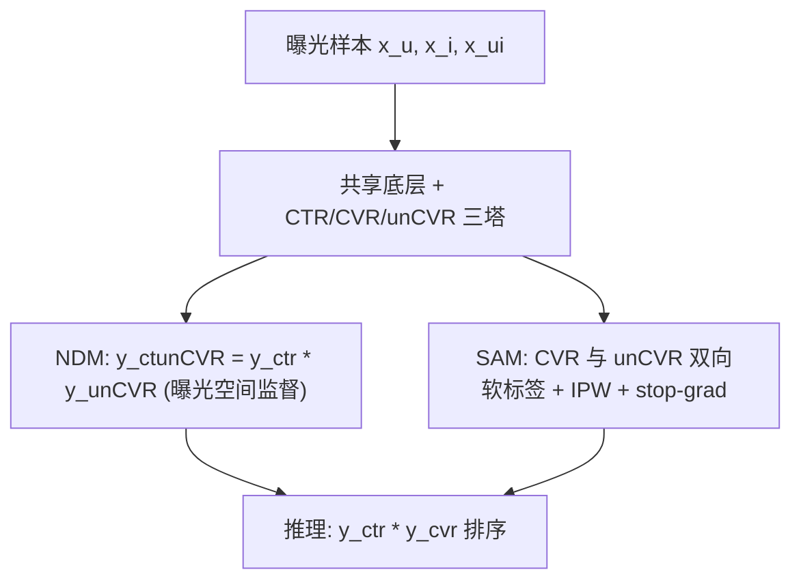
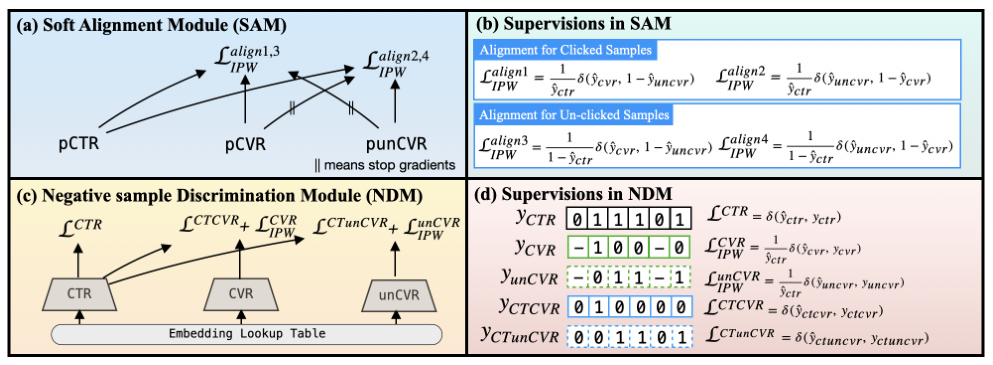

# ChorusCVR: Chorus Supervision for Entire Space Post-Click Conversion Rate Modeling (合唱式监督的全空间后点击转化率建模)

- **会议/期刊**: WSDM 2026（作者注为 work in progress）
- **作者与机构**: Wei Cheng, Yucheng Lu, Boyang Xia, Jiangxia Cao(通讯), Kuan Xu, Mingxing Wen, Wei Jiang, Jiaming Zhang, Zhaojie Liu, Liyin Hong, Guorui Zhou (快手科技)；Kun Gai (无隶属)
- **推荐链路定位**: 精排（CVR/CTCVR 预估）
- **研究方向**: CTR/CVR 预估与特征交叉 / 去偏、因果与工业系统
- **论文原文**: [https://arxiv.org/abs/2502.08277v2](https://arxiv.org/abs/2502.08277v2)
- **开源代码**: 暂未开源

## TL;DR (1分钟核心速览)

CVR 训练只看得见点击空间、推理却发生在曝光空间，样本选择偏差 (SSB) 是核心痛点；既有 ESMM/DCMT/NISE 的软标签要么缺乏对“点击了但没买”与“压根没点击”的区分力，要么缺乏鲁棒性。ChorusCVR 提出 CTunCVR 辅助任务（点击且未转化=正样本）训练 unCVR 塔，再以 CVR ↔ unCVR 双向软标签互监督（stop-gradient + IPW）实现全空间去偏。在 Ali-CCP 与快手直播电商数据上，CVR-AUC 相对最优基线提升 **1.43% / 0.13%**，线上 8 天 A/B 订单 **+0.851%**。

## Background & Motivation (背景与核心矛盾)

- **主流范式**: 共享底层 + CTR/CVR/CTCVR 多塔结构，用 $\hat{y}_{ctcvr}=\hat{y}_{ctr}\cdot\hat{y}_{cvr}$ 在曝光空间做监督（ESMM），或用 IPW/DR（ESCM2）、反事实（DCMT）、额外 CVR 塔伪标签（NISE/DDPO）为未点击样本补软标签。
- **前人局限**: (1) ESMM 把全部未点击样本当作硬负例，忽略“若被点击则可能转化”的模糊负例，MNAR 依旧存在；(2) DCMT 的反事实假设、NISE/DDPO 的外部塔伪标签，其判别面都与 ESMM 判别面部分重叠，**无法同时满足判别性 (R1：区分点击样本会不会转化) 与鲁棒性 (R2：区分事实负例与模糊负例)**。
- **核心洞察 (Key Insight)**: 软标签质量是缓解 SSB 的关键，而“点击未转化”这一格恰好是现有方法共同遗漏的监督信号；把它显式建模成新任务 CTunCVR，就天然得到两张互不重叠的判别面。
- **本文切入点**: 用 CTunCVR 生成“分级负例感知”的软标签，再让 CVR 与 unCVR 互为教师做双向软对齐。

<figure class="paper-figure" markdown="span">
  <figcaption>图1：从软标签判别空间角度，对我们提出的ChorusCVR与现有CVR模型进行的概念性比较。关键词</figcaption>
</figure>

## Method (核心方法设计)

### 1. 整体框架 (Overall Architecture)

输入为曝光级样本 $(u,i,\{x_u,x_i,x_{ui}\},o_{ui},r_{ui})$，经多任务编码器与共享底层后分出 CTR、CVR、unCVR 三塔。CTR 塔在曝光空间$\mathcal{D}$训练；CVR 塔在点击空间$\mathcal{O}$用 IPW 加权训练；unCVR 塔在点击空间以$1-r_{ui}$为标签、同样 IPW 加权，二者组合出$\hat{y}_{ctuncvr}$在曝光空间受 CTCVR 式监督（NDM）。随后 CVR 与 unCVR 的输出互为软标签，分别在点击空间（权重$\hat{y}_{ctr}$）与未点击空间（权重$1-\hat{y}_{ctr}$）做双向对齐（SAM），stop-gradient 阻断梯度回路。推理时仅用$\hat{y}_{ctr}\cdot\hat{y}_{cvr}$ 排序，无额外线上开销。

<figure class="paper-figure" markdown="span">
  <figcaption>图2：我们的ChorusCVR模型的系统概览。</figcaption>
</figure>

### 2. 关键设计拆解 (Key Designs)

1. **NDM：CTunCVR 辅助任务提供分级负例软标签**：痛点是未点击样本无标签且与“点了不买”混为一谈。做法是定义 $y^{ctuncvr}_{ui}=o_{ui}(1-r_{ui})$，仅“点击未转化”为正例；并沿用两阶段范式先建镜像 unCVR 塔，再乘 CTR 得$\hat{y}^{ctuncvr}_{ui}=\hat{y}^{ctr}_{ui}\cdot\hat{y}^{uncvr}_{ui}$，在$\mathcal{D}$上以交叉熵$\mathcal{L}_{ctuncvr}$监督；unCVR 塔本身在点击空间用$\mathcal{L}^{IPW}_{uncvr}=-\frac{1}{|\mathcal{O}|}\sum \delta(\hat{y}^{uncvr}_{ui},1-r_{ui})\,\hat{y}^{ctr}_{ui}$ 训练以消除点击倾向偏差。直觉：把“负例”拆成两档，模型在未点击空间就有了不依赖外部塔、且与正例面正交的判别边界。

2. **SAM：CVR ↔ unCVR 双向软对齐（合唱式监督）**：痛点是即便拿到软标签，单向蒸馏仍会单向漂移。作者让二者互为教师并加 stop-gradient，形成互监督平衡：
$\mathcal{L}^{IPW}_{align}=-\frac{1}{|\mathcal{O}|}\delta(\hat{y}^{cvr},1-\mathrm{sg}(\hat{y}^{uncvr}))\hat{y}^{ctr}-\frac{1}{|\mathcal{N}|}\delta(\hat{y}^{cvr},1-\mathrm{sg}(\hat{y}^{uncvr}))(1-\hat{y}^{ctr})-\frac{1}{|\mathcal{O}|}\delta(\hat{y}^{uncvr},1-\mathrm{sg}(\hat{y}^{cvr}))\hat{y}^{ctr}-\frac{1}{|\mathcal{N}|}\delta(\hat{y}^{uncvr},1-\mathrm{sg}(\hat{y}^{cvr}))(1-\hat{y}^{ctr})$。
关键增量是**在未点击空间 $\mathcal{N}$用$1-\hat{y}^{ctr}$ 做反向 IPW** —— 低 CTR 样本被高权重抬升，恰好对应“本该被曝光却未被点击”的模糊负例，从而把 ESMM 判别面缺的那一块补上。

3. **总损失与推理开销**:
$\mathcal{L}=\mathcal{L}_{ctcvr}+\mathcal{L}^{IPW}_{cvr}+\mathcal{L}_{ctuncvr}+\mathcal{L}^{IPW}_{uncvr}+\mathcal{L}^{IPW}_{align}$，全部为交叉熵、无需构造显式负采样（曝光流即负例来源），无一额外可学习参数；线上仅多一列 CTunCVR 打分用于出价/排序辅助，主排序仍为$\hat{y}_{ctr}\hat{y}_{cvr}$，推理延迟增量可忽略。

## Experimental Setup & Evaluation Protocol (实验设置与评估协议)

- **数据集与预处理**: 未报告显式过滤（如 5-core），阿里数据集直接沿用官方切分；快手数据为直播电商日志。

| 数据集 | #Users | #Items | #Interactions | 稀疏度/密度 | 特征/场景说明 |
| :--- | :---: | :---: | :---: | :---: | :--- |
| Ali-CCP | 未披露 | 未披露 | 训练 42M 曝光 / 1.6M 点击 / 9k 转化；测试 42M 曝光 / 1.7M 点击 / 9.4k 转化 | 点击率约 3.8%，CVR 约 0.56% | 33 维特征，淘宝流量日志 |
| Kuaishou | 未披露 | 未披露 | 未披露（千万级 DAU 日志） | 未披露 | >1000 维特征：用户画像/行为、主播画像、商品信息 |

- **数据划分与防穿越 (Splitting Strategy)**: Ali-CCP 沿用官方给定的训练/测试切分（**比例划分**，非全局时间戳切分）；快手侧未说明是否时间切分，存在轻微穿越风险。
- **排名评测协议 (Ranking Protocol)**: 采用 **AUC（CVR-AUC / CTCVR-AUC）** 的逐样本二分类判别指标，**并非 Full-Ranking 全库排序**，也未报告 GAUC、采样负例比例与训练负采样策略。
- **对比基线与超参设置**: 基线含 ESMM、ESCM2-IPW、ESCM2-DR、UKD、DCMT、DDPO、NISE（覆盖 CTCVR 式、IPW/DR 式、伪标签式三类）；Embedding 维度、学习率、显著性检验（$p<0.05$）均未在正文给出；线上 A/B 报告 95% 置信区间。

## Key Experimental Results (实验关键数据)

### 1. 主实验对比 (Main Results)

| 模型 | Ali CVR-AUC | Ali CTCVR-AUC | 快手 CVR-AUC | 快手 CTCVR-AUC |
| :--- | :---: | :---: | :---: | :---: |
| ESMM | 0.5963 | 0.5802 | 0.8609 | 0.9276 |
| ESCM2-IPW | 0.6385 | 0.6126 | 0.8619 | 0.9283 |
| ESCM2-DR | 0.6354 | 0.6203 | 0.8617 | 0.9280 |
| UKD | 0.6451 | 0.6282 | 0.8615 | 0.9279 |
| DCMT | 0.6447 | 0.6375 | 0.8628 | 0.9281 |
| DDPO | 0.6496 | 0.6326 | 0.8623 | 0.9289 |
| NISE | 0.6418 | 0.6291 | 0.8614 | 0.9274 |
| **ChorusCVR** | **0.6589** | **0.6401** | **0.8639** | **0.9304** |
| Improv. | +1.43% | +0.40% | +0.13% | +0.16% |

### 2. 消融实验 (Ablation Study)

| 变体 | Ali CVR-AUC | Ali CTCVR-AUC | 快手 CVR-AUC | 快手 CTCVR-AUC |
| :--- | :---: | :---: | :---: | :---: |
| ChorusCVR (full) | **0.6589** | **0.6401** | **0.8639** | **0.9304** |
| w/o NDM | 0.6498 | 0.6347 | 0.8625 | 0.9284 |
| w/o SAM | 0.6407 | 0.6139 | 0.8622 | 0.9281 |

### 3. 关键实验发现 (Key Findings)

1. **判别性模块贡献大于对齐模块的“稳态”贡献，但去掉对齐后 CTCVR 崩塌更严重**：w/o NDM 在 Ali 上 CVR-AUC 降 1.3%（0.6589→0.6498），说明“点了不买 vs 没点”的分级负例建模是主增益来源；而 w/o SAM 的 CTCVR-AUC 从 0.6401 跌到 0.6139（**-4%**），甚至低于 w/o NDM，证明未点击空间上的双向软监督是维持全空间一致性的必要条件。
2. **对最强基线 DDPO/DCMT 的增益来自“补齐缺失判别面”而非单纯加参**：DDPO 在 Ali CVR-AUC 已达 0.6496，ChorusCVR 仍 +1.43%；同时 DCMT 的 CTCVR-AUC 0.6375 在 Ali 上明显高于其 CVR-AUC 0.6447 的相对表现，而本文两项同时最优，说明 R1/R2 两个约束不必二选一。
3. **低 pCTR 子群的偏差被显著修正**：PCOC 分析显示 DCMT 在低 pCTR 样本上严重高估 CVR，ChorusCVR 的预测曲线与实际 CVR 基本贴合；线上 8 天 A/B（对比 DCMT）CVR **+0.12%**、订单 **+0.851%**、DAC **+0.705%**（95% CI），验证去偏确实转化为营收。

## Highlights & Limitations (亮点、对比与审稿批判)

- **与代表作对比 (vs. Prior Work)**: 与 ESMM 相比，本文不把未点击当硬负例而引入 CTunCVR 分级监督；与 DCMT 相比，不依赖“未点击即正例”的强反事实假设，而用 unCVR 塔数据驱动地给出软标签；与 NISE/DDPO 相比，软标签不来自同构外部塔的单向蒸馏，而是 CVR/unCVR **互监督**（stop-gradient 保证不塌缩），并在未点击空间补上 $(1-\hat{y}^{ctr})$ 反向 IPW。
- **可迁移亮点**: (1) “把负例拆档 → 定义辅助任务 → 软标签互监督”的套路可平移到退款/取消、曝光未点击、加购未下单等漏斗中间态；(2) 未点击空间用 $1-\hat{y}^{ctr}$ 反向加权的 IPW 写法，是低成本实现全空间无偏估计的通用技巧。
- **审稿级局限批判**: (1) **评估偏弱**：仅 AUC，既非 Full-Ranking 也无 GAUC/校准指标（ECE），且未报告显著性检验与超参敏感性，AUC 0.1%~0.2% 级提升在工业数据上易被噪声淹没；(2) **机制冗余与延迟**：新增 unCVR 塔 + 4 项对齐损失使训练侧计算与调参成本上升，论文未给复杂度/收敛性分析，也未说明 CTunCVR 分数是否真正进入线上排序公式，增益归因（NDM vs SAM vs IPW）不够干净。

## Rating (四维评分)

- **方法创新性 (Novelty)**: ⭐⭐⭐⭐ （CTunCVR 辅助任务 + 双向软对齐 + 未点击空间反向 IPW 三点组合确有新意，判别面视角的动机论证清晰，但仍是 ESMM 家族的多任务扩展，缺理论保证）
- **评估协议与实验扎实度 (Protocol & Experiments)**: ⭐⭐⭐ （两个数据集 + 8 天线上 A/B 加分，但仅 AUC、无 Full-Ranking/校准/显著性检验，数据集统计与超参披露不足）
- **写作与数学规范度 (Clarity & Rigor)**: ⭐⭐⭐ （公式与损失定义完整、动机图直观，但表 1 表头与列名不一致、部分符号（$\mathcal{N}$与$M$）排版混乱，缺复杂度分析）
- **工业落地与复现价值 (Industrial & Practical Value)**: ⭐⭐⭐⭐ （无额外推理开销、纯交叉熵即可训练、已在快手直播电商上线并带来 0.851% 订单增长，工程价值高；可惜未开源）

