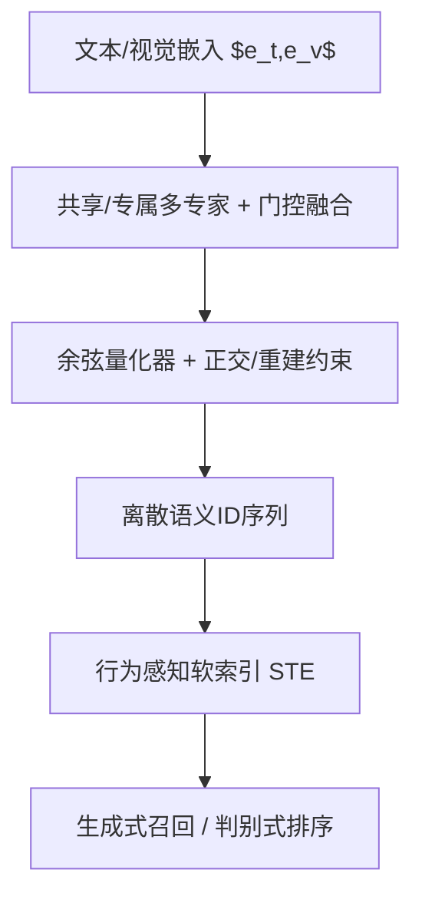
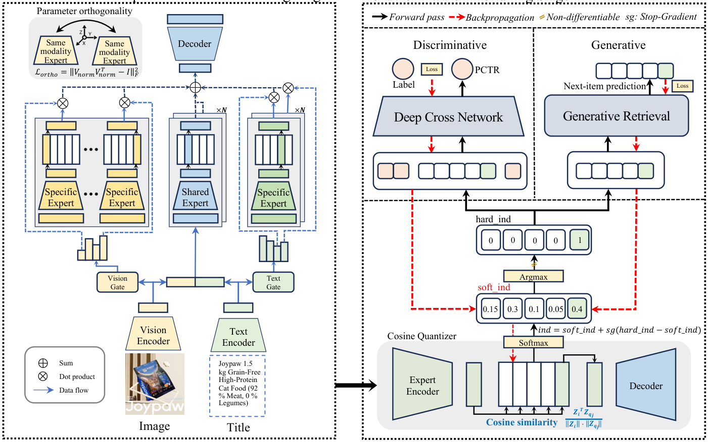

# MMQ: Multimodal Mixture-of-Quantization Tokenization for Semantic ID Generation and User Behavioral Adaptation (多模态混合量化分词：面向语义ID生成与用户行为适应)

- **会议/期刊**: WSDM 2026
- **作者与机构**: Yi Xu, Moyu Zhang, Chenxuan Li, Zhihao Liao, Haibo Xing, Hao Deng, Jinxin Hu, Yu Zhang, Xiaoyi Zeng, Jing Zhang；阿里巴巴、北京大学、北京航空航天大学、武汉大学
- **推荐链路定位**: 生成式召回 / 判别式排序（双任务验证）
- **研究方向**: 生成式推荐 / 多模态推荐
- **论文原文**: [https://arxiv.org/abs/2508.15281v1](https://arxiv.org/abs/2508.15281v1)
- **开源代码**: 暂未开源

## TL;DR (1分钟核心速览)

针对多模态语义ID中“模态协同/独有信息难兼顾、语义空间与用户行为错位”两大痛点，MMQ提出两阶段分词器：共享-专属多专家+正交约束建模协同与独有信息，行为感知软索引用STE把下游梯度回传量化器。工业广告与Amazon Beauty上，生成式召回R@10相对最优基线提升20.64%，判别排序AUC/GAUC小幅提升；线上30天A/B的CVR+4.33%、订单+3.52%。

## Background & Motivation (背景与核心矛盾)

- **主流范式**: 语义ID用RQ-VAE、RQ-Kmeans或OPQ把多模态内容量化成离散token，服务于生成式召回与判别式排序。
- **前人局限**: MA范式先融合再量化，易被单一模态主导而丢失模态独有信息；MS范式分模态独立量化，保留独有却缺跨模态协同。同时tokenizer预训练后常被冻结，离散码本切断梯度，语义ID与行为目标错位。
- **核心洞察 (Key Insight)**: PID理论将物品信息分解为模态独有+协同成分；可用共享/专属专家显式解耦，正交约束防专家塌缩，行为目标需通过软索引回传。
- **本文切入点**: 两阶段框架：共享-专属多专家量化 + 行为感知微调。

## Method (核心方法设计)

### 1. 整体框架 (Overall Architecture)

输入文本/视觉预训练嵌入$\mathbf{e}_t,\mathbf{e}_v$。Stage1用共享专家吸收跨模态协同、专属专家保留单模态独有，门控融合后经余弦量化器生成离散语义ID，并以多模态重建、辅助重建和正交正则训练。Stage2把离散索引替换为可微软索引，用STE前向hard、反向soft，将下游推荐梯度回传tokenizer，同时保留重建损失以守住语义知识。

<figure class="paper-figure" markdown="span">
  <figcaption>图2：我们提出的 MMQ 框架。（1）多模态共享-特定分词器训练阶段：我们引入具有模态特定专家和模态共享专家的多专家架构，以显式建模独特信息与协同信息。此外，我们利用正交正则化促进专家多样性，防止专家坍塌并确保全面表示。（2）行为感知微调阶段：我们使用下游推荐目标动态适配语义 ID 聚类，弥合语义-行为差距。</figcaption>
</figure>

### 2. 关键设计拆解 (Key Designs)

1. **共享-专属多专家解耦**：痛点在于MA丢独有、MS丢协同。共享专家输入$[\mathbf{e}_t,\mathbf{e}_v]$，专属专家分别输入单模态，融合为$\mathbf{z}=\sum_i\mathbf{z}_{s,i}+\sum_i g_{v,i}\mathbf{z}_{v,i}+\sum_i g_{t,i}\mathbf{z}_{t,i}$；再以$\mathcal{L}_{ortho}=\|\mathbf{V}_{norm}\mathbf{V}_{norm}^\top-\mathbf{I}\|_F^2$迫使专家投影正交。直觉是共享专家承载共性、专属专家承载差异，正交约束避免多专家学重复信息。

2. **余弦量化与多模态重建**：不同模态子模型输出尺度不一致，L2量化易受幅值影响。本文改用余弦查表$c_{s,i}=\arg\max_j\frac{\mathbf{z}_{s,i}^\top\mathbf{z}_{q,j}}{\|\mathbf{z}_{s,i}\|\|\mathbf{z}_{q,j}\|}$，并以$\mathcal{L}_{recon}=\|\mathbf{e}-decoder(\mathbf{z}+sg(\mathbf{z}_q-\mathbf{z}))\|_2^2$及分模态辅助重建$\mathcal{L}_{aux}$保真。角度几何更匹配语义嵌入，码本利用更均匀。

3. **行为感知软索引微调**：冻结tokenizer导致语义-行为断裂。对隐向量$\mathbf{z}_i$算码本余弦logits$\mathbf{p}_i$，令$\mathbf{s}=softmax(\mathbf{p}_i/\tau)$、$\mathbf{ind}=\mathbf{s}+sg(\mathbf{h}-\mathbf{s})$，前向用hard索引、反向走soft梯度；总损失$\mathcal{L}=\alpha\mathcal{L}_{recon}+\beta\mathcal{L}_{aux}+\gamma\mathcal{L}_{ortho}$，微调损失$\mathcal{L}_{ft}=\mathcal{L}_{down}+\alpha'\mathcal{L}_{recon}+\beta'\mathcal{L}_{aux}$。原文未明确负采样；生成式走HeterRec next-item，判别式走PPNet，推理仍用hard索引，开销近似码本查找。

## Experimental Setup & Evaluation Protocol (实验设置与评估协议)

- **数据集与预处理**:

| 数据集 | #Users | #Items | #Interactions | 稀疏度/密度 | 特征/场景说明 |
| :--- | :---: | :---: | :---: | :---: | :--- |
| 工业广告数据集 | 30M | 40M广告 | 未披露（曝光/点击/转化，序列均长128） | 未披露 | 东南亚电商广告，图像/标题/描述 |
| Amazon Beauty | 未披露 | 未披露 | 5-core后未披露，序列≤20 | 未披露 | 评论/评分，文本+图像 |

- **数据划分与防穿越**: 生成式任务先做`5-core`过滤，按时间构造用户行为序列、最大长度20，做next-item预测；判别式任务评分>3为正、≤3为负，按时间前90%训练、后10%测试。
- **排名评测协议**: 生成式报告`Recall@5/10`、`NDCG@5/10`；原文未说明Full-Ranking还是采样候选，也未给负采样比例。判别式用`AUC/GAUC`。
- **对比基线与超参设置**: 基线覆盖MA/MS两范式×RQ-VAE、RQ-Kmeans、OPQ；生成式骨干HeterRec，判别式骨干PPNet。文本/视觉嵌入维度均256，工业码本3000、Beauty码本100，语义ID长度6，专家数$N_s=N_t=N_v=2$；原文未报告显著性检验。

## Key Experimental Results (实验关键数据)

### 1. 主实验对比 (Main Results)

工业数据集：

| 方法 | AUC↑ | GAUC↑ | R@10↑ | N@10↑ |
| :--- | :---: | :---: | :---: | :---: |
| PPNet (ItemID) | 0.7144 | 0.6034 | - | - |
| MA-RQ-VAE | 0.7169 | 0.6064 | 0.0754 | 0.1621 |
| MA-RQ-kmeans | 0.7170 | 0.6056 | 0.0522 | 0.1388 |
| MA-OPQ | 0.7149 | 0.6046 | 0.0264 | 0.0619 |
| MS-RQ-VAE | 0.7171 | 0.6067 | 0.0988 | 0.2191 |
| MS-RQ-kmeans | 0.7181 | 0.6076 | 0.0534 | 0.1411 |
| MS-OPQ | 0.7177 | 0.6071 | 0.0927 | 0.2105 |
| **MMQ** | **0.7184** | **0.6081** | **0.1192** | **0.2883** |
| Improv. | +0.04% | +0.07% | +20.64% | +31.58% |

### 2. 消融实验 (Ablation Study)

| 方法 | $L_{recon}$↓ | Entropy↑ | Util.↑ | R@10↑ | N@10↑ |
| :--- | :---: | :---: | :---: | :---: | :---: |
| MMQ | **0.5529** | **7.9560** | **1.00** | **0.1192** | **0.2883** |
| w/o Cosine Quantizer | 0.5817 | 4.9524 | 0.59 | 0.0965 | 0.2188 |
| w/o Auxiliary Recon | 0.5879 | 4.3854 | 0.51 | 0.0834 | 0.1907 |
| w/o Orthogonal Reg. | 0.5816 | 7.5640 | 0.68 | 0.0717 | 0.1330 |
| w/o Behavior-Aware FT | 0.5726 | 7.6927 | 0.99 | 0.0997 | 0.1931 |

### 3. 关键实验发现 (Key Findings)

1. **生成式召回增益远大于判别式**：工业R@10从MS-RQ-VAE的0.0988升至0.1192（+20.64%），N@10从0.2191升至0.2883（+31.58%）；Beauty R@10从0.0549升至0.0675（+22.95%），说明共享-专属解耦+行为微调主要提升语义ID的可检索性。
2. **正交约束是防专家塌缩的关键**：去掉后R@10由0.1192降至0.0717、N@10由0.2883降至0.1330，Util.由1.00降至0.68，证明无正交压力时多专家学冗余信息、码本利用率骤降。
3. **余弦量化、辅助重建、行为微调各自有效且互补**：去掉余弦量化Util.降至0.59、R@10降至0.0965；去掉行为微调R@10降至0.0997、N@10降至0.1931；线上30天10%流量A/B收入+0.90%、CVR+4.33%、订单+3.52%。

## Highlights & Limitations (亮点、对比与审稿批判)

- **与代表作对比 (vs. Prior Work)**: TIGER用RQ-VAE做文本语义ID，EAGER融合协同信号但未显式解耦模态协同/独有；OneRec/UTGRec属MA、EGA属MS，MMQ首次在同一tokenizer中统一两类信息，并用行为感知微调桥接语义-行为鸿沟。
- **可迁移亮点**: 正交约束的多专家共享/专属结构可迁到多模态商品、短视频、POI内容ID；STE软索引可直接插入RQ-VAE/RQ-Kmeans，原文显示RQ-VAE加BAF后R@10提升1.30%–1.95%。
- **审稿级局限批判**: 两阶段训练增加复杂度，行为感知微调依赖下游任务，跨任务迁移受限；公开数据统计、候选集协议、负采样与显著性检验披露不足；线上仅10%流量30天，长期收益与冷启动物品仍需更多验证。

## Rating (四维评分)

- **方法创新性 (Novelty)**: ⭐⭐⭐⭐ （共享-专属MoE+正交约束+行为感知软索引，统一MA/MS并桥接语义-行为鸿沟）
- **评估协议与实验扎实度 (Protocol & Experiments)**: ⭐⭐⭐⭐ （工业+公开+线上A/B齐全，但公开数据统计、候选协议与显著性检验不足）
- **写作与数学规范度 (Clarity & Rigor)**: ⭐⭐⭐⭐ （关键公式与损失权重清楚，数据集表与负采样细节偏简）
- **工业落地与复现价值 (Industrial & Practical Value)**: ⭐⭐⭐⭐⭐ （线上CVR/订单显著提升，推理仍走hard索引，工程路径清晰；代码未开源）

