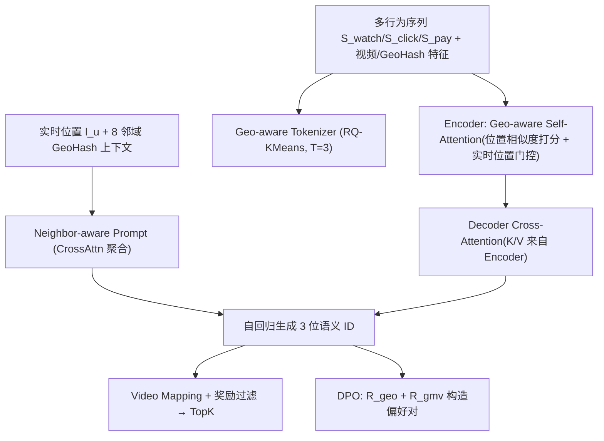
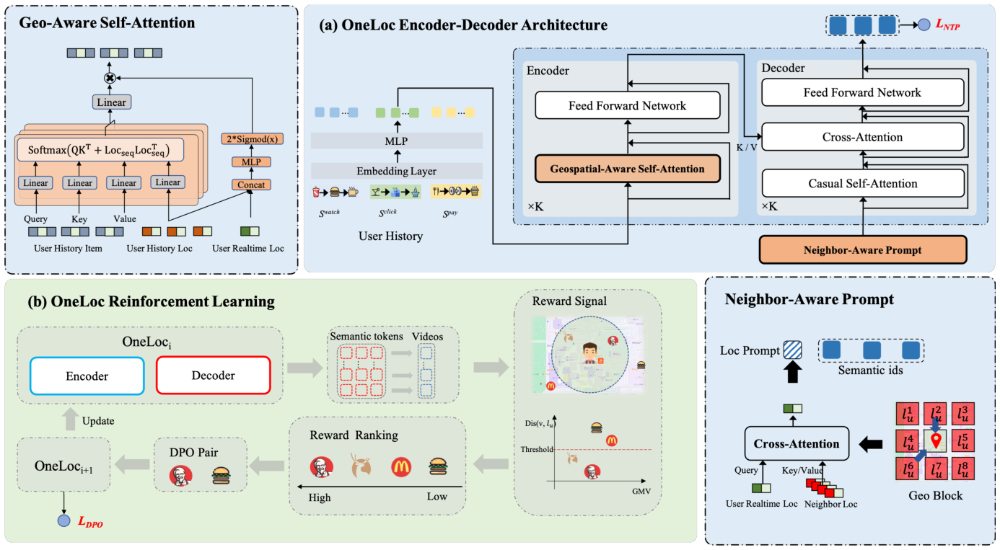

# OneLoc: Geo-Aware Generative Recommender Systems for Local Life Service (地理位置感知的本地生活生成式推荐系统)

- **会议/期刊**: WSDM 2026
- **作者与机构**: Zhipeng Wei, Kuo Cai, Junda She, Jie Chen, Minghao Chen, Yang Zeng, Qiang Luo, Wencong Zeng, Ruiming Tang, Kun Gai, Guorui Zhou（快手 Inc.）
- **推荐链路定位**: 端到端生成式（统一召回与排序，替代多级级联）
- **研究方向**: 生成式推荐与离散语义ID / 时空轨迹与 POI 本地生活推荐
- **论文原文**: [https://arxiv.org/abs/2508.14646v1](https://arxiv.org/abs/2508.14646v1)
- **开源代码**: 暂未开源

## TL;DR (1分钟核心速览)

本地生活场景要求"用户兴趣 + 实时位置"双重约束，而已有生成式推荐（TIGER、GNPR-SID）仅把地理信息当作独立特征或提示，无法刻画位置语义与距离-成交权衡。OneLoc 在 RQ-KMeans 语义 ID 中注入位置上下文，提出带位置相似度打分与实时位置门控的 Geo-aware Self-Attention、聚合 8 个邻域 GeoHash 的 Neighbor-aware Prompt，并用"地理奖励 + GMV 奖励"的 DPO 对齐多目标。KuaiLLSR 全库排序下 Recall@5 达 0.3565（较最强基线 GNPR-SID 提升 13.46%），线上 A/B 全流量 GMV +21.016%、订单 +17.891%。

## Background & Motivation (背景与核心矛盾)

- **主流范式**: 快手本地生活为"带门店位置的短视频"推荐，工业界仍以多通道召回 + 粗排/精排/重排级联为主；学术侧生成式推荐用 RQ-VAE/RQ-KMeans 语义 ID 做自回归生成。
- **前人局限**: ① 地理信息利用割裂——GNPR-SID 只在 SID 表征层注入位置，Rotan/TPG 只把时间/坐标当注意力位置编码或 decoder 提示，未同时改造表征、注意力与生成三处；② 多目标无法细粒度权衡——仅拟合曝光样本无法显式优化"距离越近越好"与 GMV 两个目标。
- **核心洞察 (Key Insight)**: 用户在同一时刻的两次点击是否相关，既取决于内容相似度，也取决于两视频门店的空间邻近度；用户当前所在位置应作为"门控信号"而非普通特征。
- **本文切入点**: 把地理信息贯穿 SID 分词 → encoder 注意力 → decoder 提示全链路，再用双奖励 RL 替代隐式的曝光对齐。

<figure class="paper-figure" markdown="span">
  <figcaption>图1：Kuaishou 本地生活服务的背景。(a) 在本地生活服务中，我们推荐视频，并在左下角（红框）显示门店位置信息。点击后会显示详细的门店和商品信息。(b) 我们的系统根据用户偏好和门店距离进行推荐。</figcaption>
</figure>

## Method (核心方法设计)

### 1. 整体框架 (Overall Architecture)

输入为用户的观看/点击/购买三路行为序列（长度 256/32/10）拼接后的综合嵌入序列 $Z$与位置上下文序列$E_{lc}$，以及用户实时位置$l_u$。Encoder 由 4 层 GA-Attn 模块构成，输出作为 Decoder 交叉注意力的 K/V；Decoder 以 8 邻域聚合得到的 Neighbor-aware Prompt 嵌入与目标视频 3 位语义 ID 为初始前缀，逐位自回归预测$q^1_t\to q^2_t\to q^3_t$。预训练用 next-token 交叉熵，后训练用 beam search 采样并依双奖励构造偏好对做 DPO；线上推理将语义 token 经 Video Mapping Server 映射回视频 ID，再经奖励系统与规则过滤取 TopK。

<figure class="paper-figure" markdown="span">
  <figcaption>图2：OneLoc 的整体框架包括编码器-解码器架构和强化学习。(a) 编码器中的核心模块是地理感知自注意力，它将位置相似度引入注意力分数，并利用用户实时位置作为门控来控制输出。编码器的输出作为解码器中交叉注意力的键和值。同时，使用邻居感知提示控制生成，该提示通过交叉注意力聚合周围上下文。最后，解码器的输出用于计算下一个 token 预测。</figcaption>
</figure>

### 2. 关键设计拆解 (Key Designs)

1. **Geo-aware Semantic IDs（地理感知分词）**：痛点是把坐标当数值 ID 无法刻画相似位置间的语义关联。本文将初始残差 $r_i^0$替换为多模态大模型抽取的"视频内容 + 位置上下文（GeoHash 块内的坐标、品牌、品类）"联合嵌入，再逐层 K-Means 量化$q_i^j=\arg\min_k\|c_k^i-r_i^j\|$、$r_i^{j+1}=r_i^j-c_{q_i^j}^i$。直觉上近邻门店的视频共享前缀码本，使生成器"按地理位置聚类"地分配概率质量。
2. **Geo-aware Self-Attention（双通道注意力 + 位置门控）**：注意力分数在内容内积之外并联位置上下文内积，直接刻画"历史上哪次行为与当前位置语境相近"：$A=\mathrm{Softmax}\!\left(\frac{(ZW_q)(ZW_k)^\top}{\sqrt{d}}+E_{lc}E_{lc}^\top\right)$。再用实时位置作缩放门控$g_i=2\cdot\mathrm{Sigmoid}(\mathrm{MLP}([e_{lc}^u;E_{lc,i}]))$，$O_i=g_i\tilde{O}_i$；区间$(0,2)$ 使门控既能抑制无关远距离行为、也能放大强相关行为，而非单纯 mask。
3. **Neighbor-aware Prompt 与双奖励 DPO**：仅用用户自身坐标缺少"周边有什么"的信息。以 $e_{lc}^u$为 Query、周边 8 个 GeoHash 块上下文$E_s$为 K/V 做交叉注意力得$e_s$作为生成提示，避免邻域噪声被 MLP 无差别拼接。RL 阶段地理奖励$R_{geo}=\mathbb{I}[\mathrm{Dis}(v,l_u)\le D]/\mathrm{Dis}(v,l_u)$（超阈值直接 0），GMV 奖励由一个传统 GMV 打分模型给出；beam search 取$N$个候选后以奖励最高/最低者为$(v_p,v_n)$，最小化$L_{dpo}=-\log\sigma\!\left(\beta\log\frac{p_{\theta_{i+1}}(Q_p)}{p_{\theta_i}(Q_p)}-\beta\log\frac{p_{\theta_{i+1}}(Q_n)}{p_{\theta_i}(Q_n)}\right)$，总损失$L=L_{ntp}+\lambda L_{dpo}$，$\lambda=0.05$。训练免负采样（全词表 softmax 于 8192 码本），推理用 beam search + KV cache/动态批处理/TensorRT，A10 上 MFU 25%。

## Experimental Setup & Evaluation Protocol (实验设置与评估协议)

- **数据集与预处理**: 快手 8 天均匀采样日志构造 KuaiLLSR；Foursquare 经 LibCity 标准流程过滤用户与 POI 后按时间排序构造序列，取 NYC、TKY 两个子集。

| 数据集 | #Users | #Items | #Interactions | 稀疏度/密度 | 特征/场景说明 |
| :--- | :---: | :---: | :---: | :---: | :--- |
| KuaiLLSR | 60 M | 900 K | 440 M | ~8.1e-4 | 快手本地生活短视频，平均序列长度约 200 |
| NYC | 1,042 | 36,359 | 212,347 | 5.6e-3 | Foursquare 签到，高用户密度 |
| TKY | 2,187 | 59,472 | 545,301 | 4.2e-3 | Foursquare 签到，POI 分布更分散 |

- **数据划分与防穿越 (Splitting Strategy)**: KuaiLLSR 采用 **全局时间戳切分**（前 7 天训练、第 8 天测试，流式训练）；Foursquare NYC/TKY 采用 **比例划分 8:1:1**（按交互序列时序）。
- **排名评测协议 (Ranking Protocol)**: 报告 Recall@{5,10,20} 与 NDCG@{5,10,20}；正文未显式声明采样负例比，按 POI/LLSR 惯例为 **Full-Ranking（全候选择优排序）**，且生成式基线（TIGER/GNPR-SID）同样全库生成，故对比公平。线上以 GMV、订单数、付费用户数为指标，$p<0.01$ 双尾 t 检验。
- **对比基线与超参设置**: 传统组 SASRec/BERT4Rec/GRU4Rec/Caser/S³-Rec，POI 组 TPG/Rotan，生成式组 TIGER/GNPR-SID；3 层码本、每层 $K=8192$，encoder/decoder 各 4 层、隐层 1024、8 头、FFN 4096，AdamW（lr$2\times10^{-4}$，wd 0.1），DPO 权重$\lambda=0.05$。

## Key Experimental Results (实验关键数据)

### 1. 主实验对比 (Main Results)

| 数据集/指标 | SASRec | BERT4Rec | S³-Rec | TPG | Rotan | TIGER | GNPR-SID | **OneLoc** | Improv.% |
| :--- | :---: | :---: | :---: | :---: | :---: | :---: | :---: | :---: | :---: |
| KuaiLLSR R@5 | 0.0927 | 0.0682 | 0.1218 | 0.1750 | 0.2185 | 0.2832 | 0.3142 | **0.3565** | +13.46% |
| KuaiLLSR R@20 | 0.2048 | 0.1623 | 0.2808 | 0.3241 | 0.3563 | 0.4413 | 0.5056 | **0.5584** | +10.44% |
| KuaiLLSR N@5 | 0.0408 | 0.0311 | 0.0793 | 0.0897 | 0.1029 | 0.1500 | 0.1775 | **0.2032** | +14.47% |
| KuaiLLSR N@20 | 0.0705 | 0.0565 | 0.1143 | 0.1117 | 0.1266 | 0.1615 | 0.1904 | **0.2151** | +12.97% |
| NYC R@5 | 0.3151 | 0.2857 | 0.3071 | 0.3551 | 0.4448 | 0.4965 | 0.5311 | **0.6107** | +14.98% |
| NYC N@5 | 0.2224 | 0.2074 | 0.2235 | 0.2464 | 0.3471 | 0.4131 | 0.4430 | **0.5355** | +20.88% |
| TKY R@5 | 0.3450 | 0.2649 | 0.3365 | 0.3725 | 0.4333 | 0.5031 | 0.5354 | **0.5964** | +11.39% |
| TKY N@20 | 0.2831 | 0.2284 | 0.2825 | 0.3051 | 0.3739 | 0.4401 | 0.4788 | **0.5306** | +10.82% |

### 2. 消融实验 (Ablation Study)

| 变体 | R@5 | R@10 | R@20 | N@5 | N@10 | N@20 |
| :--- | :---: | :---: | :---: | :---: | :---: | :---: |
| Full Model | **0.3565** | **0.4563** | **0.5584** | **0.2032** | **0.2114** | **0.2151** |
| w/o Location Scores | 0.3476 | 0.4439 | 0.5229 | 0.1758 | 0.1847 | 0.1884 |
| w/o Location Gate | 0.3501 | 0.4489 | 0.5295 | 0.1810 | 0.1914 | 0.1950 |
| w/o Geo-aware Self-Attn | 0.3315 | 0.4261 | 0.4989 | 0.1552 | 0.1640 | 0.1673 |
| Point-wise Prompt（替代邻域） | \multicolumn{6}{c}{图 4 中显著低于 Full} |
| Neighbor-MLP Prompt | \multicolumn{6}{c}{图 4 中跌幅最大，噪声未被过滤} |

### 3. 关键实验发现 (Key Findings)

1. **位置门控与位置相似度互补且缺一不可**：单独去掉 location scores 使 N@5 从 0.2032 降至 0.1758（-13.5%），去掉 gate 降至 0.1810（-10.9%），二者同时去掉降至 0.1552（-23.6%）——降幅近似可加，说明"往哪看"和"看多用力"是两个正交增益来源。
2. **生成式范式本身贡献主要增益，地理模块是在其上叠加的增量**：所有生成式方法（TIGER/GNPR-SID/OneLoc）相对传统模型 R@5 高出 29% 以上，而 OneLoc 在最强生成基线 GNPR-SID 之上再取 13.46%/14.98%（KuaiLLSR/NYC），证明 SID 分词中注入地理语义仍有独立价值。
3. **业务奖励的收益集中在"拉新"而非仅成交**：线上全流量 A/B 中 GMV +21.016%、订单 +17.891%，但本地生活新付费用户 +23.027%、付费用户数 +18.585%，新客增幅高于存量指标，说明端到端生成在稀疏/冷启动用户上收益更明显；同时序列长度从 100 扩到 300 带来 Recall/N@K 平均 +13.02%/+51.24%，呈现清晰的 scaling law，而 $\lambda=0.05$ 对 DPO 效果敏感（0.01 明显劣化）。

## Highlights & Limitations (亮点、对比与审稿批判)

- **与代表作对比 (vs. Prior Work)**: 相比 TIGER/GNPR-SID 仅在分词阶段编码协同或 POI 语义，OneLoc 把地理信号同时注入分词、注意力与提示三处；相比 Rotan/TPG 把时间/坐标作为位置编码或提示，本文的 GA-Attn 允许位置相似度直接参与行为选择；相比 OneRec 的单奖励对齐，本文用地理 + GMV 双奖励显式处理"近 vs 赚"的冲突。
- **可迁移亮点**: ① "位置相似度并联进注意力 + (0,2) 区间乘性门控"可直接迁移到跨城/跨境场景的上下文门控；② 用现成业务模型（GMV 打分器）作奖励、beam search 最高/最低分为偏好对的 DPO 构造方式，对任何已有强排序模型的工业系统都是低成本对齐方案。
- **审稿级局限批判**: ① 离线仅报告 Recall/NDCG，未披露候选集规模与是否为全库排序、也未报告训练负采样方式，与生成式基线的可比性需读者自行推断；② 奖励函数含硬阈值 $D$与 GMV 打分模型两个先验，正文未给出$D$ 敏感性分析与奖励 hacking 风险讨论；③ 消融中 prompt 与 reward 两组仅以柱状图呈现、未给具体数值表格，削弱了可复现性。

## Rating (四维评分)

- **方法创新性 (Novelty)**: ⭐⭐⭐⭐ （在地理信息上做"分词-注意力-提示-奖励"四点贯通，GA-Attn 并联位置打分 + 乘性门控是其真正新颖算子）
- **评估协议与实验扎实度 (Protocol & Experiments)**: ⭐⭐⭐⭐ （KuaiLLSR 4.4 亿交互 + 两个公开数据集 + 线上全流量 A/B 与显著性检验齐备，但排名协议细节与部分消融数值披露不足）
- **写作与数学规范度 (Clarity & Rigor)**: ⭐⭐⭐⭐ （三个模块公式与门控区间直觉解释清晰；DPO 损失符号与 KL 项写法略欠严谨，缺复杂度分析）
- **工业落地与复现价值 (Industrial & Practical Value)**: ⭐⭐⭐⭐⭐ （4 亿 DAU 全流量部署，A10 上 MFU 25%、KV cache/TensorRT 工程细节完整，未开源代码是唯一遗憾）

