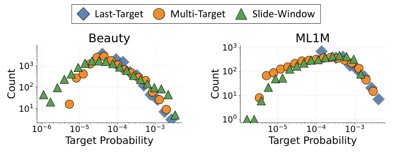
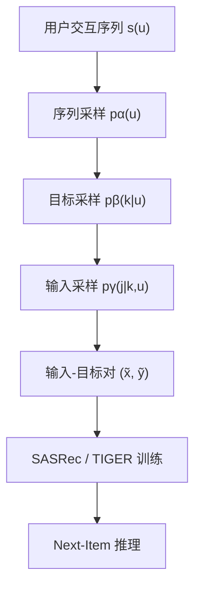
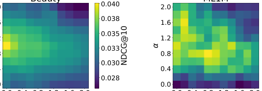

# Sequential Data Augmentation for Generative Recommendation (生成式推荐的序列数据增广)

- **会议/期刊**: WSDM 2026
- **作者与机构**: Geon Lee, Bhuvesh Kumar, Mingxuan Ju, Tong Zhao, Kijung Shin, Neil Shah, Liam Collins; KAIST & Snap Inc.
- **推荐链路定位**: 端到端生成式（训练数据构造）
- **研究方向**: 生成式推荐与离散语义ID / 序列与会话推荐
- **论文原文**: [论文原文链接](https://arxiv.org/abs/2509.13648v3)
- **开源代码**: [GenPAS](https://github.com/snap-research/GenPAS)

## TL;DR (1分钟核心速览)

本文指出生成式推荐长期把训练样本构造当作实现细节，但 LT/MT/SW 等策略会显著改变目标分布与输入-目标联合分布，NDCG@10 差距可达 783.7%。作者提出 GenPAS，将增广统一为序列、目标、输入三步有偏随机采样，用 $\alpha,\beta,\gamma$ 控制分布，并据目标 KL 与 alignment/discrimination 比值筛选配置。在 Beauty/Toys/Sports/ML1M/ML20M 的 leave-one-out 全库排序及 Snap 工业数据上，SASRec/TIGER 的 NDCG@10 相对最佳基线提升 3.02–59.08%。

## Background & Motivation (背景与核心矛盾)

- **主流范式**: 生成式推荐从用户历史序列构造 $(\tilde x,\tilde y)$ 训练对，再用 SASRec/TIGER 等模型做 next-item 预测；但样本构造策略长期不统一。
- **前人局限**: LT 只取最后目标，目标分布偏高频；MT 多目标但输入固定全前缀；SW 枚举所有窗口，样本最多却未必最优。同一模型换策略，NDCG@10 可差 783.7%。
- **核心洞察 (Key Insight)**: 性能主要由两点决定：训练/测试目标分布对齐程度，以及输入-目标分布的 alignment 与 discrimination 平衡；单纯增加样本多样性并不够。图1显示 LT 目标更偏频繁项，MT/SW 更均衡。
- **本文切入点**: 把增广视为输入-目标对上的可控随机采样，统一现有策略并搜索更优分布。

<figure class="paper-figure" markdown="span">
  <figcaption>图1：不同策略产生不同的目标分布。LT 偏向频繁项，而 MT 和 SW 产生更均衡的分布。</figcaption>
</figure>

## Method (核心方法设计)

### 1. 整体框架 (Overall Architecture)

GenPAS 不改生成式推荐模型，只改训练对构造。给定用户序列 $s^{(u)}$，先按长度偏置采样用户$u$，再在其序列内按位置偏置采样目标位置$k$，最后在$k$前按起点偏置采样连续输入$[i_j,\ldots,i_{k-1}]$，得到$(\tilde x,\tilde y)$。三个指数$(\alpha,\beta,\gamma)$ 连续控制长序列/近期目标/短上下文的偏好，LT、MT、SW 均为特例。训练前用验证集 KL 与 A/D 过滤选参，训练 SASRec/TIGER，推理路径不变。

### 2. 关键设计拆解 (Key Designs)

1. **三步有偏采样统一现有策略**：痛点是不统一导致训练分布漂移。GenPAS 定义 $p_\alpha(u)\propto(|s^{(u)}|-1)^\alpha$、$p_\beta(k|u)\propto(k-1)^\beta$、$p_\gamma(j|k,u)\propto j^\gamma$，联合分布为$p(\tilde x,\tilde y)=p_\alpha(u)p_\beta(k|u)p_\gamma(j|k,u)$。$\alpha>0$偏长序列，$\beta>0$偏近期目标，$\gamma>0$偏短上下文。LT/MT/SW 分别对应$(0,\infty,-\infty)$、$(1,0,-\infty)$、$(2,1,0)$，因此可系统探索中间配置。

2. **目标对齐与 A/D 诊断**：用 $\mathrm{KL}(p_{train}\|p_{test})=\sum_y p_{train}(y)\log\frac{p_{train}(y)}{p_{test}(y)}$度量目标分布偏差；用$A=\mathbb{E}_{(x',y')\sim D_{test}}[\frac{1}{|C_{y'}|}\sum_{x^+\in C_{y'}}\mathrm{sim}(x^+,x')]$与$D=\mathbb{E}_{(x',y')}[\mathbb{E}_{y^-\ne y'}[\frac{1}{|C_{y^-}|}\sum_{x^-\in C_{y^-}}\mathrm{sim}(x^-,x')]]$度量正/负输入结构相似性。性能随 KL 降低、A/D 升高而改善；TV 上界显示 LT 偏差主要由$\delta_n$决定，MT 平均$\delta_k$，SW 对$k\delta_k$ 加权，解释了近期偏差强时 LT 也可能更优。

3. **免训练参数筛选与训练目标**：从 $(\alpha,\beta,\gamma)$网格先保留验证集目标 KL 最低的 top$r\%$，再按$\max(\mathrm{rank}_A,\mathrm{rank}_D)$取 top-$k$，无需训练即可把上百配置缩到几个。SASRec 用 full-batch 负样本对比损失，TIGER 用标准生成损失；GenPAS 仅改采样，推理无额外开销，搜索开销约 0.07s KL + 52s A/D/配置。图3显示$\alpha,\beta$ 联合影响显著且数据集相关。

<figure class="paper-figure" markdown="span">
  <figcaption>图3：两个参数 𝛼 和 𝛽 共同塑造训练分布，并对模型性能产生显著影响。其影响模式因数据集而异。</figcaption>
</figure>

## Experimental Setup & Evaluation Protocol (实验设置与评估协议)

- **数据集与预处理**:

| 数据集 | #Users | #Items | #Interactions | 稀疏度/密度 | 特征/场景说明 |
| :--- | :---: | :---: | :---: | :---: | :--- |
| Beauty | 22,363 | 12,101 | 198,502 | 99.93% | Amazon 5-core |
| Toys | 19,412 | 11,924 | 167,597 | 99.93% | Amazon 5-core |
| Sports | 35,598 | 18,357 | 296,337 | 99.95% | Amazon 5-core |
| ML1M | 6,040 | 3,416 | 999,611 | 95.16% | MovieLens |
| ML20M | 138,493 | 26,744 | 20,000,263 | 99.46% | MovieLens |
| Internal | 69.38M | 42,805 | 1.527B | 99.94% | Snap 180 天训练序列 |

- **数据划分与防穿越**: 公开集用 `Leave-One-Out`：最后一项为 test、倒数第二为 val、其余训练；Internal 用 180 天训练，后续一周首事件作 val/test。
- **排名评测协议**: 公开集沿用 SASRec/TIGER 的 leave-one-out 排序评测（论文未改协议，按全库排序理解）；Internal 明确每用户采样 2000 负例排序。指标为 NDCG@K、Recall@K，$K\in\{5,10\}$。
- **对比基线与超参设置**: 基线为 LT、MT、SW 及序列级 Insert/Delete/Replace/Reorder/Sample；模型为 SASRec/TIGER。Embedding $d=128$，2 层 Transformer、1 头；TIGER 用 Flan-T5-XXL 4096 维文本嵌入 + 3 层×256 码本 RQ-KMeans；AdamW，公开集 batch 2096；重复运行报告标准差，未给显著性$p$ 值。

## Key Experimental Results (实验关键数据)

### 1. 主实验对比 (Main Results)

下表为 NDCG@10 / Recall@10，粗体为各数据集最优：

| 模型 | 策略 | Beauty | Toys | Sports | ML1M | ML20M |
| :--- | :--- | :---: | :---: | :---: | :---: | :---: |
| SASRec | LT | .0124/.0237 | .0121/.0237 | .0037/.0073 | .0136/.0306 | .0628/.1142 |
| SASRec | MT | .0372/.0623 | .0378/.0636 | .0162/.0282 | .1194/.2236 | .0995/.1824 |
| SASRec | SW | .0323/.0510 | .0354/.0571 | .0149/.0256 | .1022/.1960 | .0526/.1076 |
| SASRec | **GenPAS** | **.0426/.0689** | **.0481/.0771** | **.0219/.0365** | **.1230/.2288** | **.1115/.1938** |
| TIGER | LT | .0213/.0431 | .0212/.0413 | .0150/.0281 | .0147/.0340 | .0559/.1063 |
| TIGER | MT | .0319/.0608 | .0303/.0575 | .0194/.0359 | .1273/.2272 | .1147/.1900 |
| TIGER | SW | .0321/.0580 | .0273/.0504 | .0171/.0319 | .1105/.1966 | .0321/.0646 |
| TIGER | **GenPAS** | **.0443/.0766** | **.0482/.0822** | **.0254/.0453** | **.1390/.2425** | **.1233/.2009** |
| SASRec | Improv. | +14.52/+10.59 | +27.25/+21.23 | +35.19/+29.43 | +3.02/+2.33 | +12.06/+6.25 |
| TIGER | Improv. | +38.01/+25.99 | +59.08/+42.96 | +30.93/+26.18 | +9.19/+6.73 | +7.50/+5.74 |

工业 Internal 上，GenPAS 相对 LT 基线：transductive NDCG@10 +8.14%、Recall@10 +11.7%；inductive 新用户 NDCG@10 +7.29%、Recall@10 +6.77%。

### 2. 消融实验 (Ablation Study)

在 $(\alpha,\beta)=(1,0)$ 下控制输入采样与序列级增广（NDCG@10）：

| 配置 | Beauty | ML1M |
| :--- | :---: | :---: |
| $\gamma=-\infty$（固定全前缀，w/o 输入窗口采样） | .0372 | .1194 |
| $\gamma=-1$ | .0403 | .1107 |
| $\gamma=0$（GenPAS 选中） | **.0426** | **.1230** |
| $\gamma=1$ | .0410 | .1041 |
| Insert | .0399 | .1179 |
| Reorder | .0353 | .1202 |
| Sample | .0376 | .1143 |

### 3. 关键实验发现 (Key Findings)

1. **增广策略比模型架构更敏感**：TIGER 在 ML1M 上 MT 相对 LT 的 NDCG@10 提升 783.7%，而 Sports 上跨架构最大差距仅 305.4%；SW 样本最多却常输给 MT，说明分布形状比样本数量关键。
2. **GenPAS 全面优于常用策略**：SASRec 的 NDCG/Recall 提升 3.02–35.19%/2.33–29.43%，TIGER 提升 7.50–59.08%/5.74–42.96%；选出的配置均非 LT/MT/SW，常用策略只是次优特例。
3. **数据/参数效率与长尾收益明确**：ML1M 仅用 1% 数据即超过全量无增广基线；小模型配 GenPAS 可胜更大模型；长尾 G1–G3 全组提升，Internal 新用户场景仍显著增益。

## Highlights & Limitations (亮点、对比与审稿批判)

- **与代表作对比 (vs. Prior Work)**: TIGER 隐含使用 SW、SASRec 常用 MT、LT 单目标，本文把三者统一为 $(\alpha,\beta,\gamma)$特例；与 Insert/Delete/Replace/Reorder/Sample 等输入扰动相比，GenPAS 只采样连续子序列并调$\gamma$，Beauty(1,0) 下$\gamma=0$ 的 .0426 高于 Insert .0399、Reorder .0353。
- **可迁移亮点**: 三步采样+KL/A-D 过滤可迁移到 TIGER/Transformer 生成式检索、会话推荐；把数据增广从启发式提升为训练分布设计。
- **审稿级局限批判**: ① 仅离线评测，公开集未明示全库排序且缺显著性 $p$值；②$(\alpha,\beta,\gamma)$ 需按数据集验证集搜索，存在过拟合验证集与工业调参成本，且输入限定连续子序列、理论依赖 IID/独立项假设且仅给上界。

## Rating (四维评分)

- **方法创新性 (Novelty)**: ⭐⭐⭐⭐ （系统化三步采样统一 LT/MT/SW，TV 界给出偏差-方差解释；但模型架构无新意）
- **评估协议与实验扎实度 (Protocol & Experiments)**: ⭐⭐⭐⭐ （5 公开+1 工业数据、SASRec/TIGER 双模型、报告标准差；缺显著性检验且公开集协议说明略简）
- **写作与数学规范度 (Clarity & Rigor)**: ⭐⭐⭐⭐ （公式统一、符号清楚、重铸关系直观；理论仅上界且依赖较强假设）
- **工业落地与复现价值 (Industrial & Practical Value)**: ⭐⭐⭐⭐⭐ （Snap 工业数据验证、代码开源，仅改训练采样，推理零额外开销，数据/参数效率收益明显）

