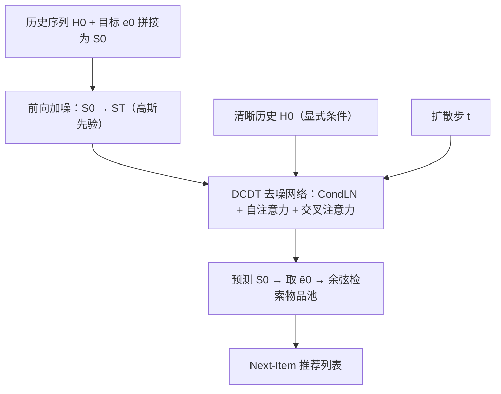
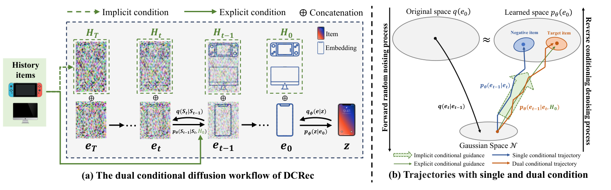
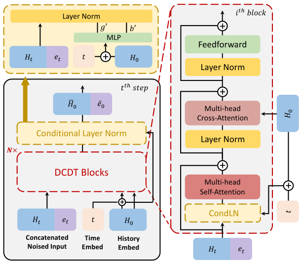

# Dual Conditional Diffusion Models for Sequential Recommendation (面向序列推荐的双条件扩散模型)

- **会议/期刊**: WSDM 2026
- **作者与机构**: Hongtao Huang, Chengkai Huang, Tong Yu, Xiaojun Chang, Wen Hu, Julian McAuley, Lina Yao (UNSW / Adobe Research / UTS / UCSD / CSIRO Data61)
- **推荐链路定位**: 召回（Next-Item 生成式检索）
- **研究方向**: 序列与会话推荐 / 生成式推荐
- **论文原文**: [arXiv:2410.21967v2](https://arxiv.org/abs/2410.21967v2)
- **开源代码**: 暂未开源

## TL;DR (1分钟核心速览)

现有扩散式序列推荐几乎全是「隐式条件」：把用户历史压成单一向量在加噪时与目标融合，序列上下文被过度简化；而可直接引导去噪的显式交互信号尚未被利用。DCRec 提出在正向过程拼接完整含噪序列 $S_0=\mathrm{Concat}(H_0,e_0)$以保全序列信息，在反向过程以清晰历史$H_0$ 作为显式条件经 CondLN 与交叉注意力逐步引导去噪，保持 ELBO 一致性。在 Beauty/Toys/Yelp 三个 5-core 数据集、Leave-One-Out 划分、Full-Ranking 协议下 HR@5 最高较 SOTA 提升 17.35%，且跳步推理使采样成本低于 DiffuRec。

## Background & Motivation (背景与核心矛盾)

- **主流范式**: DiffuRec / DreamRec 等在正向过程将目标物品嵌入加噪至高斯先验，反向用 Transformer 逐步去噪重构目标嵌入，再以余弦相似度在物品池中检索。
- **前人局限**: ① 隐式条件把整段历史压成一个条件向量，稀疏序列下的顺序与上下文细粒度丢失；② 显式条件（整段历史逐步交互）仅在重排任务（DCDR）中被验证，序列推荐中未探索，且直接引入完整序列极易被无关行为与噪声淹没。
- **核心洞察 (Key Insight)**: 隐式条件擅长刻画长期行为模式，显式条件擅长保留短期时序动态——论文用短/长序列分桶实验（表 3）直接证实了这种互补性，而二者此前从未被联合建模。
- **本文切入点**: 正向做「无损拼接」保全序列，反向做「交叉注意力 + CondLN」自适应注入显式历史，并利用双条件带来的收敛加速实现跳步推理。

## Method (核心方法设计)

### 1. 整体框架 (Overall Architecture)

DCRec 把用户历史 $H_0$与目标物品嵌入$e_0$拼接为$S_0$，在正向过程中对**整段拼接序列**逐步加噪至标准高斯；反向过程由 DCDT（双条件扩散 Transformer）驱动，每个去噪步同时接收含噪序列$S_t$、扩散步$t$与清晰历史$H_0$三重输入，经 CondLN 调制与显式交叉注意力后输出预测$\bar{S}_0$，取末位 token 的$\bar{e}_0$映射回离散物品空间并以余弦相似度全库排序。训练端-$L_T,L_t,L_z$联合优化；推理端支持均匀跳步采样与隐式先验注入$H_T\leftarrow H_T+\delta H_0$。

<figure class="paper-figure" markdown="span">
  <figcaption>图2：(a) 展示了我们的 DCRec 的简化工作流程。在端到端扩散过程中，DCRec 在每个扩散步隐式拼接含噪目标物品嵌入 𝒆𝒕 和对应的含噪历史嵌入序列 𝑯𝒕。同时，DCRec 也以清晰历史嵌入 𝑯0 作为显式条件信号进行引导。(b) 描绘了带条件的前向与反向扩散过程。存在两条带隐式引导的去噪轨迹。带有额外显式引导的双条件轨迹更可能到达目标物品（橙色区域）。</figcaption>
</figure>
<figure class="paper-figure" markdown="span">
  <figcaption>图3：DCDT 的设计。黑框表示主架构，红框表示 Transformer 块内的细节，黄框表示 CondLN 模块的细节。</figcaption>
</figure>

### 2. 关键设计拆解 (Key Designs)

1. **隐式条件前向拼接序列（Implicit Conditional Forward）**：前人把历史压缩成条件向量再与含噪目标融合，稀疏场景下序列信息缺失。本文改为在整个拼接序列上加噪：$q(S_t|S_{t-1})=\mathcal{N}(S_t;\sqrt{\alpha_t}S_{t-1},(1-\alpha_t)\mathbf{I})$，去噪网络输入由$e_t$扩展为$S_t$。直觉：每个历史 token 都保留独立的含噪表示，模型可直接从细粒度上下文中推断目标，而非从单一压缩向量反解。

2. **显式条件反向 + CondLN + 交叉注意力**：直接注入 $H_0$会被噪声与无关行为干扰。CondLN 将原 LayerNorm 的可学习 gain/bias 换成以$(t,H_0)$为输入的 MLP 输出：$\bar{S}_t=g'(t,H_0)\cdot\frac{S_t-\mathbb{E}(S_t)}{\sqrt{\mathrm{Var}(S_t)+\epsilon}}+b'(t,H_0)$；随后交叉注意力以含噪序列为 query、清晰历史$H_0$为 key/value：$\bar{S}_t=\mathrm{Softmax}\!\left(\frac{(\bar{S}_t W_Q)(H_0 W_K)^\top}{\sqrt{d}}\right)(H_0 W_V)$。直觉：CondLN 让扩散步$t$ 控制显式条件的注入强度——早期高噪声时弱化、后期精细化时强化；交叉注意力则让模型按需检索历史中与当前去噪状态最相关的片段，天然抑制无关行为。

3. **训练目标与推理加速**：总损失 $\mathcal{L}_{elbo}=\mathcal{L}_T+(1-\lambda)\mathcal{L}_t+\lambda\mathcal{L}_z$，其中$\mathcal{L}_T=\|\bar{S}_0\|^2$、$\mathcal{L}_t=\|\bar{e}_0-e_0\|^2$、$\mathcal{L}_z=D_{KL}(q_\phi(z)\|p_\phi(\bar{z}))$；$\lambda$采用随 epoch 衰减的$\lambda_{smooth}$动态调度。推理端利用双条件带来的早期高精度，跳过中间步骤：$p_\theta(S_{t-k}|S_t)=\mathcal{N}(S_{t-k};\mu_\theta(\bar{S}_0(S_t),t),\Sigma_\theta(\bar{S}_0(S_t),t))$，整体复杂度$O(nd^2+dn^2)$ 与 DiffuRec 持平但采样步更少。

## Experimental Setup & Evaluation Protocol (实验设置与评估协议)

- **数据集与预处理**: Amazon 5-core 过滤（序列长度 <5 剔除）、最大长度 50、不足补 ID=0；Yelp 仅保留 2019-01-01 后交易记录。

| 数据集 | #Users | #Items | #Interactions | 稀疏度 |
| :--- | :---: | :---: | :---: | :---: |
| Beauty | 22,363 | 12,101 | 198,502 | 99.93% |
| Toys | 19,412 | 11,924 | 167,597 | 99.93% |
| Yelp | 30,499 | 20,068 | 317,182 | 99.95% |

- **数据划分**: `Leave-One-Out`（最后一条测试、倒数第二条验证、其余训练），非比例划分。
- **排名评测协议**: 无偏 `Full-Ranking`（未采样负例，全部 12k–20k 物品参与排序），指标 HR@{5,10}、NDCG@{5,10}，paired t-test $p<0.05$ 显著性检验。
- **对比基线与超参**: 三类基线——传统 SR（GRU4Rec、Caser、SARSRec、BERT4Rec、S3Rec）、对比学习 SR（CL4SRec、ICLRec）、扩散式 SR（DreamRec、DiffuRec、SdifRec）。嵌入维度 $d=128$、batch 512、lr$4\times10^{-3}$、4 个 Transformer block、扩散步$T=50$、$\beta=0.02$、$\delta=0.1$。

## Key Experimental Results (实验关键数据)

### 1. 主实验对比 (Main Results)

| 模型 | Beauty HR@5 | Beauty NDCG@10 | Toys HR@5 | Toys NDCG@10 | Yelp HR@5 | Yelp NDCG@10 |
| :--- | :---: | :---: | :---: | :---: | :---: | :---: |
| GRU4Rec | 0.0363 | 0.0310 | 0.0286 | 0.0228 | 0.0142 | 0.0124 |
| SARSRec | 0.0374 | 0.0322 | 0.0432 | 0.0347 | 0.0162 | 0.0136 |
| BERT4Rec | 0.0209 | 0.0169 | 0.0274 | 0.0231 | 0.0196 | 0.0167 |
| CL4SRec | 0.0423 | 0.0373 | 0.0526 | 0.0428 | 0.0229 | 0.0197 |
| ICLRec | 0.0493 | 0.0393 | 0.0590 | 0.0479 | 0.0257 | 0.0217 |
| DreamRec | 0.0498 | 0.0397 | 0.0510 | 0.0391 | 0.0174 | 0.0152 |
| DiffuRec | 0.0559 | 0.0478 | 0.0550 | 0.0471 | 0.0364 | 0.0313 |
| SdifRec | _0.0609_ | _0.0507_ | _0.0588_ | _0.0498_ | 0.0233 | 0.0201 |
| **DCRec** | **0.0630\*** | **0.0523\*** | **0.0690\*** | **0.0587\*** | **0.0405\*** | **0.0338\*** |
| Improv. | +3.45% | +3.16% | +17.35% | +17.87% | +11.26% | +7.99% |

### 2. 消融实验 (Ablation Study)

**(a) 条件组合消融（HR@5）**

| 配置 | Beauty | Toys | Yelp |
| :--- | :---: | :---: | :---: |
| ICDM（仅隐式条件） | 0.0553 | 0.0616 | 0.0321 |
| ECDM（仅显式条件） | 0.0599 | 0.0633 | 0.0349 |
| **DCRec（双条件）** | **0.0630\*** | **0.0690\*** | **0.0405\*** |

**(b) 序列长度分桶（Beauty，HR@5）**

| 数据子集 | DCRec | 仅隐式 | 仅显式 |
| :--- | :---: | :---: | :---: |
| 短序列（<10，17,240 条） | **0.0591** | 0.0488 | 0.0501 |
| 长序列（≥10，5,123 条） | 0.0639 | **0.0651** | 0.0635 |

模块消融（图 5）：Single-attn 加 CondLN / Dual-attn 不加 CondLN 均低于完整 Dual-attn + CondLN；损失消融（图 4）：单用 $\mathcal{L}_z$已优于单用$\mathcal{L}_T$或$\mathcal{L}_t$，三者联合最优。

### 3. 关键实验发现 (Key Findings)

1. **双条件增益与数据稀疏度正相关**：Beauty 上 ICDM→DCRec 仅 +8.4%，Toys 上提升达 +12.0%（0.0616→0.0690），Yelp 达 +26.2%（0.0321→0.0405），说明交互越稀疏，显式序列信号补足隐式压缩损失的价值越大；同时 DCRec 在三数据集均显著超越 SdifRec（p<0.05）。
2. **隐式/显式的互补性被分桶实验定量坐实**：短序列上 DCRec 较仅隐式提升 21.1%（0.0488→0.0591），而长序列上仅隐式反而略优于双条件（0.0651 vs 0.0639），说明显式条件主要在时序信息稀缺时起主导作用，长历史下两者存在信息冗余。
3. **扩散损失的重心应放在离散到连续的对齐上**：单独优化排序损失 $\mathcal{L}_z$的效果优于单独优化重构$\mathcal{L}_t$或正则$\mathcal{L}_T$，且对整段拼接序列加噪显著优于仅对目标加噪（图 9）——因历史序列长度约为目标 50 倍，部分加噪会造成 tokens 分布严重失衡。

## Highlights & Limitations (亮点、对比与审稿批判)

- **与代表作对比 (vs. Prior Work)**: DreamRec/DiffuRec 把历史压成条件向量仅在正向融合；SdifRec 以 Schrödinger Bridge 替换高斯先验但仍是单条件；DCRec 首次在正反向双通道同时注入隐式（拼接序列）与显式（清晰历史 + CondLN + 交叉注意力）条件，且理论上保持 ELBO 一致性。
- **可迁移亮点**: ① CondLN 以「扩散步 $t$+ 条件历史$H_0$」联合调制 LayerNorm 的$\gamma/\beta$，可迁移到任意条件生成式推荐或图文跨模态生成；② 跳步推理$p_\theta(S_{t-k}|S_t)$ 可复用到扩散式检索系统的在线加速。
- **审稿级局限批判**: ① 推理仍是 $T'$ 步串行去噪，单查询成本远超 SASRec 级别编码器；② 长序列上双条件反而不及仅隐式，缺少自适应门控选择条件权重；③ 仅 3 个 5-core 数据集且未开源，跨域与冷启动场景外推性未验证。

## Rating (四维评分)

- **方法创新性 (Novelty)**: ⭐⭐⭐⭐ （首次系统化区分隐式/显式条件扩散并提出双条件统一框架，CondLN+交叉注意力组合有效，但仍是 DreamRec/DiffuRec 隐式路径的扩展，缺乏理论收敛分析）
- **评估协议与实验扎实度 (Protocol & Experiments)**: ⭐⭐⭐⭐ （3 个标准数据集 + Full-Ranking + p<0.05 显著性检验，条件消融与分桶分析完整；但缺少与 SASRec 类强基线对比及效率实验的统计检验）
- **写作与数学规范度 (Clarity & Rigor)**: ⭐⭐⭐⭐ （前反向过程与 ELBO 推导逐步展开、符号统一；但 $p_\phi(z|e_0)$ 的 argmax 近似和跳步推理的误差界缺少理论支撑）
- **工业落地与复现价值 (Industrial & Practical Value)**: ⭐⭐⭐ （跳步采样显著降低采样成本可支撑在线，但扩散模型串行推理仍偏重，且代码暂未开源，工程复现成本较高）

