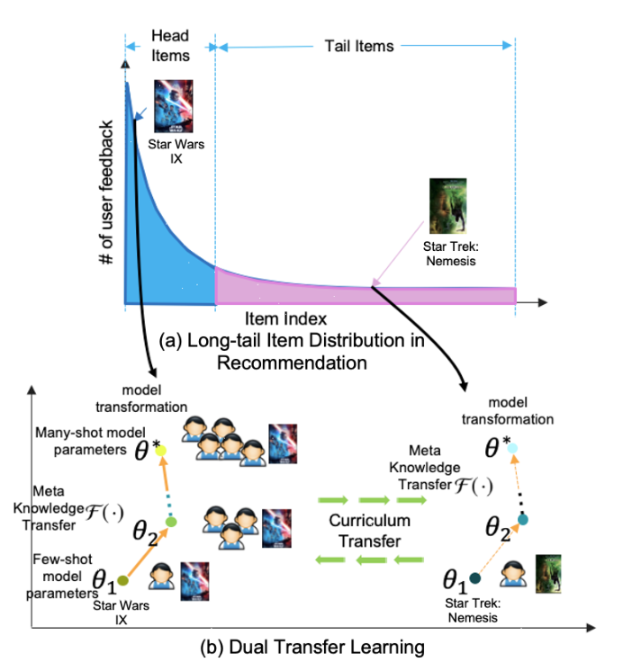
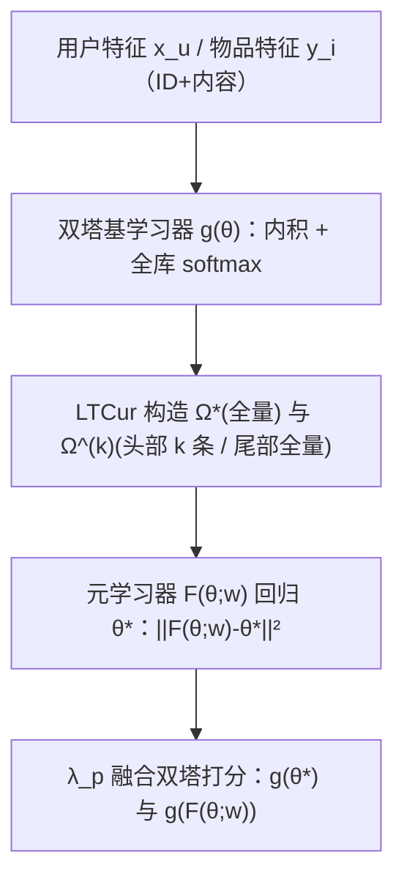

# A Model of Two Tales: Dual Transfer Learning Framework for Improved Long-tail Item Recommendation (双迁移学习框架：面向长尾物品推荐)

- **会议/期刊**: WWW 2021 (Long Paper)
- **作者与机构**: Yin Zhang (Texas A&M, 实习期间), Derek Zhiyuan Cheng, Tiansheng Yao, Xinyang Yi, Lichan Hong, Ed H. Chi (Google)
- **推荐链路定位**: 召回（双塔内积检索），单模型同时服务头部/尾部
- **研究方向**: 冷启动与长尾推荐 / 协同过滤与双塔召回
- **论文原文**: [https://arxiv.org/abs/2010.15982v2](https://arxiv.org/abs/2010.15982v2)
- **开源代码**: 暂未开源

## TL;DR (1分钟核心速览)

针对长尾物品因反馈稀疏而表征欠拟合、且重采样/重加权方案在提升尾部时普遍损伤头部的问题，本文提出 MIRec 双迁移框架：模型级用元学习器 $F(\theta;w)$学习「少样本参数$\theta$→ 多样本参数$\theta^*$」的通用映射（等价于模型层面的隐式数据增强），物品级用长尾感知课程 LTCur 让头部物品只保留$k$ 条反馈、尾部物品保留全量反馈，从而把头部学到的元映射平滑迁移到尾部。在 MovieLens1M / BookCrossing 的全库 softmax 隐式反馈协议下，尾部 HR@10 提升 14.9%、HR@100 提升 81.3%，且头部与整体指标不掉。

## Background & Motivation (背景与核心矛盾)

- **主流范式**: 双塔内容感知模型 + 长尾对策——重采样（over/under-sampling）、损失重加权（ClassBalance）、logQ 频率校正，以及把尾部当冷启动用内容特征/元学习（MeLu, MAML）增强表征。
- **前人局限**: ① 重采样与重加权直接改变训练分布，尾部涨、头部与整体往往塌，形成「不健康的权衡」；② MAML 式元学习只学一个通用初始化，未利用长尾分布本身的结构，且训练集多只用头部物品，元映射应用到海量尾部类别时严重失配。
- **核心洞察 (Key Insight)**: 尾部缺的不是内容特征，而是「再多一点反馈后参数会怎么变」这一规律；该规律可从头部物品的少样本/多样本模型对中学出，但直接套用到尾部会被头尾特征差异破坏。
- **本文切入点**: 把「模型级元映射」与「物品级课程」耦合，前者提供隐式数据增强，后者保证该增强在头尾间语义连续。

<figure class="paper-figure" markdown="span">
  <figcaption>图1：(a) 物品高度偏斜的长尾分布示例。(b) 双重迁移学习框架：其一是元级知识迁移，学习从少样本模型（基于少量用户反馈训练的推荐器）到多样本模型（基于丰富用户反馈训练的推荐器）的模型参数变化，如从𝜃1到𝜃∗的橙色箭头所示；其二是课程迁移，如绿色箭头所示，学习头部与尾部物品之间的特征联系，例如电影“Star Wars IX”与电影“Star Trek: Nemesis”之间的语义关系。</figcaption>
</figure>

## Method (核心方法设计)

### 1. 整体框架 (Overall Architecture)

输入用户特征 $\mathbf{x}_u$与物品特征$\mathbf{y}_i$（ID + 内容），基学习器$g$为双塔 MLP，内积打分后接全库 softmax。训练分三段：先在$\Omega^*$上独立优化出多样本参数$\theta^*$作为回归目标；再在$\Omega^{(k)}$上以元学习器$F$把少样本参数$\theta$映射向$\theta^*$，内层做局部梯度更新、外层联合更新$w$与$\theta$；推理时按权重$\lambda_p$ 融合多样本塔与元映射塔的表征打分。两个训练集本身由 LTCur 课程构造，从而让元映射在头尾间平滑可用。

### 2. 关键设计拆解 (Key Designs)

1. **元级知识迁移（Meta-level Transfer）**：痛点是用头部对训练的映射直接作用于尾部会失真，且全参数映射计算不稳。做法是把 $F$ 限制在用户塔/物品塔**最后一层参数**上（单个全连接层），目标为
$$\mathcal{L}(w,\theta|\Omega^*,\Omega^{(k)})=\|\mathcal{F}(\theta;w)-\theta^*\|^2+\lambda L_g(\theta|\Omega^{(k)})$$
第一项迫使映射预测「更多数据后的参数」，第二项保证映射起点仍是好推荐器。直觉：该映射学到了参数随数据量增长的演化方向，等于在不改数据分布的前提下做了模型层隐式增广，对只有几条反馈的尾部物品等价于「补了相似用户」。

2. **长尾感知课程 LTCur（Item-level Transfer）**：痛点是原始构造只用头部物品（$\Omega^{(k)}$从$I_h(k)$采样），头尾元映射被强行等同。LTCur 改为：$\Omega^*$含头尾**全部**反馈（并加 logQ 校正$s_c = s + \lambda_c\log p_i$）；$\Omega^{(k)}$中头部物品各留$k$ 条、尾部物品**全留**。这样尾部在两阶段都被充分训练，且尾部内部相对分布不变，课程由「头重尾轻」平滑过渡到真实分布，头尾特征通过共享的物品塔参数建立联系。

3. **训练目标、负采样与推理效率**：损失为奖励加权 softmax 交叉熵 $L_g(\theta|\Omega)=-\frac{1}{|\Omega|}\sum_{(u,i,r)} r(u,i)\log p(y_i|\mathbf{x}_u;\theta)$；隐式反馈下所有未交互对即负样本，全库 softmax 训练时用 logQ 频率校正近似，**无需显式负采样**。推理仅两次塔前向 + 内积：$s_{MIRec}=\lambda_p g(\mathbf{x}_u,\mathbf{y}_i;\theta^*)+(1-\lambda_p)g(\mathbf{x}_u,\mathbf{y}_i;\mathcal{F}(\theta;w))$，开销为主干双塔的常数倍。

## Experimental Setup & Evaluation Protocol (实验设置与评估协议)

- **数据集与预处理**: 含显式评分的 `<user,item>` 对均视为正例，其余为负例；缺失特征对过滤；除 age/year 为连续特征外全部 one-hot，标题用 BoW。

| 数据集 | #Users | #Items | #Interactions | 稀疏度 | 特征/场景说明 |
| :--- | :---: | :---: | :---: | :---: | :--- |
| MovieLens1M | 6,040 | 3,706 | 1,000,209 | 95.53% | 用户性别/职业/邮编/年龄；物品标题/类型/年份 |
| BookCrossing | 50,454 | 222,154 | 1,031,175 | 99.9908% | 用户地点/年龄；物品标题/作者/年份/出版社 |

- **数据划分与防穿越**: MovieLens1M 用 `Leave-One-Out`（每用户最近一条测试、次近一条验证）；BookCrossing 无时间戳，改为每用户随机抽 1 条测试、1 条验证。
- **排名评测协议**: 隐式反馈 `Full-Catalog Ranking`——softmax 分母覆盖全物品集，评测对全部未交互物品排序，报告 HR@K / NDCG@K（ML1M 取 K=10，BookCrossing 取 K=100）；并按分片报告 Head/Tail：ML1M 前 20% 高频物品为头部，BookCrossing 取前 0.1%。
- **对比基线与超参设置**: 统一双塔主干（同层数/同隐层，高层神经元为下层一半，ReLU），$d=64$，batch=1024，Adam；课程类方法每阶段 100 epoch、非课程类 200 epoch；基线含 Over/Under-sampling、ClassBalance、LogQ、Head2Tail、Tail2Head、MeLu。

## Key Experimental Results (实验关键数据)

### 1. 主实验对比 (Main Results)

MovieLens1M（HR@10 / NDCG@10，百分数）：

| 方法 | Overall HR | Overall NDCG | Head HR | Head NDCG | Tail HR | Tail NDCG |
| :--- | :---: | :---: | :---: | :---: | :---: | :---: |
| Two-tower (主干) | 6.74 | 3.26 | 8.98 | 4.33 | 3.22 | 1.59 |
| Over-sampling | 0.23 | 0.10 | 0.14 | 0.04 | 0.37 | 0.19 |
| Under-sampling | 0.72 | 0.33 | 0.41 | 0.20 | 1.19 | 0.53 |
| ClassBalance | 6.32 | 2.98 | 9.10 | 4.43 | 1.45 | 0.71 |
| LogQ | 2.24 | 0.95 | 1.41 | 0.54 | 3.53 | 1.59 |
| Tail2Head | 1.71 | 0.85 | 2.74 | 1.34 | 0.09 | 0.07 |
| MeLu | 5.96 | 2.88 | 8.98 | 4.35 | 1.23 | 0.58 |
| **MIRec** | **7.02** | **3.36** | **9.13** | **4.36** | **3.70** | **1.81** |
| Improv. vs 主干 | +4.2% | +3.1% | +1.7% | +0.7% | +14.9% | +13.8% |

BookCrossing（HR@100 / NDCG@100）：

| 方法 | Overall | Head | Tail |
| :--- | :---: | :---: | :---: |
| Two-tower | 4.98 / 1.56 | 54.67 / 17.58 | 0.32 / 0.05 |
| ClassBalance | 4.58 / 1.06 | 49.62 / 11.77 | 0.45 / 0.08 |
| LogQ | 2.06 / 0.49 | 15.52 / 4.11 | 0.82 / 0.15 |
| MeLu | 3.33 / 0.75 | 30.28 / 7.22 | 0.86 / 0.16 |
| **MIRec** | **5.25 / 1.60** | **55.28** / 17.29 | **0.58 / 0.14** |
| Improv. vs 主干 | +5.4% / +2.6% | +1.1% / −1.6% | +81.3% / +180% |

### 2. 消融实验 (Ablation Study)

MovieLens1M（HR@10 / NDCG@10）：

| 变体 | Overall | Head | Tail |
| :--- | :---: | :---: | :---: |
| Two-tower (Default) | 6.74 / 3.26 | 8.98 / 4.33 | 3.22 / 1.59 |
| **MIRec (完整)** | **7.02 / 3.36** | **9.13 / 4.36** | **3.70 / 1.81** |
| w/o 课程，仅元学习 ($MIRec_M$) | 6.48 / 3.13 | 8.75 / 4.17 | 2.88 / 1.43 |
| w/o 元学习，仅课程 ($MIRec_C$) | 6.83 / 3.30 | 8.77 / 4.21 | 3.78 / 1.87 |
| w/o logQ 校正 | 6.98 / 3.36 | 9.75 / 4.71 | 2.62 / 1.26 |
| 双塔集成 Two-tower×2 | 6.90 / 3.22 | 9.46 / 4.37 | 2.89 / 1.41 |

### 3. 关键实验发现 (Key Findings)

1. **尾部增益来自「迁移」而非「重分布」**：Over/Under-sampling 把整体 HR@10 从 6.74 打崩到 0.23/0.72，单靠 LogQ 虽把尾部拉到 3.53 却把整体压到 2.24；MIRec 同时拿到尾部 3.70 与整体 7.02，说明「不改数据分布、只迁参数演化」是长尾的正确打开方式。
2. **两个组件互补、缺一不可**：仅元映射 ($MIRec_M$) 的尾部 HR 只有 2.88（甚至低于主干 3.22），印证头部专属元映射直接套尾部会失配；仅课程 ($MIRec_C$) 尾部 HR 达 3.78 略高于完整模型，但头部 8.77、整体 6.83 明显下滑，二者结合才实现「头尾双升」。
3. **logQ 与融合策略各司其职**：去掉 logQ 后头部 HR 反升至 9.75、尾部跌至 2.62——频率校正是尾部收益的主要来源之一；而参数量相近的双塔集成 (Two-tower×2) 尾部仅 2.89，说明收益不是容量堆叠而是迁移机制带来的。此外 t-SNE 显示 MIRec 的尾部物品嵌入按电影类型聚得更紧，语义结构更好。

## Highlights & Limitations (亮点、对比与审稿批判)

- **与代表作对比 (vs. Prior Work)**: 相比 LogQ/ClassBalance 等损失侧方法，本文不动数据分布而是动参数空间；相比 MeLu 等 MAML 式冷启动元学习，本文不学「通用初始化」而学「参数演化方向」，并用 LTCur 解决头尾类别分布差异；相比 Wang et al. 的图像长尾元映射，本文处理的是数十万类别、极端稀疏的推荐场景，需额外的课程与频率校正。
- **可迁移亮点**: ① 「$||F(\theta;w)-\theta^*||^2$ + 任务损失」的双项目标可作为任何双塔召回器的插件式增广模块，只映射最后一层即可控制成本；② LTCur「头部降采样、尾部全保留」的课程构造，可平移至序列推荐的长尾 next-item 与冷启动物品微调。
- **审稿级局限批判**: ① 每步需两次前向/内外层更新，且推理要跑两套塔，线上延迟与显存开销未给出定量分析；② 评估止于两个中小规模公开集，且 BookCrossing 头部 NDCG@100 实际下降 1.6%，「头尾双升」并非无条件成立；③ $\lambda_p$、$\lambda_c$、$k$均靠网格搜索，尾部指标对$k$ 敏感度未做系统分析。

## Rating (四维评分)

- **方法创新性 (Novelty)**: ⭐⭐⭐⭐ （把「参数演化元映射」与「长尾课程」耦合是清晰的增量，但单看每一支都能在图像长尾/课程学习中找到前身）
- **评估协议与实验扎实度 (Protocol & Experiments)**: ⭐⭐⭐⭐ （全库排序 + 头/尾分片 + 「Good/Better/Great」判定标准很规范，消融与课程损失曲线完整；缺显著性检验与线上 A/B）
- **写作与数学规范度 (Clarity & Rigor)**: ⭐⭐⭐⭐ （式 (5)(6)(8)(9) 定义清楚，训练伪代码完整；但公式排版与 $\lambda$复用（$\lambda$与$\lambda_c$、$\lambda_p$）易混淆）
- **工业落地与复现价值 (Industrial & Practical Value)**: ⭐⭐⭐⭐ （主干即标准双塔、仅映射最后一层、TFRS 实现，工程改造门槛低；但两塔推理与内外层训练开销需额外优化）

