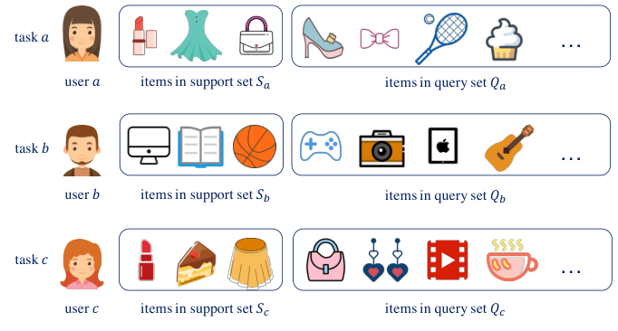
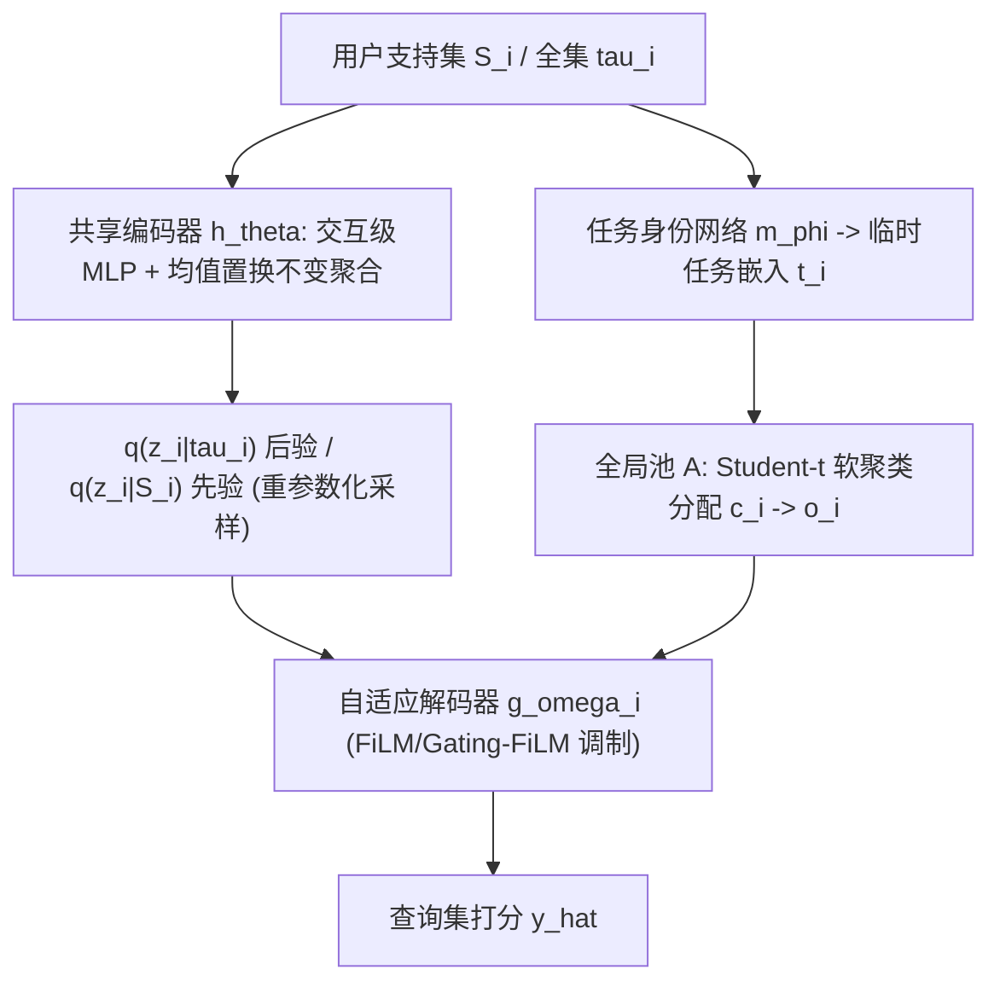
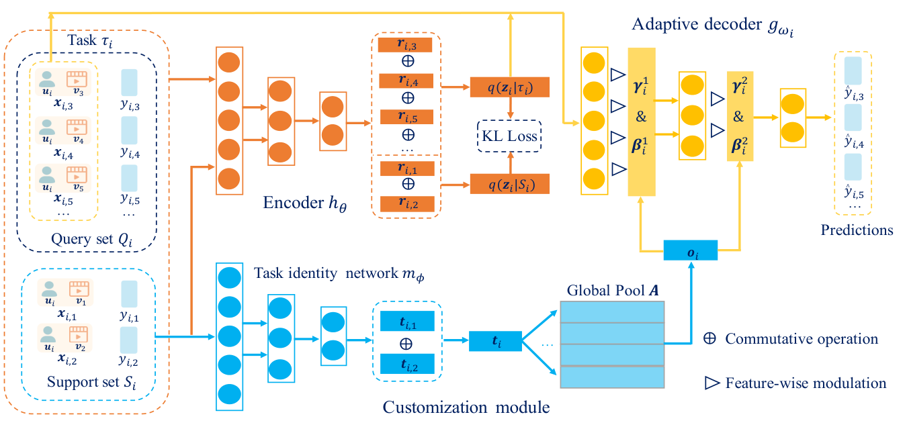

# Task-adaptive Neural Process for User Cold-Start Recommendation (面向用户冷启动推荐的任务自适应神经过程)

- **会议/期刊**: WWW 2021 (The Web Conference)
- **作者与机构**: Xixun Lin, Chuan Zhou, Yanan Cao（中科院信工所/国科大）、Jia Wu（Macquarie University）、Shirui Pan（Monash University）、Bin Wang（小米 AI Lab）
- **推荐链路定位**: 召回（冷启动用户兴趣打分）
- **研究方向**: 冷启动与长尾推荐 / 跨任务知识迁移
- **论文原文**: [https://arxiv.org/abs/2103.06137v1](https://arxiv.org/abs/2103.06137v1)
- **开源代码**: [https://github.com/IIEdm/TaNP](https://github.com/IIEdm/TaNP)

## TL;DR (1分钟核心速览)

针对用户冷启动中"少量交互不足以刻画偏好、且 MAML 类方法强行假设所有用户任务共享一个最优参数初始化"的痛点，本文提出 TaNP：把每个用户的推荐建模为一个随机过程实例，用神经过程（NP）的分摊变分推断直接把支持集映射为预测分布，彻底绕开内循环梯度更新；再用"任务身份网络 + 全局簇池"学习任务间相关性，以 FiLM/Gating-FiLM 调制解码器参数。在 MovieLens-1M、Last.FM、Gowalla 的用户级冷启动划分（$N_{S_i}=20$）下，P@5 分别相对提升 4.2%、3.6%，Gowalla MAP@5 提升 5.4%。

## Background & Motivation (背景与核心矛盾)

- **主流范式**: 冷启动推荐近年的主流是"每用户即一任务"的元学习，代表作为 MAML 系（MeLU、MetaCS、MetaHIN、MAMO），目标是学一个共享参数初始化，测试时在支持集上做几步梯度更新。
- **前人局限（矛盾一）**: MAML 系隐含假设"不同用户任务高度相关"，但真实场景中用户购买意图差异极大（如图 1 中任务 $a,c$相近而$b$ 迥异），此时"一个对所有用户都最优的初始化"根本不存在，且内循环易陷局部最优、对超参敏感。
- **前人局限（矛盾二）**: 另一类基于内容的元学习（MetaHIN 依赖 HIN 元路径、MAMO 依赖用户画像记忆矩阵）与辅助信息强绑定，换到无内容特征的隐式反馈数据集上即失效。
- **核心洞察 (Key Insight)**: 与其"用梯度去适配"，不如把推荐看成函数分布上的回归——支持集是上下文观测（context），查询集是目标函数值，NP 的条件先验天然就是"少样本函数估计器"，且推断是**一次前向**而非多步求导。

<figure class="paper-figure" markdown="span">
  <figcaption>图 1：不同任务相关性的示意图。用户 𝑎、𝑏 和 𝑐 的购买意图由相应用户-物品交互体现。它表明任务 𝑎、𝑐 紧密相关，而任务 𝑏 与它们差异较大。每个任务拥有用户特定的支持集和查询集，这将在定义 3.1 中说明。</figcaption>
</figure>

- **本文切入点**: 用 NP 替换 MAML 骨架解决训练稳定性，再引入任务自适应机制显式刻画任务相关性，把"全局知识"按任务相似度定制到解码器参数上，以平衡模型容量与适配可靠性。

## Method (核心方法设计)

### 1. 整体框架 (Overall Architecture)

TaNP 由三部分组成：共享编码器 $h_\theta$、定制模块（任务身份网络$m_\phi$+ 全局池$\boldsymbol{A}$）、自适应解码器$g_{\omega_i}$。训练时，同一任务的全体交互$\tau_i$与支持集$S_i$（$S_i$拼接序列扰动以注入随机性）分别编码出变分后验$q(z_i\mid\tau_i)$与先验$q(z_i\mid S_i)$；$S_i$同时经$m_\phi$得到临时任务嵌入$t_i$，与可学习簇池$\boldsymbol{A}$计算软分配$\boldsymbol{c}_i$，融合出最终任务嵌入$o_i$，用于逐层生成 FiLM/Gating-FiLM 的仿射参数。采样$z_i$与交互对$x_{i,j}$拼接后送入被调制的解码器预测$\hat{y}_{i,j}$。总损失端到端优化。测试阶段无梯度步：只能用$S_i$采样$z_i$、只用$S_i$生成$o_i$，单次前向即出分。

<figure class="paper-figure" markdown="span">
  <figcaption>图 2：训练阶段 TaNP 的框架。TaNP 包括编码器 ℎ𝜃、定制模块（任务身份网络 𝑚𝜙 和全局池 𝑨）以及自适应解码器 𝑔𝜔𝑖。𝑆𝑖 和 𝜏𝑖 均由 ℎ𝜃 编码，分别生成变分先验和后验。从定制模块学习到的最终任务嵌入 𝒐𝑖 用于调制 𝑔𝜔𝑖 的模型参数。从 𝑞(𝒛𝑖|𝜏𝑖) 采样的 𝒛𝑖 与 𝒙𝑖,𝑗 拼接，通过 𝑔𝜔𝑖 预测 ^𝑦𝑖,𝑗。</figcaption>
</figure>

### 2. 关键设计拆解 (Key Designs)

**创新一：NP 化的冷启动目标——把"梯度适配"换成"变分推断"**。痛点：MAML 内循环二阶梯度训练不稳。改写为条件 ELBO：$\log p(y_{Q}\mid x_{Q},S_i)\ge \mathbb{E}_{q(z_i\mid\tau_i)}\big[\sum_{j=1}^{N_{Q_i}}\log p(y_{i,j}\mid x_{i,j},z_i)+\log\frac{q(z_i\mid S_i)}{q(z_i\mid \tau_i)}\big]$。其中随机潜变量$z_i$的一个采样即一次"函数实现"，$q(z_i\mid S_i)$ 充当可解的先验正则，编码器用均值聚合保证置换不变性（对应随机过程的可交换性）。直觉：用摊销推断一次性学出"从少量交互到预测分布"的映射，比迭代求导更稳、也更快。

**创新二：任务自适应机制（软聚类 + 参数调制）**。痛点：共享解码器无法按任务复杂度伸缩（难任务欠拟合、易任务过拟合）。先用 $t_i$与全局池$\boldsymbol{A}=[a_1,\dots,a_k]$做 Student-t 核相似度：$c_{i,j}=\frac{(1+\|t_i-a_j\|^2/\alpha)^{-\frac{\alpha+1}{2}}}{\sum_{j'}(1+\|t_i-a_{j'}\|^2/\alpha)^{-\frac{\alpha+1}{2}}}$，再融合$o_i=\sigma\big(W_o(t_i+\boldsymbol{A}c_i^{\top})\big)$；全部任务的分配矩阵$C$由一个自训练聚类损失$\mathcal{L}_u=\mathrm{KL}(D\|C)$约束（$D$为锐化目标分布）。直觉：$\boldsymbol{A}$的每一列相当于一种"意图原型"，$c_i$ 刻画任务相似/差异，从而把全局知识可靠地路由到任务侧。

**创新三：调制策略 FiLM / Gating-FiLM**。逐层仿射：$\gamma^l_i=\tanh(W^l_\gamma o_i)$、$\beta^l_i=\tanh(W^l_\beta o_i)$，$g^{l+1}_{i,j}=\mathrm{ReLU}\big(\gamma^l_i\odot(W^l_\omega g^l_{i,j}+b^l_\omega)+\beta^l_i\big)$。因纯 FiLM 无法过滤"反向信息"，作者加门控：$\delta^l_i=\sigma(W^l_\delta o_i)$，$\eta^l_i=\tanh(W^l_\eta o_i)$，$\gamma^l_i\leftarrow\gamma^l_i\odot\delta^l_i+\eta^l_i\odot(1-\delta^l_i)$（$\beta$ 同理）。参数量仅每层 2/4 个矩阵，代价极低。

**训练目标、负采样与推理**：$\mathcal{L}=\frac{1}{|\mathcal{T}^{tr}|}\sum_i(\mathcal{L}_{r,i}+\mathcal{L}_{c,i})+\lambda\mathcal{L}_u$，其中$\mathcal{L}_{c,i}=\mathrm{KL}(q(z_i\mid\tau_i)\|q(z_i\mid S_i))$；$\mathcal{L}_{r,i}$对显式反馈用 MSE、隐式反馈用 BCE（隐式数据集按 [48] 预处理为查询集生成负例，模型内部无额外负采样）。时间开销约$O(ld^3)$（编码器/解码器）+$O(kd^2)$（簇分配），支持 batch 并行；测试无需梯度步，线上每用户仅一次前向。

## Experimental Setup & Evaluation Protocol (实验设置与评估协议)

- **数据集与预处理**: 仅保留交互历史长度在 $[40,200]$ 的用户；隐式数据集（Last.FM、Gowalla）转为隐式反馈并为查询集构造负例。

| 数据集 | #Users | #Items | #Interactions | 稀疏度/密度 | 特征/场景说明 |
| :--- | :---: | :---: | :---: | :---: | :--- |
| MovieLens-1M | 6,040 | 3,706 | 1,000,209 | 4.47% | 显式评分 1–5，含用户/物品内容（性别、年龄、职业、年份、类型等） |
| Last.FM | 1,872 | 3,846 | 42,346 | 0.59% | 隐式听歌行为，无内容特征 |
| Gowalla | 2,692 | 27,237 | 134,476 | 0.18% | LBS 签到隐式反馈，无内容特征 |

- **数据划分与防穿越**: 用户级**冷启动划分**——用户集合互斥切分为训练/验证/测试用户（比例 7:1:2），测试用户即"冷启动用户"；每个任务内部再切支持集 $S_i$（$N_{S_i}=20$，敏感性实验取 15/10）与查询集$Q_i$，支持集与查询集不重叠。
- **排名评测协议**: **Query-Set Ranking（采样排序）**——沿用 MetaHIN/MAMO 等前作设定，仅对查询集内物品打分排序，未做全库 Full-Ranking，故指标绝对值偏高、跨论文比较需谨慎。指标为 P@N / NDCG@N / MAP@N（N=5,7,10），对测试用户取平均。
- **对比基线与超参**: 覆盖 CF/内容类（PPR、NeuMF、DropoutNet）与元学习类（MetaLWA、MetaNLBA、MeLU、MetaCS、MetaHIN、MAMO）。嵌入维度 $d=32$，三个子网络堆叠层数$l=3$，学习率 5e-5，$\alpha=1.0$，$\lambda$从$\{1,0.5,0.1,0.05,0.01\}$选、$k\in\{10,20,30,40,50\}$，Adam 训练 150 epoch。原文未报告显著性检验（$p$ 值）。

## Key Experimental Results (实验关键数据)

### 1. 主实验对比 (Main Results)

$N_{S_i}=20$，指标单位 %（P@5 / NDCG@5 / MAP@5）：

| Model | ML-1M P@5 | ML-1M NDCG@5 | ML-1M MAP@5 | Last.FM P@5 | Last.FM NDCG@5 | Last.FM MAP@5 | Gowalla P@5 | Gowalla NDCG@5 | Gowalla MAP@5 |
| :--- | :---: | :---: | :---: | :---: | :---: | :---: | :---: | :---: | :---: |
| PPR | 49.36 | 66.62 | 37.86 | 68.61 | 67.23 | 61.72 | 60.48 | 62.92 | 53.09 |
| NeuMF | 48.27 | 65.43 | 36.65 | 67.39 | 65.23 | 59.72 | 55.98 | 57.99 | 51.02 |
| DropoutNet | 51.77 | 69.34 | 41.82 | 70.08 | 68.37 | 62.68 | 62.06 | 65.79 | 55.46 |
| MetaNLBA | – | – | – | 71.52 | 72.47 | 64.71 | 67.60 | 67.93 | 59.56 |
| MeLU | 55.99 | 73.08 | 46.79 | 73.03 | 75.38 | 67.71 | 67.85 | 69.40 | 60.97 |
| MetaCS | 55.43 | 71.69 | 44.85 | 73.33 | 75.34 | 68.76 | 66.14 | 67.39 | 58.69 |
| MetaHIN | 57.65 | 73.43 | 47.40 | – | – | – | – | – | – |
| MAMO | 57.69 | 73.24 | 47.72 | 73.64 | 75.48 | 67.22 | 67.97 | 69.52 | 61.07 |
| TaNP (w/o task-adaptive) | 58.03 | 73.76 | 47.79 | 75.45 | 75.21 | 69.06 | 68.25 | 69.76 | 61.29 |
| TaNP (FiLM) | 59.76 | 74.97 | 49.08 | 76.06 | 76.31 | **70.73** | 70.94 | 71.14 | **64.35** |
| **TaNP (Gating-FiLM)** | **60.12** | **75.00** | **49.12** | **76.36** | **77.18** | 70.12 | **71.43** | **71.60** | 64.29 |
| **Improv.% (vs 最强基线)** | **+4.2%** | **+3.6%** | **+2.9%** | **+3.6%** | **+3.2%** | **+2.9%** | **+5.1%** | **+3.0%** | **+5.4%** |

### 2. 消融实验 (Ablation Study)

| 变体 | ML-1M P@5 | ML-1M MAP@5 | Last.FM P@5 | Last.FM MAP@5 | Gowalla P@5 | Gowalla MAP@5 |
| :--- | :---: | :---: | :---: | :---: | :---: | :---: |
| w/o task-adaptive（纯 NP） | 58.03 | 47.79 | 75.45 | 69.06 | 68.25 | 61.29 |
| + FiLM 调制 | 59.76 | 49.08 | 76.06 | 70.73 | 70.94 | 64.35 |
| + Gating-FiLM 调制 | 60.12 | 49.12 | 76.36 | 70.12 | 71.43 | 64.29 |
| 相对增益（w/o → Gating） | +3.6% | +2.8% | +1.2% | +1.5% | +4.7% | +4.9% |

### 3. 关键实验发现 (Key Findings)

1. **NP 骨架本身就是主要收益来源**：去掉任务自适应机制后（纯 NP），已在三个数据集上全面超过所有 MAML 系 SOTA（ML-1M P@5 58.03 vs MAMO 57.69；Last.FM 75.45 vs MeLU 73.03；Gowalla MAP@5 61.29 vs 61.07）。说明 MAML 的"共享初始化 + 少步梯度"瓶颈主要来自内循环优化本身，而非模型容量。
2. **解码器定制是第二级增益，且增益随任务异质性变大**：Gowalla（用户签到意图最分散）上 $N_{S_i}=20$ → w/o 到 Gating 的 P@5 相对提升 4.7%、MAP@5 提升 4.9%，明显高于 Last.FM 的 1.2%/1.5%，与"任务越不相关、全局共享解码器越吃亏"的动机一致。
3. **Gating-FiLM 与 FiLM 差异微小且方向不一致**：Last.FM 上 MAP@5 反而 FiLM 更优（70.73 vs 70.12），三数据集 P@5 差距均 <0.5 pt，说明增益主要来自"任务嵌入调制"这一机制本身，门控只起到轻微稳定作用；同时 $N_{S_i}$从 20 降到 10/15 时 TaNP 仍保持领先，衰退幅度小于 MetaCS/MetaNLBA，作者归因于随机函数实现带来的鲁棒性。任务分配可视化（图 4）进一步显示$\tau_5,\tau_7$ 共享同簇且对应用户同性别、支持集重合两部电影，验证了软聚类确实捕捉语义相关性。

## Highlights & Limitations (亮点、对比与审稿批判)

- **与代表作对比 (vs. Prior Work)**: 与 MeLU/MetaCS 的本质区别是不再做"内循环梯度适配"，而是摊销变分推断一步出分布，训练更稳、推理更快；与 MetaHIN/MAMO 的区别是不依赖 HIN 元路径或用户画像记忆，仅靠交互即插即用，因此在无内容特征的 Last.FM/Gowalla 上仍可用；与普通 NP（w/o tm）的区别是解码器由全局共享变为任务调制，补齐了容量-可靠性权衡。
- **可迁移亮点**: （1）"全局原型池 + Student-t 软分配 + 自训练 KL" 作为轻量任务相似度模块，可即插到任何元学习/多场景推荐框架中；（2）用均值聚合保证置换不变、用 $S_i$ 拼序列扰动塑造随机实现，是把 NP 迁移到离散交互数据的关键工程技巧。
- **审稿级局限批判**: （1）评估仅做 **Query-Set Ranking**，候选集规模由各用户查询集决定，未报告 Full-Ranking，指标偏高且不同划分下可比性受限；"冷启动"是通过截断支持集至 10–20 模拟的，用户历史仍在 40–200 区间，与真实的 0–3 次交互新用户仍有差距。（2）$k$与$\lambda$需在验证集上网格搜索（最优$k=10/20$、$\lambda=0.1$），且任务嵌入需要在全部训练任务上维护簇池，用户意图漂移时簇分配需重训，工业增量更新成本未被讨论。

## Rating (四维评分)

- **方法创新性 (Novelty)**: ⭐⭐⭐⭐ （首次把神经过程引入用户冷启动，用"软聚类原型池调制解码器"替代梯度初始化，思路干净且有任务相关性视角的支撑）
- **评估协议与实验扎实度 (Protocol & Experiments)**: ⭐⭐⭐ （三数据集 + 用户级冷启动划分 + 完备基线合理，但仅 Query-Set Ranking、无全库排序、无显著性检验，支持集长度敏感性以图示代替统计检验）
- **写作与数学规范度 (Clarity & Rigor)**: ⭐⭐⭐⭐ （ELBO 推导与各模块公式完整、复杂度分析清晰；Gating-FiLM 中 $\beta$的更新式与$\gamma$写成同式，疑为笔误，且未给出 ELBO 中先验$p(z)$ 的具体形式）
- **工业落地与复现价值 (Industrial & Practical Value)**: ⭐⭐⭐⭐ （代码开源、推理无梯度步且每用户仅一次前向，嵌入维度仅 32，适合冷启动在线召回；但簇池维护与超参搜索在小数据集上难以直接判定大规模扩展性）

