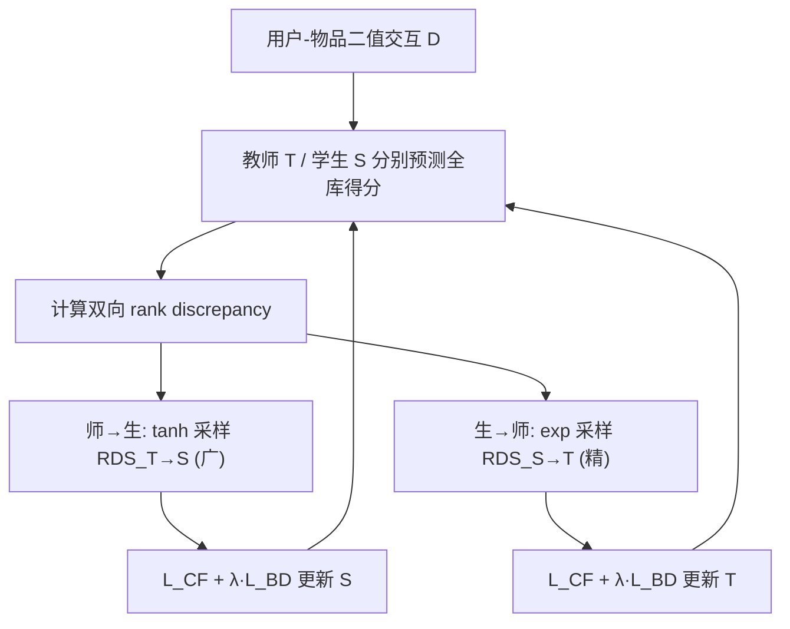
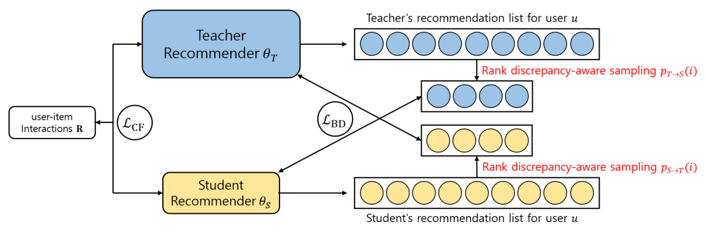

# Bidirectional Distillation for Top-K Recommender System (面向 Top-K 推荐系统的双向蒸馏)

- **会议/期刊**: WWW 2021 (The Web Conference)
- **作者与机构**: Wonbin Kweon, SeongKu Kang, Hwanjo Yu（韩国浦项科技大学 POSTECH）
- **推荐链路定位**: 精排（Top-K 排序打分）/ 模型压缩与加速推理
- **研究方向**: 协同过滤与双塔召回 / 多任务学习与列表级重排
- **论文原文**: [https://arxiv.org/abs/2106.02870v1](https://arxiv.org/abs/2106.02870v1)
- **开源代码**: [https://github.com/WonbinKweon/BD_](https://github.com/WonbinKweon/BD_)

## TL;DR (1分钟核心速览)

现有推荐蒸馏默认“教师恒优于学生”、只让学生模仿教师高分物品。本文实测发现学生在 **36%–42%** 的测试交互上排名反而优于教师（CV 任务仅 4%–9%），且教师 Top 物品大多已被学生排高，信息量不足。BD 让师生**同时互教**：以二元蒸馏损失对未观测物品互相拟合，并用 `tanh`（师→生，广覆盖）与 `exp`（生→师，高置信精选）两套秩差异采样应对容量差。Leave-One-Out + **Full-Ranking** 全库排序下，学生 H@50 超过 CD/RD 达 3.0%–13.9%，教师自身亦提升 3.8%–20.8%。

## Background & Motivation (背景与核心矛盾)

- **主流范式**: RD/CD 等两阶段蒸馏——先训练大教师，再让学生（1/10 参数）模仿教师推荐列表中排名靠前物品的打分分布。
- **前人局限**: ① 单向蒸馏隐含“教师恒优”假设，教师知识一经固定便不再进化；② 仅迁移教师高分物品，但实测这些物品学生大多已排在前列（图 1b 的点密集于左下角），信息冗余。
- **核心洞察 (Key Insight)**: 推荐场景标签极度模糊（未观测 ≠ 负反馈），训练损失更低不代表排序更准；部分简单用户-物品关系用低维表征反而刻画更好，因此小模型构成**互补知识源**而非纯粹劣化版本。
- **本文切入点**: 把蒸馏从单向后处理改造为**双模型联合训练的互学习正则**，并用排序位次差（rank discrepancy）而非绝对分数来定义“值得迁移的知识”。

## Method (核心方法设计)

### 1. 整体框架 (Overall Architecture)

师生两模型（同架构、不同 embedding 维度/参数量）先各自用 CF 损失 warm-up；随后每个 epoch 内交替更新：对每个观测交互 $(u,i)$，按当前双向推荐列表计算秩差异，分别为教师采样$RDS_{S\to T}$、为学生采样$RDS_{T\to S}$，各自在 CF 损失之外再加一条指向对方预测的二元蒸馏损失；由于全库重排代价高，推荐列表每$p=10$ 个 epoch 才刷新一次。网络知识随双方提升而同步进化：教师变强加速学生收敛，学生变强又反过来修正教师，形成正反馈闭环。

<figure class="paper-figure" markdown="span">
  <figcaption>图2：面向top-𝐾推荐系统的双向蒸馏（BD）示意图。</figcaption>
</figure>

### 2. 关键设计拆解 (Key Designs)

1. **双向二元蒸馏损失 (Bidirectional Distillation Loss)**：把图像 KD 的分类分布匹配改写为隐反馈下的**伯努利分布匹配**——让一方去拟合另一方对未观测物品的“潜在正/负偏好”概率，从而为模糊标签补入额外监督。核心式（$T$ 为学生温度）：
$\mathcal{L}_{BD}(\theta_T;\theta_S)=\sum_{j\in RDS_{S\to T}(\mathcal{I}_u^-)}\mathrm{BCE}\big(\hat{r}^T_{uj},\,\hat{r}^S_{uj}\big),\ \hat{r}_{uj}=\sigma(z_{uj}/T)$，
学生侧对称；总目标 $\mathcal{L}_T=\mathcal{L}_{CF}(\theta_T)+\lambda_{S\to T}\mathcal{L}_{BD}(\theta_T;\theta_S)$，$\mathcal{L}_S$ 同理。直觉：把“0”从硬负例软化为对方模型给出的置信度，缓解假阴性噪声。

2. **秩差异感知采样 (Rank Discrepancy-aware Sampling)**：痛点是不论 CD 的 rank-aware 还是 RD 的 Top-$N$ 都只取单侧高分物品；改为聚焦“对方排得高、自己排得低”的物品。且容量差要求两个方向**函数形状不同**：
$p_{T\to S}(i)\propto \tanh\!\big(\max((rank_S(i)-rank_T(i))\cdot\epsilon_t,0)\big)$，
$p_{S\to T}(i)\propto \exp\!\big((rank_T(i)-rank_S(i))\cdot\epsilon_e\big)$。
`tanh` 饱和特性使大秩差物品近均匀采样，学生可广泛吸收教师知识；`exp` 尖锐，只让教师追随学生**极少数高置信**判断，避免被弱模型带偏。

3. **训练目标、负采样与推理效率**：$\mathcal{L}_{CF}$沿用基模型原有目标（NeuMF/CDAE 逐点 BCE + 每正例 1 或$5|\mathcal{I}_u^+|$负例；BPR 成对损失），$\lambda_{T\to S}=\lambda_{S\to T}=0.5$，$\epsilon_t,\epsilon_e\approx10^{-4}$，蒸馏温度$T\in\{2,5,10\}$；采样得到的未观测物品同时复用于 CF 损失，无额外负采样开销。推理阶段学生仅需教师的 1/10 参数（如 NeuMF 3.05M→0.30M），全库排序墙钟时间 17.39s→14.12s（CiteULike）。

## Experimental Setup & Evaluation Protocol (实验设置与评估协议)

- **数据集与预处理**（过滤阈值：CiteULike/Foursquare 保留 ≥5 次交互用户，Yelp ≥10 次）：

| 数据集 | #Users | #Items | #Interactions | 稀疏度 | 特征/场景说明 |
| :--- | :---: | :---: | :---: | :---: | :--- |
| CiteULike | 5,219 | 25,187 | 130,788 | 99.90% | 学术文献收藏，二值隐反馈 |
| Foursquare | 2,293 | 61,858 | 537,167 | 99.62% | 东京签到 POI |
| Yelp | 25,677 | 25,815 | 730,623 | 99.89% | 商户点评 |

- **数据划分与防穿越**: `Leave-One-Out`——每用户最后一条交互作测试、倒数第二条作验证；无时间戳的数据集随机抽取两条观测交互。
- **排名评测协议**: 无偏 `Full-Ranking`，测试物品需与**全部**未观测物品 $|\mathcal{I}_u^-|$ 竞争（不采用 99 负例采样），指标 H@50/100、N@50/100，五次独立运行取均值。
- **对比基线与超参设置**: 基模型 NeuMF（逐点）/CDAE（逐点）/BPR（成对），共 9 组设置；教师规模扫描至验证集不再提升，学生固定为教师的 1/10 参数（嵌入维度 50 vs 5）；对照基线 RD、CD，以及无蒸馏的 Teacher/Student；Adam + L2，lr ∈ {1e-5,1e-4,1e-3,2e-3}，batch 128，显著性用配对 t 检验（$p\le0.05$与$p\le0.01$）。

## Key Experimental Results (实验关键数据)

### 1. 主实验对比 (Main Results)

NeuMF 骨干（全库排序，★ 为该列最优）：

| 方法 | CiteULike H@50 | CiteULike N@50 | Foursquare H@50 | Foursquare N@50 | Yelp H@50 | Yelp N@50 |
| :--- | :---: | :---: | :---: | :---: | :---: | :---: |
| Teacher (独立训练) | 0.1566 | 0.0385 | 0.1612 | 0.0615 | 0.0782 | 0.0200 |
| **BD-Teacher** | **0.1722**★ | **0.0431**★ | **0.1704**★ | **0.0653**★ | **0.0836**★ | **0.0217**★ |
| Student (独立训练) | 0.0703 | 0.0173 | 0.1264 | 0.0512 | 0.0615 | 0.0153 |
| CD (SOTA) | 0.0820 | 0.0227 | 0.1548 | 0.0592 | 0.0712 | 0.0189 |
| RD | 0.0755 | 0.0197 | 0.1442 | 0.0547 | 0.0662 | 0.0161 |
| **BD-Student** | **0.0924**★ | **0.0242**★ | **0.1657**★ | **0.0637**★ | **0.0779**★ | **0.0203**★ |
| Improv. (教师 / 学生) | +9.96% / +12.68% | +11.95% / +6.84% | +5.73% / +7.05% | +6.21% / +7.53% | +6.91% / +9.41% | +8.50% / +7.41% |

BPR 骨干（H@50，验证架构无关性与成对损失兼容性）：

| 方法 | CiteULike | Foursquare | Yelp |
| :--- | :---: | :---: | :---: |
| Teacher | 0.1224 | 0.1746 | 0.0896 |
| **BD-Teacher** | **0.1479**★ (+20.79%) | **0.1834**★ (+5.04%) | **0.0946**★ (+5.58%) |
| Student | 0.0717 | 0.1252 | 0.0559 |
| CD | 0.0803 | 0.1515 | 0.0660 |
| RD | 0.0782 | 0.1404 | 0.0661 |
| **BD-Student** | **0.0853**★ (+6.16%) | **0.1611**★ (+6.34%) | **0.0733**★ (+10.89%) |

CDAE 骨干上 BD 同样双赢：CiteULike 教师 H@50 由 0.1710 升至 0.1983（+15.96%），学生 0.0724→0.0943（+30.25%）；全部 9 组设置中 BD-Student 均以 $p\le0.05$ 显著优于最优基线。

### 2. 消融实验 (Ablation Study)

采样方案消融（H@50，CiteULike，T/S 分别指教师与学生）：

| 采样方案 | NeuMF-T | NeuMF-S | CDAE-T | CDAE-S | BPR-T | BPR-S |
| :--- | :---: | :---: | :---: | :---: | :---: | :---: |
| **秩差异感知 (本文)** | **0.1722** | **0.0924** | **0.1983** | **0.0943** | **0.1479** | **0.0853** |
| Rank-aware [CD] | 0.1617 | 0.0812 | 0.1818 | 0.0891 | 0.1367 | 0.0805 |
| Top-$N$ selection [RD] | 0.1480 | 0.0766 | 0.1757 | 0.0870 | 0.1264 | 0.0772 |
| Uniform | 0.1590 | 0.0726 | 0.1788 | 0.0819 | 0.1306 | 0.0749 |
| Swapped (`exp`/`tanh` 互换) | 0.1512 | 0.0747 | 0.1733 | 0.0851 | 0.1281 | 0.0803 |

### 3. 关键实验发现 (Key Findings)

1. **教师也被学生拉动，且增益随容量差单调放大**：BPR 骨干下 CiteULike 教师 H@50 提升 20.79%，远超 Foursquare 的 5.04%；模型规模扫描显示最小学生（10%）带来最大的教师增益，即便师生同尺寸仍有提升（自蒸馏式互正则），但“可学习的学生”始终优于“冻结的预训练学生”。
2. **采样方向不可互换，容量差必须显式建模**：把两方向概率函数对调后 NeuMF 教师跌至 0.1512（较本文 0.1722 低 12.2%），甚至不如 Uniform 的 0.1590——说明让学生全量反向灌入教师会引入噪声，`exp` 的高选择性是教师增益的必要条件。
3. **互教实现了排序同步化**：训练后平均秩差异全面下降（NeuMF CiteULike 0.1944→0.1323，Foursquare 0.1020→0.0957，Yelp 0.0918→0.0824），恰好秩差收缩幅度最大的 CiteULike 也是教师增益最大的数据集；同时学生以 1/10 参数（0.30M vs 3.05M）、更低推理延迟达到或超过独立训练的教师（Foursquare H@50 0.1657 vs 0.1612）。

## Highlights & Limitations (亮点、对比与审稿批判)

- **与代表作对比 (vs. Prior Work)**: RD 只用教师 Top-$N$ 列表作硬性正样本，CD 用 rank-aware 采样模仿教师绝对分数，二者均为两阶段单向蒸馏；BD 则在同一训练循环内互教，且以**位次差**而非绝对分数定义迁移目标，与 CV 领域的 DML（同尺寸对等学习，无容量差考量）本质不同。
- **可迁移亮点**: ① 用 `tanh`/`exp` 两种饱和特性相反的采样函数适配“能力不对等”的双向知识流，可直接移植到粗排-精排级联蒸馏、多场景模型间互蒸馏；② 以秩差异而非分数差作采样权重，规避了点估计分数不可比的问题。
- **审稿级局限批判**: ① 教师与学生必须同时驻留显存并交替前向，训练成本约为单模型的 2 倍，论文未给出该侧开销的量化对比；② 每 $p=10$个 epoch 才刷新全库排序，$p$增大时的性能衰减（图 7）与最优$p$ 的自适应选择未深入分析；③ 评估仅覆盖 `Leave-One-Out` + 二值隐反馈，未涉及采样排序、多正例或带时间戳的全局切分协议，泛化性证据有限。

## Rating (四维评分)

- **方法创新性 (Novelty)**: ⭐⭐⭐⭐ （反转“教师恒优”假设并用实证支撑，秩差异采样与方向差异化概率函数设计具体且自洽，属结构性改良而非纯调参）
- **评估协议与实验扎实度 (Protocol & Experiments)**: ⭐⭐⭐⭐⭐ （9 组设置 × 3 数据集 × 3 骨干，全部 Full-Ranking 未采样候选，5 次运行 + 配对 t 检验，另附模型规模、同步性与采样方案三重分析）
- **写作与数学规范度 (Clarity & Rigor)**: ⭐⭐⭐⭐ （损失与采样概率定义清晰、算法伪码完整；但温度符号 $T$与教师记号$T$冲突，$RDS$ 集合大小与采样复杂度未给出解析式）
- **工业落地与复现价值 (Industrial & Practical Value)**: ⭐⭐⭐⭐ （代码开源，压缩比 10× 且推理延迟实测下降；但训练期双模型共存的工程成本与教师规模上限扫描需要额外投入）

