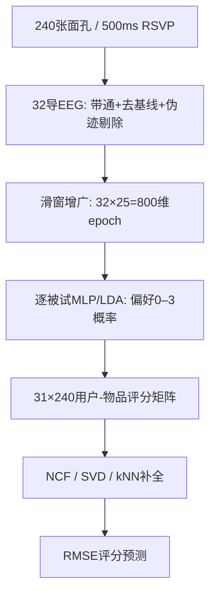
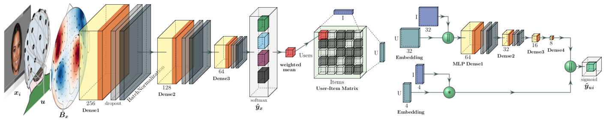

# Collaborative Filtering with Preferences Inferred from Brain Signals（基于脑信号推断偏好的协同过滤）

- **会议/期刊**: WWW 2021
- **作者与机构**: Keith M. Davis III, Michiel Spapé, Tuukka Ruotsalo；University of Helsinki / University of Copenhagen
- **推荐链路定位**: 召回/用户建模（评分预测验证）
- **研究方向**: 协同过滤与双塔召回
- **论文原文**: [论文原文链接](https://curis.ku.dk/ws/files/306898598/Collaborative_filtering.pdf)
- **开源代码**: [PGGAN 面部刺激生成代码](https://github.com/tkarras/progressive_growing_of_gans)；论文方法代码暂未开源

## TL;DR (1分钟核心速览)

针对评分/点击等行为信号只是真实偏好的间接、有偏代理，本文用EEG事件相关电位解码单试次面孔偏好，再以NCF/SVD/kNN完成协同过滤。31人×240张面孔、10%自然缺失下，MLP+NCF取得RMSE 0.29，较LDA+SVD 0.34、LDA+kNN 0.35和随机0.53分别降低14.7%、17.1%和45.3%。

## Background & Motivation (背景与核心矛盾)

- **主流范式**: 协同过滤以显式评分或点击、停留等隐式行为构造用户-物品矩阵，再做MF/NCF等补全。
- **前人局限**: 显式评分可能表达立场而非真实偏好；隐式点击受误点、猎奇与标题党污染，二者均为行为外推。
- **核心洞察 (Key Insight)**: EEG的晚期正电位P3随偏好等级单调增强，单试次即可解码；用户只需观看内容，无需额外交互。
- **本文切入点**: 将脑响应解码为偏好评分，再把该评分矩阵输入协同过滤，补全未见刺激偏好。

## Method (核心方法设计)

### 1. 整体框架 (Overall Architecture)

流程为：31名被试观看240张GAN生成人脸，RSVP每500 ms呈现一张；32导EEG经0.2–35 Hz带通、去基线、伪迹剔除后得到1100 ms epoch。每epoch滑窗重采样为750 ms，并降采样为32×25=800维向量，逐被试训练MLP/LDA输出0–3偏好概率，聚合为用户-物品评分矩阵；NCF/SVD/kNN补全缺失评分。训练端MLP用10 epoch Adam+稀疏交叉熵，NCF改造为RMSE回归损失；推理需逐物品EEG采集与分类，再矩阵补全。整体两阶段框架见图4。

<figure class="paper-figure" markdown="span">
  <figcaption>图 4：神经架构示意图。对于所有架构，机器学习和协同过滤均分两个阶段进行。在第一阶段，为参与者 u 训练一个个体分类器模型，将大脑响应 Bx 与显式偏好评分 yx 关联。然后，给定新刺激 xi 和大脑响应 ˆBx，分类器估计偏好评分 ˆyx。对所有参与者重复该过程，以预测许多没有显式评分的刺激的偏好。在第二阶段，一种协同过滤方法（在……</figcaption>
</figure>

### 2. 关键设计拆解 (Key Designs)

1. **脑响应单试次偏好解码**：行为信号有偏且间接，本文直接把epoch电压向量映射到偏好类别，$p_{ui}(c)=P(y_{ui}=c\mid\mathbf{x}_{ui})$，并以类别概率聚合为连续偏好$\hat r_{ui}=\sum_{c=0}^{3}c\,p_{ui}(c)$。其物理直觉是P3幅值随偏好等级递增，使单试次解码可行。
2. **偏好矩阵的协同过滤补全**：单被试解码噪声大、缺失多，本文将预测评分视作观测，学习 $\hat r_{ui}=f_\theta(\mathbf{p}_u,\mathbf{q}_i)$。跨用户相似性可纠正个体噪声，实验中4名分类器失效被试也被CF拉回显著优于随机。
3. **训练目标与推理开销**：分类器用逐被试Leave-One-Out与交叉熵；CF用 $\mathcal{L}=\frac{1}{|\Omega|}\sum_{(u,i)\in\Omega}(r_{ui}-\hat r_{ui})^2$。评分预测不设负采样；NCF训练10 epoch，推理主要开销在EEG采集，CF补全本身较轻。

## Experimental Setup & Evaluation Protocol (实验设置与评估协议)

- **数据集与预处理**:

| 数据集 | #Users | #Items | #Interactions | 稀疏度/密度 | 特征/场景说明 |
| :--- | :---: | :---: | :---: | :---: | :--- |
| EEG-Face | 31 | 240 | 7,440 可能评分；39,215 有效epoch | 自然缺失10%；另测25/50/75%遮蔽 | 32导EEG；GAN人脸；0–3偏好；约25分钟实验 |

- **数据划分与防穿越 (Splitting Strategy)**: 分类器逐被试`Leave-One-Out`；CF随机遮蔽条目并预测被移除评分，额外测试25/50/75%稀疏；无时间戳，非全局时间切分。
- **排名评测协议 (Ranking Protocol)**: 非`Full-Ranking`、非采样排序；本文是评分预测，指标为RMSE；未报告Top-N指标。
- **对比基线与超参设置**: Random-MLE、MLP、LDA、MLP+NCF、LDA+SVD、LDA+kNN及显式评分上界；MLP为256-128-64、dropout 25%，NCF 10 epoch Adam+RMSE，SVD 10因子，kNN $k=1$–$40$；显著性$p<0.01$或$p<0.001$。

## Key Experimental Results (实验关键数据)

### 1. 主实验对比 (Main Results)

| 方法 | 输入/类型 | RMSE ↓ | 相对随机↓ | 备注 |
| :--- | :--- | :---: | :---: | :--- |
| Random-MLE | 随机分布 | 0.53 | — | 排除数据偏置 |
| MLP | EEG分类 | 0.41 | 22.6% | 27/31被试显著 |
| LDA | EEG分类 | 0.35 | 34.0% | 28/31被试显著，优于MLP |
| LDA+kNN | EEG→kNN | 0.35 | 34.0% | 经典近邻CF |
| LDA+SVD | EEG→MF | 0.34 | 35.8% | 经典矩阵分解 |
| **MLP+NCF** | **EEG→NCF** | **0.29** | **45.3%** | **较LDA+SVD降14.7%，较kNN降17.1%；31/31优于随机** |

注：显式评分上界在原文中整体接近或优于EEG输入，说明脑信号保留了大部分偏好信息；原文未给出统一单值。

### 2. 消融实验 (Ablation Study)

| 控制/消融设置 | RMSE ↓ | 结论 |
| :--- | :---: | :--- |
| MLP only（w/o CF） | 0.41 | CF补全带来0.12绝对下降 |
| MLP+NCF（full） | **0.29** | 脑输入端到端最优 |
| LDA only | 0.35 | 线性解码强于MLP |
| LDA+SVD | 0.34 | MF接近NCF |
| LDA+kNN | 0.35 | kNN无额外增益 |
| 随机预测/标签置换 | 0.53 | 排除虚假相关 |
| 显式评分上界 | 接近/更优 | EEG接近显式评分信息量 |

### 3. 关键实验发现 (Key Findings)

1. **脑信号可单试次解码偏好**：LDA与MLP分别取得0.35/0.41 RMSE，均显著优于随机0.53；LDA在28/31被试显著，MLP在27/31被试显著。
2. **CF能纠正个体解码噪声**：MLP+NCF将MLP单独分类的0.41降至0.29，降幅29.3%；29/31被试较MLP改善，4名分类失败被试经CF后也优于随机。
3. **稀疏性与上界共同验证信号有效性**：所有模型随遮蔽比例升高而退化；EEG输入下各CF方法差异不显著，但显式评分上界显示脑信号仍接近真实评分，说明增益主要来自新信号而非复杂架构。

## Highlights & Limitations (亮点、对比与审稿批判)

- **与代表作对比 (vs. Prior Work)**: 相较行为/评分CF，本文首次把EEG偏好解码纳入CF；相较经典NCF，架构未大改，但输入信号从行为变成脑响应；相较LDA+SVD/kNN，NCF更能利用非线性交互。
- **可迁移亮点**: 750 ms滑窗+25时间窗通道平均可迁移到其他生理信号；分类器输出作为软评分、再用CF纠偏，适合噪声大的隐式用户建模。
- **审稿级局限批判**: 仅31人、240张人脸、单一视觉偏好任务，且以RMSE评分预测为主，缺少Top-N全库排序与线上验证；两阶段误差会级联，EEG采集设备和实验时长也限制真实部署，并伴随显著隐私伦理风险。

## Rating (四维评分)

- **方法创新性 (Novelty)**: ⭐⭐⭐⭐ （首次将EEG/ERP偏好解码接入CF，信号层面新意强，但NCF组件较标准）
- **评估协议与实验扎实度 (Protocol & Experiments)**: ⭐⭐⭐ （有随机与显式上界控制、逐被试显著性检验，但样本小且无Top-N排序协议）
- **写作与数学规范度 (Clarity & Rigor)**: ⭐⭐⭐⭐ （两阶段问题定义清楚，EEG预处理与分类流程完整，公式较简洁）
- **工业落地与复现价值 (Industrial & Practical Value)**: ⭐⭐ （EEG硬件、实验成本与隐私风险高，方法代码未开源，短期工程落地有限）

