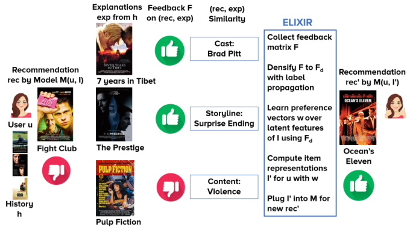
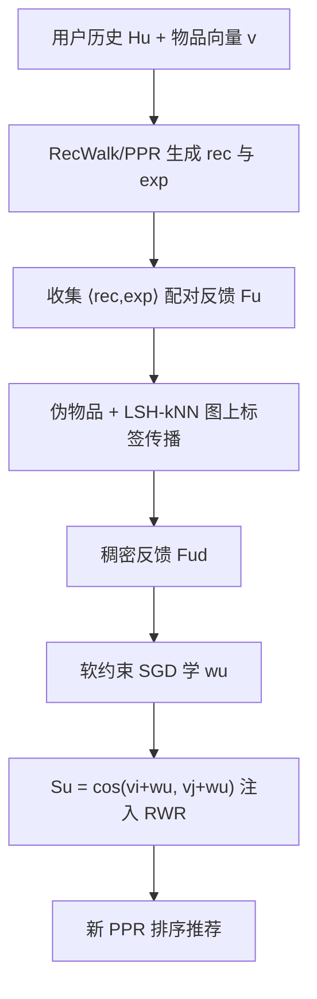

# ELIXIR: Learning from User Feedback on Explanations to Improve Recommender Models (以解释上的用户反馈驱动推荐模型改进)

- **会议/期刊**: WWW 2021 (11 pages)
- **作者与机构**: Azin Ghazimatin, Soumajit Pramanik, Rishiraj Saha Roy, Gerhard Weikum (Max Planck Institute for Informatics; IIT Bhilai)
- **推荐链路定位**: 召回（个性化 PageRank 全库打分）
- **研究方向**: 协同过滤与双塔召回 / 对话推荐与智能体仿真
- **论文原文**: [https://arxiv.org/abs/2102.09388v3](https://arxiv.org/abs/2102.09388v3)
- **开源代码**: [https://github.com/azinmatin/elixir/](https://github.com/azinmatin/elixir/)

## TL;DR (1分钟核心速览)

现有可解释推荐把解释当成单向的"说服工具"，用户反馈只落在推荐物品上，解释中的细粒度偏好信号被完全浪费。本文提出 ELIXIR 人机回环框架：让用户对⟨推荐 $rec$, 解释$exp$⟩ 配对给出二值"相似/不相似"判断，用伪物品（元素级几何均值）图标签传播 + LSH 近似 kNN 把极稀疏配对反馈稠密化，再以软约束优化学出每用户偏好向量$\boldsymbol{w}_u$ 平移物品向量、重写相似度矩阵注入 RWR 推荐。在 Movie/Book 两个域、25 人纵向用户研究中，同等反馈量下配对反馈显著优于物品级反馈，Movies P@5 0.368→0.592（+60.9%），Books P@5 0.336→0.600（+78.6%）。

## Background & Motivation (背景与核心矛盾)

- **主流范式**: 图推荐（RecWalk / RWR）用用户历史物品与物品相似度构建异构网络，以个性化 PageRank 打分，并可用 Prince 类后置方法给出"因果且忠实于用户自身历史"的解释物品集合。
- **前人局限 1**: 解释只是单向信号，用户若对推荐不满只能整体点击"不喜欢"，此反馈在正权图里甚至无法作为负边使用，直接被丢弃；而批评式推荐（critiquing）又要求用户在预设的物品属性（如 genre）上做显式 critique，属性空间难以覆盖"剧情反转""暴力程度"这类不可枚举的潜在面向。
- **前人局限 2**: 反过来只吸收物品级反馈，会把"喜欢 Kate Winslet 但讨厌灾难片"这类多维偏好摊平成一个整体 like/dislike，无法定位偏好的具体维度。
- **核心洞察 (Key Insight)**: 解释物品本身携带了"推荐与该物品为何相似"的维度提示——用户对这个配对的判断等价于对某个相似面向的确认/否决，且用户对自身历史中的解释物品天然熟悉，标注成本极低（时间监测显示配对判断认知负荷不高于物品级判断）。
- **本文切入点**: 把解释物品当作反馈载体，用配对级（pair-level）软约束替代物品级硬信号，并把反馈转化为用户专属的物品表征平移。

<figure class="paper-figure" markdown="span">
  <figcaption>图1：展示 Elixir 直觉的示例。</figcaption>
</figure>

## Method (核心方法设计)

### 1. 整体框架 (Overall Architecture)

框架分四步闭环：① 用 RecWalk 产出 top-$k$推荐$rec$，用近似 Prince（$contribution(v_j,rec)=PPR(v_j,rec)$，取$H_u$中贡献最高者）产出解释集$\{exp\}$；② 向用户收$\langle rec, exp\rangle$的$\{-1,0,+1\}$配对反馈矩阵$F_u$；③ 用伪物品图上的标签传播把$F_u$稠密化为$F_u^d$，其中 kNN 检索由 LSH 加速；④ 以 SGD 求解软约束目标得到$\boldsymbol{w}_u$，用它重写用户专属相似度矩阵$S_u$，替换 RWR 中的$S$ 后重算 PPR 完成推荐。

### 2. 关键设计拆解 (Key Designs)

1. **伪物品与标签传播稠密化（把 $O(|I|^2)$的配对空间降为$O(|I|)$）**：配对反馈天然极稀疏，无法直接约束。作者为每个有标注的配对造一个伪物品$\mathbf{v}_{ij}=(\mathbf{v}_i\otimes\mathbf{v}_j)^{1/2}$，几何均值相比算术均值更能放大两者共有的高维分量、压制分歧分量，因此伪物品落在两物品"共性区域"。难点是标签传播需要$|I|^2\times|I|^2$的亲和矩阵，故只在$kNN^I_{ij}\times kNN^I_{ij}$子空间内做 kNN（$k=10\Rightarrow\binom{10}{2}=45$个候选伪物品），并用 LSH（8 桶、3 个随机二值投影，$k=10$ 时召回失败率 15%）把搜索空间从平方级压到线性级。
2. **软约束偏好向量 $\boldsymbol{w}_u$（把偏好表达为整体平移而非硬约束）**：取$g(\mathbf{v}_i,\boldsymbol{w}_u)=\mathbf{v}_i+\boldsymbol{w}_u$、相似度为余弦，则
$$\min_{\boldsymbol{w}_u}\ \frac{1}{m}\sum_{v_i,v_j}F_u^d(v_i,v_j)\big[\cos(\mathbf{v}_i,\mathbf{v}_j)-\cos(\mathbf{v}_i+\boldsymbol{w}_u,\ \mathbf{v}_j+\boldsymbol{w}_u)\big]+\gamma\|\boldsymbol{w}_u\|^2$$
正反馈要求"平移后相似度上升"、负反馈要求下降，一个统一目标同时完成放大与抑制；若把 $F_u^d$当硬约束（不等式 + KKT），实验中多数用户直接退化为零解，软约束是可行性的关键。直觉上$\boldsymbol{w}_u$ 就是把共享隐空间整体"推向"用户口味方向，从而改变所有物品对的相对几何关系。
3. **训练目标、负采样与推理开销**：无负采样（非对比学习范式）；每用户独立解一个非凸目标，用 SGD（$\gamma=3$、$lr=0.01$、$d=20$）求近优$\boldsymbol{w}_u$。推理时构造$S_u(v_i,v_j)=\cos(\mathbf{v}_i+\boldsymbol{w}_u,\mathbf{v}_j+\boldsymbol{w}_u)$，代入$\boldsymbol{PPR}(u,\cdot)=\alpha\boldsymbol{e}_u+(1-\alpha)\boldsymbol{PPR}(u,\cdot)[\beta A+(1-\beta)S_u]$，$\alpha=0.15$、$\beta=0.1$，幂迭代至多 500 轮。反馈吸收是每用户一次离线优化，在线仅需一次 PageRank，但物品向量平移会改变整张相似度图，需按用户缓存$S_u$（$S$ 阈值 0.7 稀疏化以控边数）。

## Experimental Setup & Evaluation Protocol (实验设置与评估协议)

- **数据来源与规模**（25 名志愿者、两域各 3 周、350 人时的纵向用户研究，非公开数据集）：

| 域 / 图 | #Users | #Items | 交互边 | 相似度边 | 说明 |
| :--- | :---: | :---: | :---: | :---: | :--- |
| Movies | 25 | 621 | 1.3k | 11k | 每人 Phase-1 提供 50 部喜欢电影建画像 |
| Books | 25 | 868 | 1.3k | 41k | 同上，50 本书；图更稠密 |

- **数据划分与防穿越**: 画像构建（Phase 1，正反馈，无穿越）→ 反馈收集（Phase 2：每人 30 条物品级 + 300 条配对级判断；MovieLens/Goodreads 标签交集仅作记忆提示）→ 最终评估（Phase 3：各配置产出 30 条推荐，用户逐条判 like/dislike，每域约 1,800 条判断，人均 ≈72）。超参在每人 20% 评分构成的开发集上调优。
- **排名评测协议**: 非 Full-Ranking、非采样排序，而是**人工相关性判断下的 top-$k$列表评估**（$k=3,5,10$），指标 P@$k$、MAP@$k$、nDCG@$k$（二值相关性）；显著性用 Wilcoxon signed rank test，$p\le 0.05$。注意每个配置的列表各自被判断，存在"列表专属标注"带来的可比性偏差。
- **对比基线与超参**: 六种反馈吸收策略——Item-level（唯一基线）、Pair-level (Exp-1/3/5)、Pair-level (Rand-5)、Item+Pair-level (Exp-5)、Item+Pair-level (Rand-5)；其中 Rand-5 用画像中与 $rec$相似度最低的 5 个物品替代解释物品，作为"配对反馈但不忠实于解释"的控制组。物品向量由 MovieLens tag / Goodreads genre 稀疏矩阵上跑 NMF 得到，$d=20$（另验$d=10$ 稳健性）。

## Key Experimental Results (实验关键数据)

### 1. 主实验对比 (Main Results)

| 反馈配置 | Movies P@5 | Movies MAP@5 | Movies nDCG@5 | Books P@5 | Books MAP@5 | Books nDCG@5 |
| :--- | :---: | :---: | :---: | :---: | :---: | :---: |
| Item-level（基线） | 0.368 | 0.380 | 0.327 | 0.336 | 0.343 | 0.296 |
| Pair-level (Exp-1) | **0.592** | 0.599 | **0.557** | 0.528 | 0.620 | 0.512 |
| Pair-level (Exp-3) | 0.568 | **0.624** | 0.547 | 0.536 | 0.596 | 0.511 |
| Pair-level (Exp-5) | 0.512 | 0.579 | 0.490 | **0.600** | **0.701** | **0.607** |
| Pair-level (Rand-5) | 0.504 | 0.537 | 0.486 | 0.504 | 0.604 | 0.488 |
| Item+Pair (Exp-5) | 0.544 | 0.571 | 0.517 | 0.456 | 0.566 | 0.458 |
| Item+Pair (Rand-5) | 0.488 | 0.520 | 0.458 | 0.416 | 0.509 | 0.399 |
| **Improv.%** (最优 vs 基线) | +60.9% | +64.2% | +70.3% | +78.6% | +104.4% | +105.1% |

### 2. 消融实验 (Ablation Study)

| 消融维度 | 对照设置 | Movies P@5 | Books P@5 | 结论 |
| :--- | :--- | :---: | :---: | :--- |
| w/o 解释（用最不相似画像物品） | Pair-Exp-5 → Pair-Rand-5 | 0.512 → 0.504 (−1.6%) | 0.600 → 0.504 (−16.0%) | 解释的"忠实性"在 Books 上不可或缺 |
| w/o 解释（组合反馈下） | Item+Pair-Exp-5 → Item+Pair-Rand-5 | 0.544 → 0.488 (−10.3%) | 0.456 → 0.416 (−8.8%) | 配对增益主要来自 $exp$ 而非任意配对 |
| 反馈量对齐（30 对 vs 30 物品） | Pair-Exp-1 vs Item-level | 0.592 vs 0.368 (+60.9%) | 0.528 vs 0.336 (+57.1%) | 增益源于信息粒度而非数量 |
| 稠密度/维度稳健性 | $d=20\to10$ | 0.520 / 0.712 / 0.712 | — | 趋势与显著性保持 |

### 3. 关键实验发现 (Key Findings)

1. **配对反馈的信息效率远高于物品级**：在配对判断数量被压到与物品反馈相同（各 30 条）的 Pair-Exp-1 设置下，Movies P@5 仍从 0.368 跳到 0.592、nDCG@5 从 0.327 到 0.557（$p\le0.05$），说明单个"⟨rec,exp⟩ 相似与否"判断所携带的偏好维度信息量大于一个整体 like/dislike。
2. **解释物品不能被随机画像物品替代**：Item+Pair 组合中把 $exp$换成$rand$，Movies P@5 由 0.544 掉到 0.488、Books MAP@3 由 0.543 掉到 0.469；Books 上 Pair-Exp-5 更以 MAP@3 0.726（vs Rand 0.593，+22.4%）拉开差距——即"解释忠实性"本身就是增益来源，而不只是"多给了一些配对信号"。
3. **负反馈在正权图上被系统性浪费，但配对负反馈可间接生效**：用户在物品级与配对级的负向倾向高度一致（Movies/Books Pearson 0.53 / 0.51）；由于图模型无法建负边，收益与正反馈量正相关（反馈规模–P@5 提升曲线），而配对负反馈通过"降低 dislike 维度的相似度"间接压制同类坏推荐，这提示 ELIXIR 应迁移到矩阵分解类模型以显式利用负信号。

## Highlights & Limitations (亮点、对比与审稿批判)

- **与代表作对比 (vs. Prior Work)**: 相比 Prince 等后置解释方法（解释只用于说服、不回流模型）与增量批评式推荐（要求用户在预设属性上做 critique、属性空间受限），本文把解释物品本身变成反馈接口，无需枚举属性；相比 DLC 类语言批评（依赖自由文本与 LFM 重构），本文的反馈只需一次二值点击且能注入图模型。
- **可迁移亮点**: ① "伪物品 = 元素级几何均值 + 邻域标签传播"是把稀疏配对/集合级监督稠密化的通用算子，可直接用于 bundle 推荐与列表级偏好；② 用"用户向量平移 + 相似度重写"而非重训模型注入个性化，是一种极低成本的增量适配范式；③ LSH 预筛把 $O(|I|^2)$配对检索降为$O(|I|)$ 的工程技巧。
- **审稿级局限批判**: ① 评估规模小（25 人、每人 50 条画像、每域约 1.8k 判断），且各配置的 top-30 列表各自被标注，人工相关性判断存在配置相关的偏置，无法与公开基准上的 Full-Ranking 数字对照；② 每用户需求解非凸目标并重算/缓存 $S_u$与 PPR，代价随用户数线性放大，文中未报告时延与内存；③ 图模型无法吸收显式负边，导致 Item+Pair 组合在 Books 上反而低于纯 Pair-level（0.456 vs 0.600），反馈融合策略仍显粗糙；$\gamma$、$k$、LSH 桶数的敏感性仅在开发集上局部验证。

## Rating (四维评分)

- **方法创新性 (Novelty)**: ⭐⭐⭐⭐ （首次把"解释"从单向说服信号转为可行动的训练信号，伪物品标签传播与软约束平移组合新颖，但理论分析止于直觉层面）
- **评估协议与实验扎实度 (Protocol & Experiments)**: ⭐⭐⭐ （真实纵向用户研究与 Wilcoxon 检验难得，但 25 人规模、列表专属人工标注与无公开基准复现使外部效度受限）
- **写作与数学规范度 (Clarity & Rigor)**: ⭐⭐⭐⭐ （框架四模块与公式链条清晰，Eq.1/6/7/8 逐层可追；复杂度与硬约束退化的讨论足够）
- **工业落地与复现价值 (Industrial & Practical Value)**: ⭐⭐⭐⭐ （代码与用户研究数据开源，反馈成本极低、注入方式不改模型主干，适合作为线上"解释-反馈"闭环的轻量插件）

