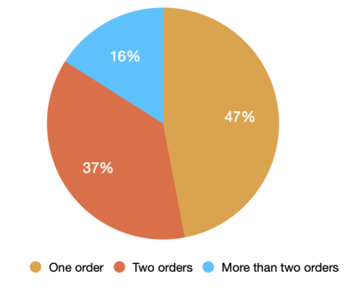
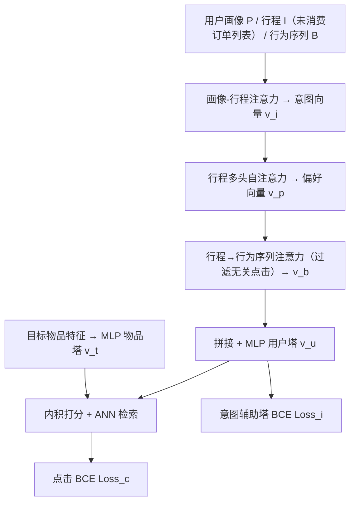
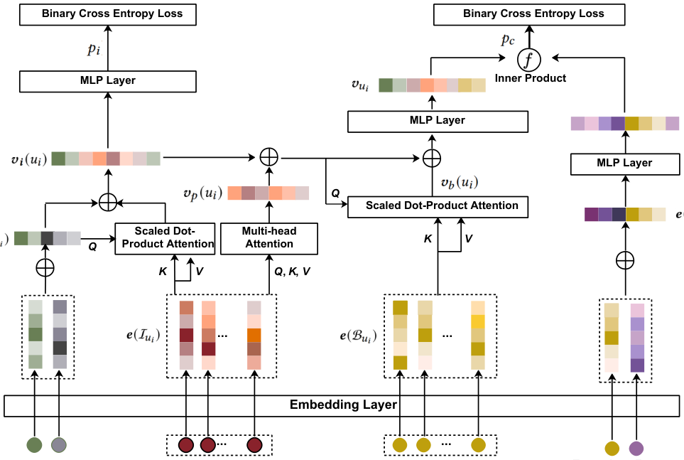

# Itinerary-aware Personalized Deep Matching at Fliggy (飞猪的行程感知个性化深度匹配)

- **会议/期刊**: WWW 2021 (The Web Conference)
- **作者与机构**: Jia Xu (广西大学)、Ziyi Wang / Zulong Chen / Detao Lv / Yao Yu (阿里巴巴·飞猪)、Chuanfei Xu (Concordia University)
- **推荐链路定位**: 召回 (Matching / 双塔向量检索)
- **研究方向**: 协同过滤与双塔召回 / 多任务学习与列表级重排
- **论文原文**: [https://arxiv.org/abs/2108.02343v1](https://arxiv.org/abs/2108.02343v1)
- **开源代码**: 暂未开源

## TL;DR (1分钟核心速览)

在线旅游平台 (OTP) 的召回面临三难：行为稀疏、需求跨域多样、意图隐式——单条订单无法判断用户是"中转"还是"观光"。本文提出 FitNET，首次把用户**全部未消费订单的列表（itinerary，行程）**作为一个整体输入，用三重视图行程的注意力（画像↔行程、行程自注意力、行程→行为序列）抽取用户表征，并以「观光意图预测 + 点击预测」双 BCE 联合训练后做内积双塔召回。在 0.27M 用户 / 1.53M 物品的飞猪生产数据（采样排序，负正比 1:10）上，HR@10 较最强基线 MIND 提升 5.5%，线上 7 天 A/B 的 CTR 提升 1.3%，已全量上线。

## Background & Motivation (背景与核心矛盾)

- **主流范式**: 工业召回普遍采用 YouTube DNN / MIND / SDM 一类深度匹配网络，把用户画像与历史点击序列池化或路由为定长向量，再与物品塔做内积 + ANN 检索。
- **前人局限**: ①这些模型把历史行为视为兴趣的全部，而 OTP 的用户行为极稀疏（旅游是低频需求），且点击序列中大量是"与本次出行无关的因果点击"；②更致命的是**隐式性**——飞猪统计显示 53% 用户在单次旅行中创建 ≥1 张订单、16% 创建 ≥2 张，仅看最新一张订单极易把中转地误判为目的地。
- **核心洞察 (Key Insight)**: 用户的出行意图不是由单条订单表达，而是由**尚未消费的多张订单共同约束**（如"南宁中转 + 桂林住宿"联立后可推断南宁订单只是过境，不应推南宁景点）。因此建模粒度应从 order 提升到 itinerary。
- **本文切入点**: 把 itinerary 定义为"未消费订单列表"，用行程向量去**反向筛选**画像与行为序列中真正相关的信息，并让"意图分类"作为辅助任务正则化召回向量。

<figure class="paper-figure" markdown="span">
  <figcaption>图2：Fliggy 用户按旅行计划创建订单的统计（2020年9月10日至2020年10月10日）。</figcaption>
</figure>

## Method (核心方法设计)

### 1. 整体框架 (Overall Architecture)

输入为四类特征组：用户画像 $\mathcal{P}_{u}$、行程$\mathcal{I}_{u}=\{\bar{o}_{u,1},\dots\}$、行为序列$\mathcal{B}_{u}$、目标物品$\mathcal{F}_{t}$。前三者经 embedding 后进入三重行程感知注意力：先用画像查询行程得到意图向量$\boldsymbol{v}_i$，再用多头自注意力建模行程内部订单共现得到偏好向量$\boldsymbol{v}_p$，最后以$[\boldsymbol{v}_i\oplus\boldsymbol{v}_p]$为查询去注意力聚合行为序列得$\boldsymbol{v}_b$；三向量拼接过 MLP 得用户塔输出$\boldsymbol{v}_u$。物品塔独立 MLP 得$\boldsymbol{v}_t$，内积即点击概率。训练用两个 BCE（意图 + 点击）；serving 时离线算好物品向量建 ANN 索引，用户向量随新点击实时重算，实现实时个性化。

<figure class="paper-figure" markdown="span">
  <figcaption>图4：所提出的 FitNET 模型架构。</figcaption>
</figure>

### 2. 关键设计拆解 (Key Designs)

1. **画像–行程软对齐注意力（解决稀疏 + 意图推断）**：以画像向量为 Query、行程中各订单为 Key/Value，做带双线性矩阵的缩放点积注意力，把"家乡城市 vs 订单目的地"这类交叉证据显式建模（如同一城市 ⇒ 探亲而非观光）：$\alpha_{l}=\mathrm{softmax}\!\left(\frac{\boldsymbol{e}(\mathcal{P}_{u})\boldsymbol{W}_{1}[\boldsymbol{e}(\bar{o}_{u,l})]^{\top}}{\sqrt{d}}\right),\ \boldsymbol{v}_{i}(u)=\sum_{l}\alpha_{l}\,\boldsymbol{e}(\bar{o}_{u,l})$。输出再与画像向量拼接，用画像补足行为稀疏。
2. **行程内多头自注意力（解决多样性）**：单张订单无法刻画用户对目的地/品类的整体偏好，故用 8 头自注意力在订单序列内部做 token 间交互，输出 $\boldsymbol{v}_{p}(u)=[\boldsymbol{v}^{1}_{p}\oplus\cdots\oplus\boldsymbol{v}^{N}_{p}]\boldsymbol{W}^{O}$，捕捉"跨域打包需求"（机票+酒店+门票）的组合模式。
3. **行程引导的行为序列注意力 + 双目标训练**：以 $\boldsymbol{v}_{c}=[\boldsymbol{v}_{i}\oplus\boldsymbol{v}_{p}]$为 Query 对行为序列加权$\beta_{m}=\mathrm{softmax}(\boldsymbol{v}_{c}\boldsymbol{W}_{2}\boldsymbol{e}(t_{u,m})^{\top})$，压制与本次行程无关的历史点击。总损失$\mathcal{L}=\mathcal{L}_{i}+\mathcal{L}_{c}$，其中$\mathcal{L}_{i}=-\mathbb{I}_{i}\log p_{i}-(1-\mathbb{I}_{i})\log(1-p_{i})$为"是否观光"意图辅助监督（规则自动打标），$\mathcal{L}_{c}$为点击 BCE；意图塔使召回向量对齐业务语义，避免纯 CTR 目标下的热门偏置。打分采用内积$f_{score}=\boldsymbol{v}_{u}\cdot\boldsymbol{v}_{t}$，负采样见下节。

## Experimental Setup & Evaluation Protocol (实验设置与评估协议)

- **数据集与预处理**: 飞猪 App 2020 年 4 月单月真实日志（生产环境全量统计，未做 5-core 过滤）。

| 数据集 | #Users | #Items | #Interactions | 稀疏度/密度 | 特征/场景说明 |
| :--- | :---: | :---: | :---: | :---: | :--- |
| Fliggy-Train | 0.27M | 1.53M | 12.1M (正 1.3M) | ~3.5e-5 | 0.73M 订单 / 0.34M 行程；画像、订单、点击、物品四组特征 |
| Fliggy-Test | 0.10M | 1.51M | 3.4M (正 0.4M) | — | 0.26M 订单 / 0.11M 行程 |

- **数据划分与防穿越 (Splitting Strategy)**: 按日志时间组织训练/测试集（比例划分，训练集取更早时段）；测试集内的行程、订单与用户画像均取"首张订单创建之前"的行为序列，避免未来交互泄漏。
- **排名评测协议 (Ranking Protocol)**: **Sampled Ranking**——每条正样本配 10 条负样本（负正比 1:10）构成候选集后计算 HitRate@k 与 Precision@k，非 Full-Ranking；这是本文最大的协议短板（见局限）。
- **对比基线与超参设置**: OrderDest2i（目的地热度）、DeepWalk（物品图 embedding）、YouTube DNN（均值池化）、MIND（k=1 动态路由，经调参为飞猪最优）、FitNET−（仅用最近一张未消费订单）。embedding 维度未在正文给出具体 $d$值，注意力头数$N=8$；未报告显著性检验。

## Key Experimental Results (实验关键数据)

### 1. 主实验对比 (Main Results)

| 方法 | HR@10 | HR@50 | P@10 | P@50 | HR@10 相对提升 |
| :--- | :---: | :---: | :---: | :---: | :---: |
| OrderDest2i | 0.140 | 0.350 | 0.024 | 0.009 | −48.3% |
| DeepWalk | 0.200 | 0.430 | 0.035 | 0.016 | −26.1% |
| YouTube DNN | 0.250 | 0.480 | 0.039 | 0.021 | −7.6% |
| MIND | 0.271 | 0.528 | 0.042 | 0.023 | 基准 |
| FitNET− | 0.282 | 0.537 | 0.0454 | 0.0235 | +4.1% |
| **FitNET** | **0.286** | **0.5403** | **0.046** | **0.024** | **+5.5%** |

线上 A/B（2020 年 5 月，7 天，各方法均分 20% 流量、同一精排引擎、各召回 1000 候选）：FitNET 平均 CTR 较次优 MIND **+1.3%**。

### 2. 消融与负采样实验 (Ablation & Negative Sampling)

| 变体 | HR@10 | HR@50 | P@10 | ΔHR@10 |
| :--- | :---: | :---: | :---: | :---: |
| FitNET (完整) | 0.286 | 0.5403 | 0.046 | — |
| Var1: w/o 画像–行程注意力 + 意图辅助塔 | 0.269 | 0.5312 | 0.0441 | −5.9% |
| Var2: w/o 行程内多头自注意力 | 0.267 | 0.5346 | 0.0440 | −6.6% |
| Var3: w/o 行程引导行为序列注意力 | 0.273 | 0.5350 | 0.0452 | −4.5% |

| 负采样设置 | HR@10 (1:1) | HR@10 (1:10) | HR@10 (1:15) |
| :--- | :---: | :---: | :---: |
| Setting 1: 全库随机负样本 | 0.157 | 0.171 | 0.169 |
| Setting 2: 同目的地 + 50/50 同异品类 | 0.263 | 0.278 | 0.280 |
| Setting 3: 同目的地 + 10/90 同异品类 | 0.269 | **0.286** | 0.287 |

### 3. 关键实验发现 (Key Findings)

1. **负采样策略的影响远大于模型结构**：把负样本约束到"与行程同目的地城市"后，HR@10 从 0.171 跃至 0.286（+67%），远超任何模块贡献；负正比在 1:10 后饱和（1:15 仅 +0.001），说明旅游召回的关键是构造**难而地理合理**的负样本，而非无脑堆量。
2. **行程必须整体建模**：仅用最新一张订单的 FitNET− 在 HR@10 上落后 1.4%、P@10 落后 1.7%；消融中移除行程内自注意力损失最大（HR@10 −6.6%），证明订单间的跨域共现（机票↔酒店↔门票）才是多样性需求的主要载体。
3. **意图辅助任务不可省**：Var1 去掉画像–行程注意力与意图塔后 HR@10 掉 5.9%，是三个注意力中损伤最重的，说明观光/中转的业务语义标签能有效校正纯点击目标带来的表征漂移。

## Highlights & Limitations (亮点、对比与审稿批判)

- **与代表作对比 (vs. Prior Work)**: 相比 YouTube DNN（均值池化，无权重区分）与 MIND（用动态路由聚类历史兴趣，但对**未消费订单**完全无感知），FitNET 的差异在于把"未来将要发生但尚未消费的订单"引入用户塔，并用它反向门控历史行为；与 SDM 的 session 建模相比，行程不是时间序列而是**并行约束集合**，因此用自注意力而非 RNN。
- **可迁移亮点**: ①"未完成/购物车类未消费信号"作为独立特征组 + 交叉注意力门控，可直接迁移到电商加购、OTA 机票+酒店、外卖多商家中；②地理/品类约束式难负采样，是所有 LBS 与本地生活召回的低成本涨点手段。
- **审稿级局限批判**: ①评测为 1:10 采样排序，未做 Full-Ranking，且正样本含曝光未点击的正负定义模糊，HitRate 绝对值缺乏跨论文可比性；无显著性检验、无公开数据集与代码，复现性弱。②模型仅支持"单一行程"，多行程场景被留作 future work；用户向量需随点击实时重算，高并发下的推理延迟与 ANN 索引更新成本论文未量化；意图标签依赖人工规则，规则迁移到其他 OTP 需重新标注。

## Rating (四维评分)

- **方法创新性 (Novelty)**: ⭐⭐⭐ （"itinerary"概念与行程引导门控是业务驱动的有效增量，但注意力模块本身均为标准组件组合，无理论或谱分析支撑）
- **评估协议与实验扎实度 (Protocol & Experiments)**: ⭐⭐⭐ （有生产级数据 + 7 天线上 A/B，但仅采样排序、缺 Full-Ranking 与显著性检验，消融粒度较粗）
- **写作与数学规范度 (Clarity & Rigor)**: ⭐⭐⭐⭐ （三重注意力与双损失的数据流描述清晰、图示到位，公式编号完整；但部分维度超参缺失、符号略冗余）
- **工业落地与复现价值 (Industrial & Practical Value)**: ⭐⭐⭐⭐ （已在飞猪全量上线并服务主流量，负采样与行程建模经验可直接复用；扣分于未开源、私有数据不可复现）

