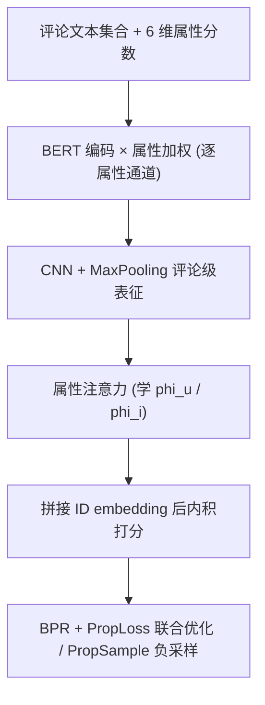
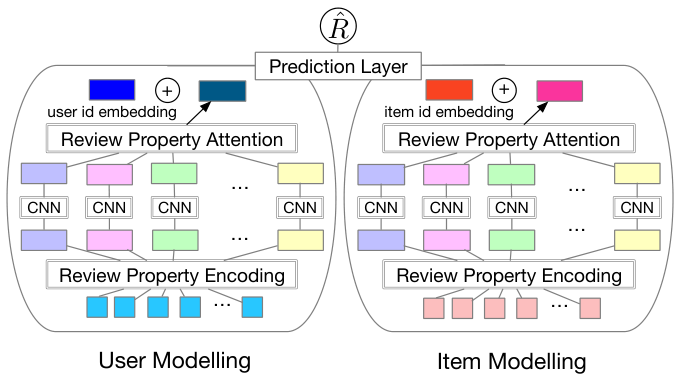
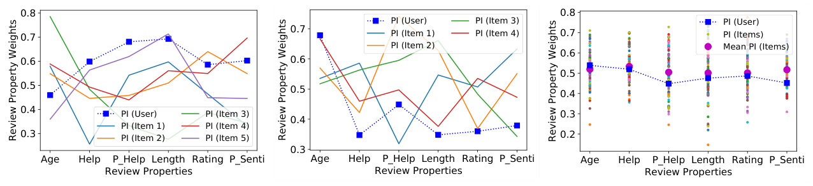

# Leveraging Review Properties for Effective Recommendation (基于评论属性的有效推荐模型)

- **会议/期刊**: WWW 2021 (The Web Conference)
- **作者与机构**: Xi Wang, Iadh Ounis, Craig Macdonald (University of Glasgow, UK)
- **推荐链路定位**: 召回（用户-物品隐向量打分）
- **研究方向**: 协同过滤 / 评论文本增强推荐
- **论文原文**: [https://arxiv.org/abs/2102.03089v1](https://arxiv.org/abs/2102.03089v1)
- **开源代码**: 暂未开源（作者承诺录用后公开，正文未提供链接）

## TL;DR (1分钟核心速览)

现有评论增强推荐的瓶颈在于：评论"有用性"靠历史交互或注意力从文本中学，模型见过的评论才有信号，**未见评论无法泛化**。本文提出 RPRM，用 6 个**不依赖训练数据**的评论属性（时间新近度、长度、评分、有用票数、预测有用概率、情感极性）对 BERT 评论文本做逐属性加权，再用 dot-product attention 学出"该用户/该物品更看重哪个属性"，并引入两条属性一致性损失 `PropLoss` 与属性感知负采样。在 Yelp 与 Amazon（每用户最少 5 条评论、80/10/10 时间切分）上，P@1/P@10/R@10/MAP 全面显著超越 BPR-MF、DREAM、CASER、DeepCoNN、JRL、NARRE 六个基线，MAP 相对最强基线 NARRE 提升 35.5%（Amazon）与 18.9%（Yelp）。

## Background & Motivation (背景与核心矛盾)

- **主流范式**: 评论增强推荐把用户/物品的评论集合经 CNN 或注意力编码为语义向量（DeepCoNN、NARRE），或用 RNN/CNN 编码时间属性做序列建模（DREAM、CASER）。
- **前人局限 1**: NARRE 等用注意力估计评论有用性，但注意力权重完全由训练集内的历史评论拟合得到，对**测试期新出现、模型未见过的评论**缺乏泛化能力。
- **前人局限 2**: DREAM/CASER 等把评论属性（年龄、地理）仅当作 side information 拼进协同过滤，**放弃了评论正文语义**，与纯文本模型互补性未被利用。
- **核心洞察 (Key Insight)**: 依据用户信息采纳框架（information adoption / ELM 双路径），不同用户对评论属性的偏好本身是稳定的——偏好长评论的用户，其交互物品的"有用评论"也多由长度属性刻画。因此**用户与物品在属性重要性上的"一致性"** 本身就是一个可学习、且对新评论泛化的推荐信号。
- **本文切入点**: 把属性当作逐条评论的加权通道（而非全局 side feature），用注意力学属性重要性向量 $\phi_u,\phi_i$，再用一致性损失约束用户与正样本物品、负样本物品之间的属性偏好关系。

## Method (核心方法设计)

### 1. 整体框架 (Overall Architecture)

RPRM 是标准 CF 框架，用户侧与物品侧共享同一套网络。输入为某用户/物品的全部评论：每条评论先经预训练 BERT 编码为 768 维向量 $X_t$；随后与 6 个归一化到$[0,1]$的属性标量逐条相乘，得到 6 组"属性视角"的评论表征；每组再经 CNN + max-pooling 压成一条评论级向量；注意力层在这 6 组向量上按学到的属性重要性$\phi$加权融合，得到评论侧表征$O'$；最后与用户/物品 ID embedding$V$ 拼接、逐元素内积打分。训练用 BPR 与两条 `PropLoss` 的加权和，负样本按属性相似度 `PropSample` 采样，推理只需一次前向打分。

<figure class="paper-figure" markdown="span">
  <figcaption>图1：RPRM 的神经网络架构。</figcaption>
</figure>

### 2. 关键设计拆解 (Key Designs)

1. **逐属性通道编码（Review Property Encoding）**：针对"注意力不可泛化"的痛点，本文不把属性当全局特征，而是把每个属性作为一个**乘性子空间**，对同一条评论生成 6 份表征：$O_{u,P_1}=[X_1 p_{1,1},X_2 p_{1,2},\dots,X_{|C_u|}p_{1,|C_u|}]$。其中$p$为属性分数（如年龄$p=1-d/\max(D)$，新评论更接近 1）。直觉：属性值只依赖评论自身元数据，测试期新评论同样可算，从而把"有用性"从数据驱动转为**属性驱动**。
2. **属性重要性注意力（Review Property Attention）**：不同用户/物品看重的属性不同，故在 6 个属性通道上做加权融合并归一化为权重分布：$O'_u=\sum_{t=0}^{k}\phi_{u,t}O_{u,P_t}/k$，$\phi_u,\phi_i$ 即"属性重要性分数 (PI)"。这让模型能自动解释"该用户偏好长评论 / 偏好近期评论"，而不必人工指定属性权重。
3. **属性一致性学习（PropLoss + PropSample）**：受信息采纳框架启发，用户应与其正样本物品在属性重要性上趋于一致、与负样本物品不一致：
$PropLoss_{uu}=Sim(\phi_u,\phi_{i^-})-Sim(\phi_u,\phi_{i^+})$，$PropLoss_{ui}=Sim(\phi_{i^+},\phi_{i^-})-Sim(\phi_u,\phi_{i^+})$；
总损失 $\mathcal{L}=\alpha\cdot BPR(u,i^+,i^-)+(1-\alpha)\cdot PropLoss$。相似度用 KL 散度（取倒数）或 Cosine，KL 稳定更优。`PropSample` 则按$\phi_{i^+}$与候选负样本$\phi_{i^-}$ 的相似度归一化为概率分布来采样——即**优先采那些"属性像正样本但用户没交互"的难负样本**，属 Hard-Negative 变体，无需额外在线开销。

## Experimental Setup & Evaluation Protocol (实验设置与评估协议)

- **数据集与预处理**: 移除冷启动用户/物品，要求**每个用户与物品至少 5 条评论**（近似 `5-core`）：

| 数据集 | #Users | #Items | #Reviews | 特征/场景说明 |
| :--- | :---: | :---: | :---: | :--- |
| Yelp (Round 13) | 47k | 16k | 551k | 餐厅类本地商户，含有用票数 |
| Amazon | 26k | 16k | 285k | 6 个商品类目，跨品类偏好 |

- **数据划分与防穿越 (Splitting Strategy)**: 比例划分 + **时间敏感切分**，80%/10%/10%，且每个用户内部按同比例切分，保证训练评论早于测试评论。
- **排名评测协议 (Ranking Protocol)**: 评测测试集中用户真实交互物品是否被推荐命中，报告 P@1、P@10、R@10、MAP。**原文未明确说明候选集是 Full-Ranking 全库排序还是采样排序**（仅描述为"对测试集交互物品考察是否被选中"），这一点属于协议披露不足。
- **对比基线与超参设置**: BPR-MF（经典）、DREAM、CASER、DeepCoNN、JRL、NARRE（5 个 SOTA）；为公平起见 DeepCoNN/NARRE 也改用 BERT 编码，最大长度 512 token；Adam，Yelp $5e^{-4}$、Amazon$1e^{-3}$，早停；显著性用 paired t-test 与 Tukey HSD 双重检验，$p<0.05$。

## Key Experimental Results (实验关键数据)

### 1. 主实验对比 (Main Results)

| Model | Amazon P@1 | Amazon P@10 | Amazon R@10 | Amazon MAP | Yelp P@1 | Yelp P@10 | Yelp R@10 | Yelp MAP |
| :--- | :---: | :---: | :---: | :---: | :---: | :---: | :---: | :---: |
| BPR-MF | 0.0053 | 0.0034 | 0.0301 | 0.0111 | 0.0101 | 0.0058 | 0.0391 | 0.0145 |
| DREAM | 0.0030 | 0.0008 | 0.0062 | 0.0029 | 0.0083 | 0.0065 | 0.0469 | 0.0155 |
| CASER | 0.0093 | 0.0060 | 0.0499 | 0.0239 | 0.0111 | 0.0083 | 0.0571 | 0.0229 |
| DeepCoNN | 0.0053 | 0.0037 | 0.0343 | 0.0119 | 0.0054 | 0.0025 | 0.0173 | 0.0072 |
| JRL | 0.0041 | 0.0031 | 0.0310 | 0.0092 | 0.0043 | 0.0021 | 0.0135 | 0.0061 |
| NARRE (最优基线) | 0.0175 | 0.0066 | 0.0588 | 0.0279 | 0.0137 | 0.0087 | 0.0605 | 0.0228 |
| No-Prop (去属性) | 0.0208 | 0.0088 | 0.0805 | 0.0357 | 0.0153 | 0.0099 | 0.0745 | 0.0260 |
| **RPRM** | **0.0223** | **0.0095** | **0.0865** | **0.0378** | **0.0161** | **0.0104** | **0.0761** | **0.0271** |
| **Improv.% (vs NARRE)** | +27.4% | +43.9% | +47.1% | +35.5% | +17.5% | +19.5% | +25.8% | +18.9% |

### 2. 消融实验 (Ablation Study)

| 变体 | Amazon MAP | Yelp MAP | 说明 |
| :--- | :---: | :---: | :--- |
| No-Prop（无属性层） | 0.0357 | 0.0260 | 属性层单独贡献 |
| RPRM-basic（全属性 + BPR + 均匀采样） | 0.0378 | 0.0271 | 完整属性注意力 |
| RPRM + 单属性 Age | 0.0372 | 0.0267 | 最有效单属性之一 |
| RPRM + 单属性 Prob_Helpful | 0.0376 | 0.0264 | 最有效单属性之二 |
| + $PropLoss_{uu}$-KL | 0.0381 | 0.0281 | 用户-负样本不一致 |
| + $PropLoss_{ui}$-KL | **0.0385** | **0.0288** | 物品-负样本不一致，最佳 |
| + $PropLoss_{ui}$-Cos | 0.0382 | 0.0278 | Cosine 略逊 KL |
| + $PropSample$-KL | 0.0385 | 0.0268 | 仅 Amazon 有效 |
| + $PropSample$-Cos | 0.0376 | 0.0276 | 仅 Yelp 有效 |
| + $PropLoss_{ui}$-KL +$PropSample$-KL | 0.0373 | 0.0266 | **组合反而下降** |

### 3. 关键实验发现 (Key Findings)

1. **最大增幅来自"简化 + ID embedding"，而非属性本身**：去掉属性层的 No-Prop 已经超过全部 6 个基线（Amazon MAP 0.0357 vs NARRE 0.0279，+28%），说明 DeepCoNN/JRL 类纯文本模型失败的主要原因不是缺少属性，而是缺少 ID embedding 与合理融合；属性层在此之上再贡献 +5.9%（Amazon）/ +4.2%（Yelp）MAP，是"锦上添花"型增量。
2. **属性选择强依赖数据集，唯有 Age 与 Prob_Helpful 双向稳定**：Helpful 提升 Amazon 但**降低** Yelp，Rating 提升 Yelp 但不提升 Amazon；而 Age、Prob_Helpful 在两个数据集上均显著正向。这直接支撑了"应让模型学属性权重而非人工挑属性"的设计动机。
3. **一致性损失优于负采样，且负采样与损失叠加会互相抵消**：$PropLoss_{ui}$-KL 在两侧均取最佳（MAP 0.0378→0.0385 / 0.0271→0.0288，$p<0.05$），而 `PropSample` 与$PropLoss_{ui}$ 组合后 MAP 回落到 0.0373/0.0266——因两者都在刻画"物品间属性重要性一致/不一致"，信息冗余且采样限制了负样本多样性。图 2 的定性可视化进一步验证：偏好长评论的用户 A，其交互物品的长度属性权重同样最高；交互多的用户 C 的属性重要性与其物品均值曲线几乎重合。

<figure class="paper-figure" markdown="span">
  <figcaption>图2：随机选取的用户及其交互物品的评论属性重要性分数。‘Help’、‘P_Help’、‘P_Senti’分别是‘Helpful’、‘Prob_Helpful’和‘Polar_Senti’的缩写；‘PI’表示属性重要性分数。</figcaption>
</figure>

## Highlights & Limitations (亮点、对比与审稿批判)

- **与代表作对比 (vs. Prior Work)**: 对比 NARRE，本文把"评论有用性"的估计从**数据驱动的注意力权重**换成**属性驱动的可解释加权**，因而对未见评论可泛化；对比 DREAM/CASER，本文保留评论正文语义而不仅用时间/位置 side info；对比 JRL 的多源异构融合，本文只需评论与元数据，工程依赖更轻。
- **可迁移亮点**: (1) "元数据标量 × 语义向量"生成多通道表征、再用注意力学通道权重的做法，可零成本迁移到短视频/电商评论场景的冷启动召回；(2) 用属性偏好分布相似度构造 Hard Negative，可作为通用负采样插件接入双塔模型。
- **审稿级局限批判**: (1) **评测协议披露不足**：未说明候选集规模与是否 Full-Ranking，仅用 10% 测试集命中判断，容易高估绝对指标、且无法与全库排序方法公平横比；(2) **离线依赖重且推理成本未报**：BERT 768 维逐条编码 + 每条评论 6 份 CNN 通道，训练开销是 NARRE 的数倍，`Prob_Helpful`/`Polar_Senti` 还需额外的 NCWS、CNN 分类器做预处理，属性分数本身有误差传播风险；(3) `PropLoss` 的 $\alpha$ 权重与 KL 温度未做敏感性分析，`PropSample` 的失败也说明该模块缺乏鲁棒性。

## Rating (四维评分)

- **方法创新性 (Novelty)**: ⭐⭐⭐⭐ （首次把评论属性作为可泛化的"有用性通道"并与信息采纳框架挂钩，注意力学的属性重要性具备可解释性，但整体仍是注意力加权 + 辅助损失的组合式创新）
- **评估协议与实验扎实度 (Protocol & Experiments)**: ⭐⭐⭐ （两数据集 + 六基线 + paired t-test 与 Tukey HSD 双检验、单属性消融与损失/采样分解都较完整，但候选集与排序协议未交代清楚，也无全库排序实验）
- **写作与数学规范度 (Clarity & Rigor)**: ⭐⭐⭐⭐ （四层结构与公式定义清晰、属性归一化与直觉说明到位；$PropLoss_{ui}$ 的符号组合略显反直觉，缺少推导与复杂度分析）
- **工业落地与复现价值 (Industrial & Practical Value)**: ⭐⭐⭐ （思路易复现且属性提取轻量，但 BERT + 多通道 CNN 的在线打分成本高，代码尚未开源，落地需先做表征蒸馏与属性预处理链路优化）

