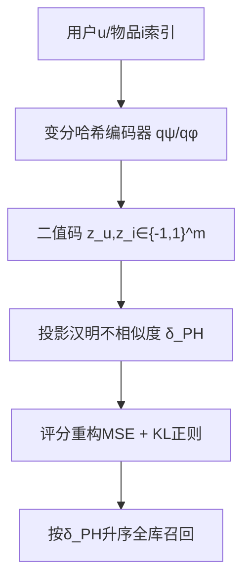

# Projected Hamming Dissimilarity for Bit-Level Importance Coding in Collaborative Filtering (面向协同过滤位级重要性编码的投影汉明不相似度)

- **会议/期刊**: WWW 2021
- **作者与机构**: Christian Hansen, Casper Hansen, Jakob Grue Simonsen, Christina Lioma（University of Copenhagen）
- **推荐链路定位**: 召回
- **研究方向**: 协同过滤与双塔召回
- **论文原文**: [论文原文链接](https://arxiv.org/abs/2103.14455v1)
- **开源代码**: [开源代码仓库链接](https://github.com/casperhansen/Projected-Hamming-Dissimilarity)

## TL;DR (1分钟核心速览)

哈希协同过滤用二值码与汉明距离换取极快检索，但每一位等权，丢失判别信息；本文在 Z2 哈希空间推导投影汉明不相似度，用用户码对物品码做位级二值掩码，并以变分哈希模型端到端学习。4 个评分数据集全库排序下，较最强哈希基线最高 +7% NDCG、+14% MRR，存储与时延不增。

## Background & Motivation (背景与核心矛盾)

- **主流范式**: 哈希 CF 将用户/物品编码为二值码，用 Hamming 距离与 popcnt/布尔指令实现极快召回；实值 MF 用内积表达力更强，但存储与计算成本高数倍。
- **前人局限**: Hamming 距离对每位等权，无法按查询动态强调关键位；加权 Hamming/CCCF 引入实值权重或块权重，破坏布尔位运算，并增加存储/寄存器搬运开销。
- **核心洞察 (Key Insight)**: 内积可理解为“物品向量在用户向量上的投影长度差”；若把同一投影几何搬到 Hamming 空间，就能用查询码对物品码做“开/关位”的二值重要性选择。
- **本文切入点**: 提出非对称的 Projected Hamming dissimilarity，查询码中的 -1 位可屏蔽物品对应位；再用变分哈希学习适配该度量的二值码。

## Method (核心方法设计)

### 1. 整体框架 (Overall Architecture)

模型先把用户 $u$与物品$i$经变分编码器映射为$m$位哈希码$z_u,z_i\in\{-1,1\}^m$：编码器输出 sigmoid 概率，经 Bernoulli 采样与 straight-through 估计反传。训练时用投影汉明不相似度$\delta_{PH}(z_u,z_i)$经仿射映射重构评分，优化高斯似然（等价 MSE）与 KL 正则；推理时对全部候选物品按$\delta_{PH}$升序排序。核心是只改“距离算子+学习目标”，不增加二值码存储，且可预计算$\mathrm{NOT}\,z_i$ 保持与 Hamming 距离相同的布尔运算量。

### 2. 关键设计拆解 (Key Designs)

1. **投影汉明不相似度（位级二值重要性编码）**：传统 $d_H(z_u,z_i)=\mathrm{SUM}(z_u\ \mathrm{XOR}\ z_i)$每位等权；本文令$P_{z_u}(z_i)=z_u\ \mathrm{AND}\ z_i$，定义$\delta_{PH}(z_u,z_i)=\|z_u-P_{z_u}(z_i)\|_0=\mathrm{SUM}(z_u\ \mathrm{XOR}\ (z_u\ \mathrm{AND}\ z_i))$。由于$z_u$ 中 -1 位会把物品码对应位“掩掉”，查询码从“偏好向量”变为“重要性掩码”，且天然非对称，适合 user→item 召回。
2. **等价加速与无额外开销**：利用 $\delta_{PH}(z_u,z_i)=\mathrm{SUM}(z_u\ \mathrm{AND}\ (\mathrm{NOT}\ z_i))$，可离线存储$\mathrm{NOT}\,z_i$；因此在线只需与 Hamming 距离相同的 XOR/AND/popcnt 级操作，不增加存储，也不引入实值权重乘法。
3. **变分哈希学习目标**：对 $q_\psi(z_u|u),q_\phi(z_i|i)$做 Bernoulli 采样，最大化 ELBO$\mathbb{E}[\log p(R_{u,i}|z_u,z_i)]-\mathrm{KL}(q_\phi(z_i|i)\|p(z_i))-\mathrm{KL}(q_\psi(z_u|u)\|p(z_u))$；条件似然取$p(R_{u,i}|z_u,z_i)=\mathcal{N}(R_{u,i}-g(\delta_{PH}),\sigma^2)$，即用$g(\delta_{PH})$ 重构评分并优化 MSE。训练只用观测评分对，无额外负采样；推理为全库哈希排序，开销与 Hamming 基线同级。

## Experimental Setup & Evaluation Protocol (实验设置与评估协议)

- **数据集与预处理**: 过滤评分少于 10 的用户/物品；同一用户对同一物品仅保留首次评分。

| 数据集 | #Users | #Items | #Interactions | 密度 | 场景 |
| :--- | :---: | :---: | :---: | :---: | :--- |
| Yelp | 22,087 | 14,873 | 602,517 | 0.18% | 本地服务评分 |
| ML-1M | 6,040 | 3,260 | 998,539 | 5.07% | 电影评分 |
| ML-10M | 69,878 | 9,708 | 9,995,471 | 1.47% | 电影评分 |
| Amazon | 158,650 | 128,939 | 4,701,968 | 0.02% | 图书评分 |

- **数据划分与防穿越**: 按用户比例划分：50% 测试、42.5% 训练、7.5% 验证；非全局时间戳切分，属于随机 per-user ratio split。
- **排名评测协议**: 对用户全部未交互物品按哈希距离/投影哈希距离升序进行 Full-Ranking 全库排序，无采样负例；指标为 NDCG@5/10 与 MRR。
- **对比基线与超参**: 哈希基线含 DCF、CCCF、MFmean/MFmedian、VH（同变分模型但用 Hamming）；MF 为实值内积参考。哈希码长 32/64 bit，MF 维度同码长；Adam，学习率 $\{0.005,0.001,0.0005\}$，batch$\{100,200,400,800\}$；显著性用配对双尾 t-test，$p<0.05$ 且 Bonferroni 校正。

## Key Experimental Results (实验关键数据)

### 1. 主实验对比 (Main Results)

64-bit 结果如下；**粗体为哈希类最优**，MF 为实值参考上界、不参与 Δ% 计算。

| 方法 | Yelp N@10 | Yelp MRR | ML-1M N@10 | ML-1M MRR | ML-10M N@10 | ML-10M MRR | Amazon N@10 | Amazon MRR |
| :--- | :---: | :---: | :---: | :---: | :---: | :---: | :---: | :---: |
| CCCF | .8060 | .6329 | .7259 | .6716 | .6134 | .5837 | — | — |
| DCF | .8155 | .6574 | .7285 | .6766 | .6316 | .6088 | .8747 | .7825 |
| MFmean | .7712 | .5810 | .5981 | .5172 | .4675 | .4257 | .8458 | .7340 |
| MFmedian | .7752 | .5780 | .5966 | .5105 | .4679 | .4270 | .8457 | .7334 |
| VH | .8185 | .6561 | .7338 | .6759 | .6328 | .6013 | .8746 | .7828 |
| **VHPHD** | **.8577** | **.7540** | **.7459** | **.7136** | **.6427** | **.6373** | **.8908** | **.8147** |
| MF (实值参考) | .8591 | .7573 | .7552 | .7439 | .6562 | .6594 | .8954 | .8259 |
| Δ% vs 最强哈希 | +4.8 | +14.7 | +1.7 | +5.5 | +1.6 | +4.7 | +1.8 | +4.1 |

### 2. 消融实验 (Ablation Study)

核心消融为同一变分哈希模型下将投影汉明替换为普通 Hamming（即 w/o Projected）。

| 变体 (64-bit) | Yelp N@10 | Yelp MRR | ML-1M N@10 | ML-1M MRR | ML-10M N@10 | ML-10M MRR | Amazon N@10 | Amazon MRR |
| :--- | :---: | :---: | :---: | :---: | :---: | :---: | :---: | :---: |
| VH（w/o Projected） | .8185 | .6561 | .7338 | .6759 | .6328 | .6013 | .8746 | .7828 |
| VHPHD | .8577 | .7540 | .7459 | .7136 | .6427 | .6373 | .8908 | .8147 |
| 绝对增益 | +.0392 | +.0979 | +.0121 | +.0377 | +.0099 | +.0360 | +.0162 | +.0319 |

### 3. 关键实验发现 (Key Findings)

1. **增益集中在榜首**: MRR 提升显著高于 NDCG，如 Yelp MRR 相对 DCF 提升 +14.7%，说明位级重要性编码主要改善最靠前的推荐结果；32-bit 下 Yelp NDCG@5 亦最高 +7.6%。
2. **缩小与实值 MF 的鸿沟**: 64-bit 下 16 个 NDCG 对比中 9 个与 MF 差距低于 0.01，MRR 有 4/8 接近 0.01；在 ML-10M 最低 MF 表现的 20k 用户上，哈希法整体反超 MF。
3. **效率与收敛同时获益**: 100M 次 64-bit 距离计算中，Hamming 与投影汉明均为 0.07401s，内积为 4.71414s（+6269.6%）；VHPHD 收敛 epoch 在 ML-10M 为 6，而 VH 为 295，说明掩码使物品位更新局部化、更易训练。

## Highlights & Limitations (亮点、对比与审稿批判)

- **与代表作对比 (vs. Prior Work)**: DCF 学习适配 Hamming 的二值码；CCCF 用块级实值权重换取表达力但破坏布尔运算；VH 用同一变分框架却仍优化 Hamming。本文只替换距离与目标，即获得位级二值重要性且零额外存储/时延。
- **可迁移亮点**: 查询条件化二值掩码可迁移到语义哈希/文档检索；预计算 $\mathrm{NOT}\,z_i$ 的技巧可保持线上极低延迟；变分编码+straight-through 适合离散表征学习。
- **审稿级局限批判**: 评测采用随机 per-user 比例划分，未做时间切分/冷启动切分，线上时序泛化未验证；投影汉明为非对称 user→item 设计，item-item 对称检索与更大码长仍需扩展；整体效果仍低于实值 MF，且依赖采样/直通估计的训练稳定性。

## Rating (四维评分)

- **方法创新性 (Novelty)**: ⭐⭐⭐⭐ （把内积投影几何搬到 Z2 得到非对称投影汉明，位级二值重要性机制新颖且理论清晰）
- **评估协议与实验扎实度 (Protocol & Experiments)**: ⭐⭐⭐⭐ （4 个数据集、Full-Ranking、显著性检验与收敛/运行时分析完整，但缺少时间切分与线上验证）
- **写作与数学规范度 (Clarity & Rigor)**: ⭐⭐⭐⭐ （投影、等价加速与 ELBO 推导简洁，符号统一，复杂度分析到位）
- **工业落地与复现价值 (Industrial & Practical Value)**: ⭐⭐⭐⭐ （开源代码，零额外存储/时延且可直接替换 Hamming，适合大规模召回，但需注意哈希 CF 的精度上限）

