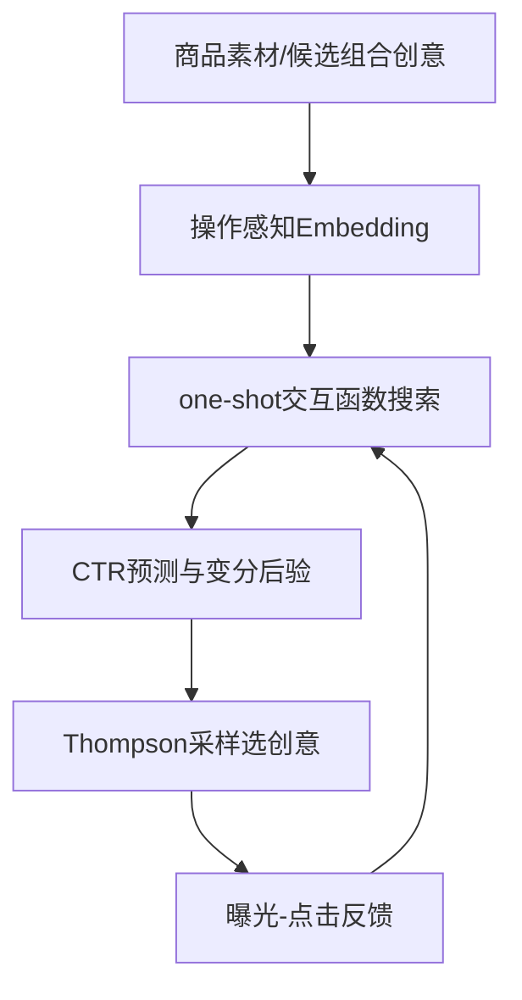
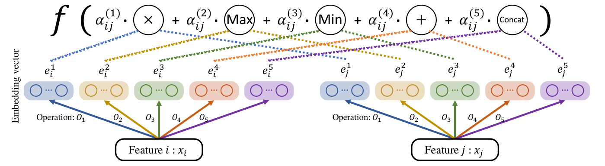

# Automated Creative Optimization for E-Commerce Advertising（电商广告创意自动优化）

- **会议/期刊**: WWW 2021
- **作者与机构**: Jin Chen, Ju Xu, Gangwei Jiang, Tiezheng Ge, Zhiqiang Zhang, Defu Lian, Kai Zheng；UESTC / Alibaba / USTC
- **推荐链路定位**: 精排/在线创意优选（曝光时刻在候选组合创意中选一）
- **研究方向**: CTR预估与特征交叉 / 强化学习与动态探索推荐
- **论文原文**: [https://arxiv.org/abs/2103.00436v1](https://arxiv.org/abs/2103.00436v1)
- **开源代码**: [https://github.com/alimama-creative/AutoCO](https://github.com/alimama-creative/AutoCO)

## TL;DR (1分钟核心速览)

针对电商组合创意数量爆炸、单创意反馈极稀疏、FM内积交互表达不足三个痛点，AutoCO用one-shot AutoML搜索创意元素间的最优交互算子，并以重参数化变分推断+Thompson Sampling在线探索候选创意。在合成数据与Mushroom/Adult bandit评测中降低累积regret，线上A/B测试CTR相对提升7%。

## Background & Motivation (背景与核心矛盾)

- **主流范式**: 智能广告平台按模板、图片、字体、颜色等素材自动合成创意；传统做法用FM/线性bandit预估CTR后贪心选择。
- **前人局限**: 组合创意指数爆炸且单产品曝光有限，导致每个创意的反馈极稀疏、CTR预估高方差；FM内积未必能表达元素间复杂交互，贪心选择也忽略不确定性。
- **核心洞察 (Key Insight)**: 离线统计显示不同交互算子均优于FM（IFS平均AUC 0.6050 vs. FM 0.5947，+1.71%），说明元素间交互函数本身值得搜索；同时Thompson Sampling可缓解稀疏反馈下的探索不足。
- **本文切入点**: 将“交互函数选择”与“参数后验估计”端到端联合，用AutoML搜算子、用变分贝叶斯做探索。

## Method (核心方法设计)

### 1. 整体框架 (Overall Architecture)

模型输入为商品素材、候选创意元素与上下文特征；先为每个元素生成操作感知嵌入，再对所有元素对进行可微的one-shot交互函数搜索，得到CTR预测器；训练时对参数后验做变分近似，在线曝光时从后验采样一组参数，对候选创意打分并选最高者，观测点击后增量更新。该闭环把复杂交互建模与探索利用统一在一个端到端框架中。

### 2. 关键设计拆解 (Key Designs)

1. **One-shot交互函数搜索**：将元素对之间的算子选择松弛为连续权重，避免遍历$|\mathcal{O}|^K$种组合。核心式为$\bar{\mathcal{O}}_{ij}(X)=\sum_{k=1}^{|\mathcal{O}|}\alpha_{ij}^{(k)}\mathcal{O}_{ij}^{(k)}(X)$，并约束$\boldsymbol{\alpha}_{ij}\in\mathcal{C}_1\cap\mathcal{C}_2$，其中$\mathcal{C}_1=\{\boldsymbol{\alpha}\mid\|\boldsymbol{\alpha}\|_0=1\}$保证每对元素最终只选一个算子，$\mathcal{C}_2$限制权重范围以稳定训练。直觉是把离散AutoML变成带prox投影的可微搜索。

2. **Operation-Aware Embedding (OAE)**：共享嵌入会让同一特征同时接收plus、multiply、concat等异构算子的梯度，量级冲突导致收敛不稳。OAE为每个算子$k$分配独立嵌入，将交互重写为$\mathcal{I}[x,\alpha,\Theta]=\sum_{i<j}\sum_{k}\alpha_{ij}^{(k)}\mathcal{O}_{ij}^{(k)}(e_i^{(k)},e_j^{(k)})$，使不同算子互不干扰。图2展示了该搜索空间：同一特征在不同操作下拥有独立嵌入。

<figure class="paper-figure" markdown="span">
  <figcaption>图2：使用 Operation-Aware Embedding 模块的搜索空间表示。</figcaption>
</figure>

3. **变分推断与Thompson Sampling**：由于复杂算子使后验不可解析，设$q(\Theta)=\mathcal{N}(\mu,\Sigma)$，用重参数化$\Theta^{(s)}=\mu+\Sigma^{1/2}\odot\epsilon$采样，训练目标为$\mathcal{L}=\mathrm{KL}(q(\Theta)\|p(\Theta))-\sum_{(x,y)}\log p(y|x,\Theta^{(s)})$。线上每次曝光采样参数后取$\arg\max_c \mathbb{E}[r|x_c]$；反馈为二元点击，无需负采样，推理开销主要是候选创意前向打分与小时级增量更新。

## Experimental Setup & Evaluation Protocol (实验设置与评估协议)

- **数据集与预处理**:

| 数据集 | 规模 | 特征/元素 | 反馈与评估 |
| :--- | :---: | :---: | :--- |
| Synthetic | 167个商品，平均67个创意/商品，20批次共2M曝光 | 模板、图片尺寸、字体、背景虚化、背景色 | 模拟延迟反馈，每10k trials更新；平均CTR 0.0885 |
| Mushroom | 8,124样本，采样50k trials | 22个属性 | 公共bandit模拟；吃安全蘑菇+5，毒性蘑菇以0.5概率+5否则-35 |
| Adult | 48,842样本，使用9个类别特征 | 14个属性 | 公共bandit模拟；预测正确+1，否则0 |
| Online | 1,000商品，>290k创意，6天 | 创意元素+商品类目+ResNet图像特征 | 每算法每日>150k曝光，随机均分流量，小时级更新 |

- **数据划分与防穿越 (Splitting Strategy)**: 非传统train/test划分，采用序贯bandit协议；合成数据按20个batch推进并模拟延迟反馈，公共数据按bandit trial在线累积，线上A/B按流量随机分流。
- **排名评测协议 (Ranking Protocol)**: 非Full-Ranking/非Sampled Ranking；在候选创意集合内做在线选择，报告累积regret、归一化累积CTR及线上A/B CTR。regret越低越好。
- **对比基线与超参设置**: 对比Uniform、ε-greedy、LinUCB、LinTS、MVT、FM、FM-TS及固定单算子TS变体；ε-greedy离线$\epsilon=0.1$、线上0.2。正文未突出报告嵌入维度$d$与显著性检验，主要报告5次/3次重复的均值与标准误。

## Key Experimental Results (实验关键数据)

### 1. 主实验对比 (Main Results)

公共数据集累积regret（相对Uniform=100，越低越好；**加粗为最优**）：

| 方法 | Mushroom Regret↓ | Adult Regret↓ |
| :--- | :---: | :---: |
| **AutoCO** | **3.02±0.51** | **35.40±0.03** |
| Concat-TS | 6.12±2.37 | 35.79±0.06 |
| Plus-TS | 3.40±0.30 | 37.19±0.39 |
| Min-TS | 3.62±0.35 | 38.34±2.01 |
| Max-TS | 4.95±2.00 | 36.55±1.18 |
| Multiply-TS | 5.44±1.05 | 49.28±0.36 |
| FM-TS | 5.64±1.70 | 38.71±2.30 |
| Uniform | 100.00±0.38 | 100.00±0.15 |

AutoCO相对各数据集最优基线的regret降低：Mushroom 3.02 vs. 3.40，**Improv. 11.2%**；Adult 35.40 vs. 35.79，**Improv. 1.1%**。相对Uniform分别降低96.98%与64.60%；线上6天A/B平均CTR相对基线提升7%。

### 2. 消融实验 (Ablation Study)

| 设置 | Synthetic CTR↑ | Mushroom Regret↓ | Adult Regret↓ |
| :--- | :---: | :---: | :---: |
| AutoCO full | **0.1102±0.0014** | **3.02±0.51** | **35.40±0.03** |
| w/o OAE | 0.1097±0.0006 | - | - |
| w/o TS（Greedy） | 0.1073 | 5.58±0.51 | 40.07±0.40 |
| FM+TS（去掉交互搜索） | 0.1055 | 5.64±1.70 | 38.71±2.30 |

### 3. 关键实验发现 (Key Findings)

- **交互搜索是主增益来源**：合成数据上AutoCO+TS的CTR 0.1102，较FM-TS的0.1055相对提升4.45%；Mushroom regret由5.64降至3.02，降低46.5%，说明固定内积/单算子不足。
- **Thompson Sampling显著优于贪心**：Mushroom上去掉TS后regret从3.02升至5.58（+84.8%），Adult由35.40升至40.07（+13.2%）；ε-greedy在Mushroom/Adult的regret高达63.38/58.85，证明稀疏反馈下按后验概率探索更有效。
- **OAE与线上收益互相印证**：OAE带来0.1097→0.1102的稳定提升；线上前2天仅持平，第3天起持续拉开，最终CTR+7%，而context-free TS因单创意日均曝光不足1次几乎无提升。

## Highlights & Limitations (亮点、对比与审稿批判)

- **与代表作对比 (vs. Prior Work)**: FM仅用内积建模元素交互；LinUCB/MVT用线性bandit捕捉元素关系；SIF虽搜索user-item交互函数，但未处理创意组合爆炸与后验探索。AutoCO把可微算子搜索、OAE与变分TS整合到在线创意优选。
- **可迁移亮点**: 操作感知嵌入可迁移到多特征交叉网络，缓解异构算子梯度冲突；one-shot算子搜索+变分TS适合候选空间大、反馈稀疏的冷启动排序场景。
- **审稿级局限批判**: 公共验证仅Mushroom/Adult，非真实电商创意数据；正文未报告$d$、显著性检验及算子搜索稳定性。线上更新依赖小时级重训与后验采样，且只优化CTR，未约束视觉质量与长期收益。

## Rating (四维评分)

- **方法创新性 (Novelty)**: ⭐⭐⭐⭐ （AutoML交互函数搜索与变分Thompson Sampling端到端结合较新，但各组件均有前作影子）
- **评估协议与实验扎实度 (Protocol & Experiments)**: ⭐⭐⭐ （合成+两个公共bandit+线上A/B较完整，但缺少标准电商数据和显著性检验）
- **写作与数学规范度 (Clarity & Rigor)**: ⭐⭐⭐⭐ （算法与公式清晰，搜索约束和后验推导完整；部分符号/似然表述略混）
- **工业落地与复现价值 (Industrial & Practical Value)**: ⭐⭐⭐⭐ （开源代码、线上+7%CTR有说服力；后验采样与频繁更新带来工程开销）

