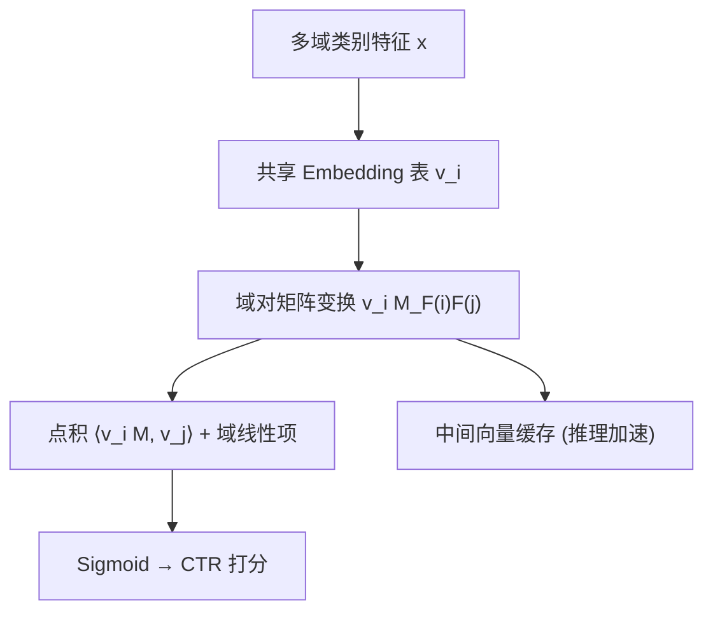
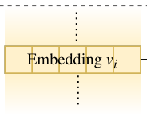

# $FM^2$: Field-matrixed Factorization Machines for Recommender Systems (域矩阵化分解机)

- **会议/期刊**: WWW 2021 (The Web Conference)
- **作者与机构**: Yang Sun, Junwei Pan, Alex Zhang, Aaron Flores (Yahoo Research / Verizon Media)
- **推荐链路定位**: 精排（浅层 CTR 预估，可作为深度模型的低阶组件）
- **研究方向**: CTR/CVR 预估与特征交叉
- **论文原文**: [https://arxiv.org/abs/2102.12994v2](https://arxiv.org/abs/2102.12994v2)
- **开源代码**: [https://github.com/VerizonMedia/FmFM](https://github.com/VerizonMedia/FmFM)

## TL;DR (1分钟核心速览)

针对 FFM 参数量爆炸（$O(mnK)$，Criteo 上 859M）而 FwFM 仅用标量刻画域交互、表达力不足的矛盾，本文提出 FmFM：为每个域对学习一个$K\times K$矩阵$\mathbf{M}_{F(i),F(j)}$，把特征向量线性变换到对方域空间再做点积，并证明 FM/FwFM/FvFM 分别是该矩阵取单位阵/标量阵/对角阵的特例。在 Criteo、Avazu 的 80/10/10 随机划分全量评测下，FmFM 以 14.63M 参数取得浅层模型最优 AUC（0.8109 / 0.7763），并借助域自适应维度与中间向量缓存把推理 FLOPs 从 40 万压到 8,960。

## Background & Motivation (背景与核心矛盾)

- **主流范式**: 多域类别特征场景下，FM 用共享 embedding 内积建模二阶交叉，FFM 为每个特征学 $n-1$个域专属 embedding，FwFM 用一个域对标量权重$r_{F(i),F(j)}$ 缩放内积。
- **前人局限**: (1) FFM 表达力强但参数与内存为 $O(mnK)$，Criteo 上比 FM 大近 60 倍，工业部署不友好；(2) FwFM 只有一维自由度，只能调"交互强度"而无法调"交互方向/语义子空间"，且所有域被迫共享同一维度$K$。
- **核心洞察 (Key Insight)**: 若把 FwFM 的 $\langle \boldsymbol{v}_i,\boldsymbol{v}_j\rangle r$改写为$\langle \boldsymbol{v}_i (r\mathbf{I}_K), \boldsymbol{v}_j\rangle$，则 FM/FwFM/FvFM 只是"域矩阵"受限程度不同的同一族模型——自由度依次为 0/1/2/3，FmFM 是释放到满矩阵的自然终点。矩阵不必是方阵，可顺带实现域特异维度。
- **本文切入点**: 用共享 embedding + 域对变换矩阵（推理式变换而非独立记忆）替代 FFM 的多份 embedding，兼顾表达力与参数效率。

## Method (核心方法设计)

### 1. 整体框架 (Overall Architecture)

输入一条多域类别样本后，每个激活特征先从**唯一一张** embedding 表查出 $\boldsymbol{v}_i$；对每个特征对$(i,j)$，用域对矩阵$\mathbf{M}_{F(i),F(j)}$把$\boldsymbol{v}_i$变换为域$F(j)$空间中的中间向量$\boldsymbol{v}_{i,F(j)}=\boldsymbol{v}_i\mathbf{M}_{F(i),F(j)}$，再与$\boldsymbol{v}_j$点积得交叉项；线性部分改为域向量内积$\langle \boldsymbol{v}_i,\boldsymbol{w}_{F(i)}\rangle$ 以省去逐特征标量。全模型仍是 logistic loss 下的浅层二阶结构，可直接作为 DeepFM/DCN 类模型的低阶模块。训练完成后，中间向量可离线缓存，在线等价于一次 FFM 式查表+点积。

### 2. 关键设计拆解 (Key Designs)

1. **域矩阵交叉项 (Field-matrixed Interaction)**：痛点是不满足于标量缩放、又不想付 FFM 的参数量。核心算子
$\Phi_{FmFM}=w_0+\sum_i x_i w_i+\sum_{i<j}x_i x_j\langle \boldsymbol{v}_i\mathbf{M}_{F(i),F(j)},\boldsymbol{v}_j\rangle$，
等价于加权外积 $p(\boldsymbol{v}_i,\boldsymbol{v}_j,\mathbf{W})=\sum_{k}\sum_{k'}v_i^k v_j^{k'}w^{k,k'}_{F(i),F(j)}$。直觉：矩阵把"特征$i$在域$j$语境下的语义"显式建模为一次线性投影，比标量多出方向性表达，又因 embedding 共享而保持$O(n^2K^2)$量级的域参数（$n\ll m$）。

<figure class="paper-figure" markdown="span">
  <figcaption>图 1：FmFM 交互项计算示例</figcaption>
</figure>

2. **统一自由度阶梯与 FFM 的本质差异**：FM 取 $\mathbf{M}=\mathbf{I}_K$（自由度 0，不可学），FwFM 取$r\mathbf{I}_K$（自由度 1），FvFM 取$\mathrm{diag}(\boldsymbol{d})$（自由度 2，即$\boldsymbol{v}_i\odot \boldsymbol{d}$），FmFM 取满矩阵（自由度 3）。FFM 无法纳入该框架：它为每个特征存$n-1$份独立 embedding，是"记忆"；FmFM 只有一份 embedding，$n-1$个中间向量由矩阵"推理"得到且相互绑定——长尾特征对$(v_i,v_k)$即使从未共现，也能借高频对$(v_i,v_j)$训好的$\boldsymbol{v}_i$与域矩阵$\mathbf{M}_{F(i),F(k)}$ 推断出来。这正是 FmFM 抗过拟合的机理。

3. **域特异维度软剪枝 + 中间向量缓存**：矩阵允许非方阵 $\mathbf{M}\in\mathbb{R}^{d_i\times d_j}$，故各域可设不同维度（如 `user_gender` 3 值用 5 维、`top_level_domain` 百万值用 7 维），实现"软剪枝"——低强度域对保留低维通道而非像 DeepLight 那样二值剪掉。维度由两阶段法确定：先以$K=16$全量训练，对各域 embedding 表做 PCA，保留 95% 方差得平均维度 7.72，再从零重训。推理侧利用对称性$\langle \boldsymbol{v}_i\mathbf{M},\boldsymbol{v}_j\rangle=\langle \boldsymbol{v}_j\mathbf{M}^\top,\boldsymbol{v}_i\rangle$，总是缓存维度较小的一侧，例如$[2,14]$ 矩阵缓存 2 维侧可省 7 倍内存与计算。总损失仍为加权 logistic loss + L2，负样本即曝光未点击样本（无额外负采样策略），推理仅需千级 FLOPs。

## Experimental Setup & Evaluation Protocol (实验设置与评估协议)

| 数据集 | #Users(样本) | #Fields | #Features | 正负比 | 说明 |
| :--- | :---: | :---: | :---: | :---: | :--- |
| Criteo | 45.84M (36.67M/4.58M/4.58M) | 39 (13 数值+26 类别) | 1,327,180 | ~1:3 | 数值特征取 $\log(x)^2\ (x>2)$ |
| Avazu | 40.43M (32.34M/4.04M/4.04M) | 23 (全类别) | 1,544,257 | ~1:5 | 时间戳拆为 day_of_week(0-6) 与 hour(0-23) |

- **数据划分与防穿越**: **随机 80%/10%/10% 划分**（作者强调比部分工作的 90/10 更严格，留出独立验证集），**非全局时间戳切分**，存在轻微未来信息泄漏风险。
- **排名评测协议**: CTR 二分类评测，指标为 **AUC 与 Log Loss**（全测试集，非采样排序）；低频特征（Criteo <8 次、Avazu <5 次）统一替换为 `unknown`，不做 5-core 过滤。
- **对比基线与超参**: 浅层 LR/FM/FwFM/FFM/FvFM，深度模型 Wide&Deep、Deep&Cross、DeepFM、xDeepFM、AutoInt、FiBiNET、DeepLight（DNN 结果直接引原文最优值，DCN 因原文缺 AUC 自行复现）；$K=16$，$\lambda$与学习率在验证集上网格搜索，TensorFlow 实现，$0.001$ 级 AUC 差异即视为显著。

## Key Experimental Results (实验关键数据)

### 1. 主实验对比 (Main Results)

| 模型 | Criteo AUC | Criteo LogLoss | Avazu AUC | Avazu LogLoss | 参数量 (Criteo) |
| :--- | :---: | :---: | :---: | :---: | :---: |
| LR | 0.7917 | 0.4582 | 0.7517 | 0.3953 | 1.33M |
| FM | 0.8075 | 0.4441 | 0.7695 | 0.3857 | 14.63M |
| FwFM | 0.8092 | 0.4426 | 0.7731 | 0.3835 | 14.63M |
| FFM | 0.8103 | 0.4414 | 0.7761 | 0.3826 | 859.18M |
| FvFM (ours) | 0.8101 | 0.4417 | 0.7733 | 0.3834 | 14.63M |
| **FmFM (ours)** | **0.8109** | **0.4410** | **0.7763** | **0.3822** | 14.63M |
| Deep & Cross | 0.8118 | 0.4413 | 0.7826 | 0.3791 | — |
| xDeepFM | 0.8052 | 0.4418 | — | — | — |
| FiBiNET | 0.8103 | 0.4423 | — | — | — |
| DeepLight | 0.8123 | 0.4395 | 0.7897 | 0.3748 | — |
| **Improv. vs FM** | +0.42% | -0.70% | +0.88% | -0.91% | — |
| **Improv. vs FFM** | +0.07% | -0.09% | +0.03% | -0.10% | 缩小 58.7× |

### 2. 消融实验 (Ablation Study)

自由度阶梯 + 维度/缓存优化（Criteo）：

| 配置 | 域矩阵形式 | 平均维度 | FLOPs | AUC | LogLoss |
| :--- | :--- | :---: | :---: | :---: | :---: |
| FM | $\mathbf{I}_K$ (DoF 0) | 16 | 1,920 | 0.8075 | 0.4441 |
| FwFM | $r\mathbf{I}_K$ (DoF 1) | 16 | 25,272 | 0.8092 | 0.4426 |
| FvFM | $\mathrm{diag}(\boldsymbol{d})$ (DoF 2) | 16 | 25,272 | 0.8101 | 0.4417 |
| FmFM (full) | 满矩阵 (DoF 3) | 16 (100%) | 403,923 → 24,531 (cached) | **0.8109** | **0.4410** |
| FmFM + PCA 99% | 满矩阵 | 10.56 (66.0%) | 12,884 (52.5%) | 0.8109 | 0.4410 |
| **FmFM + PCA 95%** | 满矩阵 | **7.72 (48.2%)** | **8,960 (36.5%)** | 0.8108 | 0.4411 |
| FmFM + PCA 90% | 满矩阵 | 6.26 (39.1%) | 7,202 (29.4%) | 0.8103 | 0.4415 |
| FmFM + PCA 85% | 满矩阵 | 3.82 (23.9%) | 4,716 (19.2%) | 0.8084 | 0.4432 |

### 3. 关键实验发现 (Key Findings)

1. **自由度换 AUC 的边际收益递减且主要集中在 FwFM→FvFM 一步**：Criteo 上 FM→FwFM 提升 +0.0017，FwFM→FvFM +0.0009，FvFM→FmFM 仅 +0.0008 却使未缓存 FLOPs 膨胀 16 倍，说明满矩阵的表达力红利需靠缓存+降维才能兑现；Avazu 上 FmFM 相对 FM 的 +0.0068 则显著大于 Criteo 的 +0.0034，提示高基数纯类别场景更吃域矩阵。
2. **共享 embedding 的"推理式变换"比 FFM 的"独立记忆"更抗过拟合**：FmFM 训练-测试 AUC 差仅 0.0074，远低于 FFM 的 0.0127 与 FwFM 的 0.0099，在参数少 58.7 倍的前提下测试 AUC 反而更高，直接验证了长尾域对可被域矩阵桥接的假设。
3. **95% 方差是性能-开销的甜点**：维度从 16 降到 7.72（48.2%）、FLOPs 降到 8,960（36.5%）时 AUC 仅掉 0.0001，而压到 80% 方差时 AUC 掉到 0.8080；最终优化版 FLOPs 仅为 Deep&Cross 的 1.76%、DeepLight 的 8.78%，却仍属浅层模型 AUC 第一梯队。

## Highlights & Limitations (亮点、对比与审稿批判)

- **与代表作对比 (vs. Prior Work)**: 相对 FFM，本文把"每特征 $n-1$ 份 embedding"换成"每域对一个矩阵"，参数降两个数量级并顺带解决长尾域对冷启动；相对 FwFM，把标量权重升级为矩阵，并首次给出 FM/FwFM/FvFM 的统一自由度视角（这是本文最被引用的理论贡献）；相对 DeepLight 等剪枝工作，把二值剪枝变为维度级软剪枝。
- **可迁移亮点**: (1) "先大维度训练 → 对各域 embedding 做 PCA 定维 → 二次重训"的两阶段降维流程，可直接搬到任何带域 embedding 表的模型；(2) 利用 $\mathbf{M}$ 转置对称性选择缓存小维度一侧的工程技巧，适合在线低延迟场景。
- **审稿级局限批判**: (1) 评测采用**随机划分而非时间切分**，CTR 场景下存在特征分布穿越，AUC 绝对值可能偏乐观；(2) 深度基线数值直接引自各自原论文，特征处理/优化器不一致，"comparable to DNN"的结论证据强度有限，且缺少线上 A/B 与延迟实测；(3) 模型本质仍是线性二阶，无法建模三阶及以上交叉，PCA 定维依赖一次全量训练，超参（保留方差比例）对稀疏域敏感。

## Rating (四维评分)

- **方法创新性 (Novelty)**: ⭐⭐⭐⭐ （域矩阵本身是 FwFM 的自然延伸，但"自由度 0/1/2/3"的统一框架与 FFM 记忆-vs-推理的机理解释具有真正的理论增量）
- **评估协议与实验扎实度 (Protocol & Experiments)**: ⭐⭐⭐ （两个亿级公开数据集 + 含验证集的严格划分值得肯定，但随机切分、深度基线引用他文数值、缺显著性检验与线上验证削弱了说服力）
- **写作与数学规范度 (Clarity & Rigor)**: ⭐⭐⭐⭐⭐ （从 FwFM 标量阵推导到满矩阵的脉络极清晰，参数量/FLOPs 复杂度逐模型列表，对称性引理有附录证明）
- **工业落地与复现价值 (Industrial & Practical Value)**: ⭐⭐⭐⭐⭐ （代码开源、14.63M 参数与 8,960 FLOPs 的推理预算对广告/推荐精排极具吸引力，可直接替换现有 FM 低阶模块）

