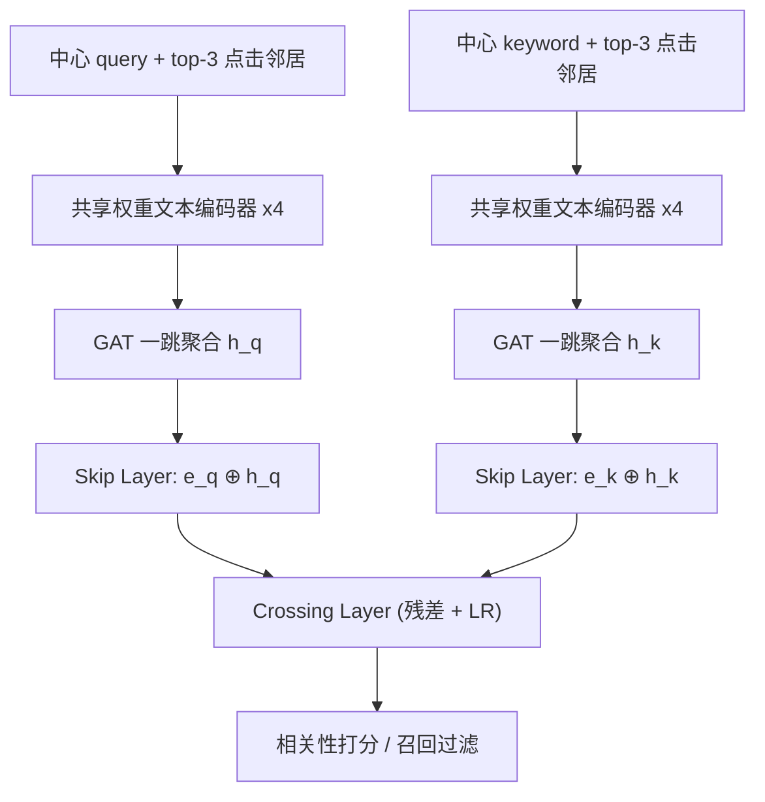
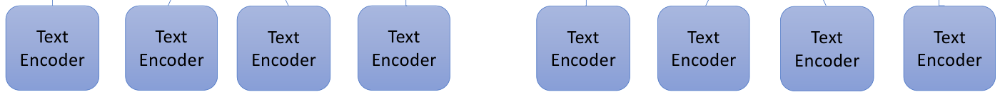

# TextGNN: Improving Text Encoder via Graph Neural Network in Sponsored Search (用图神经网络增强赞助搜索中的文本编码器)

- **会议/期刊**: WWW 2021 (The Web Conference)
- **作者与机构**: Jason Yue Zhu, Yanling Cui, Yuming Liu, Hao Sun, Xue Li, Markus Pelger, Tianqi Yang, Liangjie Zhang, Ruofei Zhang, Huasha Zhao（Stanford University & Microsoft）
- **推荐链路定位**: 召回 / 粗排（广告相关性 Relevance & Selection 阶段）
- **研究方向**: CTR/CVR 预估与特征交叉 / 图神经网络推荐
- **论文原文**: [https://arxiv.org/abs/2101.06323v3](https://arxiv.org/abs/2101.06323v3)
- **开源代码**: [https://github.com/microsoft/TextGNN](https://github.com/microsoft/TextGNN)

## TL;DR (1分钟核心速览)

赞助搜索的双塔文本相关性模型（TwinBERT）受限于纯语义输入，在长尾 query/广告上意图难以判定，而继续堆叠 Transformer 已进入收益递减。TextGNN 把用户点击日志构成的 query–keyword 行为图引入塔内：中心节点与其 top-3 邻居经**参数共享的同一文本编码器**编码，再由 GAT 聚合，并以残差方式与中心语义向量融合后送入 crossing layer，文本塔与图聚合端到端联合训练。在 3.97 亿 RoBERTa 蒸馏样本训练、24.3 万人工标注样本评估的协议下，ROC-AUC 由 0.8459 提升至 0.8471（+0.14%），最低频广告分组准确率提升约 1%；线上 A/B 测试 RPM +2.03%、广告缺陷率 −2.32%。

## Background & Motivation (背景与核心矛盾)

- **主流范式**: 工业界以 C-DSSM / TwinBERT 双塔结构做 query–keyword 相关性打分——keyword 塔离线预计算，线上只跑 query 塔，并配知识蒸馏压缩到 3 层 Transformer，以满足毫秒级延迟。
- **前人局限①（语义天花板）**: 纯文本语义对罕见词失效，如 `sharding` 被 WordPiece 切成 `sha/##rdi/##ng`，模型无从得知其与 `sql server` 的领域关联；`achilles heel` 被误判与"足底筋膜炎鞋"相关。
- **前人局限②（图只做特征泛化）**: 已有 GNN4CTR 工作仅把既有的**固定特征**连成图做邻居传播，图不参与特征生成、也无强动机说明特征为何天然成图，因此增益有限且难解释。
- **核心洞察 (Key Insight)**: 用户输入 query 后点击某广告，即隐含"该 keyword 满足其意图"的强信号——这是无需人工标注、覆盖全站的**互补信息源**；且恰恰在低频 item 上语义最弱、点击邻居的相对价值最大。
- **本文切入点**: 不做结构微调，而是把邻居的**原始文本**送进同一个共享文本编码器，让语言模型与图模型在同一损失下 co-train，把"图"变成"更好的文本表征"。

## Method (核心方法设计)

### 1. 整体框架 (Overall Architecture)

模型完全保留 TwinBERT 的双塔骨架。以 query 侧为例：给定中心 query 及其 top-3 点击邻居，四个句子分别送入**四份参数共享**的 3 层 Transformer 文本编码器（权重由 BERT-base 前三层初始化，去掉 segment embedding，采用加权平均池化得到句向量 $\boldsymbol{e}_0,\boldsymbol{e}_1,\boldsymbol{e}_2,\boldsymbol{e}_3$）；GNN Aggregator（实验取 GAT）以中心为锚点做一跳聚合得到$\boldsymbol{h}_q$，再经 **skip layer** 与中心句向量$\boldsymbol{e}_q$ 拼接或相加，得到该塔最终输出；keyword 侧同构。两侧向量拼接后经 TwinBERT 的残差 crossing layer + 逻辑回归输出相关性分数。训练分两段：先用 RoBERTa 教师对 3.97 亿 query–keyword 对打软标签做 MSE 蒸馏，再在人工标注数据上二分类微调。推理时 keyword 侧与全部邻居向量可离线预计算，线上仅需对 query 及其邻居跑一次批量前向，延迟与 TwinBERT 同量级。

<figure class="paper-figure" markdown="span">
  <figcaption>图2：TextGNN 架构：用于解耦生成查询/关键词嵌入的双塔结构</figcaption>
</figure>

### 2. 关键设计拆解 (Key Designs)

1. **共享编码器 + GAT 邻居聚合 + Skip 融合（把图信息写成"更好的文本向量"）**：痛点是把邻居当独立特征拼接会破坏塔结构的可离线预计算性。本文让邻居与中心共用同一编码器，聚合写作 $\boldsymbol{h}_{q}=\sum_{j\in\{0\}\cup\mathcal{N}(q)}\alpha_{qj}\mathbf{W}\boldsymbol{e}_{j}$，其中$\alpha_{qj}=\mathrm{softmax}_{j}\big(\mathrm{LeakyReLU}(\mathbf{a}^{\top}[\mathbf{W}\boldsymbol{e}_{q}\Vert\mathbf{W}\boldsymbol{e}_{j}])\big)$；随后$\boldsymbol{z}_{q}=\boldsymbol{e}_{q}\oplus\boldsymbol{h}_{q}$（$\oplus$ 为 concat 或 add）。直觉：邻居只在"中心语义不足以定性"时提供增量，残差结构保证当图输出被完全跳过时模型可退化回 TwinBERT，避免复杂模型在常见样本上过拟合。
2. **点击图构建与 ANN 代理邻居补全（解决图的覆盖率）**：邻居定义为过去一年内曝光 ≥50 次（抑制 CTR 小样本噪声）且被点击的广告 keyword，按 CTR 取 top-3。原始点击图覆盖率极低——仅 37% 的 query、87% 的 keyword 有邻居，长尾输入几乎全被 50 次曝光门槛过滤掉。作者用 C-DSSM 向量 + NGS 近似最近邻检索，为无邻居节点找"语义近邻且有点击邻居"的代理 query 并借用其 keyword（等价于隐式 query rewriting），使覆盖率升至 query 100% / keyword 99%。选 3 个邻居是"互补信息 vs. 编码器前向次数 vs. 噪声污染"的折中。
3. **训练目标、蒸馏与推理开销**：蒸馏阶段最小化软标签均方误差 $\mathcal{L}_{\text{KD}}=\frac{1}{N}\sum_{i}\big(\hat{y}_{i}-s_{i}^{\text{RoBERTa}}\big)^{2}$（连续分数比二值标签信息更细），微调阶段用二元交叉熵；负采样即日志中未点击对，无需额外构造。线上只跑 query 塔 + 邻居并行前向，keyword 侧全部离线，参数增量仅为每塔 4 倍编码器前向（可并行、可缓存）。

## Experimental Setup & Evaluation Protocol (实验设置与评估协议)

- **数据集与预处理**:

| 数据 | 规模 | 说明 |
| :--- | :---: | :--- |
| 蒸馏训练集 | 397M query–keyword 对 | RoBERTa 教师打 0–1 连续分 |
| 人工评测集 | 243k 样本 | 5 级相关性（excellent/perfect/good/fair/bad），前 4 级归为正 |
| 点击图日志 | 2019-07 ~ 2020-06 | 曝光 ≥50 且被点击的广告 keyword，按 CTR 取 top-3 |
| 覆盖率 | query 37%→100%，keyword 87%→99% | 加入 ANN 代理邻居前后 |

- **数据划分与防穿越**: 工业日志按时间窗口截取（过去一年点击日志构图），人工标注集为独立抽样评测集，未见"训练/测试时间重叠"说明，属**离线留出划分 + 线上 A/B**。
- **排名评测协议**: 非全库排序，而是**点对二分类 / Sampled 评估**——主指标 ROC-AUC（离线）与 PR-AUC、RPM、广告缺陷率（线上人工抽检）；广告缺陷率由抽样人工标注近似。
- **对比基线与超参**: 基线为同数据同超参训练的 TwinBERT（3 层、$H=512$、$A=8$、加权池化），变体为"原生点击图"与"点击图+ANN"两种图；学生模型由 BERT-base 前 3 层初始化；线上简化为 C-DSSM + 仅商品侧图聚合。

## Key Experimental Results (实验关键数据)

### 1. 主实验对比 (Main Results)

| 模型 | 图信息 | ROC-AUC | Δ vs TwinBERT | 线上 RPM | 线上缺陷率 |
| :--- | :--- | :---: | :---: | :---: | :---: |
| TwinBERT (baseline) | 无 | 0.8459 | — | — | — |
| TextGNN (原生点击图) | 37% query 覆盖 | 0.8461 | +0.02% | — | — |
| **TextGNN + ANN 邻居** | **~100% 覆盖** | **0.8471** | **+0.14%** | **+2.03%** | **−2.32%** |
| 线上 Selection 阶段（简化 C-DSSM 版） | ANN 图 | — | — | +1.21% | −0.34% |

### 2. 消融与分组实验 (Ablation & Subgroup)

| 广告频次分组（占比） | TwinBERT | TextGNN（原生图） | TextGNN+ANN |
| :--- | :---: | :---: | :---: |
| 1 次曝光（43%，最稀有） | 84.91 | **85.18** | 84.97 |
| 2 次曝光（12%） | 84.85 | 84.50 | **85.28** |
| 3+ 次曝光（45%，常见） | 85.28 | 85.14 | **86.04** |

（表中为分组 ROC-AUC×100，读自原文图 4，均为相对基线的同尺度比较）

### 3. 关键实验发现 (Key Findings)

1. **增益主要来自长尾而非全体**：整体 AUC 仅 +0.14%，但"仅曝光 1 次"的最稀有分组上原生图 TextGNN 从 84.91 提升到 85.18（约 +1% 相对准确率），而常见广告分组反而降到 85.14——说明纯语义已足够时，稀疏图带来的额外参数只造成欠拟合与噪声。
2. **图的价值取决于覆盖率而非聚合器**：原生点击图只让 37% 的 query 获得邻居，因此整体几乎无增益（+0.02%）；ANN 补全把覆盖率拉到 100% 后，模型才在**所有频次分组**上一致优于基线（最高 86.04）。这直接反驳了"换更强的 GNN 聚合器即可"的思路。
3. **原生邻居质量 > 代理邻居质量**：最稀有分组上 ANN 版本（84.97）反而不如原生图（85.18），因为代理邻居语义相似但行为意图可能偏离，引入噪声；提示可按样本频次在"原生图 / ANN 图 / 无图"三档模型间动态切换。
4. **线上收益远大于离线 AUC 差异**：AUC +0.14% 却换来 RPM +2.03%、缺陷率 −2.32%，说明该任务上离线 AUC 对业务指标的分辨率极低，也说明相关性模型的排序头部区域改善被放大。

## Highlights & Limitations (亮点、对比与审稿批判)

- **与代表作对比 (vs. Prior Work)**: 与 C-DSSM/TwinBERT 的本质差别是**引入语义之外的互补信息源**而非改网络结构；与 GNN4CTR 类工作（如利用图泛化既有特征）差别是图信息参与**表征生成**并与文本编码器联合优化，且"无图即退化为基线"的残差设计使增益可归因；与 label propagation 类半监督方法差别是邻居特征显式进入前向计算而非仅传播软标签。
- **可迁移亮点**: ①"共享编码器 + 残差 skip + 可退化为基线"是把图/序列/多模态旁路信息注入双塔的通用安全范式，天然兼容离线预计算；②ANN 代理邻居补全是一个廉价的冷启动/长尾图补全技巧，可直接用于社交图、序列物品图。
- **审稿级局限批判**: ①**实验体量偏弱**——主表只有 3 行、无外部强基线（如 BERT 交叉编码器、其他 GNN 变体）、无显著性检验，AUC 差异仅 0.0012，稳定性存疑；②**邻居数量与门槛（top-3、50 次曝光）全靠人工经验**，未做敏感性分析；③推理时每塔需 4 倍编码器前向，虽然可缓存 keyword 侧，但 query 侧邻居向量必须实时计算，延迟分析缺失；④评估为点对分类而非全库排序，与召回场景的真实排序质量存在偏差。

## Rating (四维评分)

- **方法创新性 (Novelty)**: ⭐⭐⭐⭐ （"图信息注入塔内 + 共享编码器 + 残差可退化"是干净且工业友好的组合式创新，但组件本身均为已有技术的自然拼装，缺乏理论刻画）
- **评估协议与实验扎实度 (Protocol & Experiments)**: ⭐⭐⭐ （有真实线上 A/B 与分组分析是亮点，但离线仅 3 组对比、无显著性检验、无强外部基线，主指标差异过小）
- **写作与数学规范度 (Clarity & Rigor)**: ⭐⭐⭐⭐ （架构、构图、蒸馏三段叙述清晰，公式简洁；但 GAT 聚合与损失仅给出通用形式，且排版存在图号/小节编号错乱）
- **工业落地与复现价值 (Industrial & Practical Value)**: ⭐⭐⭐⭐⭐ （已上线、关键词塔可离线缓存、延迟与 TwinBERT 同量级，官方开源 BERT 版实现，落地门槛极低）

