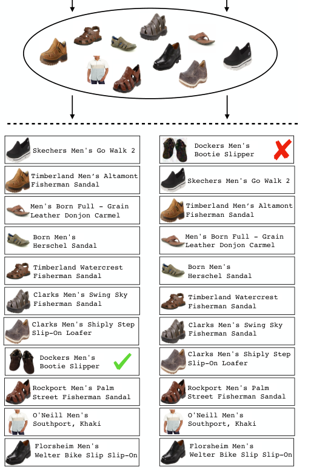
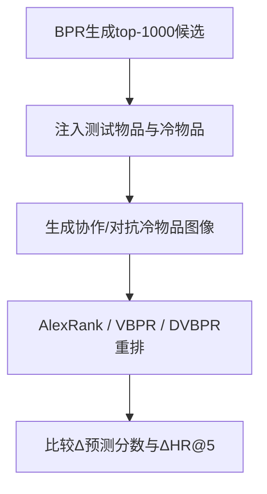

# Adversarial Item Promotion: Vulnerabilities at the Core of Top-N Recommenders that Use Images to Address Cold Start (对抗物品推广：使用图像解决冷启动的 Top-N 推荐器核心漏洞)

- **会议/期刊**: WWW 2021
- **作者与机构**: Zhuoran Liu, Martha Larson；Radboud University
- **推荐链路定位**: 重排（视觉感知的二阶段候选重排）
- **研究方向**: 去偏公平、可信隐私与工业架构 / 冷启动与长尾推荐
- **论文原文**: [https://arxiv.org/abs/2006.01888v3](https://arxiv.org/abs/2006.01888v3)
- **开源代码**: [https://github.com/liuzrcc/AIP](https://github.com/liuzrcc/AIP)

## TL;DR (1分钟核心速览)

本文指出：用商品图像缓解冷启动的视觉推荐器，其排序核心可被商家通过改图直接攻击。作者提出 AIP 攻击，分别以 INSA 嵌入扰动、EXPA hook 图拉近、c-SEMA 语义拼贴生成对抗冷物品，并在 Amazon Men/Tradesy 的 BPR top-1000 候选集上使冷物品 HR@5 大幅上升，例如 DVBPR 从 0.0010 升至 0.7211；同时证明 AMR 与图像压缩防御不足。

## Background & Motivation (背景与核心矛盾)

- **主流范式**: AlexRank、VBPR、DVBPR 等视觉感知推荐器将商品图像特征并入排序，以补足冷启动物品的交互缺失。
- **前人局限**: TAaMR 等对抗图像工作攻击分类器，不直接优化排序分数；profile/poisoning 攻击需伪造用户，不适合可自行上传商品图的单品商家。
- **核心洞察 (Key Insight)**: 冷启动物品的排名由“用户内容向量—图像嵌入”点积或视觉近邻决定，因此改图即可把冷物品嵌入推向高偏好区域或热销 hook 物品附近。
- **本文切入点**: 把攻击目标从分类损失改为排序得分，按攻击者知识水平定义 INSA、EXPA、SEMA 三类 AIP 攻击。

<figure class="paper-figure" markdown="span">
  <figcaption>图1：协作冷物品图像及其对应的对抗冷物品图像（上）分别注入由第一阶段排序器（此处为 BPR）生成的候选集。在由视觉感知第二阶段排序器（此处为 DVBPR）生成的个性化排序列表中，对抗物品（右）的排名远高于协作物品（左）。（图为真实示例。对抗物品图像由我们的 INSA 攻击生成，参数为 ε=32、epoch=5，详见第 4.1 节。）</figcaption>
</figure>

*图1：协作冷物品与对抗冷物品在同一候选集中被视觉排序器重排后的排名差异。*

## Method (核心方法设计)

### 1. 整体框架 (Overall Architecture)

采用两阶段设定：BPR 用交互生成每用户 top-1000 候选，再注入普通测试物品与一个冷物品，形成 1002 个候选，由 AlexRank/VBPR/DVBPR 重排。攻击端只修改冷物品图像：INSA 用全用户排序目标优化像素扰动，EXPA 将图像嵌入拉向 hook 物品，c-SEMA 则把 hook 商品拼入原图。评估比较协作冷物品与对抗冷物品的预测位移和 HR@5，并用 AMR、JPEG 压缩、位深降低检验防御。

### 2. 关键设计拆解 (Key Designs)

1. **INSA：直接攻击排序嵌入**：痛点在于分类器对抗样本不保证提升排名。以 DVBPR 为例，在 $L_\infty$ 球内最大化全体用户偏好：
$\max_{\|\boldsymbol{\delta}\|_\infty\le\epsilon}\sum_{u\in\mathcal{U}}\theta_u^\top\Phi_e(X_i+\boldsymbol{\delta})$。
直觉是沿用户内容向量的共同高分区推图像嵌入；对 AlexRank 则等价于缩短与用户历史物品的视觉距离。

2. **EXPA 与 SEMA：基于 hook 的低知识攻击**：真实商家拿不到用户嵌入，但可观察热销品。EXPA 选 hook 图并最小化嵌入距离：
$\min_{\|\boldsymbol{\delta}\|_\infty\le\epsilon}\|\Phi(X_i+\boldsymbol{\delta})-\Phi(X_{\mathrm{hook}})\|_2$，
借 hook 在偏好空间的位置把冷物品拉入高相关簇；c-SEMA 不优化像素，直接把 hook 商品作为 inset 拼入原图，甚至不需访问模型，因而跨排序器可迁移。

3. **训练目标、优化与推理开销**：被攻击模型沿用 BPR pairwise 损失，BPR 使用 bootstrap 负采样；AMR 防御在训练中加参数扰动：
$\min_\Theta\sum -\ln\sigma(p_{u,i}-p_{u,j})-\lambda_{\mathrm{adv}}\ln\sigma(p'_{u,i}-p'_{u,j})+\lambda_\Theta\|\Theta\|^2$。
AIP 无额外负采样，直接用 Adam 优化图像；INSA 取 $\epsilon=32$、10 epochs，单张 RTX 2080Ti 生成 1000 张对抗图约 2 小时。

## Experimental Setup & Evaluation Protocol (实验设置与评估协议)

- **数据集与预处理**:

| 数据集 | #Users | #Items | #Interactions | 稀疏度/密度 | 特征/场景说明 |
| :--- | :---: | :---: | :---: | :---: | :--- |
| Amazon Men | 34,244 | 110,636 | 254,870 | 密度约 0.0067% | 男装，图像+隐式反馈 |
| Tradesy.com | 33,864 | 326,393 | 655,409 | 密度约 0.0059% | C2C 二手服饰，冷启动关键 |

- **数据划分与防穿越 (Splitting Strategy)**: 每用户留一个交互物品作测试，属 `Leave-One-Out` 风格；另随机抽取 1000 个无交互冷物品并排除出训练，作为冷测试集。
- **排名评测协议 (Ranking Protocol)**: 非全库 `Full-Ranking`，而是 `候选集排序`：BPR top-1000 + 普通测试物品 + 协作/对抗冷物品 = 1002；指标为 prediction shift、HR@5/10/20，采用 item-level paired t-test，$p<0.01$。
- **对比基线与超参设置**: 三类受害排序器 AlexRank、VBPR、DVBPR；防御基线 AMR；分类器攻击对照 TAaMR（FGSM/PGD20）。BPR 维度 64，VBPR/DVBPR 嵌入 100，AlexRank 特征 2048。

## Key Experimental Results (实验关键数据)

### 1. 主实验对比 (Main Results)

下表为攻击后冷物品 HR@5；协作冷物品为攻击前基线，INSA 后越高表示攻击越成功。Δ 为绝对提升，因基线接近 0，百分比会失真。

| 数据集 | 排序器 | 协作冷物品 | INSA | EXPA | c-SEMA | INSA ΔHR@5 |
| :--- | :--- | ---: | ---: | ---: | ---: | ---: |
| Amazon Men | AlexRank | 0.0011 | **0.8296** | 0.0036 | 0.0017 | +0.8285 |
| Amazon Men | VBPR | 0.0017 | **0.2678** | 0.0150 | 0.0027 | +0.2661 |
| Amazon Men | DVBPR | 0.0010 | **0.7211** | 0.0646 | 0.0181 | +0.7201 |
| Amazon Men | AMR | 0.0013 | **0.7476** | 0.0185 | 0.0007 | +0.7463 |
| Tradesy | AlexRank | 0.0003 | **0.9399** | 0.0002 | 0.0000 | +0.9396 |
| Tradesy | VBPR | 0.0022 | **0.0783** | 0.0048 | 0.0048 | +0.0761 |
| Tradesy | DVBPR | 0.0011 | **0.2711** | 0.0384 | 0.0005 | +0.2700 |
| Tradesy | AMR | 0.0013 | **0.2858** | 0.0039 | 0.0047 | +0.2845 |

### 2. 消融实验 (Ablation Study)

以 INSA 的扰动强度 $\epsilon$作稳健性/敏感性分析，HR@5 随$\epsilon$ 变化：

| 设置 | Amazon DVBPR | Amazon VBPR | Amazon AlexRank | Tradesy DVBPR | Tradesy VBPR | Tradesy AlexRank |
| :--- | ---: | ---: | ---: | ---: | ---: | ---: |
| 协作冷物品 | 0.0007 | 0.0018 | 0.0023 | 0.0018 | 0.0025 | 0.0054 |
| $\epsilon=4$ | 0.0049 | 0.2932 | 0.7856 | 0.0015 | 0.0734 | 0.9280 |
| $\epsilon=8$ | 0.0391 | 0.3159 | 0.8180 | 0.0194 | 0.0755 | 0.9351 |
| $\epsilon=16$ | 0.3706 | 0.3498 | 0.8258 | 0.1116 | 0.0815 | 0.9381 |
| $\epsilon=32$ | **0.7039** | **0.3599** | **0.8297** | **0.2731** | **0.0842** | **0.9400** |

### 3. 关键实验发现 (Key Findings)

- **INSA 最强，且 AMR 不足以防住**：Tradesy 上 AlexRank 的冷物品 HR@5 从 0.0003 升至 0.9399；AMR 在 Amazon/Tradesy 仍被 INSA 推至 0.7476/0.2858，说明对抗训练提升普通精度并不等于排序鲁棒。
- **低知识 c-SEMA 已具现实威胁，且强于分类器攻击**：Amazon DVBPR 上 c-SEMA 将 HR@5 从 0.0010 提到 0.0181，约 18 倍；TAaMR 的 FGSM 对 DVBPR 仅 ΔHR@5=+0.0070，PGD20 甚至为负，表明直接攻击 ranker 比攻击分类器更有效。
- **扰动预算存在排序器差异**：AlexRank 在 $\epsilon=4$ 已饱和（0.7856→0.8297），DVBPR 则从 0.0049 升至 0.7039；短嵌入更脆弱，图像压缩需压到 JPEG 10% 或 2–3 bit 才可能降排，此时商品信息已被破坏。

## Highlights & Limitations (亮点、对比与审稿批判)

- **与代表作对比 (vs. Prior Work)**: TAaMR 攻击分类器，AIP 直接攻击用户—图像嵌入与排序分数；profile injection/poisoning 伪造用户，AIP 只改单品图像；AMR 旨在提升普通推荐性能，并非针对外部图像攻击的可靠防御。
- **可迁移亮点**: “hook 物品嵌入方向”可作为冷启动物品表征审计的探针；将攻击目标直接写在排序得分上，比分类损失更贴近推荐业务风险；同时报告 integrity 与 availability，值得用于推荐系统安全评测。
- **审稿级局限批判**: 评估限于 BPR top-1000 候选集与 1000 个冷物品，未做全库排序或线上点击验证，外部有效性有限；INSA 需用户嵌入、c-SEMA 主要靠人工拼贴，且缺少用户对图像质量感知的人评与多物品合谋场景。

## Rating (四维评分)

- **方法创新性 (Novelty)**: ⭐⭐⭐⭐ （首次把对抗图像攻击从分类器推进到视觉排序器嵌入，三类知识等级划分清晰）
- **评估协议与实验扎实度 (Protocol & Experiments)**: ⭐⭐⭐☆ （双数据集、三种受害模型与显著性检验较完整，但候选集排序和离线冷物品采样限制结论强度）
- **写作与数学规范度 (Clarity & Rigor)**: ⭐⭐⭐⭐ （攻击目标、威胁模型与指标定义明确，公式简洁；SEMA 形式化略弱）
- **工业落地与复现价值 (Industrial & Practical Value)**: ⭐⭐⭐⭐ （开源代码、攻击成本可控，直接揭示电商冷启动图像审核缺口，防御部分仍待补强）

