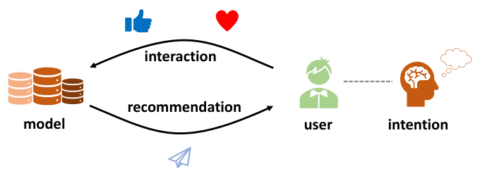
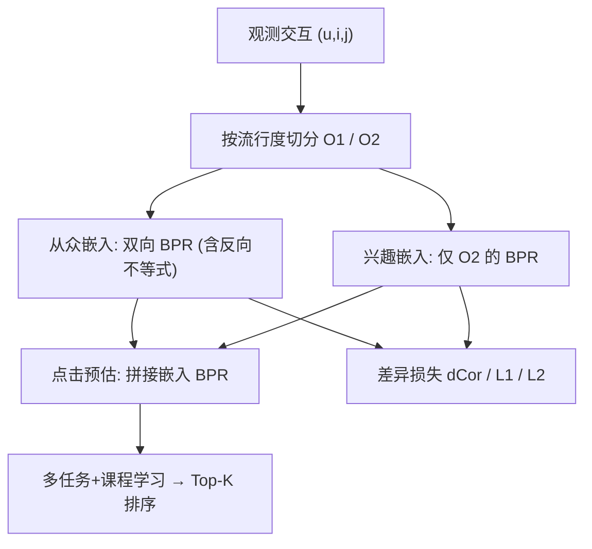

# Disentangling User Interest and Conformity for Recommendation with Causal Embedding (因果嵌入解耦用户兴趣与从众性)

- **会议/期刊**: WWW 2021 (The Web Conference)
- **作者与机构**: Yu Zheng, Chen Gao, Xiang Li, Xiangnan He, Depeng Jin, Yong Li（清华大学电子系、北京信息科学与技术国家研究中心、香港大学、中国科学技术大学）
- **推荐链路定位**: 召回（可插拔于任意嵌入式 backbone，实验验证于 BPR-MF 与 LightGCN）
- **研究方向**: 去偏公平、可信隐私与工业架构 / 协同过滤与双塔召回
- **论文原文**: [https://arxiv.org/abs/2006.11011v2](https://arxiv.org/abs/2006.11011v2)
- **开源代码**: [https://github.com/tsinghua-fib-lab/DICE](https://github.com/tsinghua-fib-lab/DICE)

## TL;DR (1分钟核心速览)

观测交互中混杂了「真实兴趣」与「对热门物品的从众」，既有 IPS 系方法只把流行度当作**物品侧的统一标量偏置**去重加权，既忽略了不同用户从众程度的异质性，又把两种成因捆绑进同一表征。本文提出 DICE：给用户/物品各配兴趣与从众两套嵌入，借助因果图中的**对撞效应 (colliding effect)** 从观测数据中切出「成因特定」样本分别训练两套嵌入，再用多任务 + 课程学习融合。在 40% 逆流行度干预构造的非 IID 测试集上，MF/LightGCN 双 backbone 下 Recall@20 提升 15%–23%，NDCG@20 最高提升 26.5%。

## Background & Motivation (背景与核心矛盾)

- **主流范式**: 将流行度偏置视为物品侧静态全局项，用 IPS 及其变体（IPS-C / IPS-CN / IPS-CNSR）对样本逆流行度重加权，或用 CausE 在小规模无偏数据上做双 MF 并对齐嵌入。
- **前人局限**: ①「同一用户对不同物品、不同用户对同一物品」的从众强度不同，单个标量偏置在数学上无法同时满足 $b_u^{(a)}>b_u^{(b)}$与$b_u^{(a)}<b_u^{(t)}$ 这类矛盾约束；②推荐系统是活的反馈回路（图 1），训练与服务的分布天然非 IID，捆绑表征在成因漂移时泛化崩塌。
- **核心洞察 (Key Insight)**: 参照图 2 的形状识别例子——训练集里「颜色/大小」与形状伪相关，只有解耦潜在因子的模型能在分布偏移下存活；点击正是「兴趣」与「从众」两个独立成因的**对撞点 (collider)**，条件化于点击后两成因反相关，这一结构可反推成因特定样本。
- **本文切入点**: 不做「物品侧去偏」，而是从**用户侧拆因**，用分离嵌入 + 成因特定数据实现结构性解耦。

<figure class="paper-figure" markdown="span">
  <figcaption>图 1：推荐系统的反馈回路。用户根据用户意图与模型交互，模型利用用户交互数据进行训练。</figcaption>
</figure>

## Method (核心方法设计)

### 1. 整体框架 (Overall Architecture)

DICE 为每个用户与物品各维护兴趣嵌入 $\boldsymbol{u}^{(int)},\boldsymbol{i}^{(int)}$与从众嵌入$\boldsymbol{u}^{(con)},\boldsymbol{i}^{(con)}$（维度 64×2，与基线 128 维参数量对齐）。打分采用加性因果模型$s^{click}_{ui}=\langle\boldsymbol{u}^{(int)},\boldsymbol{i}^{(int)}\rangle+\langle\boldsymbol{u}^{(con)},\boldsymbol{i}^{(con)}\rangle$。训练时按「负样本是否比正样本更热门」把三元组切到$\mathcal{O}_1/\mathcal{O}_2$，分别驱动从众、兴趣、点击、差异四个子任务，并以多任务课程学习衰减权重与采样 margin；推理时两套嵌入拼接后内积排序，可无缝嵌入 MF/LightGCN 等 backbone。

### 2. 关键设计拆解 (Key Designs)

1. **对撞效应驱动的成因特定样本构造**：观测数据只有「和」，无真值可分解，作者把等式改成不等式。当负样本比正样本更热门（Case 2，$\mathcal{O}_2$）时，点击不热门物品极大概率源于兴趣，故同时成立$M^I_{uc}>M^I_{ud}$、$M^C_{uc}<M^C_{ud}$与总和不等式；反之（Case 1，$\mathcal{O}_1$）只保留从众与总和不等式。这一步把「学绝对值」变成「学相对序」，使解耦从不可解变为可解。
2. **分离嵌入 + 差异损失**：用高维嵌入替代标量偏置，从一维解空间升维后可同时容纳用户的多面从众；再对两组嵌入加直接监督 $\mathcal{L}_{discrepancy}\in\{-L_1,-L_2,dCor\}$，其中$dCor$ 约束两组嵌入成对距离的相关性，解耦质量最佳（+2%）但每 epoch 约 100s，远慢于 L1/L2 的 44s。
3. **PNSM 负采样与课程训练**：仅当流行度差足够大时上述不等式才高概率成立，故要求负样本流行度 $>p+m_{up}$或$<p-m_{down}$；总损失$\mathcal{L}=\mathcal{L}^{click}+\alpha(\mathcal{L}^{int}+\mathcal{L}^{con})+\beta\mathcal{L}_{discrepancy}$，$\alpha=0.1,\beta=0.01$，且每个 epoch 将 margin 与$\alpha$ 乘 0.9 做「易到难」衰减，使模型对初始超参不敏感，推理无额外开销。

## Experimental Setup & Evaluation Protocol (实验设置与评估协议)

- **数据集与预处理**（评分 =5 记为正，其余为负）：

| 数据集 | #Users | #Items | #Interactions | 密度 | 熵(训练/测试) |
| :--- | :---: | :---: | :---: | :---: | :--- |
| Movielens-10M | 37,962 | 4,819 | 1,371,473 | 0.75% | 6.22 / 7.97 |
| Netflix | 32,450 | 8,432 | 2,212,690 | 0.81% | 6.85 / 8.54 |

- **数据划分与防穿越**: 非随机划分，按因果推荐标准协议构造**干预 (intervention) 划分**：以逆流行度概率抽取 40% 记录作干预集，概率上限截断 0.9 以抑制冷启物品；最终 70/10/20 = 训练（60% 常规 + 20% 干预）/ 验证（10% 干预）/ 测试（20% 干预）。测试熵显著高于训练熵，确保训练-测试非 IID。
- **排名评测协议**: 在干预后的测试集上做 Top-K（K=20/50）全候选排序，报告 Recall / HR / NDCG；未采用固定正负比采样排序。
- **对比基线与超参**: 基线含 MF、GCN 两个 backbone 上分别叠加 None / IPS / IPS-C / IPS-CN / IPS-CNSR / CausE；嵌入维度 128（IPS 系）与 64×2（CausE、DICE）以保证参数量一致；Adam 优化，网格搜索调参，$p<0.05$ 显著性。

## Key Experimental Results (实验关键数据)

### 1. 主实验对比 (Main Results)

TopK=20，Movielens-10M 与 Netflix：

| Backbone | 方法 | ML-10M Recall | ML-10M HR | ML-10M NDCG | Netflix Recall | Netflix HR | Netflix NDCG |
| :--- | :--- | :---: | :---: | :---: | :---: | :---: | :---: |
| MF | None | 0.1286 | 0.4429 | 0.0846 | 0.1122 | 0.5194 | 0.0943 |
| MF | IPS | 0.1335 | 0.4434 | 0.0852 | 0.1058 | 0.4882 | 0.0864 |
| MF | IPS-C | 0.1367 | 0.4564 | 0.0875 | 0.1119 | 0.5046 | 0.0919 |
| MF | IPS-CN | 0.1412 | 0.4700 | 0.0925 | 0.1080 | 0.5042 | 0.0935 |
| MF | IPS-CNSR | 0.1365 | 0.4588 | 0.0895 | 0.1110 | 0.5159 | 0.0948 |
| MF | CausE | 0.1157 | 0.4066 | 0.0744 | 0.0935 | 0.4641 | 0.0782 |
| MF | **DICE** | **0.1634** | **0.5197** | **0.1084** | **0.1258** | **0.5545** | **0.1070** |
| GCN | None | 0.1378 | 0.4625 | 0.0898 | 0.1026 | 0.4908 | 0.0870 |
| GCN | IPS-C | 0.1478 | 0.4829 | 0.0971 | 0.1157 | 0.5219 | 0.1004 |
| GCN | IPS-CN | 0.1119 | 0.3997 | 0.0701 | 0.0726 | 0.3991 | 0.0643 |
| GCN | CausE | 0.1027 | 0.3729 | 0.0632 | 0.0838 | 0.4289 | 0.0677 |
| GCN | **DICE** | **0.1812** | **0.5563** | **0.1228** | **0.1420** | **0.5910** | **0.1217** |
| GCN | Improv.% (vs 最优基线) | +22.6% | +15.2% | +26.5% | +22.7% | +13.2% | +21.2% |

### 2. 消融实验 (Ablation Study)

| 变体 (ML-10M, MF) | Recall@20 | HR@20 | NDCG@20 | 说明 |
| :--- | :---: | :---: | :---: | :--- |
| DICE 完整版 | **0.1634** | **0.5197** | **0.1084** | 全组件 |
| w/o PNSM (改随机负采样) | 0.1274 | 0.4394 | 0.0843 | 成因特定不等式失效，−22% Recall |
| w/o 从众建模 | 略降 | 略降 | 略降 | 指标降幅小，但从众嵌入分层混乱、离群点增多 |
| w/o 课程学习 (固定 $\alpha$) | — | — | 较低 | 初始值 0.1→1 时性能明显下滑，$>$0.5 后不稳定 |
| 差异损失 L1/L2 → dCor | — | — | +2% | 但每 epoch 44s → 100s |

### 3. 关键实验发现 (Key Findings)

1. **解耦换取的是分布偏移下的稳定性**：IPS-CN 在 ML-10M 上 Recall 0.1412 接近最优，但在 Netflix+MF 上仅 0.1080（不如 None 的 0.1122）；DICE 在两个数据集、两个 backbone、三个指标上全部第一，说明捆绑表征的增益高度依赖数据偏置形态，而解耦的增益是可迁移的。
2. **从众必须用嵌入而非标量**：BIAS-U / BIAS-I / BIAS-UI 三种标量偏置全部显著落后（图 4）；IOU 分析显示 DICE-con 与 ItemPop 的重合度在 TopK>40 时超 50%，而 DICE-int 几乎为 0，定量证明从众信息被彻底「挤」进另一套嵌入。
3. **强负采样是本框架的命门**：PNSM 换成均匀随机负采样后 Recall@20 从 0.1634 掉到 0.1274（−22%），因为因果不等式的成立概率直接取决于流行度间隔；此外，即使在 0% 干预训练数据下 DICE 仍优于 CausE（后者无法运行）与 IPS-CNSR，说明不依赖昂贵无偏数据也可落地。

## Highlights & Limitations (亮点、对比与审稿批判)

- **与代表作对比 (vs. Prior Work)**: IPS 系从物品侧统一重加权、零偏但高方差且无法区分用户；CausE 需额外小规模无偏数据并强制两套嵌入**相似**，与本文目标相反（本文要两套嵌入**独立**）；CV 领域的 $\beta$-VAE / 解耦 GCN 只分解物品属性（品牌、颜色），未触及从众这一与用户强相关的成因。
- **可迁移亮点**: ①「用 collider 结构把等式监督改造为不等式序监督」的思路可搬到任何无真值成因分解任务（如曝光-点击、转化延迟反馈）；②PNSM 的 margin 控制 + 课程衰减是低成本的高性价比 trick，可独立用于任何需要「强对比样本」的 pairwise 训练。
- **审稿级局限批判**: ①干预测试集由逆流行度人工采样构造，其「无偏」仅是对流行度的近似代理，真实线上曝光策略远比此复杂，离线增益未必等价于线上收益；②加性分解假设两种成因可加且互不交互，且每用户参数量翻倍、$dCor$ 版本训练时间翻 2.3 倍，对千万级物品库的工业落地仍需工程裁剪。

## Rating (四维评分)

- **方法创新性 (Novelty)**: ⭐⭐⭐⭐⭐ （首次从用户侧把兴趣/从众形式化为 collider 结构并用分离嵌入求解，因果图-SCM-不等式推导链条完整且自洽）
- **评估协议与实验扎实度 (Protocol & Experiments)**: ⭐⭐⭐⭐ （双数据集 × 双 backbone × 六类基线 + 干预强度/干预数据比例/嵌入可视化多维分析，唯干预集为模拟构造、缺线上 A/B）
- **写作与数学规范度 (Clarity & Rigor)**: ⭐⭐⭐⭐ （加性因果模型与四任务损失定义清晰、符号一致，discrepancy 损失与课程学习的最优性仅有经验支撑，缺理论界）
- **工业落地与复现价值 (Industrial & Practical Value)**: ⭐⭐⭐⭐ （代码与数据处理全开源、可插拔任意嵌入式召回模型，但参数与训练开销翻倍，需权衡线上预算）

