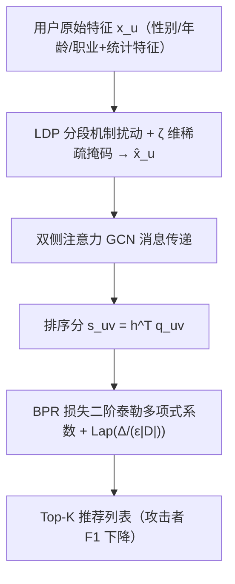
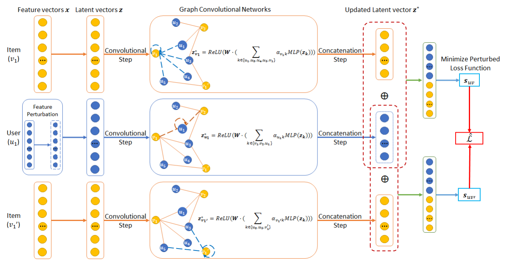

# Graph Embedding for Recommendation against Attribute Inference Attacks (面向属性推断攻击的隐私保护图嵌入推荐)

- **会议/期刊**: WWW 2021
- **作者与机构**: Shijie Zhang, Hongzhi Yin, Tong Chen, Zi Huang (The University of Queensland), Lizhen Cui (山东大学), Xiangliang Zhang (KAUST)
- **推荐链路定位**: 召回（图嵌入表征学习）
- **研究方向**: 去偏公平、可信隐私与工业架构 / 图神经网络推荐
- **论文原文**: [https://arxiv.org/abs/2101.12549v1](https://arxiv.org/abs/2101.12549v1)
- **开源代码**: 暂未开源

## TL;DR (1分钟核心速览)

GCN 推荐器在利用用户画像（性别/年龄/职业）提升精度的同时，让攻击者可从交互记录与推荐结果反推敏感属性，而现有防御（对抗式 RAP、仅防成员推断的 DPMF/DPNE）要么绑定特定攻击模型、要么牺牲巨大精度。GERAI 提出**双阶段差分隐私**：输入级用本地差分隐私（LDP）分段机制扰动用户特征，优化级用功能机制对 BPR 损失的二阶泰勒多项式系数注入拉普拉斯噪声。在 ML-100K 上，攻击者 F1 较 GCN 相对下降 11%(Age)/14.4%(Gen)/6.75%(Occ)，同时 Hit@5 达 0.333、NDCG@5 0.217，全面优于 RAP(0.319/0.211)。

## Background & Motivation (背景与核心矛盾)

- **主流范式**: 以 GCN 聚合用户-物品二部图邻域信息生成 embedding，并拼接用户侧画像特征以缓解冷启动、提升排序精度。
- **前人局限**: ① 加密类方法（同态加密）计算开销无法上线；② DP 类推荐（DPMF/DPNE/DPAE）只防"成员/评分推断"，噪声加在梯度或输出上，对**属性推断**保护不足且重创排序学习；③ 代表工作 RAP 依赖预定义 RNN 攻击器做对抗训练，攻击者一旦换型即失效，且仅把敏感属性当标签、不用于推荐。
- **核心洞察 (Key Insight)**: 攻击者的信息来源有两条——用户原始特征的上传，以及推荐列表本身对偏好的强反射。因此必须对**输入端**与**优化端**分别施加可证明的隐私约束，而非扰动最终推荐结果。
- **本文切入点**: 用 LDP 遮蔽原始画像（切断第一条泄漏路径），用损失函数扰动（FM）让模型学到的参数不依赖任何单个用户的属性（切断第二条），两者合成一个端到端可 SGD 训练的整体。

## Method (核心方法设计)

### 1. 整体框架 (Overall Architecture)

GERAI 由三个部件串联：① 用户特征编码器把 $x_u$（性别/年龄/职业 one-hot + 评分统计量）经$\mathbf{E}^U$映射为初始 embedding；② 双侧注意力 GCN 依次聚合$\mathcal{N}(u)$与$\mathcal{N}(v)$的邻居消息，得到$z_u^*,z_v^*$；③ 拼接后经 ReLU 得到预测特征$q_{uv}$与排序分$s_{uv}=h^\top q_{uv}$。隐私注入发生在两处：$x_u$在进入编码器**之前**被 LDP 扰动为$\hat{x}_u$（并置零未选中维度）；训练时 BPR 损失先做二阶泰勒展开，再对其多项式系数注入拉普拉斯噪声后反传。推理阶段不再加噪，开销与标准 GCN 同阶。

<figure class="paper-figure" markdown="span">
  <figcaption>图1：GERAI 概述</figcaption>
</figure>

### 2. 关键设计拆解 (Key Designs)

1. **输入级 LDP 特征扰动 + ζ-稀疏选择**：若把 $d'$个特征各当作独立元素加噪，按组合定理每维预算被摊薄到$\epsilon^\triangleright/d'$，效用崩塌。GERAI 先随机选取$\zeta=\max\{1,\min\{d',\lfloor \epsilon^\triangleright/2.5\rfloor\}\}$个特征，其余维度直接置 0（既省预算又混入额外掩码），被选中的数值特征用分段机制扰动：$C=\frac{e^{\epsilon^\triangleright/2}+1}{e^{\epsilon^\triangleright/2}-1}$，输出密度在$[\ell(x),\pi(x)]$上取$p$、区间外取$p/e^{\epsilon^\triangleright}$，从而满足$\epsilon^\triangleright$-LDP；类别特征则逐 bit 做随机响应。直觉是"少而强"优于"全而弱"：保留维度的信噪比显著更高。
2. **优化级功能机制 (Functional Mechanism) 损失扰动**：BPR 的 $-\log\sigma(s_{uv}-s_{uv'})$输出无界，无法直接算敏感度。作者先把$q_{uv}$用 clip 归一化到$(0,1)$，再在 0 处二阶泰勒展开$\tilde{\mathcal{L}}$，系数为$\log 2,-\tfrac12,\tfrac18$；由 L1 范数界推得全局敏感度$\Delta=d+d^2/4$，对每个多项式系数$\lambda_\phi$注入$\mathrm{Lap}(\Delta/(\epsilon|\mathcal{D}|))$。噪声只污染系数、不阻断"用户画像—物品"的关联学习，这是它优于"扰动推荐结果"的关键。
3. **训练目标与推理效率**：总损失为扰动后的 $\hat{\mathcal{L}}$加$\gamma\|\Theta\|^2$（$\gamma=0.01$），负采样为均匀单负样本，每轮迭代对全部系数重新加噪；推理无额外噪声，只需一次前向扰动特征，复杂度$O(|\mathcal{E}|d)$，与 GCN 基线一致。

## Experimental Setup & Evaluation Protocol (实验设置与评估协议)

- **数据集与预处理**:

| 数据集 | #Users | #Items | #Interactions | 稀疏度/密度 | 特征/场景说明 |
| :--- | :---: | :---: | :---: | :---: | :--- |
| ML-100K | 943 | 1,682 | 100,000（原文正文误记为 10,000） | 密度 ≈ 6.3% | 电影评分；用户侧性别(2维)、年龄(3桶)、职业(21类)敏感属性 + 7 类评分统计特征；无 5-core 过滤 |

- **数据划分与防穿越**: 每用户随机留 80% 交互训练、20% 测试（**比例划分**，非时间切分，存在未来交互穿越风险）。
- **排名评测协议**: 仅报告 $Hit@K$、$NDCG@K$（$K\in\{5,10,15,20,25,30\}$），**未声明 Full-Ranking 或采样负样本比例**，属于评测披露不足；结果取 5 次运行均值，未报告显著性检验。
- **攻击评测协议**: 攻击者为两层 DNN，输入为交互物品 one-hot ⊕ Top-$K$ 推荐物品 one-hot（隐层 100），80/20 划分有标签用户训练/测试攻击器；以分类 **F1 越低表示隐私越强**。另用 DT/NB/KNN/GP 四种未见攻击器检验泛化鲁棒性。
- **超参**: $d=60$、3 层网络、lr=0.005、batch=64、$\epsilon=0.4$（全局）、$\epsilon^\triangleright=20$（本地）；基线 BPR、GCN、Blurm、DPAE、DPNE、DPMF、RAP 均取原文最优设置。

## Key Experimental Results (实验关键数据)

### 1. 主实验对比 (Main Results)

| Method | Hit@5 | Hit@10 | NDCG@5 | NDCG@20 | F1-Age↓(K=15) | F1-Gen↓(K=15) | F1-Occ↓(K=15) |
| :--- | :---: | :---: | :---: | :---: | :---: | :---: | :---: |
| BPR | 0.348 | 0.507 | 0.228 | 0.330 | 0.699 | 0.808 | 0.264 |
| GCN (非隐私上界) | **0.365** | **0.519** | **0.247** | **0.340** | 0.730 | 0.891 | 0.277 |
| Blurm | 0.184 | 0.263 | 0.124 | 0.174 | 0.716 | 0.789 | 0.262 |
| DPAE | 0.185 | 0.285 | 0.126 | 0.176 | 0.695 | 0.770 | 0.255 |
| DPNE | 0.301 | 0.430 | 0.204 | 0.289 | 0.700 | 0.781 | 0.266 |
| DPMF | 0.195 | 0.280 | 0.134 | 0.182 | 0.695 | 0.768 | 0.270 |
| RAP | 0.319 | 0.475 | 0.211 | 0.308 | 0.677 | 0.763 | 0.260 |
| **GERAI** | 0.333 | 0.495 | 0.217 | 0.314 | **0.648** | **0.763** | **0.255** |
| Improv. vs RAP | +4.4% | +4.2% | +2.8% | +1.9% | −4.3% | ±0 | −1.9% |
| Improv. vs GCN(隐私) | −8.8% | −4.6% | −12.1% | −7.6% | −11.2% | −14.4% | −7.9% |

### 2. 消融实验 (Ablation Study)

| 变体 | Hit@5 | NDCG@5 | F1-Age↓ | F1-Gen↓ | F1-Occ↓ |
| :--- | :---: | :---: | :---: | :---: | :---: |
| GCN（无隐私） | 0.365 | 0.247 | 0.697 | 0.851 | 0.277 |
| GERAI-NL（仅损失扰动，原始特征） | 0.340 | 0.221 | 0.688 | 0.791 | 0.270 |
| GERAI-NF（仅特征扰动，无损失扰动） | 0.337 | 0.219 | 0.679 | 0.788 | 0.266 |
| GERAI（双阶段） | 0.333 | 0.217 | **0.677** | **0.760** | **0.260** |

### 3. 关键实验发现 (Key Findings)

1. **隐私主力在输入端，损失扰动是"最后 3 个百分点"**：去掉输入扰动的 GERAI-NL 使 Gen 属性 F1 从 0.760 回升到 0.791（+4.1%），是三者中隐私损失最大的一档；而精度反而最高（Hit@5 0.340），说明损失扰动是典型的"小幅效用换隐私"补充项，两阶段缺一不可。
2. **DP 的分布无关保证优于对抗式防御**：在未见攻击器下 RAP 明显退化（Gen-DT：RAP 0.670 vs GERAI 0.619；Occ-GP：RAP 0.127 vs GERAI 0.090），因为 RAP 只针对训练的 DNN 攻击器；GERAI 不需要任何攻击者假设即全面领先。
3. **$K$越大越安全，且预算-精度可调**：随$K$从 5 增至 30，攻击者 F1 单调缓降（更多推荐项充当"自然噪声"），GERAI 在$K\in\{15,\dots,30\}$对三类属性全部最优；$\epsilon$由 3.2 降到 0.1 时 F1 与 NDCG 同步下降，$d=60$是隐私与表达力的最佳折中（因$\Delta=d+d^2/4$随$d$平方增长，更大$d$ 需更强噪声）。

## Highlights & Limitations (亮点、对比与审稿批判)

- **与代表作对比**: RAP 用固定 DNN 攻击器做对抗训练，本质是"针对已知攻击者的经验防御"；DPMF/DPNE/DPAE 把噪声加在梯度或输出上，只防成员/评分推断且伤害排序；GERAI 首次把 LDP（输入端）与功能机制（目标端）组合，给出 $\epsilon^\triangleright$-LDP 与$\epsilon$-DP 的双重可证明保证，并保留画像特征的正向价值。
- **可迁移亮点**: ① "ζ-稀疏采样 + 组合定理预算再分配"可迁移到任何需要上传稠密用户特征向量的联邦/端侧场景；② 用"泰勒展开系数加噪"替代"梯度/输出加噪"，能在不破坏损失曲面形状的前提下实现 DP 训练，适用于任意 pairwise 排序损失。
- **审稿级局限批判**: ① 实验仅 ML-100K 单数据集，无显著性检验，且未交代 Full-Ranking/负采样协议与随机划分的时序泄漏问题，精度优势的统计可信度存疑；② 隐私评估全靠经验攻击器 F1，未给出属性推断误差的形式化下界，而 $\zeta$的经验系数 2.5 与$\epsilon^\triangleright=20$（远大于常见 LDP 预算）缺乏理论最优性论证；③ LDP 掩码会置零$(d'-\zeta)/d'$ 维特征，在冷启动/特征稀疏用户上效用风险未被分桶分析。

## Rating (四维评分)

- **方法创新性 (Novelty)**: ⭐⭐⭐⭐ （双阶段 DP 与 GCN 推荐的绑定思路清晰，将 FM 从回归迁移到 pairwise 排序损失并给出 $\Delta=d+d^2/4$ 的闭式敏感度，属实质性增量）
- **评估协议与实验扎实度 (Protocol & Experiments)**: ⭐⭐⭐ （隐私侧引入 4 种未见攻击器值得肯定，但仅单数据集、无显著性检验、未披露排名评测的候选集构造方式）
- **写作与数学规范度 (Clarity & Rigor)**: ⭐⭐⭐⭐ （LDP/FM 的引理-证明链条完整，符号统一；$\zeta$ 与预算分配的经验性削弱了理论闭环）
- **工业落地与复现价值 (Industrial & Practical Value)**: ⭐⭐⭐ （推理零额外开销、可直接嵌入现有 GCN 召回栈；但无开源代码，且 $\epsilon^\triangleright=20$ 的弱隐私设定在真实合规场景下说服力有限）

