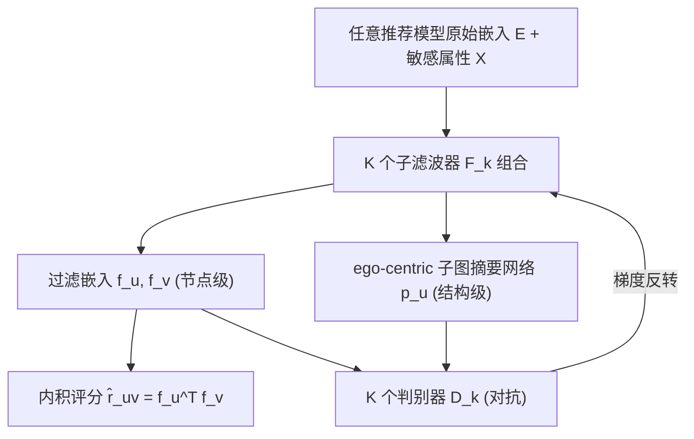

# Learning Fair Representations for Recommendation: A Graph-based Perspective (基于图视角的推荐公平表征学习)

- **会议/期刊**: WWW 2021
- **作者与机构**: Le Wu, Lei Chen, Pengyang Shao, Richang Hong, Meng Wang（合肥工业大学）；Xiting Wang（微软亚洲研究院）
- **推荐链路定位**: 召回（用户/物品表征层，模型无关后处理插件）
- **研究方向**: 去偏公平、可信隐私与工业架构 / 图神经网络推荐
- **论文原文**: [https://arxiv.org/abs/2102.09140v3](https://arxiv.org/abs/2102.09140v3)
- **开源代码**: [https://github.com/newlei/FairGo](https://github.com/newlei/FairGo)

## TL;DR (1分钟核心速览)

现有公平表征学习假设实例独立、逐节点抹除敏感信息，但推荐中用户-物品二部图的协同结构本身就会泄露性别/年龄/职业。FairGo 以任意推荐模型输出的原始嵌入为输入，学习 $K$ 个敏感属性子滤波器的组合，并在节点级嵌入与 ego-centric 子图摘要两个通道上做对抗训练。在 MovieLens-1M 上，GCN 底座的性别 AUC 由 0.7041 降至 0.5042（近随机 0.5），职业 F1 由 0.1485 降至 0.1070（−28%），RMSE 仅上升 5.9%。

## Background & Motivation (背景与核心矛盾)

- **主流范式**: 公平推荐主要靠公平正则项（如 Non-parity 对齐两群体的评分均值）或对抗式公平表征学习（如 ICML_2019）把敏感信息从嵌入中过滤掉。
- **前人局限**: ①这些方法都建立在"实体独立"假设上，逐用户独立去偏，完全忽略用户间的协同相关；②推荐场景里用户与物品天然构成二部图，即使 $u$ 自己的嵌入已去偏，她的邻域结构仍在泄露属性。
- **核心洞察 (Key Insight)**: 作者用 PMF/GCN 的 $l$ 阶以用户为中心的子图嵌入去预测敏感属性，发现泄露是**多通道**的（图 1）：PMF 用户嵌入性别 AUC 0.6615，一阶子图 0.6181，二阶 0.5102；GCN 更严重（0.7041 → 0.6804 → 0.5811），说明注入图结构既提精度也放大泄露。
- **本文切入点**: 设计一个模型无关的滤波器组合，同时抹掉"节点级"与"子图结构级"两条泄露路径。

<figure class="paper-figure" markdown="span">
  ![图1：两种推荐模型（PMF \[24\] 和 GCN \[21\]）在 MovieLens 数据集上进行敏感属性预测的性能。学习用户和物品嵌入后，我们提取每个用户的第𝑙个以用户为中心的子图嵌入。学习到的第𝑙阶嵌入向量作为敏感属性预测的特征输入。我们观察到，每个第𝑙阶以用户为中心的图表示都有助于属性预测。详见实验部分。](../../../../assets/papers/2102.09140v3/figure_1.png)<figcaption>图1：两种推荐模型（PMF [24] 和 GCN [21]）在 MovieLens 数据集上进行敏感属性预测的性能。学习用户和物品嵌入后，我们提取每个用户的第𝑙个以用户为中心的子图嵌入。学习到的第𝑙阶嵌入向量作为敏感属性预测的特征输入。我们观察到，每个第𝑙阶以用户为中心的图表示都有助于属性预测。详见实验部分。</figcaption>
</figure>

## Method (核心方法设计)

### 1. 整体框架 (Overall Architecture)

FairGo 是一个两阶段插件：先用任意推荐模型（PMF / GCN）离线得到原始嵌入矩阵 $\mathbf{E}=\text{Enc}(\mathcal{G})$，再针对$K$个敏感属性各训练一个子滤波器$F_k$与一个判别器$D_k$。用户/物品经$K$个子滤波器过滤并平均后进入过滤嵌入空间，评分仍用内积；判别器同时以过滤后的节点嵌入$\mathbf{f}_u$与 ego-centric 子图摘要$\mathbf{p}_u$为输入预测敏感属性，滤波器则反向最大化判别器的预测熵。整体价值函数为$\arg\max_{F}\arg\min_{D} V_R-\lambda V_G$，训练完成后推理只需一次前向过滤。

### 2. 关键设计拆解 (Key Designs)

1. **模型无关的多属性子滤波器组合**：前人多针对二值单属性且需重训底座模型；本文对任意 $\mathbf{E}$学习属性专属滤波器并平均$\mathbf{f}_i=\frac{1}{K}\sum_{k=1}^{K}F_k(\mathbf{e}_i)$，评分$\hat{r}_{uv}=\mathbf{f}_u^{\top}\mathbf{f}_v$。平均而非拼接，是为避免某一属性滤波器欠训时整体表征被破坏——这样 FairGo 可同时兼容性别（2 类）、年龄（7 类）、职业（21 类）及三属性组合设定。

2. **Ego-centric 图对抗（核心增量）**：只做节点级对抗 $V_N=\mathbb{E}\sum_{k}x_{uk}\ln D_k(\mathbf{f}_u)$仍留结构泄露口，故补一条结构级通道$V_S=\mathbb{E}\sum_{k}x_{uk}\ln D_k(\mathbf{p}_u)$，其中$\mathbf{p}_u=\mathcal{P}(\mathcal{G}_u,F)$是用户局部子图摘要。摘要网络给出三种实现：一阶加权池化$\mathbf{p}_u=\frac{\sum_{v\in\mathcal{A}_u}r_{uv}\mathbf{f}_v}{\sum_{v\in\mathcal{A}_u}r_{uv}}$；$l$阶递推$\mathbf{h}_i^{l}=\frac{\sum_{j\in\mathcal{A}_i}a_{ij}\mathbf{h}_j^{l-1}}{\sum_{j\in\mathcal{A}_i}a_{ij}}$并按$\lambda_l$手工加权（因阶数越高、远邻泄露越弱）；以及学习式聚合$\mathbf{p}_u=\mathrm{MLP}(\mathbf{h}_u^{1},\dots,\mathbf{h}_u^{L})$，免去调$\lambda_l$。直觉是：把"邻居能猜出你"这条路径也变成对抗目标，去偏才闭环。

3. **训练目标、负采样与推理开销**：总目标在判别器取最优时等价于 $\min_{F}-\mathrm{H}(R|\mathbf{F})+\lambda\sum_{k=1}^{K}\mathrm{H}(X_k|(\mathbf{F},\mathbf{P}))$，即最小化评分与过滤表征的条件熵（保精度）、最大化各敏感属性与过滤表征的条件熵（去泄露）。全监督评分回归、无负采样；嵌入维度$D=64$，Adam、lr=0.005，MovieLens$\lambda=0.1$、Lastfm$\lambda=0.2$；推理仅$K$ 次 MLP 前向，与底座解耦，可离线批量刷新嵌入。

## Experimental Setup & Evaluation Protocol (实验设置与评估协议)

- **数据集与预处理**:

| 数据集 | #Users | #Items | #Interactions | 稀疏度 | 敏感属性/场景 |
| :--- | :---: | :---: | :---: | :---: | :--- |
| MovieLens-1M | 6,040 | ~4,000 | ~1,000,000 | 4.1% | 性别(2)/年龄(7)/职业(21)，含三属性组合设定 |
| Lastfm-360K | ~360,000 | ~290,000 | ~17,000,000 | ~0.016% | 性别(2)/年龄(3)，播放次数 log 变换后归一化到 1–5 当评分 |

- **数据划分与防穿越**: MovieLens 按 **9:1 比例划分**训练/测试；Lastfm 按 **7:1:2** 划分训练/验证/测试，验证集仅用于调参。
- **排名评测协议**: 本文不做 Top-N 排名，采用**评分回归 RMSE** 衡量推荐精度；公平性采用"表征可推断性"代理协议——随机取 80% 用户的属性训练线性分类器、在剩余 20% 用户上测试，性别用 **AUC**（约 70%/30% 不平衡），年龄与职业用 **micro-F1**，值越小越公平。
- **对比基线与超参设置**: PMF（隐因子）、GCN（图卷积，改为评分损失以适配设定）、Non-parity（公平正则，仅适用二值性别）、ICML_2019（多属性公平表征 SOTA）。滤波器与判别器均为 MLP（ML 上 3/4 层，Lastfm 上 4/4 层），LeakyReLU，$D=64$。

## Key Experimental Results (实验关键数据)

### 1. 主实验对比 (Main Results)

MovieLens-1M（RMSE 越低越好；AUC/F1 越低越公平）：

| 模型 | RMSE | Gender AUC ↓ | Age F1 ↓ | Occ F1 ↓ | Com.(Gen/Age/Occ) ↓ |
| :--- | :---: | :---: | :---: | :---: | :---: |
| PMF（无去偏） | 0.8681 | 0.6615 | 0.3821 | 0.1332 | — |
| GCN（无去偏） | **0.8564** | 0.7041 | 0.4215 | 0.1485 | — |
| Non-parity | 0.8621 | 0.8428 | — | — | — |
| ICML_2019 | 0.9203 | 0.5175 | 0.3420 | 0.1190 | 0.5389/0.3620/0.1240 |
| FairGo_PMF | 0.9150 | 0.5042 | 0.3220 | 0.1130 | **0.5026**/0.3380/**0.1060** |
| FairGo_GCN | 0.9068 | **0.5042** | **0.3140** | **0.1070** | 0.5134/**0.3260**/0.1250 |
| Improv.（AUC/F1 vs 底座） | +5.9% | −28.4% | −25.5% | −27.9% | — |

Lastfm-360K：

| 模型 | RMSE | Gender AUC ↓ | Age F1 ↓ |
| :--- | :---: | :---: | :---: |
| PMF | 0.7112 | 0.5506 | 0.4716 |
| GCN | 0.7034 | 0.5696 | 0.4716 |
| Non-parity | 0.7346 | 0.6649 | — |
| ICML_2019 | 0.7259 | 0.5409 | 0.4682 |
| FairGo_PMF | 0.7096 | 0.5428 | 0.4689 |
| FairGo_GCN | **0.7072** | **0.5354** | **0.4672** |

### 2. 消融实验 (Ablation Study)

子图摘要网络的阶数与聚合方式（FairGo_GCN，单属性设定）：

| 变体 | ML RMSE | ML Gender AUC | ML Age F1 | ML Occ F1 | Lastfm Gender AUC |
| :--- | :---: | :---: | :---: | :---: | :---: |
| L=1 加权池化 (Eq.10) | 0.9068 | 0.5042 | 0.3140 | 0.1070 | 0.5354 |
| L=2 局部价值加权 (Eq.14) | 0.9070 | 0.5065 | 0.3080 | 0.1090 | 0.5442 |
| L=2 学习式 MLP 聚合 (Eq.15) | **0.9004** | **0.5014** | 0.3100 | **0.1000** | **0.5337** |

### 3. 关键实验发现 (Key Findings)

1. **图结构是"精度与泄露同源"的双刃剑**：GCN 比 PMF 精度更高（RMSE 0.8564 vs 0.8681），但性别 AUC 也从 0.6615 涨到 0.7041，验证了"协同信号携带人口属性"的动机；FairGo 把该 AUC 拉回 0.5042（接近随机），代价是 RMSE 从 0.8564 升到 0.9068（+5.9%），即去偏的精度税约 5–10%，与文中"过滤掉对评分有用但与属性相关的维度"的解释一致。
2. **类别数越多、对抗越难训**：职业 21 类且仅 6040 用户时，FairGo 虽将 F1 从 0.1485 降到 0.1070，但在组合设定下 FairGo_PMF（0.1060）反优于 FairGo_GCN（0.1250）——底座更强的 GCN 表征纠缠更紧，弱底座的"易去偏"反而占优，说明多值敏感属性的对抗判别器存在容量/样本瓶颈。
3. **高阶子图与学习式聚合更优，但有边界**：MLP 聚合相较一阶池化在 MovieLens 上同时改善精度（0.9068→0.9004）与公平（职业 F1 0.1070→0.1000）；然而在 Lastfm 上手调 $\lambda_l$的 L=2 加权反而劣于 L=1（性别 AUC 0.5354→0.5442），说明阶数收益依赖图稠密度，稠密大图上二阶邻域重叠过多，故作者不报告$L\ge3$。

## Highlights & Limitations (亮点、对比与审稿批判)

- **与代表作对比 (vs. Prior Work)**: Non-parity 只对齐两群体评分均值、不直接净化嵌入，故性别 AUC 反而恶化到 0.8428；ICML_2019 虽支持多属性但逐节点独立过滤，忽略邻域泄露，AUC 停在 0.5175；FairGo 的差异在于把"结构"也纳入对抗目标，并以子滤波器平均实现多属性解耦。
- **可迁移亮点**: ①"嵌入后处理式去偏插件"思路可直接挂到任意工业双塔/图召回模型上，无需重训底座；②ego-centric 子图摘要 + 多判别器可迁移到位置/流行度偏差等其它结构性偏置的消除。
- **审稿级局限批判**: ①评测仅用 RMSE 回归与"属性可推断性"代理，缺少 Full-Ranking Top-N 与真实曝光/效用层面的群体公平指标，也未做线上 A/B；②两阶段设计使去偏目标与底座表征解耦，底座换代即需重训滤波器，且 $K$个判别器在 21 类属性上训练不稳定、结果方差大，$\lambda$ 还需按数据集手调。

## Rating (四维评分)

- **方法创新性 (Novelty)**: ⭐⭐⭐⭐ （首次指出推荐去偏的"结构泄露通道"，ego-centric 双通道对抗与多子滤波器平均的设计有清晰物理直觉）
- **评估协议与实验扎实度 (Protocol & Experiments)**: ⭐⭐⭐ （双数据集、单属性与组合属性、AUC/F1 代理协议与三种摘要网络消融较完整，但缺 Top-N 排序公平性评测与显著性检验）
- **写作与数学规范度 (Clarity & Rigor)**: ⭐⭐⭐⭐ （minimax 目标到条件熵等价 $-\mathrm{H}(R|\mathbf{F})+\lambda\sum_k\mathrm{H}(X_k|(\mathbf{F},\mathbf{P}))$ 的推导链完整，Lemma/Theorem 分层清晰）
- **工业落地与复现价值 (Industrial & Practical Value)**: ⭐⭐⭐⭐ （代码开源、插件式接入成本低、推理仅 $K$ 次 MLP 前向，但多属性判别器调参成本与子图摘要的邻居规模开销需工程折衷）

