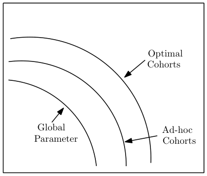
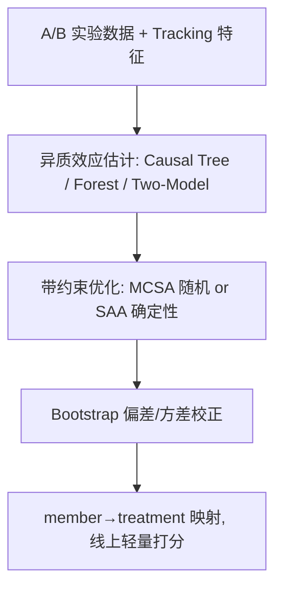
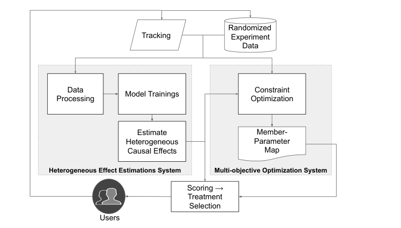

# Personalized Treatment Selection using Causal Heterogeneity (基于因果异质性的个性化处理选择)

- **会议/期刊**: WWW 2021 (arXiv:1901.10550, 2020 最终版)
- **作者与机构**: Ye Tu, Kinjal Basu, Cyrus DiCiccio, Romil Bansal, Preetam Nandy 等，LinkedIn Corporation
- **推荐链路定位**: 策略层 / 端到端（个性化 treatment 分配，非传统打分精排）
- **研究方向**: 去偏公平与工业架构 / 强化学习与动态探索
- **论文原文**: [arXiv:1901.10550](https://arxiv.org/abs/1901.10550v4)
- **开源代码**: [tuye0305/prophet](https://github.com/tuye0305/prophet)

## TL;DR (1分钟核心速览)

A/B 测试长期采用“全局最优 treatment 放给所有用户”的 global allocation，但同一 treatment 在不同用户/队列上效应迥异，全局选择既损失业务指标、又可能加剧对少数群体的不平等。本文提出“异质效应估计 + 带约束优化”两阶段框架：用 Causal Tree/Forest（或 Two-Model）在队列级/成员级估计多 treatment、多指标的因果效应 $\mathbf{U}_k$，再用 MCSA 随机优化或 SAA 确定性优化求解$x^\top\mathbf{U}_0$最大化、$x^\top\mathbf{U}_k\le c_k$约束下的最优分配$\mathbf{x}^*$。在 LinkedIn 通知配额场景中（在线 A/B,$p<0.05$）相对 global baseline 取得 **+1.39% Sessions** 且约束指标（Sends、CTR、Disables）均满足，显著优于两个 heuristic cohort 版本。

## Background & Motivation (背景与核心矛盾)

- **主流范式**: 互联网公司以 A/B 测试确定最优 treatment 变体后 ramp 到全体成员（global allocation），即对所有用户输出同一最优参数/模型/UI。
- **前人局限 (1)**: 因果效应 $\mathbf{U}_{i,j}$ 本质不可直接观测，传统 A/B 仅给出群体平均效应，无法刻画个体/队列异质性；且平均效应被多数群体主导，少数群体偏好被系统性忽略（隐含公平问题）。
- **前人局限 (2)**: 已有 Causal Tree/Forest 工作仅停留在“识别异质性”，并未回答“如何在多 treatment、多指标、带约束场景下利用异质性做决策”。
- **核心洞察 (Key Insight)**: 论文用图 1 展示——在 objective/guardrail 两指标平面，cohort-level 选择因自由度更高，其 Pareto 前沿严格优于 global allocation；智能队列划分（而非启发式分桶）能进一步外扩前沿。
- **本文切入点**: 把“异质性估计”和“约束优化”拼成可上线的端到端 pipeline，并在工业级通知系统中落地验证。

<figure class="paper-figure" markdown="span">
  <figcaption>图1：目标指标与护栏指标的帕累托最优曲线。由于群体层级选择比全局分配更灵活，性能包络严格更优。</figcaption>
</figure>

## Method (核心方法设计)

### 1. 整体框架 (Overall Architecture)

框架分两大模块并构成反馈闭环：(i) **异质因果效应估计**——输入随机实验数据与 tracking 特征，训练 Causal Tree（队列级）或 Causal Forest/Two-Model（成员级）模型，输出各 treatment $j$、各指标$k$下的效应均值$\hat\mu_{i,j}^k$与方差$(\hat\sigma_{i,j}^k)^2$；(ii) **多目标约束优化**——将上述估计嵌入带 guardrail 约束的线性规划/随机近似，求解分配向量$\mathbf{x}^*$，再经 bootstrap 偏差校正后写入 member→parameter 映射表，线上仅需轻量树模型打分 + 后处理即可落盘。训练与优化均在 Spark + R 离线完成，线上推理几乎无额外延迟。

<figure class="paper-figure" markdown="span">
  <figcaption>图4：系统架构展示了异质效应估计与优化两个关键模块，以及完成反馈回路的评分与跟踪模块。</figcaption>
</figure>

### 2. 关键设计拆解 (Key Designs)

1. **多 Tree/多指标合并算法 (Algorithm 1)**：Causal Tree 对每个 $(j,k)$产出一套队列划分，简单相交会碎片化队列导致效应方差爆炸。作者沿 SUTVA 与强可忽略假设，顺序对联合集做求交$\cap_{j,k}\mathcal{C}^{j,k}$，在每个交集子块内保留原始的$(\tau^{j,k}(C),(\sigma^{j,k}(C))^2)$，既保证队列互斥穷尽又避开小样本噪声，是整个 pipeline 能同时处理多 treatment、多指标的“粘合剂”。

2. **MCSA 多约束随机优化 (Algorithm 2)**：将带 $K$个 guardrail 期望约束的问题写成$\min_\mathbf{x}\mathbb{E}U_0(F(\mathbf{x},U_0))$s.t.$\mathbb{E}U_k(G_k(\mathbf{x},U_k))\le 0$；每步先由$L$次采样估计$\hat G_{k,t}=\frac{1}{L}\sum_\ell G_k(\mathbf{x}_t,U_{k,\ell})$，若全部$\hat G_{k,t}\le\eta_{k,t}$则沿 objective 的随机梯度走，否则从违反集合中随机抽一个约束$k^*$沿其梯度投影，最终返回“落在可行域步的加权均值”。收敛性满足$\mathbb{E}(f(\hat{\mathbf{x}})-f(\mathbf{x}^*))\le c_0/\sqrt{N}$与$\mathbb{E}(g_k(\hat{\mathbf{x}}))\le c_k/\sqrt{N}$，比 SAA 更能吸收方差；SAA 则退化为$\mathbf{x}^\top\hat{\boldsymbol{\mu}}_0$ 的确定性 LP，只在低噪声、可精确建模式的场景稳健。

3. **Bootstrap 偏差/方差校正 (Algorithm 3)**：由于 $\hat\mu$、$\hat\sigma$均是样本估计，直接代入会因“偶然大效应 treatment 被过度加权”而高估收益。作者用$\hat\mu^k_{i,j,b}=\hat\mu^k_{i,j}+\hat\sigma^k_{i,j}\sqrt{N_i}Z$与卡方重构方差，重解优化得到$\hat{\mathbf{x}}_b$，再取$\mathrm{d}\widehat{\mathrm{bias}}=\bar{\mathbf{x}}-\hat{\mathbf{x}}$ 反补原分配（对数几率尺度保持概率合法性），从而得到更保守、期望收益更高的策略。

**目标函数汇总**：核心优化为
$$\max_{\mathbf{x}}\ \mathbf{x}^\top\mathbf{U}_0\quad \text{s.t.}\ \mathbf{x}^\top\mathbf{U}_k\le c_k,\ \textstyle\sum_j x_{i,j}=1,\ 0\le\mathbf{x}\le 1$$
训练侧无需负采样概念，采样发生在 MCSA 内层 $L$ 次模拟（Gaussian/卡方采样）；线上推理仅一次树遍历。

## Experimental Setup & Evaluation Protocol (实验设置与评估协议)

- **数据集与预处理**: 无公开数据集统计表；线上为 LinkedIn 通知系统两周随机实验数据，含成员画像（国家/语言/职位）、历史通知/邮件、互动行为、社交网络特征四类。

| 场景 | 成员规模 | Treatments ($J$) | 指标 ($K$) | 实验时长 | 划分 |
| :--- | :---: | :---: | :---: | :---: | :--- |
| 仿真 (simcausal) | 合成 | 3 | 1 objective + 2 guardrail | — | train/test 独立 DAG 生成 |
| 线上通知 | LinkedIn 全体（百万级） | 多档配额 | Sessions + Sends + CTR + Disables | 2 周 | 随机 A/B |

- **数据划分与防穿越 (Splitting Strategy)**: 仿真按训练/测试 DAG 分别生成并重复 10 次取均值±std；线上严格走标准 A/B 随机分桶，无时间戳切分，但保证实验桶与对照桶独立。
- **排名评测协议 (Ranking Protocol)**: 非 ranking 任务，采用归一化 ITE $\tau(\mathbf{x}^*)_k=\frac{1}{n}\sum_i\sum_j\frac{(Y_{1,i,k}-Y_{0,i,k})x_{i,j}}{\mu_{0,k}}$作为评价指标，并按$p<0.05$ 显著性报告 ATE。
- **对比基线与超参**: Global（全局最优）、HT.ST（启发式分桶+随机优化，$\alpha$分位 16 桶）、CT.ST（Causal Tree+MCSA）、CF.DT（Causal Forest+SAA）、TM.DT（Two-Model RF+SAA）；Causal Tree 调节$\alpha$ 以平衡队列数量与效应置信度，优化器比较 SGD vs Adagrad（SGD 收敛更快）。

## Key Experimental Results (实验关键数据)

### 1. 主实验对比 (Main Results)

线上通知配额 A/B（Table 4, n 百万级, $p<0.05$）：

| 指标 | Personalized Cap | Heuristic Cap A | Heuristic Cap B |
| :--- | :---: | :---: | :---: |
| **Sessions (Objective)** | **+1.39%** | +1.31% | +0.54% |
| Notification Sends | +1.64% | +6.62% | +3.07% |
| Notification CTR | **−1.24%** | −1.73% | −1.18% |
| Total Disables | **Neutral** | +9.23% | Neutral |

- Personalized cap 在 objective 上最高（+1.39%），同时 Sends 仅 +1.64%、CTR 下降幅度最小、Disables 保持 Neutral，明显优于两个启发式。Heuristic Cap A 虽然 Sends +6.62% 但 Disables +9.23% 说明过度推送。

### 2. 消融实验 (Ablation Study)

论文无标准消融表，仿真方法对比如下（归纳自 Fig. 3 与 Table 2）：

| 方法 | 异质估计 | 优化 | 低噪声效果 | 高噪声效果 | 可扩展性 |
| :--- | :--- | :--- | :---: | :---: | :---: |
| Global | — | — | 基线 | 基线 | ★★★ |
| HT.ST | 启发式分桶 | 随机 | 次优 | 次优 | ★★★ |
| CT.ST | Causal Tree | 随机 | 中 | **最优** | ★★★ |
| CF.DT | Causal Forest | 确定性 | **优** | 中 | ★ |
| TM.DT | Two-Model | 确定性 | 优 | 中 | ★ |

### 3. 关键实验发现 (Key Findings)

1. **噪声水平翻转最优解**: 低噪声下成员级估计（CF.DT/TM.DT）因用了 ensemble 而最优；一旦 uncertainty weight 增大，CT.ST（队列级 + 随机优化）反超——随机近似能显式吸收方差，确定性 LP 因忽略方差而解不可行。这为“线上高噪声场景选 CT.ST”提供了直接证据。
2. **智能分桶 > 启发式分桶**: 同为随机优化，CT.ST 在 objective 上持续高于 HT.ST，说明模型驱动的队列识别（而非分位分桶）是提升的关键，与图 1 中“更灵活 cohort 划分导致更优 Pareto 前沿”对应。
3. **约束的代价被明确量化**: 相比 Heuristic Cap A 以 +9.23% Disables 换 +1.31% Sessions，Personalized Cap 只用 +1.64% Sends 就拿到 +1.39% Sessions 且 Disables 保持 Neutral，验证了“带方差约束的保守分配”在线上能取得更干净的正收益。

## Highlights & Limitations (亮点、对比与审稿批判)

- **与代表作对比 (vs. Prior Work)**: 相较 Athey & Imbens 的 Causal Tree/Forest（仅识别异质性），本文首次给出从识别到约束优化的完整 Ground→Select 闭环；相较 uplift 常用的 Two-Model，本文将其定位为“低噪声可用、高噪声不可靠”的成员级近似，并用 MCSA 提供方差鲁棒的替代；相较 Zinkevich 等的通用在线约束优化，MCSA 的收敛证明更贴合本问题（$O(1/\sqrt{N})$ 双向界）。
- **可迁移亮点**: (i) Algorithm 1 的“多 Tree 求交合并”可直接复用于任何需要同时控制多个目标（如 CTR + 留存 + 公平性）的分配问题；(ii) MCSA 的“违反时按拟合约束梯度投影”是比 SGD 温和但更稳的求多元约束 policy 的实用套路；(iii) Bootstrap 偏差校正里“在对数几率尺度修正以保持概率合法性”是工程落地小技巧。
- **审稿级局限批判**: (1) 队列划分未考虑成员在时间维度进出队列的**动态性**，作者在 Discussion 中自承这是开放问题；(2) 线上仅部署 CT.ST 一条路径，其余三条方法（尤其 CF.DT）缺工业级大规模验证，论文结论对多 treatment+多指标合并方案的实际加速效果也缺乏在线 A/B 对照；(3) 数据采集两周一桶，成本高，缺少 observational 数据替代方案的实证，冷启动/低数据场景的适用性主要靠仿真外推。

## Rating (四维评分)

- **方法创新性 (Novelty)**: ⭐⭐⭐⭐ （首次把因果异质性识别的输出无缝接进多目标约束 policy 优化，MCSA 的多约束推广与偏差校正组合是有价值增量）
- **评估协议与实验扎实度 (Protocol & Experiments)**: ⭐⭐⭐⭐ （仿真覆盖多噪声水平 + 在线 A/B 百万级 $p<0.05$ 双重验证，但缺 factorized 消融表与四条方法的一致性线上对比）
- **写作与数学规范度 (Clarity & Rigor)**: ⭐⭐⭐⭐ （算法伪码完整、收敛性引用严谨，但 Table 1/部分符号在正文与算法间略有混用，成员级方差“正确设定模型”依赖强假设）
- **工业落地与复现价值 (Industrial & Practical Value)**: ⭐⭐⭐⭐⭐ （已全量上线 LinkedIn 通知系统，Pareto 前沿比 baseline 外扩清晰，且开源了 prophet 仓库，可直接迁移到推荐系统的配额/UI/模型路由等参数个性化场景）

