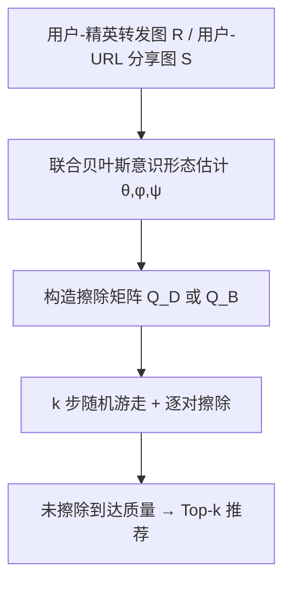

# Random Walks with Erasure: Diversifying Personalized Recommendations on Social and Information Networks (带擦除的随机游走：面向社交与信息网络的个性化推荐多样化)

- **会议/期刊**: WWW 2021
- **作者与机构**: Bibek Paudel (Stanford University), Abraham Bernstein (University of Zürich)
- **推荐链路定位**: 召回（图随机游走候选生成与排序）
- **研究方向**: 去偏公平、可信隐私与工业架构 / 图神经网络与知识图谱推荐
- **论文原文**: [https://arxiv.org/abs/2102.09635v3](https://arxiv.org/abs/2102.09635v3)
- **开源代码**: [https://github.com/bibekp/random_walks_erasure](https://github.com/bibekp/random_walks_erasure)

## TL;DR (1分钟核心速览)

针对协同过滤与图随机游走推荐易把用户锁入同质信息茧房、且传统“媒体机构级”意识形态标签在具体政治事件中失效的问题，本文提出 RWE：在用户-物品二部图上引入**逐节点对擦除矩阵**，把到达高同质节点的游走质量按比例擦除并送回起点，从而可控地提升长尾或跨立场内容的曝光。配合用户-精英背书与用户-URL 分享双图联合贝叶斯估计，RWE 在 Twitter 三国政治数据上使 Top-10 意识形态覆盖范围（RecRange@10）最高提升约 20%，AUC 不降；在 ML-1M/Yelp 上精度与 RP3β 持平。

## Background & Motivation (背景与核心矛盾)

- **主流范式**: 以 BPRMF/ItemCF 及 P3、RP3β 为代表的图随机游走召回，按用户历史或相似用户 popularity 扩散，天然放大已曝光内容与高度数节点。
- **前人局限**: ① 信息茧房与政治极化：Top-k 推荐集中在意识形态两端，中间温和内容被系统性稀释；② 机构级立场标签失效：同一媒体（如 BBC、Telegraph）的不同文章会被对立阵营同时分享，仅按媒体左右标签无法刻画单条内容立场；③ 长期行为标签在 Brexit 这类“非传统左右轴”事件中相关性很弱（UK2016 Pearson 仅 0.44）。
- **核心洞察 (Key Insight)**: 在具体政治事件中，用户的转发/分享行为同时编码了对精英与单条 URL 的认可；把用户、精英、内容映射到同一维意识形态空间后，可识别“桥接弱 ties”——与用户立场相反但距离不远的内容，比极端对立内容更可能被接受。
- **本文切入点**: 用**可定制的擦除矩阵**改写随机游走转移质量，把曝光从极端/高度数节点转移到桥接节点或长尾节点，实现“多样化不牺牲精度”。

## Method (核心方法设计)

### 1. 整体框架 (Overall Architecture)

输入两张二部图：用户-精英转发图 $\mathbf{R}$与用户-URL 分享图$\mathbf{S}$。先以联合贝叶斯逻辑模型估计用户$\theta_u$、精英$\phi_e$、单条内容$\psi_i$的一维意识形态；再依据任务构造擦除矩阵$\mathbf{Q}$——长尾场景用度数幂律$\mathbf{Q}_D$，政治多样化用桥接相似度$\mathbf{Q}_B$；最后在用户-物品图上执行$k$ 步带擦除随机游走，以未被擦除的到达质量作为推荐分数。训练阶段仅优化意识形态参数（梯度交替），推荐阶段为无需训练的稀疏图传播。

### 2. 关键设计拆解 (Key Designs)

1. **双图联合意识形态估计（解决单图稀疏与机构标签粗粒度）**：假设用户与精英/内容立场越近越可能转发或分享，采用二次效用 Logistic 似然
$p(R_{u,e}=1)=\sigma\!\left(-\|\theta_u-\phi_e\|^2+\alpha_u+\beta_e\right)$，
对 URL 同理 $p(S_{u,i}=1)=\sigma(-\|\theta_u-\psi_i\|^2+\alpha_u+\gamma_i)$。联合目标以$\mu$权衡精英图与内容图，并共享$\theta_u$：
$\mathcal{L}=\mu\sum_{(u,e)}\!\left[a_{u,e}\Pi_{u,e}-\log(1+e^{\Pi_{u,e}})\right]-\sum_{(u,i)}\!\left[b_{u,i}\Pi_{u,i}-\log(1+e^{\Pi_{u,i}})\right]+\frac{\lambda}{2}\left(\|\theta\|^2+\|\phi\|^2+\|\psi\|^2\right)$。
直觉：当 R 或 S 任一稀疏时，另一张图可为 $\theta_u$ 提供正则与对齐信号，使单条 URL 也能落在共同尺度上。

2. **RWE 擦除算子（把“多样性”写成可微的游走质量重分配）**：常规 $k$步游走只按度数转移，无法偏好属性节点。RWE 在每轮到达节点$j$时以$Q_{ij}$概率擦除并送回起点$i$，下一轮起点质量变为
$\mathbf{v}_s^{(t+1)}=(\mathbf{P}^k\circ\mathbf{Q})\mathbf{1}\circ\mathbf{I}_{\cdot,s}$，
其中 $\circ$为 Hadamard 积，$\mathbf{1}$汇总所有回到起点的擦除质量。与 PageRank 的全局 restart 不同，$Q_{ij}$是**逐节点对**且随迭代变化，因而能按“起点-终点”关系精细抑制同质节点。最终以未擦除到达概率$[\mathbf{v}_u\mathbf{P}^k]_i$ 排序。

3. **两种擦除策略与训练/推理开销**：长尾策略 $\mathbf{Q}_{D,i,j}=1-D_{jj}^{-\beta}$，度数越低擦除越少，直接扶持长尾；政治桥接策略
$\mathbf{Q}_{B,u,i}=\begin{cases}\mathrm{sim}(u,i), & i\text{ 为 }u\text{ 的桥接节点}\\ \epsilon, & \text{否则}\end{cases}$，
其中 $\mathrm{sim}(u,i)=1-\frac{|\psi_i-\theta_u|}{\max p-\min p}$，桥接指立场相反但通过邻近弱 ties 可达的内容。$\epsilon$越大，非桥接内容被擦除越多。训练为隐式 0/1 反馈的 Logistic 损失，无负采样；推理为$k$步稀疏矩阵乘，单用户复杂度约$O(k|E|)$，可批量预计算。

## Experimental Setup & Evaluation Protocol (实验设置与评估协议)

- **数据集与预处理**: Twitter 数据按事件关键词爬取，过滤转发少于 50 次及低活跃用户；被转发 >5 次者为精英，出现于 >5 条推文的 URL 为内容。ML-1M/Yelp 为公开基准。

| 数据集 | #Users | #Items | #Interactions | 说明 |
| :--- | :---: | :---: | :---: | :--- |
| UK-RT | 10,547 | 2,439 | 71,310 | 2016 英国脱欧公投，精英背书 |
| US-RT | 7,913 | 968 | 71,310 | 2016 美国总统选举，精英背书 |
| DE-RT | 5,305 | 837 | 23,561 | 2017 德国联邦选举，精英背书 |
| UK-URL | 10,547 | 1,244 | 37,036 | 脱欧相关 URL 分享 |
| US-URL | 7,913 | 698 | 30,801 | 美国大选相关 URL 分享 |
| DE-URL | 5,305 | 424 | 8,212 | 德国大选相关 URL 分享 |
| ML-1M | 6,040 | 3,706 | 998,087 | 电影推荐长尾基准 |
| Yelp | 6,945 | 11,274 | 316,162 | 餐厅推荐长尾基准 |

- **数据划分与防穿越**: 对交互数 >3 的用户随机抽取 30% 物品为测试集，其余为训练集；重复 3 次独立划分，每个算法在每个划分上各跑一次，报告三次平均。非全局时间切分，存在一定未来信息泄漏风险。
- **排名评测协议**: 对全库未交互物品打分排序（未显式负采样）；精度用 AUC、MR、HR@10、Precision@10，长尾多样性用 GiniD@20、Pers@20、Surp@20、AvgDeg@20，政治多样性用 $\mathrm{RecRange}@k=\frac{1}{|U|}\sum_u(\max pos(R_u[1:k])-\min pos(R_u[1:k]))$。
- **对比基线与超参**: CF、BPRMF 类 MF、P3（无擦除 3 步游走）、RP3β（度数幂律擦除）。RWE 网格搜索 $\nu$（$\mathbf{Q}\circ\nu$）、$\beta$、$k$，固定$\epsilon=0.9$；显著性用单尾 Welch t 检验（*$p<0.05$，***$p<0.001$）。

## Key Experimental Results (实验关键数据)

### 1. 主实验对比 (Main Results)

政治内容推荐（AUC / HR@10）：

| 方法 | US-RT AUC | US-RT HR | UK-URL AUC | UK-URL HR | DE-URL AUC | DE-URL HR |
| :--- | :---: | :---: | :---: | :---: | :---: | :---: |
| CF | 0.86 | 0.02 | 0.82 | 0.13 | 0.81 | 0.21 |
| MF | 0.87 | 0.26 | 0.75 | 0.16 | 0.73 | 0.14 |
| P3 | 0.92 | **0.32** | **0.85** | **0.32** | **0.83** | **0.36** |
| RP3β | 0.91 | 0.27 | 0.84 | 0.23 | 0.82 | 0.31 |
| RWE-B | **0.92** | **0.32** | **0.85** | **0.32** | **0.83** | 0.34 |

长尾推荐（AUC / HR@10 / Gini@20）：

| 方法 | ML-1M AUC | ML-1M HR | ML-1M Gini | Yelp AUC | Yelp HR | Yelp Gini |
| :--- | :---: | :---: | :---: | :---: | :---: | :---: |
| CF | 0.91 | 0.06 | 0.22 | 0.92 | 0.02 | 0.37 |
| P3 | 0.89 | 0.09 | 0.24 | 0.94 | 0.07 | 0.12 |
| RP3β | **0.92** | **0.13** | 0.14 | **0.94** | 0.06 | 0.34 |
| RWE-D | **0.92** | 0.12 | **0.08** | **0.94** | **0.07** | **0.24** |

相对最强基线：RWE-B 在 US-RT 的 HR@10 较 RP3β 提升 18.5%（0.27→0.32），UK-URL 提升 39.1%（0.23→0.32），DE-URL 提升 9.7%（0.31→0.34）；AUC 均持平或 +1.2%。ML-1M 上 RWE-D 的 HR 略低于 RP3β（0.12 vs 0.13，-7.7%），Yelp 上 HR 高 16.7%（0.06→0.07），AUC 均持平。

### 2. 消融实验 (Ablation Study)

意识形态检测（Pearson $r$，精英仅用背书图 vs 双图联合）与推荐擦除策略（RecRange@10）：

| 数据集 | 精英单图 $r$| 双图联合$r$ | P3 RecRange | RP3β RecRange | RWE-B RecRange |
| :--- | :---: | :---: | :---: | :---: | :---: |
| US2016 | 0.87 | **0.93** | — | — | — |
| UK2016 | 0.44 | **0.50** | — | — | — |
| DE2017 | 0.56 | **0.64** | — | — | — |
| US-RT | — | — | 1.43 | 1.61 | **1.71** |
| UK-RT | — | — | 2.58 | 2.45 | **2.83** |
| DE-RT | — | — | 2.98 | 2.61 | **3.14** |
| DE-URL | — | — | 1.47 | **1.69** | 1.53 |

### 3. 关键实验发现 (Key Findings)

1. **联合双图显著提升意识形态估计，尤其在传统左右轴失效场景**：US2016 的 Pearson 从 0.87 升至 0.93，DE2017 从 0.56 升至 0.64；UK2016 虽仅 0.44→0.50，但已说明 Brexit 立场不能由传统左右轴解释，单图估计更不可靠。
2. **擦除机制是多样性增益的直接来源，且不必牺牲精度**：US-RT 的 RecRange@10 从 P3 的 1.43 升至 RWE-B 的 1.71（+19.6%），DE-RT 从 2.98 升至 3.14（+5.4%）；同时 US-RT AUC 维持 0.92、HR 维持 0.32，说明质量从极端节点转移到桥接节点而非随机噪声。
3. **长尾策略的多样性来自更均匀覆盖，而非更强长尾偏置**：ML-1M 上 RWE-D 的 Gini 0.08 低于 RP3β 的 0.14，AvgDeg 1430 高于 RP3β 的 1140，即推荐覆盖更广但单物品集中度更低；Yelp 上 Gini 0.24 vs 0.34、AvgDeg 104 vs 77 呈同样趋势，精度不掉。

## Highlights & Limitations (亮点、对比与审稿批判)

- **与代表作对比 (vs. Prior Work)**: 相比 P3 的纯度数游走，RWE 的擦除是**逐节点对、属性驱动**的，可在不重训练的情况下切换多样化目标；相比 RP3β 仅按度数幂律扶持长尾，RWE-B 能按意识形态桥接关系定向曝光；相比仅用媒体机构标签的工作，本文把立场细化到单条 URL 与单个精英。
- **可迁移亮点**: ① 擦除矩阵可作为“可控多样性”插件叠加到任意图召回（社交、短视频、电商长尾）；② 双图联合贝叶斯对齐可迁移到跨域冷启动——用行为更密的辅助图正则稀疏主图。
- **审稿级局限批判**: ① 一维意识形态是强简化，真实政治立场多维且动态；② RecRange/KS 只衡量分布差异，未验证用户满意度，可能推荐“多样但反感”的内容；③ 需要桥接用户存在，DE-URL 上 RWE-B 即失败（1.53 vs RP3β 1.69）；④ 30% 随机划分而非时间切分，存在未来交互泄漏；⑤ $\nu,\epsilon,\beta$需网格搜索，线上大规模逐用户$k$ 步游走仍有延迟开销，且缺少在线 A/B。

## Rating (四维评分)

- **方法创新性 (Novelty)**: ⭐⭐⭐⭐ （逐对擦除矩阵把“多样性”写成可定制的游走质量重分配，区别于 PageRank restart 与 RP3β 的全局度数偏置）
- **评估协议与实验扎实度 (Protocol & Experiments)**: ⭐⭐⭐⭐ （三国 Twitter + ML-1M/Yelp 共 8 数据集、3 次划分×3 次运行、显著性检验完整；但随机划分非时间切分，政治多样性指标缺乏用户效用验证）
- **写作与数学规范度 (Clarity & Rigor)**: ⭐⭐⭐⭐ （双图联合似然与 RWE 迭代定义清晰，复杂度讨论略简，部分符号如 $b_{u,e}$ 存在笔误）
- **工业落地与复现价值 (Industrial & Practical Value)**: ⭐⭐⭐ （开源代码可用、擦除矩阵易插拔；但逐用户游走与超参搜索在大规模场景需工程优化，线上收益未验证）

