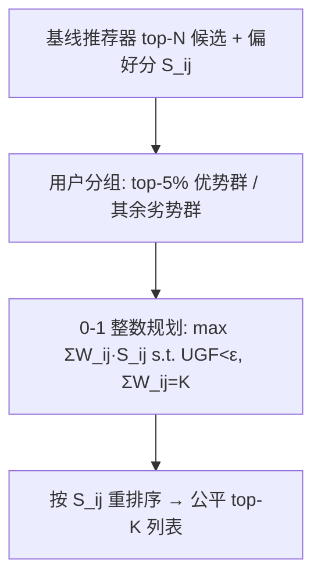

# User-oriented Fairness in Recommendation (面向用户视角的推荐公平性)

- **会议/期刊**: WWW 2021 (The Web Conference)
- **作者与机构**: Yunqi Li, Hanxiong Chen, Zuohui Fu, Yingqiang Ge, Yongfeng Zhang (Rutgers University)
- **推荐链路定位**: 重排 (Post-processing Re-ranking)
- **研究方向**: 去偏公平、可信隐私与工业架构 / 多任务学习与列表级重排
- **论文原文**: [https://arxiv.org/abs/2104.10671v1](https://arxiv.org/abs/2104.10671v1)
- **开源代码**: [https://github.com/rutgerswiselab/user-fairness](https://github.com/rutgerswiselab/user-fairness)

## TL;DR (1分钟核心速览)

本文把推荐公平从"物品/供给方"翻转到"用户侧"：按交互数/总消费/最高消费三种可观测信号把用户切成 top-5% 优势群与 95% 劣势群，实证发现 4 个主流模型（BiasedMF/PMF/NeuMF/STAMP）在劣势群上的 F1@10、NDCG@10 大幅落后。作者提出模型无关的约束重排——在基线 top-N 列表上求解 0-1 整数规划"最大化偏好分之和 s.t. 群体差距 $<\varepsilon$且每人恰选$K$ 项"。在 Amazon 三数据集、采样排序协议下，NeuMF 在 Grocery 上把 F1 差距 23.51→5.82（降 75.2%），同时整体 F1 14.51→15.48（+6.7%），实现"公平与精度双赢"。

## Background & Motivation (背景与核心矛盾)

- **主流范式**: 公平推荐此前几乎只讨论物品侧/供给侧的流行度偏差与长尾曝光（如校准型后处理），少数用户侧工作（Yao & Huang 的四类指标、Beutel 的成对正则）需改动训练目标。
- **前人局限一**: 物品侧去偏方法无法回答"同一模型对不同活跃度用户的推荐质量是否均等"，而数据不平衡在用户侧的传导机制与物品侧同构——活跃用户样本充足、主导 CF 的共现统计。
- **前人局限二**: 训练期正则化强绑定具体模型（MF/NeuMF 各自实现不同），无法在线上已部署的黑盒排序器之后直接套用。
- **核心洞察 (Key Insight)**: 用户分布极度长尾——Beauty 中仅 1.44% 用户交互数 $\geq 30$、69.91% 仅$\geq 5$；而占据极小比例的优势群却获得远高的 F1/NDCG。**劣势用户才是多数派**，因此提升其体验不仅公平、还能抬升整体指标，这打破了"公平必然损精度"的直觉。
- **本文切入点**: 只改重排层——保留基线打分 $S_{i,j}$，用群体公平约束决定"选哪些进 top-K"，做到 model-agnostic。

## Method (核心方法设计)

### 1. 整体框架 (Overall Architecture)

给定任一已训练推荐器，为每个用户输出 top-$N$候选及其偏好分$S_{i,j}$；重排器以 0-1 决策矩阵$\mathbf{W}_{n\times N}$（$\mathbf{W}_{ij}=1$表示物品$j$进入用户$i$的公平列表）为变量，在"每人恰选$K$项"与"优势/劣势群平均效用差$<\varepsilon$"两类约束下最大化总分之和，用 Gurobi 求可行解；最后按原始偏好分$S_{i,j}$对这$K$ 项重新降序排列，保证列表内部序仍忠实于原模型。

### 2. 关键设计拆解 (Key Designs)

1. **用户侧群体公平的形式化 (UGF / $\varepsilon$-fairness)**：痛点在于"公平"此前无用户侧可计算定义。作者要求两群期望效用相等，并以均值差绝对值度量不公平度：
$$UGF(Z_1,Z_2,\mathbf{W})=\left|\frac{1}{|Z_1|}\sum_{i\in Z_1}\mathcal{M}(\mathbf{W}_i)-\frac{1}{|Z_2|}\sum_{i\in Z_2}\mathcal{M}(\mathbf{W}_i)\right|\leq\varepsilon$$
   其中 $\mathcal{M}$直接取评测指标本身（本文为 F1@10）。直觉：不同于 demographic parity 只约束"选择率"，这里约束的是**质量指标**，因此$\varepsilon$ 天然成为"公平—效用"旋钮。

2. **约束重排的 0-1 规划目标**：不做任何模型假设，只重排已有候选：
$$\max_{\mathbf{W}_{ij}}\ \sum_{i=1}^{n}\sum_{j=1}^{N}\mathbf{W}_{ij}S_{i,j}\quad \text{s.t.}\ UGF<\varepsilon,\ \sum_{j=1}^{N}\mathbf{W}_{ij}=K,\ \mathbf{W}_{ij}\in\{0,1\}$$
   物理直觉：劣势群效用低并非因为"没有好物品可选"，而是其高分物品被优势群挤占名额后仍按同一截断阈值取 top-K；显式引入跨群约束后，求解器被迫在**用户间**重新分配"命中名额"，把部分高置信名额让渡给劣势用户。由于劣势群占 95%，少量让渡即换来整体指标的净增益。

3. **训练/求解开销**：无训练阶段（post-processing），沿用基线 BPR 损失与 1:1 随机负采样；重排等价于带基数约束的最大覆盖类整数规划（NP-hard），作者用 Gurobi 启发式求解，仅离线/近线在 top-$N$小候选集上运行（$N\ll m$），不触碰全库打分。

## Experimental Setup & Evaluation Protocol (实验设置与评估协议)

- **数据集与预处理**（Amazon 5-core，1996-05 至 2014-07，无重复交互）：

| 数据集 | #Users | #Items | #Interactions | 稀疏度 | 特征/场景说明 |
| :--- | :---: | :---: | :---: | :---: | :--- |
| Beauty | 22,363 | 12,101 | 198,502 | 99.93% | 美妆，含价格字段 |
| Grocery & Gourmet Food | 14,681 | 8,713 | 151,254 | 99.88% | 食品杂货 |
| Health & Personal Care | 38,609 | 18,534 | 346,355 | 99.95% | 个护健康 |

- **数据划分与防穿越**: 随机 `比例划分` 80%/10%/10%（train/valid/test），**用户分组仅依据训练集统计**（top-5% 为优势群），避免用到测试交互造成穿越；测试集再按群切分分别算指标。
- **排名评测协议**: `Sampled Ranking` —— 每个用户保留测试正样本 + 随机 100 个未交互负样本作为候选（负正比约 100:1），在候选列表上算 F1@10 与 NDCG@10，全用户平均。注意：非 Full-Ranking，指标绝对值被负采样稀释（F1 仅 12–16%）。
- **对比基线与超参**: 4 个公平无感基线覆盖浅层/深层/序列：BiasedMF、PMF、NeuMF、STAMP；$d=64$，NeuMF 的 MLP 为 32-16-8，STAMP 历史长度 30，lr=0.001，$\ell_2=1e\text{-}5$；$\varepsilon$ 统一设为**基线原始群体差距的一半**（避免逐模型调参）。

## Key Experimental Results (实验关键数据)

### 1. 主实验对比 (Main Results)

Grocery（按交互数分组，F1/NDCG 为 %；Orig.=基线，Fair=本文重排）：

| 模型 | F1@10 Overall | F1@10 Adv. | F1@10 Disadv. | UGF(F1)↓ | NDCG@10 Overall | NDCG@10 Adv. | NDCG@10 Disadv. | UGF(NDCG)↓ |
| :--- | :---: | :---: | :---: | :---: | :---: | :---: | :---: | :---: |
| BiasedMF | 15.78 | 36.48 | 13.86 | 22.62 | 45.08 | 70.29 | 42.74 | 27.55 |
| **BiasedMF-Fair** | **16.13** | 21.37 | **15.65** | **5.72** | **45.75** | 55.74 | **44.83** | **10.91** |
| PMF | 15.62 | 36.37 | 13.70 | 22.67 | 44.85 | 70.80 | 42.44 | 28.36 |
| **PMF-Fair** | **16.06** | 21.28 | **15.58** | **5.70** | **45.74** | 57.23 | **44.67** | **12.56** |
| NeuMF | 14.51 | 36.02 | 12.51 | 23.51 | 38.86 | 68.34 | 36.13 | 32.21 |
| **NeuMF-Fair** | **15.48** | 20.81 | **14.99** | **5.82** | **40.09** | 50.02 | **39.17** | **10.85** |
| STAMP | 14.35 | 33.52 | 12.57 | 20.95 | 38.58 | 65.61 | 36.08 | 29.53 |
| **STAMP-Fair** | **14.47** | 19.23 | **14.03** | **5.20** | **39.16** | 52.42 | **37.93** | **14.49** |

Beauty（NeuMF，同协议）：F1 Overall 12.44→**13.81**（+11.0%），Disadv. 10.91→**13.43**，UGF 18.19→**3.50**（-80.8%）；NDCG Overall 35.13→**36.30**，UGF 29.07→**5.01**。

### 2. 消融与敏感性分析 (Ablation Study)

以 NeuMF 在 Grocery 上做"分组信号 + 公平强度"双维消融：

| 配置 | UGF(F1) 原始→公平 | UGF(NDCG) 原始→公平 | F1 Overall 原始→公平 | 结论 |
| :--- | :---: | :---: | :---: | :--- |
| 分组=交互数 | 23.51→5.82 | 32.21→10.85 | 14.51→15.48 | 差距最大、收益最高 |
| 分组=总消费额 | 20.34→2.02 | 27.43→1.86 | 14.51→15.49 | 约束几乎"零成本"达成 |
| 分组=最高单价 | 8.86→1.00 | 13.41→0.21 | 14.51→14.82 | 差距小、整体增益收窄至 +2.1% |
| $\varepsilon\to 0$（全公平） | →0 | →0 | 仍优于原始 | 三群 F1@10 趋于相等，优势群甚至被压到劣势群之下 |

### 3. 关键实验发现 (Key Findings)

1. **公平与整体精度同向而非对立**：劣势群占 95%，NeuMF-Fair 让优势群 F1 损失 15.21（36.02→20.81），却让劣势群提升 2.48（12.51→14.99），按人数加权后整体净增 0.97——收益来自"多数派"的权重放大。
2. **$\varepsilon$呈现单调可调性**：从原始差距的 1/2 收紧到$\varepsilon=0$，优势群 F1 单调下滑、劣势群与整体单调上升，且在$\varepsilon=0$时整体 F1 仍不低于基线，说明"适度公平"存在免费的帕累托区间（本文默认的$\varepsilon=$ 半差距正落在该区间内）。
3. **分组信号决定可挖掘空间**：以"最高单价"分组时原始 UGF 仅 8.86（远低于交互数的 23.51），与之对应整体 F1 增益从 +6.7% 掉到 +2.1%——说明重排的收益上界由"群体间既有质量落差"决定，活跃度/累积消费是比单次最高消费更有效的偏差放大信号。

## Highlights & Limitations (亮点、对比与审稿批判)

- **与代表作对比 (vs. Prior Work)**: 相对 Yao & Huang 的 CF 公平指标与 Beutel 的成对公平正则，本文不修改训练目标、不假设模型结构，可插在黑盒排序器之后；相对物品侧校准式重排（如 Abdollahpouri 的流行度校准），本文约束的是**跨群质量指标差**而非曝光配额，因此能同时报告"整体精度反而上升"这一反直觉结论。
- **可迁移亮点**: (1) 把"评测指标本身"（F1@K）而非代理量写进约束，$\varepsilon$ 直接对应业务可理解的差距上限，便于产品化对齐 SLA；(2) 分组信号可用任意可观测字段替换（活跃度→地域/设备/新老客），框架不变。
- **审稿级局限批判**: 一是求解依赖 Gurobi 且用户数 $n$与候选$N$ 同时进约束，全量线上场景需分片近似，论文未给复杂度/时延实测；二是评测仅为 100 负样本的 Sampled Ranking，F1 绝对值偏低且未做 Full-Ranking 或显著性检验，优势群被"主动降质"是否存在用户流失的长期反噬亦未讨论。

## Rating (四维评分)

- **方法创新性 (Novelty)**: ⭐⭐⭐ （首个系统提出"用户侧群体公平"并把指标差写成整数规划约束，问题定义价值高于算子新颖度）
- **评估协议与实验扎实度 (Protocol & Experiments)**: ⭐⭐⭐ （三数据集 × 四模型 × 三种分组 × 变 $\varepsilon$ 覆盖充分，但仅采样排序、无显著性检验）
- **写作与数学规范度 (Clarity & Rigor)**: ⭐⭐⭐⭐ （UGF/$\varepsilon$-fairness 定义与优化式干净自洽；未讨论 NP-hard 求解的近似比与规模开销）
- **工业落地与复现价值 (Industrial & Practical Value)**: ⭐⭐⭐⭐ （model-agnostic、代码开源、约束直译业务指标，但需补充大规模求解时延与长期留存验证）

