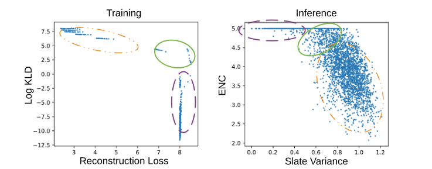
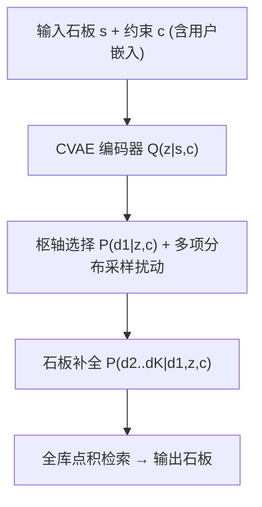

# Variation Control and Evaluation for Generative Slate Recommendations (生成式石板推荐的变异性控制与评估)

- **会议/期刊**: WWW 2021 (The Web Conference)
- **作者与机构**: Shuchang Liu, Yingqiang Ge, Yongfeng Zhang (Rutgers University)；Fei Sun, Changhua Pei (Alibaba Group)
- **推荐链路定位**: 重排 / 列表级端到端生成
- **研究方向**: 生成式推荐与离散语义ID / 多任务学习与列表级重排
- **论文原文**: [https://arxiv.org/abs/2102.13302v1](https://arxiv.org/abs/2102.13302v1)
- **开源代码**: [https://github.com/CharlieFaceButt/PivotCVAE](https://github.com/CharlieFaceButt/PivotCVAE)

## TL;DR (1分钟核心速览)

石板推荐需要一次性生成整张长度为 $K$的列表，主流 CVAE 方案（List-CVAE）存在**重构-集中困境 (RCD)**：$\beta$小则过拟合训练石板、生成近乎随机；$\beta$大则退化为少数"石板原型"、精度高但毫无变化，可用区间仅占$\log\beta$ 搜索空间的 30% 以内。本文提出以"总物品方差 + 列表内多样性"补充精度评估，并把生成过程拆成**枢轴选择 (pivot selection) + 石板补全 (slate completion)** 两阶段，在生成前施加扰动。在 ML(User) 上物品覆盖率由 0.004 升至 0.250（约 60 倍），ENC 仅从 3.579 降到 3.252。

## Background & Motivation (背景与核心矛盾)

- **主流范式**: 传统 LTR 逐物品打分再取 Top-$K$，本质贪心，忽略同一列表内物品的互补/竞争关系；近期工作 (Jiang et al.) 用条件 VAE 直接建模石板分布$P_\theta(\boldsymbol{s}|\boldsymbol{z},\boldsymbol{c})$。
- **前人局限**: ① VAE 的随机性在 CV 里是优点，在推荐里却是双刃剑——重构项与 KL 项此消彼长，模型要么只会复读训练集、要么坍缩到几个原型石板；② 现有评估只看精度 (ENC/HitRate)，无法度量生成模型"是否只会生成同几张列表"。
- **核心洞察 (Key Insight)**: 作者对生成物品做方差分解，证明总物品方差 = **石板均值方差**（跨列表覆盖）+ **列表内方差**（ILD），二者互为总方差的下界，故"ILD 高"不代表"覆盖广"。进一步发现最优性能只落在两极端之间的狭窄"肘部" $\beta\in[\beta^-,\beta^+]$，且$\beta^+-\beta^-\ll 10^{-2}$，几乎不可搜索。
- **本文切入点**: 与其调 $\beta$ 找肘部，不如主动注入扰动把肘部"拓宽"；关键是扰动必须发生在**生成之前**而非之后。

<figure class="paper-figure" markdown="span">
  <figcaption>图3：RCD 在 Yoochoose 数据上的训练损失变化（左）和推荐性能（右）。左图中每个点表示模型在一个训练轮次中各列表的平均结果。右图中每个点表示某个生成的列表。这里，我们使用 ILD 作为列表变化指标，ENC 作为准确率指标。</figcaption>
</figure>

## Method (核心方法设计)

### 1. 整体框架 (Overall Architecture)

模型沿用 CVAE 骨架：编码器 $Q_\phi(\boldsymbol{z}|\boldsymbol{s},\boldsymbol{c})$把输入石板$\boldsymbol{s}$与约束$\boldsymbol{c}$（由理想点击响应 one-hot 与用户嵌入拼接而成）压成隐变量$\boldsymbol{z}$；解码器不再一次性吐出整张石板，而是先在固定槽位$d_1$上采样一个**枢轴物品**$d_1\sim P_\theta(d_1|\boldsymbol{z},\boldsymbol{c})$，再把$d_1$作为额外条件送入**石板补全模型**$P_\theta(d_2,\dots,d_K|d_1,\boldsymbol{z},\boldsymbol{c})$，逐槽输出隐物品向量并全库点积检索最近邻。训练时两项子模型各自用 softmax 交叉熵 + 负采样独立优化，编码器几乎无需改动；推理时$\boldsymbol{z}$从条件先验$P_\theta(\boldsymbol{z}|\boldsymbol{c}^*)$采样，$\boldsymbol{c}^*$ 取全点击响应。扰动只在枢轴阶段注入，补全阶段"收拾残局"。

### 2. 关键设计拆解 (Key Designs)

1. **两阶段解耦生成 (Pivot-CVAE)**：后置扰动（直接替换已生成列表中的一个物品）会造成大幅精度崩塌（附录 A：仅扰动 1 个物品，$R(\boldsymbol{r}|\boldsymbol{s})$ 分布已严重偏离原石板）。本文改为预生成扰动，将联合分布因式分解为
$P_\theta(\boldsymbol{s}|\boldsymbol{z},\boldsymbol{c})=P_\theta(d_2,\dots,d_K|d_1,\boldsymbol{z},\boldsymbol{c})\,P_\theta(d_1|\boldsymbol{z},\boldsymbol{c})$如此扰动发生在"语义决策"层而非"结果层"，补全模型可依据枢轴重新组织剩余$K-1$ 个位置以纠正坏枢轴，因此同等方差下精度损失更小。

2. **单枢轴的理论最优性**：若物品间为二元有向关系，长度 $K$的石板至多含$K(K-1)$条关系；选$k'$个枢轴会丢失$(K-k')k'$条关系，而$(K-k')k'\ge K-1$（当$k'=1$ 取等）。故只选一个枢轴是在"引入扰动"与"保留列表内关系"之间的最优折中。

3. **训练目标、负采样与四种变体**：损失即 $\beta$-KL 加权重构项
$\mathcal{L}_{\boldsymbol{s}}=\mathbb{E}_{Q_\phi(\boldsymbol{z}|\boldsymbol{s},\boldsymbol{c})}\big[\log P_\theta(\boldsymbol{s}|\boldsymbol{z},\boldsymbol{c})\big]-\beta\,\mathrm{KL}\big[Q_\phi(\boldsymbol{z}|\boldsymbol{s},\boldsymbol{c})\,\|\,P_\theta(\boldsymbol{z}|\boldsymbol{c})\big]$重构项用**降采样负例的 softmax**（Yoochoose 1000 个、MovieLens/仿真 100 个负例）防过拟合。训练时枢轴可用真值$d_1$（收敛更快、效果等同）或采样值，推理时亦然，组合出 GT-PI / SGT-PI / GT-SPI / SGT-SPI 四种变体；扰动按 sigmoid 点积相似度的多项分布采样。

## Experimental Setup & Evaluation Protocol (实验设置与评估协议)

- **数据集与预处理**: 石板大小 $K=5$；MovieLens 将连续评分会话切成 5 元组，评分 4–5 记为正反馈；两数据集响应分布均偏斜向 0 与 3 次点击，作者对 1/2/4/5 次点击样本随机重复上采样至最大类一半规模。

| 数据集 | #Users | #Items | #Slates | 稀疏度/密度 | 特征/场景说明 |
| :--- | :---: | :---: | :---: | :---: | :--- |
| Yoochoose | — | — | ~274K | — | RecSys'15 点击会话，无用户 ID |
| ML (User) | 943 | 1,682 | ~100K 评分切片 | 6.3% | MovieLens 100K，保留用户 ID |
| ML (No User) | — | 1,682 | 同上 | 6.3% | 抹去用户 ID 的对照组 |
| URM_P_MR ($\rho$) | 1,000 | 3,000 | 100K (生成) | 3.3% | 仿真环境，$\rho\in\{0,0.5,5\}$ 控制列表内关系强度 |

- **数据划分与防穿越 (Splitting Strategy)**: 全部采用 **80-10-10 随机留出 (holdout)**，每组实验重复 5 次取均值，报告 $p<0.05$ 显著性。
- **排名评测协议 (Ranking Protocol)**: **不使用**传统 test-set Full-Ranking，而训练一个用户响应模型 $R(\boldsymbol{r}|\boldsymbol{s})$（有用户 ID 时$R(\boldsymbol{r}|\boldsymbol{s},u)$，point-wise BCE）充当"地面真值环境"，用采样估计期望点击$\mathrm{ENC}=\mathbb{E}[\sum_{k=1}^{K}r_k]=\sum_{\boldsymbol{s}}P(\boldsymbol{s})\mathbb{E}[\sum_k r_k|\boldsymbol{s}]$，每模型采样$N=500$张石板。变化性用 **Item Coverage**（覆盖物品占比）与 **ILD**$=1-\mathrm{ILS}$ 度量；test-set HitRate/Recall 仅作辅助（作者明确指出其偏袒确定性模型）。
- **对比基线与超参**: MF、NeuMF、MF-MMR（多样性重排）、Non-Greedy MF/NeuMF、List-CVAE、Non-Greedy List-CVAE；嵌入维度 $d=8$，隐变量$m=16$，编码/解码隐层 256×2，batch 64，学习率$10^{-4}$（CF 系$3\times10^{-4}$），weight decay$10^{-4}$，$\beta$在$[10^{-5},30]$ 上对数均匀搜索。

## Key Experimental Results (实验关键数据)

### 1. 主实验对比 (Main Results)

| 模型 | ML(User) ENC | Cov. | ILD | URM_P_MR(ρ=5) ENC | Cov. | ILD |
| :--- | :---: | :---: | :---: | :---: | :---: | :---: |
| MF | 3.246 | 0.003 | 0.206 | 4.961 | 0.002 | 0.036 |
| NeuMF | 3.197 | 0.003 | 0.694 | 4.938 | 0.002 | 0.779 |
| MF-MMR | 2.400 | 0.003 | 0.287 | 4.617 | 0.002 | 0.227 |
| Non-Greedy NeuMF | 3.020 | 0.141 | **0.836** | 4.819 | 0.080 | **0.827** |
| List-CVAE | **3.579** | 0.004 | 0.178 | **4.971** | 0.005 | 0.524 |
| Non-Greedy List-CVAE | 3.285 | 0.139 | 0.428 | 4.777 | 0.084 | 0.664 |
| Pivot-CVAE (SGT-PI) | 3.376 | 0.071 | 0.486 | 4.944 | 0.005 | 0.632 |
| Pivot-CVAE (GT-SPI) | 3.252 | **0.250** | 0.725 | 4.622 | **0.227** | 0.814 |
| Improv. (Cov. vs List-CVAE) | — | **+6150%** | +307% | — | **+4440%** | +55% |

### 2. 消融实验 (Ablation Study)

扰动位置消融（ML(User)，Pivot-CVAE 四种变体）：

| 变体 | 训练扰动 | 推理扰动 | ENC | Cov. | ILD |
| :--- | :---: | :---: | :---: | :---: | :---: |
| List-CVAE (无枢轴解耦) | ✗ | ✗ | **3.579** | 0.004 | 0.178 |
| Pivot-CVAE (SGT-PI) | ✓ | ✗ | 3.376 | 0.071 | 0.486 |
| Pivot-CVAE (GT-SPI) | ✗ | ✓ | 3.252 | **0.250** | **0.725** |
| Pivot-CVAE (SGT-SPI) | ✓ | ✓ | 3.152 | 0.144 | 0.551 |

### 3. 关键实验发现 (Key Findings)

1. **精度与变化性只能靠"扰动位置"折中，不能靠 $\beta$折中**：List-CVAE 在 ML(User) 取得最高 ENC 3.579，但 Item Coverage 仅 0.004（几乎只输出同一个原型石板）；GT-SPI 覆盖率提升至 0.250（60 倍），ENC 只损失 9.1%。而单纯调小$\beta$会同时牺牲精度与可解释性——对照实验中$\beta\le 0.003$ 时重建几乎"抄答案"，推理 ENC 反而最低。
2. **扰动放在推理端 > 训练端**：SGT-PI（只在训练扰动）ILD 达 0.486 但覆盖率仅 0.071，说明模型学会了"去噪"——用扰动枢轴仍找回高内聚石板，牺牲跨列表覆盖；GT-SPI（只在推理扰动）同时拿到最优 Cov./ILD，证明扰动应作用于"探索"而非"拟合"。
3. **生成式模型在含列表内关系的环境中真正占优**：URM_P（纯 point-wise，$\rho=0$）下 MF 类 ENC 最高；而$\rho=5.0$ 时 List-CVAE 的 ENC 4.971 超过 MF 4.961，且生成模型方差指标全面领先，说明真实数据（ML(User)）的响应结构更接近 URM_P_MR 而非 URM_P；test-set 上 MF 的 HitRate 0.0330 高于所有生成模型，恰恰暴露了传统排序指标对随机生成模型的系统性偏见。

## Highlights & Limitations (亮点、对比与审稿批判)

- **与代表作对比 (vs. Prior Work)**: 与 List-CVAE (Jiang et al.) 相比，本文不改编码器、不重训骨干，仅做一次分布因式分解就把"生成不可控"变成"扰动可控"；与 MF-MMR 这类后处理多样性方法相比，MMR 靠牺牲 ENC 换 ILD（ML(User) ENC 仅 2.400），而 GT-SPI 在 ENC 3.252 下拿到更高 Cov./ILD；与 Non-Greedy 后置扰动相比，预生成扰动信息损失从"整条列表崩塌"降为"仅丢 $K-1$ 条物品关系"。
- **可迁移亮点**: ① 方差分解恒等式（总方差 = 石板均值方差 + 列表内方差）可直接复用为任何随机生成推荐器的双指标体检；② "先选锚点、再补全"的两阶段解码范式（pivot + completion）可迁移到扩散/自回归生成式推荐，用少量扰动换取可控多样性。
- **审稿级局限批判**: ① 主指标 ENC 依赖一个学出来的响应模型 $R(\boldsymbol{r}|\boldsymbol{s})$作"真值"，该模型本身有偏，评估链条存在循环论证风险；② 肘部搜索需对每个$\beta$独立训练一次模型（$[10^{-5},30]$对数均匀网格），超参开销大，且$K=5$、$|D|\le 3000$ 的小规模设定未验证工业级百万物品下的推理延迟与全库点积检索成本。

## Rating (四维评分)

- **方法创新性 (Novelty)**: ⭐⭐⭐⭐ （用一次因式分解 + 关系计数上界 $(K-k')k'\ge K-1$ 论证单枢轴最优，简洁且有理论支撑，但本质仍是 CVAE 变体改良）
- **评估协议与实验扎实度 (Protocol & Experiments)**: ⭐⭐⭐⭐ （两真实数据集 + 三个强度可控的仿真环境，5 次重复与 $p<0.05$ 检验齐备；扣分在于"真值"由学习模型替代，且数据集规模偏小）
- **写作与数学规范度 (Clarity & Rigor)**: ⭐⭐⭐⭐⭐ （方差分解推导清晰、RCD 三区间的可视化论证（TSNE + 重建散点）非常有说服力）
- **工业落地与复现价值 (Industrial & Practical Value)**: ⭐⭐⭐⭐ （代码已开源、改动量极小易于插拔；但推理需多次采样方能估计方差，大规模全库检索与在线延迟仍是待验证的工程问题）

