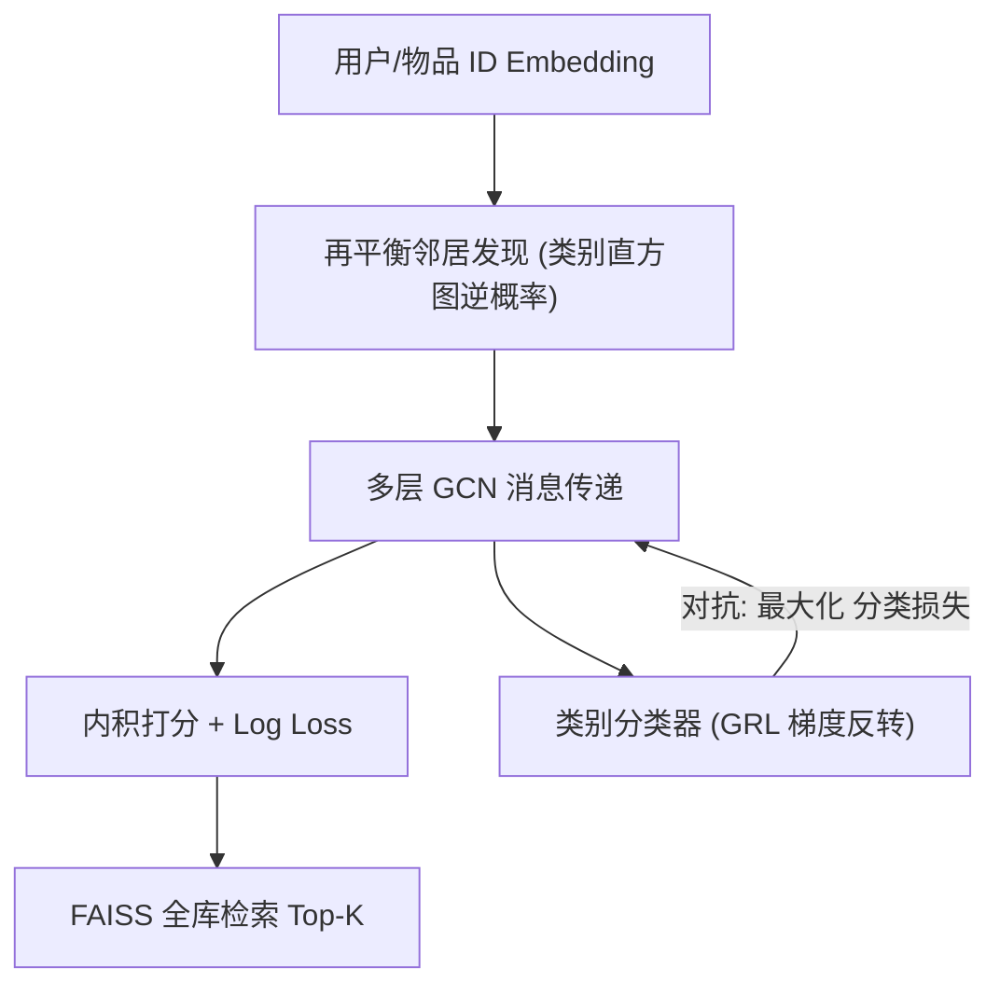
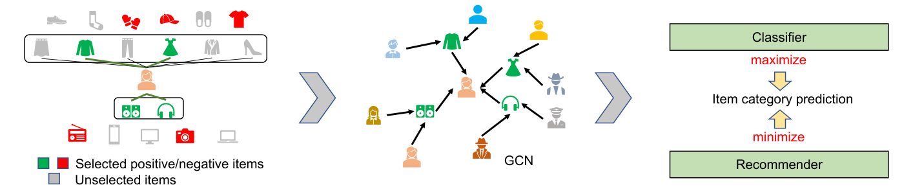

# DGCN: Diversified Recommendation with Graph Convolutional Networks (基于图卷积网络的多样化推荐)

- **会议/期刊**: WWW 2021
- **作者与机构**: Yu Zheng, Chen Gao, Liang Chen, Depeng Jin, Yong Li（清华大学电子工程系、北京信息科学与技术国家研究中心、中山大学）
- **推荐链路定位**: 召回（候选生成 / Matching，直接以 FAISS 内积检索出 Top-300）
- **研究方向**: 图神经网络推荐 / 去偏与多样性
- **论文原文**: [论文原文链接](https://arxiv.org/abs/2108.06952v1)
- **开源代码**: [开源代码仓库链接](https://github.com/tsinghua-fib-lab/DGCN)

## TL;DR (1分钟核心速览)

现有多样化方法（MMR/DUM/DPP）都作用在候选生成之后，与上游匹配模型**解耦**，导致召回的候选项本身冗余、全系统次优。本文把多样化前移到 GCN 召回层，提出 DGCN：用类别直方图逆概率做**再平衡邻居采样**、从"正类别内"抽取难负例、并用 GRL 做**类别分类对抗**剥离嵌入中的类别偏好。在 Taobao/Beibei 上以 FAISS 全库 Top-300 排序评估，DGCN 在覆盖率提升的同时把 Recall 从 DPP 的 0.0633 提升到 0.0776（Taobao，+22.6%）。

## Background & Motivation (背景与核心矛盾)

- **主流范式**: 推荐系统分匹配（召回）→ 打分 → 重排三段；多样化普遍在后端重排实现（MMR、DUM 贪心、PMF+α+β、DPP 行列式点过程），或走 LTR 直接生成列表。
- **前人局限**: ①后处理/DPP 的多样化与匹配模型解耦，多样化信号无法回传至上游，召回集本身已冗余，瓶颈从源头锁死；②贪心方法在"精度–多样性"曲线上交换率极陡，DUM 覆盖率极高（Taobao 126.66）但 Recall 仅 0.0495，几乎不可用；LTR 则难以构造合适的列表级训练集。
- **核心洞察 (Key Insight)**: 用户–物品二部图的高阶邻居天然包含"相似用户喜爱的其它类别物品"，理论上更具多样性可达性；但无专门设计的 GCN 会让高频主导类别占据绝大多数入边，用户嵌入被拉向主导类别簇，多样性反而被压制。
- **本文切入点**: 在 GCN 的三个算子层面注入类别多样化先验（采样分布、负采样分布、对抗目标），让多样化与匹配端到端联合优化。

## Method (核心方法设计)

### 1. 整体框架 (Overall Architecture)

输入仅为用户/物品 ID，经 Embedding 层得到 $0$层节点特征，随后在采样的 Node Flow 子图上做多层 GCN 消息传递：每层先对邻居做 MEAN 聚合再经$\tanh(W_k\cdot)$变换（含自环），得到用户/物品最终表示$h^K_u, h^K_i$，以内外积$p_{u,i}=\langle h^K_u,h^K_i\rangle$ 打分。训练端并行三支多样化改造：再平衡邻居采样改变"谁的邻居被激活"、类别增强负采样改变"哪些负例参与对比"、对抗分类支路（经 GRL）改变"嵌入空间是否按类别成簇"。推理端将物品嵌入灌入 FAISS IndexFlatIP，用户向量作查询，端到端输出多样化 Top-K。

<figure class="paper-figure" markdown="span">
  <figcaption>图3：我们提出的 DGCN 概览。</figcaption>
</figure>

### 2. 关键设计拆解 (Key Designs)

1. **再平衡邻居发现 (Rebalanced Neighbor Discovering)**：痛点——主导类别占据大多数入边，用户嵌入被拽向单类簇。做法——对用户节点统计其邻居的类别直方图 $H$，令采样概率$p(i)\propto H(C(i))^{-\alpha}$ 并归一化（物品节点保持均匀采样）。物理直觉：把二阶可达性从"高频类"重分配至"弱势类"，使多种类别的物品在嵌入空间进入同一用户邻域，为后续检索提供多样候选。

2. **类别增强负采样 (Category-Boosted Negative Sampling)**：痛点——均匀负采样下"同类相似但未被交互"的物品未被明确推开，模型只能学到粗粒度类别偏好。做法——以概率 $\beta$从正样本$i$所属类别$\mathcal{I}_{C(i)}$ 内抽负例，否则从全库抽（负采样率 4）。直觉：同类难负例迫使模型在**类内**做细粒度偏好判别，从而把兴趣点从"整类"收敛到"具体物品"，为其它类别腾出推荐位。

3. **对抗学习与训练目标**：在物品嵌入上加全连接分类器预测类别，分类器最小化 $\mathcal{L}_c$，而 GCN 通过 GRL 最小化$\mathcal{L}_r-\gamma\mathcal{L}_c$：

$$\mathcal{L}=\mathcal{L}_r-\gamma\mathcal{L}_c,\quad \mathcal{L}_c=-\hat{c}[c]+\log\sum_j\exp(\hat{c}[j])$$

其效果是让嵌入**不留类别簇结构**（类内散开、又保留 $\mathcal{L}_r$ 的偏好语义）。负采样为"正类内难负例 + 全库均匀"混合；推理仅需一次内积近邻检索，无额外在线开销。

## Experimental Setup & Evaluation Protocol (实验设置与评估协议)

- **数据集与预处理**（均为 `10-core` 过滤，保留交互 ≥10 的用户/物品）：

| 数据集 | #Users | #Items | #Interactions | 类别数 | 场景说明 |
| :--- | :---: | :---: | :---: | :---: | :--- |
| Taobao | 82,633 | 136,710 | 4,230,631 | 3,108 | 阿里妈妈点击/加购/收藏/购买行为 |
| Beibei | 19,140 | 17,196 | 265,110 | 110 | 母婴电商购买记录 |
| MSD | 65,269 | 40,109 | 2,423,262 | 15 | 音乐收听（多样性基准曲线） |

- **数据划分与防穿越**: **全局时间戳切分**——按时间排序取前 60% 训练、接着 20% 验证（调参）、最后 20% 测试。
- **排名评测协议**: **Full-Ranking 全库排序**（无负采样候选），用 FAISS `IndexFlatIP` 对全部物品做内积近邻检索，取 TopK=300 评估匹配质量；指标含 Recall、Hit Ratio（精度）与 Coverage、Entropy、Gini Index（多样性，Gini 越低越好）。
- **对比基线与超参**: 基线为 MMR、DUM、PMF+α+β、DPP 四类多样化方法（各自调参使其在精度或多样性单项上与本方法持平再比较另一项）；嵌入维度 $d=32$，负采样率 4，AMSGrad 优化，早停，网格搜索超参。

## Key Experimental Results (实验关键数据)

### 1. 主实验对比 (Main Results)

| 数据集 | 方法 | Recall | HitRatio | Coverage | Entropy | Gini↓ |
| :--- | :--- | :---: | :---: | :---: | :---: | :---: |
| Taobao | MMR | 0.0544 | 0.0453 | 74.55 | 3.4931 | 0.5825 |
| Taobao | DUM | 0.0495 | 0.0497 | 126.66 | 4.1051 | **0.4587** |
| Taobao | PMF+α+β | 0.0473 | 0.0435 | 125.56 | **4.3725** | 0.4648 |
| Taobao | DPP | 0.0633 | 0.0485 | 79.12 | 3.3904 | 0.6096 |
| Taobao | **DGCN** | **0.0776** | **0.0783** | 84.67 | 3.5779 | 0.5583 |
| Beibei | MMR | 0.1097 | 0.1036 | 77.02 | **4.0184** | 0.4373 |
| Beibei | DUM | 0.0746 | 0.0724 | **84.30** | 4.0389 | 0.4599 |
| Beibei | DPP | 0.0751 | 0.0745 | 69.34 | 3.7545 | 0.5078 |
| Beibei | **DGCN** | **0.1212** | **0.1278** | 71.85 | 3.7149 | 0.5279 |

（Improv. 相对 DPP：Taobao Recall +22.6%、Coverage +7.0%；Beibei Recall +61.4%、HitRatio +71.5%）

### 2. 消融实验 (Ablation Study)

| 配置 (Taobao) | Recall | Coverage |
| :--- | :---: | :---: |
| DPP（后处理 SOTA） | 0.0633 | 79.12 |
| GCN（无多样化设计） | **0.1013** | 61.91 |
| + 再平衡邻居采样 | 0.0939 | 71.25 |
| + 类别增强负采样 | 0.0954 | 76.74 |
| + 对抗学习 | 0.0846 | 79.07 |
| DGCN（三者叠加） | 0.0776 | **84.67** |
| GCN w/o GRL | 0.1041 | 55.66（分类器 acc 25%） |
| GCN w/ GRL | 0.0739 | 80.49（分类器 acc 6%） |

### 3. 关键实验发现 (Key Findings)

1. **精度–多样性困境在贪心类方法上最严重，DGCN 以极小精度代价换取大幅多样性**：DUM 把 Taobao Coverage 推到 126.66，但 Recall 仅 0.0495（较 DGCN 低 36%）；而 DGCN 同时取得最高 Recall 0.0776 与超越 DPP 的 Coverage 84.67，位于 MSD 精度–多样性曲线的"右上角"（图 7）。
2. **三个组件对覆盖率各司其职、叠加增益最大**：单一组件把 Coverage 从 61.91 分别提升到 71.25 / 76.74 / 79.07，三者叠加达 84.67；其中对抗学习单点增益最大（+17.2），说明"嵌入空间去除类别簇结构"是多样性的主要来源。
3. **GRL 确实完成了类别信息蒸馏**：插入 GRL 后类别分类器准确率由 25% 骤降至 6%，同时推荐多样性从 55.66 升至 80.49（+44.6%），证明嵌入已在类内被打散而仍保留偏好语义；超参 $\alpha,\beta$ 单调控制多样性，且在较小取值区间内精度**同时上升**，可平滑权衡。

## Highlights & Limitations (亮点、对比与审稿批判)

- **与代表作对比**: 相比 MMR/DUM/PMF+α+β 的"召回后重排"，DGCN 把多样化写进图卷积算子，多样化信号可反向传播至嵌入；相比 DPP 的"子集行列式建模"，DGCN 无需构造候选集上的核矩阵，端到端训练且天然适配 FAISS 内积召回；相比 NGCF/PinSage 等纯精度 GCN，本文首次量化并改造了 GCN 对多样性的负向影响。
- **可迁移亮点**: ①"直方图逆概率重采样"可用于任何图召回模型的邻居采样器以缓解长尾/类目偏斜；②"正类内难负例 + GRL 类别对抗"组合可迁移至跨域场景，剥离场景特有表征以增强跨域泛化。
- **审稿级局限批判**: ①评估仅离线 Recall/多样性指标，未做线上 A/B，而作者自己承认离线精度–多样性冲突部分源于离线评估与在线留存之间的因果差异；②对抗目标的平衡系数 $\gamma$与$\alpha,\beta$ 引入三个超参，且 GRN 训练需每步维护采样 Node Flow，深层 GCN 下采样与 GRL 反向传播的工程开销未给出复杂度/延迟分析。

## Rating (四维评分)

- **方法创新性 (Novelty)**: ⭐⭐⭐⭐ （首次将多样化下沉到 GCN 召回算子层，三个改造点各自对应采样分布/负例分布/嵌入几何三个正交维度，思路清晰但缺乏理论刻画）
- **评估协议与实验扎实度 (Protocol & Experiments)**: ⭐⭐⭐⭐ （三数据集 + FAISS 全库排序 + 三维多样性指标 + 近邻搜索加速，消融充分；缺线上验证与显著性检验）
- **写作与数学规范度 (Clarity & Rigor)**: ⭐⭐⭐⭐ （公式简洁、算法伪代码完整，GRL 与对抗目标说明清楚；对抗部分的梯度符号与 $\gamma$ 语义可再澄清）
- **工业落地与复现价值 (Industrial & Practical Value)**: ⭐⭐⭐⭐ （代码开源，纯内积检索、FAISS 可直接上线，采样器可增量训练，但三超参调优与图采样成本需在工程侧权衡）

