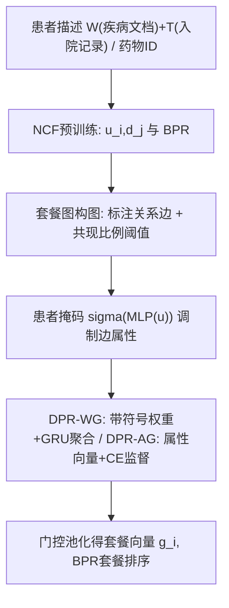
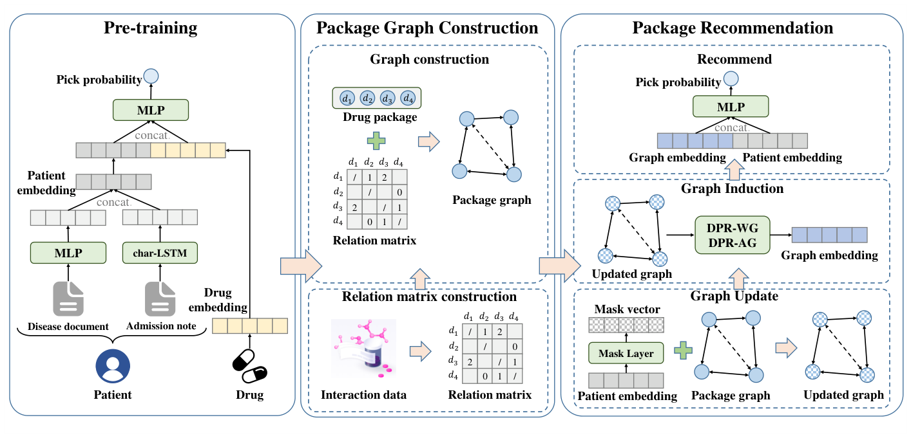

# Drug Package Recommendation via Interaction-aware Graph Induction (交互感知图归纳的药物套餐推荐)

- **会议/期刊**: WWW 2021
- **作者与机构**: Zhi Zheng, Chao Wang, Tong Xu (通讯), Dazhong Shen, Penggang Qin, Enhong Chen (USTC 大数据分析省重点实验室)；Baoxing Huai (华为)；Tongzhu Liu (中科大附一院)
- **推荐链路定位**: 精排（套餐/集合级打分，非单物品）
- **研究方向**: 图神经网络与知识图谱推荐 / 冷启动与长尾推荐
- **论文原文**: [https://arxiv.org/abs/2102.03577v1](https://arxiv.org/abs/2102.03577v1)
- **开源代码**: [PyTorch Geometric](https://github.com/rusty1s/pytorch_geometric)（作者仅依赖 PyG 实现，未单独开源本模型，视为“暂未开源”）

## TL;DR (1分钟核心速览)

药物推荐长期沿用 CF/NCF 范式，把每种药视为独立物品，忽略了药物间**协同/拮抗**的潜在交互，且该交互强度还受**患者病情**调制。本文把每个患者的用药套餐表示成一张图：节点为药物，边由“已标注交互关系 + 共现比例阈值”稀疏化，边属性取**带符号实数权重 (DPR-WG)** 或**交互属性向量 (DPR-AG)**，再用患者掩码向量逐维调制边属性，经单层 MPNN 归纳出套餐表征做 BPR 排序。在 15.8 万条真实 EMR 上，DPR-AG 取得 F1 = 0.5162，相对最优基线 DAM (0.4979) 提升 3.7%，召回提升 5.9%。

## Background & Motivation (背景与核心矛盾)

- **主流范式**: EMR 药物推荐沿用协同过滤/深度隐因子（NCF、Medicine-LDA、异构图标签传播）；套餐推荐（BR、DAM、P2V）则把套餐内 item 向量池化/注意力聚合后打分，本质仍是“用户-套餐”二元偏好学习。
- **前人局限 1**: 上述方法把套餐内的 drug 视为**相互独立**——22,986 对协同 vs 6,389 对拮抗的领域知识被完全丢弃，模型只能靠流行度推荐（NCF 的 Precision 仅 0.3812 即为此病灶的直接证据）。
- **前人局限 2**: 药物交互的**效用符号会被病情翻转**。图 1 的肾病案例中，头孢呋辛+庆大霉素抗菌协同但加重肾毒性，对该患者必须排除；这意味着交互边的贡献不能是全局静态常量，须由患者条件调制。
- **核心洞察 (Key Insight)**: 药物推荐场景**没有稳定用户集**（患者多为一次性就诊）、套餐组合近乎无限，user-item 矩阵天然不适合；但“套餐=图”这一结构先验是可靠的——同套餐药物必成边，交互类型是边属性。
- **本文切入点**: 把套餐推荐重构成**图归纳 (graph induction)** 问题：先构图，再让患者掩码改写边属性，最后 GNN 聚合出套餐向量。

## Method (核心方法设计)

### 1. 整体框架 (Overall Architecture)

三段式闭环：(i) **预训练**——患者侧用 MLP 编码疾病文档（人口学 + 异常化验项 one-hot）得 $\boldsymbol{m}_w$、char-LSTM 编码入院记录得$\boldsymbol{h}_q$，拼接成$\boldsymbol{u}_i$；药物侧用 ID embedding$\boldsymbol{d}_j$；以 NCF+ BPR（负采样比 10:1）预训练患者-药物匹配分$\hat{r}_{ij}=\mathrm{MLP}([\boldsymbol{u}_i\|\boldsymbol{d}_j])$。(ii) **套餐图构建**——按关系矩阵与共现比例决定边是否存在，避免全连接图的$O(n^2)$归纳开销。(iii) **图归纳推荐**——患者掩码调制边属性 → 一层 MPNN 消息传递 → 门控池化得套餐向量$\boldsymbol{g}_i$ → BPR 排序候选套餐。两变体仅在“边属性是标量还是向量”上分叉。

<figure class="paper-figure" markdown="span">
  <figcaption>图3：药物包推荐系统的框架概览。</figcaption>
</figure>

### 2. 关键设计拆解 (Key Designs)

1. **套餐图稀疏化构图（把 $O(n^2)$压回$O(n)$）**：全连接图虽理论上囊括所有可能交互，但归纳代价从$O(n)$膨胀到$O(n^2)$，且药物共现呈长尾、绝大多数药对无明确关系。本文定义边存在的两条充分条件：$R_{vu}\neq -1$（已被 DrugBank/药智标注）或共现比例$p_{ij}=num_{ij}/num_i$ 超过阈值 0.01。直觉：把先验知识与统计共现做“或”融合，既保留专家标注的强信号，又让未标注但临床常同用的药对进入图。

2. **患者条件掩码 + 上下文影响因子（让边权随病情变化）**：静态边权无法表达“同一药对不同患者意义相反”。DPR-WG 中先以掩码做逐维特征选择 $\hat{\boldsymbol{d}}_v=\sigma(\mathrm{MLP}(\boldsymbol{u}))\odot \boldsymbol{d}_v$，再算边上的上下文缩放因子$c_{vu}=\tanh(\boldsymbol{a}^{\top}\mathrm{MLP}([\hat{\boldsymbol{d}}_u\|\hat{\boldsymbol{d}}_v]))$，最终$\hat{e}_{vu}=c_{vu}\cdot e_{vu}$（$e_{vu}\in\{1,-1,p_{vu}\}$分别对应协同/拮抗/共现）。$c_{vu}$可正可负，等价于允许模型“反转”某条协同边对该患者的价值（案例中咪达唑仑-氯化钾的协同被压到$-0.264$）。DPR-AG 则把边属性升为向量$\boldsymbol{e}_{vu}=\mathrm{MLP}([\boldsymbol{d}_v\|\boldsymbol{d}_u])$，用同一掩码做$\hat{\boldsymbol{e}}_{vu}=\sigma(\mathrm{MLP}(\boldsymbol{u}))\odot \boldsymbol{e}_{vu}$，表达力更强。

3. **训练目标、消息聚合与推理开销**：DPR-WG 聚合用 GRU 门控过滤 $\boldsymbol{M}_u=\sum_{v\in\mathcal{N}(u)}\mathrm{GRU}(\hat{e}_{vu}\boldsymbol{m}_{vu},\boldsymbol{h}_u^{(l-1)})$，标量权重天然充当消息门；DPR-AG 用向量消息$\boldsymbol{m}_{vu}=\boldsymbol{W}_1^{(l-1)}\hat{\boldsymbol{e}}_{vu}^{(l-1)}$。套餐向量用自门控池化$\boldsymbol{g}=\sum_{v\in\mathcal{V}}\sigma(\mathrm{MLP}([\boldsymbol{d}_v\|\boldsymbol{h}_v]))\odot\mathrm{MLP}([\boldsymbol{d}_v\|\boldsymbol{h}_v])$。总损失 = 患者-套餐 BPR（对比同患者其他套餐）$+$（AG 专属）边类型交叉熵$\mathcal{L}_{CE}=-\sum_{R_{uv}\neq-1}\ln\mathrm{softmax}(\boldsymbol{e}_{vu}^{\top}\boldsymbol{Q})_{R_{uv}}$，$\boldsymbol{Q}\in\mathbb{R}^{D\times 3}$；该辅助任务把领域交互类别显式压进边向量，属“排序主任务 + 分类辅助任务”的多任务式联合训练。因套餐图稠密（平均 18 味药），一层 GNN 即可覆盖全图信息，推理仅需一次前向。

## Experimental Setup & Evaluation Protocol (实验设置与评估协议)

- **数据集与预处理**: 中国某三甲医院真实 EMR；人口学与化验结果转文档（化验按正常值离散为正常/异常高/异常低，仅保留异常项），入院记录去噪后定长；药物交互从 DrugBank 与药智网模板化抽取并由领域专家归入三类。

| 数据集 | #Records(患者) | #Items(药物) | #Interactions | 稀疏度/密度 | 特征/场景说明 |
| :--- | :---: | :---: | :---: | :---: | :--- |
| 医院 EMR | 158,556 | 1,428（对齐 565） | ≈2.85M（均套餐 18 味） | 极稀疏，患者几乎无重复 | 疾病文档词表 1,242；协同对 22,986 / 拮抗对 6,389 / 无交互 2,560，其余未标注 |

- **数据划分与防穿越 (Splitting Strategy)**: 随机 **比例划分 80%/10%/10%**（train/valid/test），取验证集最优 checkpoint 报测试集结果；预训练与主模型共用同一划分。
- **排名评测协议 (Ranking Protocol)**: **Sampled Candidate Ranking**——除 NCF 可自行生成 top-$K$（$K$=平均套餐长）外，其余模型（含本文）在“10 个最相似患者的历史套餐”构成的候选集中挑最优，用 Precision/Recall/F1 衡量。注意这不是全库全排序，候选集质量本身受患者相似度检索影响。
- **对比基线与超参设置**: NCF、NN（患者向量最近邻）、Package2vec、LDA、BR、DAM、GNN（去掉边属性的本文简化版）共 7 个基线；MLP/LSTM 隐层 32、患者向量 64、MLP 隐层 128、共现阈值 0.01、BPR 负采样比 10、Adam lr=1e-3、batch=256；未报告显著性检验。

## Key Experimental Results (实验关键数据)

### 1. 主实验对比 (Main Results)

| Model | Precision | Recall | F1-score | F1 Improv. |
| :--- | :---: | :---: | :---: | :---: |
| NCF | 0.3812 | 0.5442 | 0.4200 | −15.7% |
| NN | 0.4890 | 0.4985 | 0.4732 | −8.3% |
| Package2vec | 0.4846 | 0.5268 | 0.4857 | −5.9% |
| LDA | 0.5014 | 0.5219 | 0.4904 | −5.0% |
| BR | 0.5068 | 0.5106 | 0.4879 | −5.5% |
| DAM | 0.5254 | 0.5107 | 0.4979 | −3.5% |
| GNN (无边缘属性) | 0.5085 | 0.5288 | 0.5009 | −3.0% |
| **DPR-WG** | 0.5133 | **0.5488** | 0.5137 | **+3.2%** |
| **DPR-AG** | **0.5260** | 0.5407 | **0.5162** | **+3.7%** |

### 2. 消融实验 (Ablation Study)

| Variant | 移除组件 | Precision | Recall | F1-score | ΔF1 |
| :--- | :--- | :---: | :---: | :---: | :---: |
| DPR-WG-Context | 去掉患者掩码调制的上下文因子，仅留初始边权 | 0.5126 | 0.5330 | 0.5053 | −0.84 |
| DPR-WG-Type | 仅留上下文因子，去掉交互类型初始权重 | 0.5126 | 0.5377 | 0.5074 | −0.63 |
| DPR-AG-Mask | 删除掩码层（边向量不随病情变化） | 0.5152 | 0.5342 | 0.5061 | −1.01 |
| DPR-AG-Type | 删除边类型交叉熵辅助损失 | 0.5154 | 0.5317 | 0.5056 | −1.06 |
| DPR-AG (2 层 GNN) | 堆叠两层消息传递 | 0.5139 | 0.5457 | 0.5128 | −0.34 |
| **DPR-AG (full)** | — | **0.5260** | **0.5407** | **0.5162** | — |

### 3. 关键实验发现 (Key Findings)

1. **“结构 $\to$ 结构+交互”是增益主因**：GNN（仅拓扑、无边缘属性）已把 F1 从 DAM 的 0.4979 拉到 0.5009，而引入边属性后 DPR-AG 再进一步到 0.5162（+3.1% F1、+2.3% Recall 相对于 GNN），说明拓扑只能刻画“常同用”，交互类型才刻画“该不该同用”。
2. **患者掩码与交互类型是互补而非替代**：DPR-WG 去掉掩码掉 0.84 F1、去掉类型初值掉 0.63 F1，DPR-AG 上去掉掩码掉 1.01、去掉类型监督掉 1.06，任一单独保留都明显低于全模型，验证了“交互效应受病情调制”这一核心假设。
3. **稠密套餐图上加深度有害**：第二层 GNN 使 DPR-WG/AG 的 F1 分别降 0.37/0.34（过平滑），且共现阈值从 0.01 放宽到 0.1 时指标变化平缓，印证长尾共现分布下“少边+单层”即为最优复杂度；启发式套餐生成在 5 名医生的盲评中被偏好 **62% vs 38%**。

## Highlights & Limitations (亮点、对比与审稿批判)

- **与代表作对比 (vs. Prior Work)**: 对比 BR/DAM 这类将 item 向量池化/因子化注意力聚合的套餐模型，本文根本差别是**显式建模套餐内两两关系**且关系带类型与方向；对比 NCF/Medicine-LDA 这类单物品协同过滤，本文把打分粒度从“药物”升到“药物集合”；对比同期异构图标签传播方法，本文用患者掩码实现了**边级的个性化调制**，而非常见的节点级 user embedding 拼接。
- **可迁移亮点**: (1) “患者/情境掩码 $\odot$ 边属性”这一算子可直接搬到电商捆绑包、旅行套餐、多菜品搭配等任意 bundle 排序任务，只需把共现比例换成关联规则置信度；(2) 用领域标注的交互类型作为**辅助交叉熵**约束边表征，是把 KG 先验注入 GNN 的低成本做法。
- **审稿级局限批判**: (1) 评测是“10 个相似患者套餐”的小候选集 Sampled Ranking，候选集本身由患者向量相似度决定，容易高估模型而掩盖全库排序下的真实代价，也缺乏显著性检验与多数据集复现；(2) 论文反复强调患者与套餐的冷启动，却未做冷启动分桶实验，也没有报告线上安全校验/推理时延，医疗场景最关键的“错误代价”未被量化（仅 5 名医生几十例人工盲评）。

## Rating (四维评分)

- **方法创新性 (Novelty)**: ⭐⭐⭐⭐ （把套餐推荐重构为交互感知图归纳，并以可正可负的上下文因子调制边权，是 2021 年较少见的“边级个性化”思路；但 GNN+掩码的组合本身不算颠覆式）
- **评估协议与实验扎实度 (Protocol & Experiments)**: ⭐⭐⭐ （有 7 个基线与双向消融、参数敏感性与医生盲评，但仅单院数据集、Sampled 候选集、无显著性检验，泛化性存疑）
- **写作与数学规范度 (Clarity & Rigor)**: ⭐⭐⭐⭐ （两变体的公式对照清晰、MPNN 记号规范、有一层 GNN 的复杂度论证；但包内候选集构造、方向性交互的使用细节略含糊）
- **工业落地与复现价值 (Industrial & Practical Value)**: ⭐⭐⭐⭐ （构图稀疏化 + 单层消息传递使推理开销与套餐长度线性相关，工程上极易落地；但医疗合规、冷启动与长尾药物的下游验证仍缺失）

