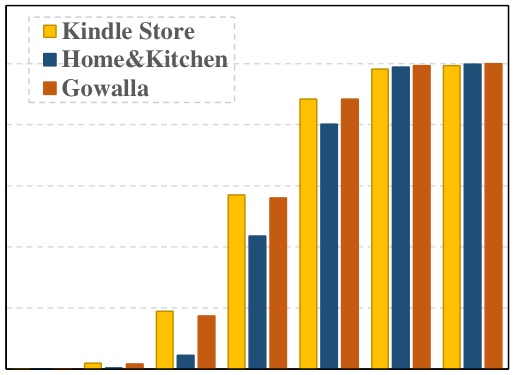
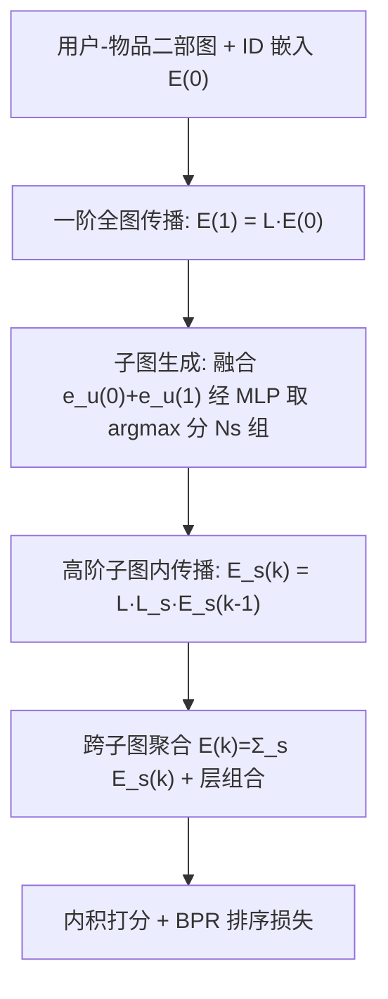
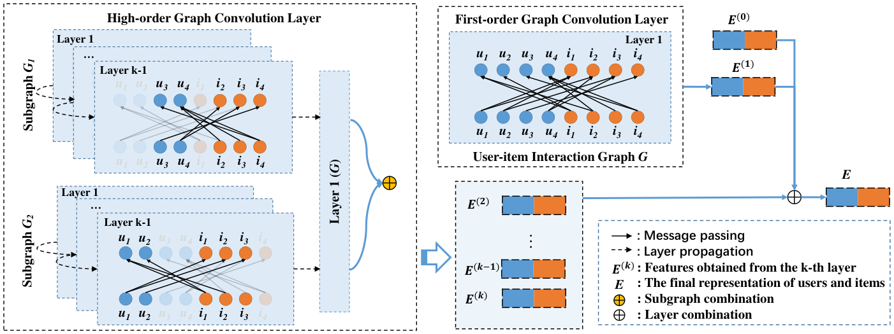

# Interest-aware Message-Passing GCN for Recommendation (兴趣感知消息传递图卷积推荐模型)

- **会议/期刊**: WWW 2021 (The Web Conference)
- **作者与机构**: Fan Liu, Zhiyong Cheng, Lei Zhu, Zan Gao, Liqiang Nie（山东大学、齐鲁工业大学山东省人工智能研究院、山东师范大学）
- **推荐链路定位**: 召回（用户/物品表示学习与 Top-N 检索）
- **研究方向**: 图神经网络与知识图谱推荐 / 自监督对比学习与交互去噪
- **论文原文**: [https://arxiv.org/abs/2102.10044v2](https://arxiv.org/abs/2102.10044v2)
- **开源代码**: [https://github.com/liufancs/IMP_GCN](https://github.com/liufancs/IMP_GCN)

## TL;DR (1分钟核心速览)

深度 GCN 推荐的过平滑被 LightGCN/LR-GCN 归因于"卷积算子本身"（非线性、残差、自环），但本文指出真正的污染源是**高阶邻居中兴趣相悖的用户被无差别聚合**：隐式反馈图里 $k$ 阶可达的用户未必同好，层层传播后异质用户嵌入趋同。IMP-GCN 一阶传播保持全局，高阶传播只在"相似兴趣用户 + 其交互物品"构成的子图内进行，子图由无标签的 ID 嵌入与一阶结构融合做软分类生成。全库排序（Full-Ranking）下三个数据集 Recall@20 相对 LightGCN 提升 4.07%–6.46%，NDCG@20 提升 3.66%–7.85%，且堆到 7 层仍不退化。

## Background & Motivation (背景与核心矛盾)

- **主流范式**: LightGCN 去掉特征变换、非线性与自环，仅保留对称归一化邻域聚合，再对多层嵌入做层组合，在 3–4 层达到峰值，是当前 GCN 推荐的 SOTA 骨架。
- **前人局限**: ① 优化对象始终是**图卷积算子**（简化结构、加残差），默认"所有高阶邻居的协同信号都是有益的"；② 在隐式反馈（点击）图上，两用户可经"共享冷门物品"的 $k$ 阶路径连通，兴趣甚至相互矛盾，聚合后其嵌入被强行拉近——这本身即是过平滑的**语义成因**，而非单纯层数问题。
- **核心洞察 (Key Insight)**: 作者统计了各层传播可触达节点占全图的比例（图 1），6–7 层后单节点几乎覆盖全图，故"靠加深层数必然趋同"在稠密图上不可避免；只要**换掉传播的边集合**而非算子，深层的正向高阶协同信号仍可被利用。
- **本文切入点**: 用子图把"谁的信息可以流向我"这一约束显式写进消息传递——异质用户之间直接断路。

<figure class="paper-figure" markdown="span">
  <figcaption>图1：三个数据集上图卷积不同层所涉及节点的平均比例。</figcaption>
</figure>

## Method (核心方法设计)

### 1. 整体框架 (Overall Architecture)

输入为用户-物品二部图的 ID 嵌入 $\mathbf{E}^{(0)}$。第 1 层在图$\mathcal{G}$全图上做与 LightGCN 完全一致的一阶聚合（直接交互最可靠，不能砍）；从第 2 层起，先在每个子图$\mathcal{G}_s$内部用$\mathbf{L}_s$传播，再把子图结果映射回全图拉普拉斯$\mathbf{L}$上聚合，得到该层表示$\mathbf{E}^{(k)}=\sum_{s}\mathbf{E}^{(k)}_s$；各层表示等权（$1/(K+1)$）组合后内积打分。子图并非外部预训练：用户分组由"ID 嵌入 + 一阶图邻域"融合特征经两层 MLP 输出$N_s$ 维预测向量、取 argmax 得到，全程无标签、随 BPR 损失端到端训练，每轮分组可与推荐目标共同演化。

<figure class="paper-figure" markdown="span">
  <figcaption>图2：我们的 IMP-GCN 模型概览，以两个子图为例。IMP-GCN 中，一阶传播作用于整个图，高阶传播在子图内进行。</figcaption>
</figure>

### 2. 关键设计拆解 (Key Designs)

1. **兴趣感知高阶消息传递（让物品"分视角"表达）**：痛点是物品节点的一阶用户邻居天然横跨多个兴趣簇，硬性聚合会串味。作者让物品 $i$在它所属的每个子图$s$内各学一份嵌入$e_{i_s}^{(k)}$，只在子图内接收该簇用户的信号，最终表示为各视角之和：
$e_{u}^{(k+1)}=\sum_{i_s\in\mathcal{N}_u}\frac{1}{\sqrt{|\mathcal{N}_u|}\sqrt{|\mathcal{N}_i|}}e_{i_s}^{(k)},\quad e_i^{(k)}=\sum_{s\in S_i}e_{i_s}^{(k)}$。
直觉：同好用户偏好物品的**相同侧面**，因此"分簇视角之和"比"混合视角之平均"更能保住物品的多面性与用户的独特性。

2. **无监督子图生成（把结构信号注入分组）**：仅用 ID 嵌入聚类会退化为随机划分，仅用结构又会受噪声边干扰。故融合二者：
$F_u=\sigma(\mathbf{W}_1(e_u^{(0)}+e_u^{(1)})+b_1),\quad U_o=\mathbf{W}_3\,\sigma(\mathbf{W}_2F_u+b_2)$，
$U_o$的最大值位置即用户所属子图；按分组结果对原拉普拉斯矩阵$\mathbf{L}$做行掩码，只保留同组用户的邻接关系，得到$\mathbf{L}_s$。以 LeakyReLU 保留小幅负信号，使"弱异质"用户不至于被粗暴切开。

3. **训练目标、负采样与推理效率**：沿用 pairwise BPR + L2：
$\min\sum_{(u,i^+,i^-)\in O}-\ln\sigma(\hat{r}_{ui^+}-\hat{r}_{ui^-})+\lambda\|\Theta\|_2^2$，
每正样本均匀采 1 个未交互负样本（无难负采样、无对比辅助损失）。训练用 Adam、$d=64$；推理时$\mathbf{L}$与$\mathbf{L}_s$均为稀疏矩阵，多层传播可离线预计算为一次稀疏-稠密乘，在线仅需内积 + ANN 检索；代价相对 LightGCN 约为$N_s$倍的稀疏乘开销（$N_s\in\{2,3,4\}$），仍属工业可接受量级。

## Experimental Setup & Evaluation Protocol (实验设置与评估协议)

- **数据集与预处理**: 三个数据集统一采用 `10-core` 过滤（保留交互数 ≥ 10 的用户与物品），覆盖不同规模与稀疏度：

| 数据集 | #Users | #Items | #Interactions | 稀疏度 | 特征/场景说明 |
| :--- | :---: | :---: | :---: | :---: | :--- |
| Kindle Store | 68,223 | 61,934 | 982,618 | 99.98% | Amazon 图书隐式反馈，极稀疏 |
| Home&Kitchen | 66,519 | 28,237 | 551,681 | 99.97% | Amazon 家居，物品侧最稠密 |
| Gowalla | 29,858 | 40,981 | 1,027,370 | 99.92% | LBS 签到图，密度最高 |

- **数据划分与防穿越 (Splitting Strategy)**: 逐用户 `比例划分` 80:10:10（训练/验证/测试），未使用全局时间戳切分，理论上存在同一用户未来交互泄漏到训练集的风险。
- **排名评测协议 (Ranking Protocol)**: 无偏 `Full-Ranking`——测试时把用户全部未交互物品作为候选负例排序，报告 Recall@20 与 NDCG@20，指标为全体测试用户均值。
- **对比基线与超参设置**: 基线含 NeuMF、CSE、HOP-Rec、GCMC、NGCF、LightGCN，全部统一 BPR 目标与调参流程；$d=64$、Xavier 初始化、Adam ($\text{lr}=0.001$)、batch 1024（Gowalla 2048）、$\lambda\in\{10^{-6},\dots,10^{-2}\}$、早停与验证策略同 LightGCN；显著性采用双侧配对 t 检验（$p<0.05$）。

## Key Experimental Results (实验关键数据)

### 1. 主实验对比 (Main Results)

| 数据集 | \multicolumn{2}{c}{Kindle Store} | \multicolumn{2}{c}{Home&Kitchen} | \multicolumn{2}{c}{Gowalla} |
| :--- | :---: | :---: | :---: | :---: | :---: | :---: |
| 指标 | Recall@20 | NDCG@20 | Recall@20 | NDCG@20 | Recall@20 | NDCG@20 |
| NeuMF | 4.96 | 2.06 | 1.34 | 0.62 | 12.96 | 11.21 |
| CSE | 7.65 | 4.54 | 1.93 | 0.91 | 13.85 | 11.51 |
| HOP-Rec | 7.96 | 4.58 | 1.98 | 0.94 | 14.11 | 12.70 |
| GCMC | 7.93 | 4.55 | 1.42 | 0.64 | 14.03 | 11.68 |
| NGCF | 8.25 | 5.09 | 2.14 | 0.96 | 15.62 | 13.35 |
| LightGCN | 10.22 | 6.24 | 3.03 | 1.39 | 17.96 | 15.29 |
| **IMP-GCN** | **10.88*** | **6.73*** | **3.22*** | **1.49*** | **18.69*** | **15.85*** |
| Improv. (vs. LightGCN) | +6.46% | +7.85% | +6.27% | +7.19% | +4.07% | +3.66% |

（数值为百分比并省略 `%`；`*` 表示 $p<0.05$ 显著。）

### 2. 消融实验 (Ablation Study)

| 变体 | Kindle R / N | Home&Kitchen R / N | Gowalla R / N |
| :--- | :---: | :---: | :---: |
| **IMP-GCN** | **10.88 / 6.73** | **3.22 / 1.49** | **18.69 / 15.85** |
| w/o 结构项 ($e_u^{(1)}$，即 IMP-GCN$_s$) | 10.57 / 6.63 | 3.14 / 1.43 | 18.61 / 15.61 |
| 一阶亦限制在子图内 (IMP-GCN$_f$) | 10.19 / 6.40 | 2.97 / 1.31 | 17.84 / 15.11 |

### 3. 关键实验发现 (Key Findings)

1. **深层收益是本方法的核心证据**：LightGCN 在 3–4 层达峰后急剧下滑，而 IMP-GCN 在 2→7 层持续上升（超过 7 层时单节点已覆盖全图故无增益），说明性能瓶颈来自"跨兴趣的负向消息"而非层数本身；这与图 1 的覆盖比例曲线互为印证。
2. **子图数存在最优折中**：≤3 层时 2 子图最好（子图内短距可达节点更多），>3 层时 3 子图最优；4 子图虽分组更细，但因切断过多短距离有效边，深层表现仅与 2 子图持平——分组粒度是可调的信息增益／连通性权衡。
3. **两个消融细节均不可省**：去掉图结构项（仅用 ID 聚类）NDCG@20 在 Kindle 上从 6.73 掉到 6.63，说明纯 ID 分组会把噪声边一并带入；把一阶传播也关进子图内则掉到 6.40（相对完整模型 −4.9%），确认"一阶全局 + 高阶子图内"的非对称设计是必要的。

## Highlights & Limitations (亮点、对比与审稿批判)

- **与代表作对比 (vs. Prior Work)**: 相较 NGCF 的"全图高阶传播 + 复杂算子"、LightGCN/LR-GCN 的"算子简化 + 残差"路线，本文不改算子而改**传播的边空间**；相较 SGL 类对比学习通过随机扰动隐式降噪，本文的降噪是**确定性的、结构化的**（按兴趣簇断路），且无需额外增广视图与前缀任务。
- **可迁移亮点**: ① "物品在多子图各学一份嵌入再求和"这一多视角表示技巧可直接迁移到多兴趣/多场景召回与异质信息网络；② 用"ID 嵌入 + 一阶邻域聚合"融合特征做无监督软聚类，可作为任何图模型的前置分组/路由模块（类似 MoE 的图版本）。
- **审稿级局限批判**: ① 子图数为人工设定的固定超参且需按层数匹配调节，缺乏自适应分组数或层次化分组机制；② 划分采用逐用户随机 8:1:1 而非时间切分，隐式反馈下的评测偏乐观，且缺少冷启动/长尾分桶与线上 A/B 验证；③ 每个物品需要 $N_s$份嵌入与$N_s$ 次稀疏乘，训练与显存开销随子图数线性增长，论文未报告实际训练时延对比。

## Rating (四维评分)

- **方法创新性 (Novelty)**: ⭐⭐⭐⭐ （把过平滑从"算子退化"重解释为"跨兴趣负向消息传播"，并以子图级消息路由给出干净解法，问题洞察优于技术复杂度）
- **评估协议与实验扎实度 (Protocol & Experiments)**: ⭐⭐⭐⭐ （三数据集 Full-Ranking + 显著性检验 + 层数/子图数/覆盖率多维分析完整，但缺少时间切分、冷启划分与效率实测）
- **写作与数学规范度 (Clarity & Rigor)**: ⭐⭐⭐⭐ （LightGCN 基线复盘与矩阵形式传播推导清晰，符号统一；子图生成与主损失的联合优化缺少收敛性讨论）
- **工业落地与复现价值 (Industrial & Practical Value)**: ⭐⭐⭐⭐ （代码开源、仅依赖稀疏矩阵乘即可复现，子图掩码可离线预计算，适合作为召回层深层 GCN 的即插即用替换）

