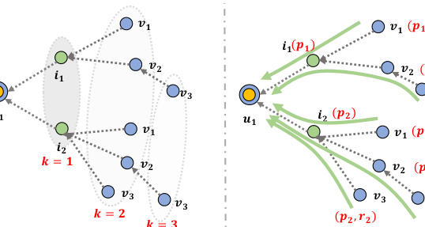
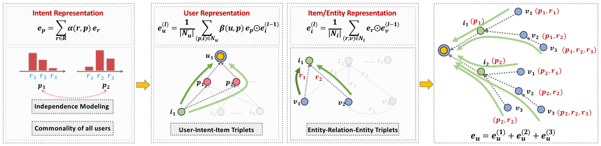
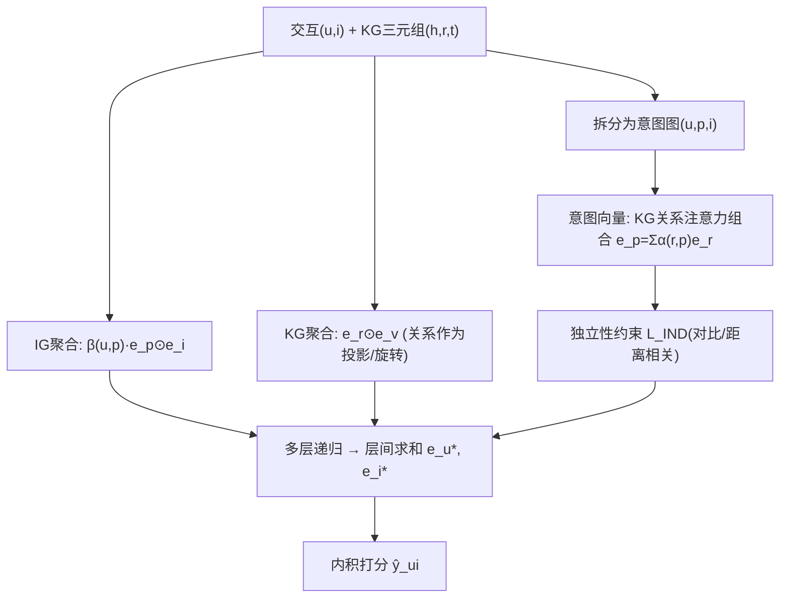

# Learning Intents behind Interactions with Knowledge Graph for Recommendation (基于知识图谱挖掘交互背后用户意图的推荐)

- **会议/期刊**: WWW 2021 (Oral)
- **作者与机构**: Xiang Wang, Tinglin Huang, Dingxian Wang, Yancheng Yuan, Zhenguang Liu, Xiangnan He*, Tat-Seng Chua (NUS / 浙大 / eBay / PolyU / USTC)
- **推荐链路定位**: 召回（知识图谱增强的表示学习）
- **研究方向**: 图神经网络与知识图谱推荐 / 自监督对比学习
- **论文原文**: [论文原文链接](https://arxiv.org/abs/2102.07057v1)
- **开源代码**: [开源代码仓库链接](https://github.com/huangtinglin/Knowledge_Graph_based_Intent_Network)

## TL;DR (1分钟核心速览)

现有 GNN 知识图谱推荐把 `user-item` 当作单一 `interact-with` 同质边，且聚合方式是**节点式**的，既无法刻画"用户为何买这件"的细粒度意图，也在多跳传播中丢失了关系序列的语义。KGIN 将每次交互拆成 $\{u,p,i\}$ 三元组构成意图图，把意图表示为 KG 关系的注意力组合并施加独立性（对比）约束；同时在意图图与 KG 上采用**关系路径感知**的两套聚合器。在三数据集 **Full-Ranking** 协议下，ndcg@20 相对最强基线提升 **14.51% / 13.97% / 5.91%**。

## Background & Motivation (背景与核心矛盾)

- **主流范式**: KG 推荐已从 embedding-based（CKE 用 TransR 补 item 表示）→ path-based（RippleNet 枚举路径）→ GNN-based（KGAT / KGNN-LS / CKAN 用邻域聚合），GNN 端到端方案成为 SOTA 主流。
- **前人局限**: (1) **意图缺失**：所有 GNN 方法都假设用户与物品之间只有一条 `interact-with` 边，忽视"同一用户买多件商品背后是不同意图驱动"这一事实；(2) **关系依赖丢失**：节点式聚合把多跳邻居的信号混合成一个标量衰减因子，无法区分该信号来自哪条路径，也无法保留 $(p_2,r_2,r_3)$ 这种关系序列。
- **核心洞察 (Key Insight)**: 用户意图应当是**所有用户共享**的、可解释的"关系组合"，例如"导演+主演"构成一种意图，"主演+搭档"构成另一种；同一意图在不同物品上表现一致，形成比 CF 更细粒度的同质性。
- **本文切入点**: 把交互关系在意图粒度上切片，并让聚合算子显式携带关系序列，从而让表示天然编码"路径语义"。

<figure class="paper-figure" markdown="span">
  <figcaption>图2：基于节点的聚合方案与关系路径感知的聚合方案示例，其中（虚线或实线）箭头表示节点间的信息流。建议彩色查看。</figcaption>
</figure>

## Method (核心方法设计)

### 1. 整体框架 (Overall Architecture)

模型输入为交互集 $\mathcal{O}^+$与 KG$\mathcal{G}$。首先将每条$(u,i)$拆成$\{(u,p,i)\mid p\in\mathcal{P}\}$构造**意图图 (IG)**，把 4 个共享意图$p$作为关系节点桥接用户与物品。每个意图向量由 KG 关系集合通过注意力加权得到（$\mathbf{e}_p=\sum_r\alpha(r,p)\mathbf{e}_r$），并用对比式独立性损失拉开意图间距离。随后在 IG 与 KG 上**分别**执行关系路径感知聚合器（IG 侧重行为模式，KG 侧重物品属性关联），逐层递归并把各层输出求和作为最终表示，内积打分。

<figure class="paper-figure" markdown="span">
  <figcaption>图3：所提出的 KGIN 框架示意图。建议彩色查看。</figcaption>
</figure>

### 2. 关键设计拆解 (Key Designs)

1. **意图建模 + 独立性约束**: 痛点是把每意图硬绑到单一 KG 关系（如 KTUP）过于孤立、无法形成高阶概念。KGIN 令意图为关系的软组合 $\mathbf{e}_p=\sum_{r\in\mathcal{R}}\alpha(r,p)\mathbf{e}_r$，$\alpha$ 为可学习权重 softmax；再对意图两两施加对比式损失
$\mathcal{L}_{\text{IND}}=\sum_{p}-\log\frac{\exp(s(\mathbf{e}_p,\mathbf{e}_p)/\tau)}{\sum_{p'}\exp(s(\mathbf{e}_p,\mathbf{e}_{p'})/\tau)}$，
（或距离相关 $dCor$），使意图语义不冗余，也即解释了"从不同角度刻画偏好"。
2. **关系路径感知聚合**: 痛点在于节点式聚合只用衰减系数缩放邻居，关系本身不进入消息。KGIN 让关系 $\mathbf{e}_r$以 **element-wise 乘**参与消息构造：$\mathbf{e}_i^{(1)}=\frac{1}{|\mathcal{N}_i|}\sum_{(r,v)}\mathbf{e}_r\odot\mathbf{e}_v^{(0)}$；IG 侧引入个性化意图注意力$\beta(u,p)$，$\mathbf{e}_u^{(1)}=\frac{1}{|\mathcal{N}_u|}\sum_{(p,i)}\beta(u,p)\mathbf{e}_p\odot\mathbf{e}_i^{(0)}$。递归展开后表示等价于路径连乘
$\mathbf{e}_i^{(l)}=\sum_{s\in\mathcal{N}_i^l}\frac{\mathbf{e}_{r_1}}{|\mathcal{N}_{s_1}|}\odot\cdots\odot\frac{\mathbf{e}_{r_l}}{|\mathcal{N}_{s_l}|}\odot\mathbf{e}_{s_l}^{(0)}$，
从而把关系序列"写进"向量，替代不可控的路径枚举与衰减因子。
3. **训练目标与开销**: 总损失 $\mathcal{L}_{\text{KGIN}}=\mathcal{L}_{\text{BPR}}+\lambda_1\mathcal{L}_{\text{IND}}+\lambda_2\|\Theta\|_2^2$，负采样采用**均匀随机采未交互物品**（非难负样本）。去掉了非线性激活与特征变换矩阵（借鉴 LightGCN 式简化），复杂度$O(L|\mathcal{C}|d+L|\mathcal{G}|d+|\mathcal{P}|^2)$，与 KGAT/CKAN 同量级；推理无需路径搜索，仅需前向聚合。

## Experimental Setup & Evaluation Protocol (实验设置与评估协议)

- **数据集与预处理**: 全部采用 **10-core** 过滤（用户/物品交互数 <10、KG 实体三元组 <10 均剔除）。

| 数据集 | #Users | #Items | #Interactions | #KG Entities | #Relations | #Triplets |
| :--- | :---: | :---: | :---: | :---: | :---: | :---: |
| Amazon-Book | 70,679 | 24,915 | 847,733 | 88,572 | 39 | 2,557,746 |
| Last-FM | 23,566 | 48,123 | 3,034,796 | 58,266 | 9 | 464,567 |
| Alibaba-iFashion | 114,737 | 30,040 | 1,781,093 | 59,156 | 51 | 279,155 |

- **数据划分与防穿越**: 沿用 KGAT 的固定划分，`比例划分`式训练/测试集，**未采用时间戳切分**。
- **排名评测协议**: **无偏 Full-Ranking（全库未交互物品全量排序）**，指标为 recall@20 与 ndcg@20，明确反对 leave-one-out 与采样排序。
- **对比基线与超参**: MF、CKE（TransR）、KGNN-LS、KGAT、CKAN、R-GCN。统一 $d=64$、Adam、batch=1024、$L\in\{1,2,3\}$、$|\mathcal{P}|=4$、$\lambda$网格搜索于$\{10^{-5},\dots,10^{-1}\}$。

## Key Experimental Results (实验关键数据)

### 1. 主实验对比 (Main Results)

| 模型 | Amazon-Book R@20 / N@20 | Last-FM R@20 / N@20 | iFashion R@20 / N@20 |
| :--- | :---: | :---: | :---: |
| MF | 0.1300 / 0.0678 | 0.0724 / 0.0617 | 0.1095 / 0.0670 |
| CKE | 0.1342 / 0.0698 | 0.0732 / 0.0630 | **0.1103** / 0.0676 |
| KGAT | 0.1487 / 0.0799 | 0.0873 / 0.0744 | 0.1030 / 0.0627 |
| KGNN-LS | 0.1362 / 0.0560 | **0.0880** / 0.0642 | 0.1039 / 0.0557 |
| CKAN | 0.1442 / 0.0698 | 0.0812 / 0.0660 | 0.0970 / 0.0509 |
| R-GCN | 0.1220 / 0.0646 | 0.0743 / 0.0631 | 0.0860 / 0.0515 |
| **KGIN-3** | **0.1687** / **0.0915** | **0.0978** / **0.0848** | **0.1147** / **0.0716** |
| **Improv.%** | **+13.44% / +14.51%** | **+11.13% / +13.97%** | **+3.98% / +5.91%** |

### 2. 消融实验 (Ablation Study)

| 变体 | Amazon-Book R / N | Last-FM R / N | iFashion R / N |
| :--- | :---: | :---: | :---: |
| KGIN-3（完整） | 0.1687 / 0.0915 | 0.0978 / 0.0848 | 0.1147 / 0.0716 |
| w/o 意图 + 关系 ($|\mathcal{P}|{=}0$, 无边) | 0.1518 / 0.0816 | 0.0802 / 0.0669 | 0.0862 / 0.0530 |
| w/o 仅意图 ($|\mathcal{P}|{=}0$) | 0.1627 / 0.0870 | 0.0942 / 0.0819 | 0.1103 / 0.0678 |
| KGIN-1（1 层） | 0.1455 / 0.0766 | 0.0831 / 0.0707 | 0.1045 / 0.0638 |
| KGIN-2（2 层） | 0.1652 / 0.0892 | 0.0920 / 0.0791 | **0.1162 / 0.0723** |
| w/o 独立性约束（意图间 dCor） | 高相关 0.3490 | 高相关 0.4944 | 高相关 0.3121 |

### 3. 关键实验发现 (Key Findings)

1. **关系建模是最大功臣**：同时去掉意图与关系后 Amazon-Book ndcg 从 0.0915 掉到 0.0816（**-10.8%**），但只去意图仅掉到 0.0870（-4.9%），说明"关系进入消息构造"比"多意图切片"更关键，二者互补。
2. **深度收益受 KG 结构支配**：KGIN-3 在 Amazon-Book/Last-FM 优于 KGIN-2（0.0915 vs 0.0892、0.0848 vs 0.0791），但在 iFashion 反被 KGIN-2 反超（0.0723 vs 0.0716），因为该数据集 KG 三元组几乎全是 `outfit-includes-staff` 的一阶连接，三跳已无新增信息。
3. **独立性约束是"可解释性杠杆"而非精度杠杆**：加约束后意图间距离相关系数从 0.35/0.49/0.31 降至 0.039/0.037/0.011，精度基本持平，但意图边界清晰、可逐意图归因（如 Last-FM 中 $p_1$= "某歌手的特定版本"，Amazon-Book 中$u_{231}$选$i_{21904}$因$p_1$ 权重 0.7616）。

## Highlights & Limitations (亮点、对比与审稿批判)

- **与代表作对比**: KGAT/CKAN 把关系压成注意力衰减系数，RippleNet 靠枚举路径——KGIN 是首个把"关系序列"内化进聚合算子且无需路径搜索的方案；与 KTUP 相比，意图从"单关系绑定"升级为"关系软组合 + 互斥约束"，表达能力显著更宽。
- **可迁移亮点**: (1) 把"用户意图"建为共享桥接节点并配对比互斥损失，可直接迁移到多行为/多场景建模；(2) 用 $\mathbf{e}_r\odot\mathbf{e}_v$ 的连乘形式等价编码路径，避免 meta-path 枚举，工程上极友好。
- **审稿级局限批判**: (1) 意图数 $|\mathcal{P}|$ 需人工搜索（Amazon-Book 最优 4、Last-FM 最优 8），无自适应机制，且独立性过强会让意图"过细而无信息"；(2) 意图为**全局共享**，无法刻画用户个体意图分布；同时实验仅用静态比例划分、缺乏时间切分与线上 A/B，对实际冷启与流行度漂移的鲁棒性未验证。

## Rating (四维评分)

- **方法创新性 (Novelty)**: ⭐⭐⭐⭐ （意图=关系注意力组合 + 对比互斥、路径连乘式聚合两个设计均属结构性增量，但底层仍是 LightGCN 式线性聚合的细化）
- **评估协议与实验扎实度 (Protocol & Experiments)**: ⭐⭐⭐⭐ （Full-Ranking + 10-core + 三域数据集扎实，消融覆盖意图/关系/深度/意图数；扣分在仅单次划分无显著性检验细节）
- **写作与数学规范度 (Clarity & Rigor)**: ⭐⭐⭐⭐ （式 (12) 把聚合还原为路径连乘的推导清晰漂亮，附复杂度与解释性案例；注意力仅用可学习权重略简陋）
- **工业落地与复现价值 (Industrial & Practical Value)**: ⭐⭐⭐⭐ （代码/数据/日志全开源，无路径搜索开销、与 KGAT 同量级复杂度，意图数调参是主要落地成本）

