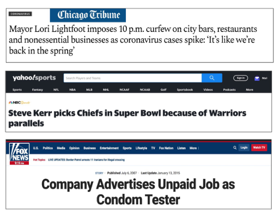
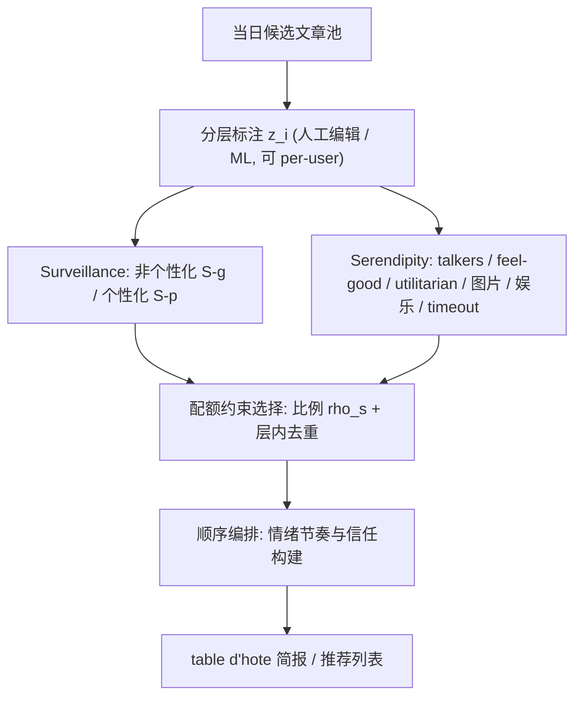
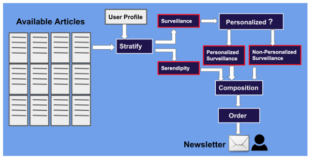

# Toward the Next Generation of News Recommender Systems (迈向下一代新闻推荐系统：套餐式 table d'hôte 研究议程)

- **会议/期刊**: WWW '21 Companion (5 页 vision/short paper)
- **作者与机构**: Himan Abdollahpouri、Edward C. Malthouse、Jeremy Gilbert（Northwestern University），Joseph A. Konstan（University of Minnesota），Bamshad Mobasher（DePaul University）
- **推荐链路定位**: 重排（列表级打包与顺序编排），不涉及召回与精排打分模型
- **研究方向**: 多任务学习与列表级重排 / 去偏公平与工业评测基准
- **论文原文**: [论文原文链接](https://arxiv.org/abs/2103.06909v1)
- **开源代码**: 暂未开源

## TL;DR (1分钟核心速览)

本文是一篇 **vision / research agenda** 短文，而非实证论文：作者指出新闻推荐二十余年研究几乎只在优化单篇效用估计 $\hat{u}_{ui}$，把多样性/惊喜度当作事后列表属性，既无法保证覆盖用户“必须知道”的信息，也无法控制各类需求的比例与阅读顺序。为此提出 **table d'hôte（主人之桌/套餐）范式**：先按使用与满足理论（U&G）把文章分层为 surveillance（再分非个性化/个性化）与 serendipity（talkers、feel-good、utilitarian、图片、娱乐、timeout），再按配额配比、层内去重并按序编排。**重要提示：全文无数据集、无划分、无任何实验表格与开源代码**，其价值在于问题定义与议程，而非性能收益。

## Background & Motivation (背景与核心矛盾)

- **主流范式**: 现有新闻推荐把任务视为“预测用户对单篇新闻的效用并降序排列”，后期再以 diversity / novelty / serendipity 作为列表重排的软约束（如 MMR 式后处理）。
- **前人局限一（多样性≠需求覆盖）**: 一篇体育、一篇财经、一篇明星八卦构成“很不同”的列表，却可能漏掉“今晚 10 点宵禁封城”这类人人须知信息——主题多样性并不等价于用户需求的覆盖度。
- **前人局限二（集合属性而非序列属性）**: 打包推荐（bundle / package）在旅游域已成熟（酒店+机票+餐饮互补），但新闻的独特之处在于用户读新闻**不只是追兴趣，而是要被“告知”**；且现有工作把列表视为无序集合，忽略“先读什么、后读什么”的体验效应。
- **核心洞察 (Key Insight)**: 借用**分层抽样 (stratified sampling)** 的设计思想——先把抽样单元划分到互斥层（strata），再逐层按比例抽取；作者用“米其林套餐 vs 自助餐 vs 单点菜单”作物理直觉：套餐既保证营养结构（surveillance），又在其中穿插惊喜菜（serendipity）。
- **本文切入点**: 把“配比 (composition)”与“顺序 (sequencing)”提升为列表生成的一等公民，明确五项约束：须知道、须惊喜、须平衡、须有序、须避免信息过载。

<figure class="paper-figure" markdown="span">
  <figcaption>图1：非个性化监控（上）、个性化监控（中）和意外发现（下）文章示例。</figcaption>
</figure>

（图 1：上为非个性化 surveillance“宵禁封城”，中为个性化 surveillance（特定患者/特定投资人的资讯），下为 serendipity 中的 talker 文章。）

## Method (核心方法设计)

### 1. 整体框架 (Overall Architecture)

table d'hôte 是一条**多目标策展流水线**而非单一模型：给定当日候选文章池，先由人工编辑或预训练分类器为每篇文章打上分层标签 $z_i$（并区分“所有人须知”与“某些人须知”）；随后配比模块决定各层在最终列表中占多少条（由媒体机构使命固定，或按用户历史交互用数据驱动方式个性化）；再由顺序模块决定层间交错与层内位置；最终输出一份自足的 newsletter / e-edition。作者的动机数据是：新闻订阅者访问站点的**中位数频次仅 1 次/月**，因此外发型简报这一次触达必须自己承载全部价值，配比失误的边际代价远高于站内 feed。

<figure class="paper-figure" markdown="span">
  <figcaption>图2：创建 table d’hôte 的机制</figcaption>
</figure>

（图 2：table d'hôte 的生成机制——分层、配比、排序三段式。）

### 2. 关键设计拆解 (Key Designs)

1. **U&G 双层分层体系（把“需求”而非“主题”作为分层变量）**：痛点在于主题分桶无法表达“义务性”。作者依据传播学的 surveillance 功能与 Calder-Malthouse 读者体验类型学定义 $z_i \in \{\text{S-g},\text{S-p}\}\cup\{\text{Ser}_{k}\}_{k=1}^{K}$，其中 S-g 为全民须知（宵禁、飓风预警，应走**非个性化**通道），S-p 为特定人群须知（癌症新疗法、东京证交所异动，走个性化通道）。关键棘手之处在于标签是**用户条件化**的：$z_i = z_i(u)$，同一篇文章对 A 是 serendipity、对 B 是 surveillance，这直接决定了后续配额约束能否成立。

2. **配额配比 + 层内聚合去重（把软多样性变成硬约束）**：原文只给叙述，这里形式化其意图——在预算 $K$ 条内求解
$\max_{x}\ \sum_{s} w_s \sum_{i\in\mathcal{S}_s}\hat{u}_{ui}\,x_i \quad \text{s.t.}\ \sum_i x_i = K,\ \lfloor \rho_s K\rfloor \le \sum_{i\in\mathcal{S}_s} x_i \le \lceil \rho_s K\rceil,\ \ \forall i\neq j\in\mathcal{S}_s:\ \mathrm{sim}(i,j)\le \tau.$其中$\rho_s$为层配额（$\sum_s \rho_s = 1$），$w_s$ 为媒体使命赋予的层权重。相对 MMR 的增量在于：多样性从“相似度惩罚项”变为**硬性比例约束**，并额外要求**聚合层面不重复**——若列表已含宵禁新闻，则同主题的第二条即使属 surveillance 也应被剔除。

3. **从 Set 属性到 Ranked-List 属性（顺序即体验）**：作者强调“套餐极少以甜点开场、主菜居中、前菜收尾”。可形式化为位置相关打分 $r_{uip} = \hat{u}_{ui} + \lambda_{z_i}\,\phi(p, z_i)$，其中$\phi$ 编码情绪节奏（连续负面 surveillance 后的 feel-good 缓冲）与**信任构建**（与党派叙事冲突的文章应后置，先以中性内容建立可信度）。注意：原文对此仅提出问题清单，未给算法。

**训练目标、负采样与推理开销**：本文**没有损失函数、没有负采样、没有在线实现**。若要落地，最经济的做法是把上述配额约束以拉格朗日乘子并入现有点排分 $s_{ui}=\hat{u}_{ui}+\sum_s \mu_s\mathbb{I}[z_i\in\mathcal{S}_s]$，重排阶段复杂度$O(K\cdot|\mathcal{C}|)$，无需重训召回/精排模型。

## Experimental Setup & Evaluation Protocol (实验设置与评估协议)

- **数据集与预处理**: **无**。全文未使用任何公开数据集，也未给出统计表。表 1 以其分层体系与文中/图 1 的示例文章替代常规数据统计：

| 层 / 子层 | 判定依据 | 示例文章（原文） | 个性化程度 | 对算法的要求 |
| :--- | :--- | :--- | :---: | :--- |
| Surveillance – 非个性化 $\text{S-g}$ | 所有人均需知道 | "Curfew lockdown starts 10 pm tonight"；"Hurricane forecast to strike in two days" | 无（全量下发） | 非个性化通道，多为人工策展 |
| Surveillance – 个性化 $\text{S-p}$ | 特定人群生计/健康相关 | 癌症新疗法新闻；东京证交所异动（针对亚洲证券投资人） | 高 | 主题分层 + 多目标排序（健康/生计优先于爱好） |
| Serendipity – Talkers | 提供社交谈资 | 适合“茶水间议论”的故事 | 中 | 与社交关系强度联动 |
| Serendipity – Feel good / Utilitarian / 视觉 / 娱乐 / Timeout | 惊喜、放松、实用建议、逃逸叙事 | 励志结局故事、周末活动指南、大图摄影、趣闻问答、长篇冒险 | 中 | 情绪极性识别（需人工监督的情感分析） |

- **数据划分与防穿越 (Splitting Strategy)**: 不适用（无实验）。
- **排名评测协议 (Ranking Protocol)**: 不适用。作者主张未来评测必须走**真实用户实验**（newsletter 打开率、停留时长、订阅留存作为长期目标，同时兼顾广告收入的竞争性目标），并明确呼吁**开发针对“分层多样性”与“结构化 serendipity”的新指标**，而非复用主题熵或 ILS。
- **对比基线与超参设置**: 无。仅概念上对标三类范式（见下文表 2）。无 Embedding 维度、无显著性检验。

## Key Experimental Results (实验关键数据)

### 1. 主实验对比 (Main Results)

**本文不存在主实验表**，故以表 2 给出作者隐含的范式对照（✓/✗ 为依据原文论述的判断，非实测数值）：

| 范式 | 覆盖“须知道”需求 | 控制层间比例 | 顺序敏感 | 层内/跨层去重 | 典型代表 |
| :--- | :---: | :---: | :---: | :---: | :--- |
| À la carte 纯相关性 top-K | ✗ | ✗ | ✗ | ✗ | 主流新闻精排 |
| 主题多样化（MMR 类） | ✗（主题≠需求） | ✗（仅软惩罚） | ✗ | 部分 | 新闻 diversity 文献 |
| 旅游 Bundle 打包 | 部分（互补但非义务性） | 部分 | ✗ | 部分 | package recommendation |
| **table d'hôte（本文）** | ✓（$\text{S-g}$强制注入） | ✓（硬配额$\rho_s$） | ✓（$\phi(p,z_i)$） | ✓（同主题至多一次） | 本文愿景 |

### 2. 消融实验 (Ablation Study)

无实测消融。表 3 为**概念性消融**（作者未运行，仅标注移除组件后预期失效的维度，无可比数值）：

| 移除组件 | 预期失效的维度 |
| :--- | :--- |
| w/o 分层（退回主题桶） | 义务性信息覆盖、需求比例可控性 |
| w/o 配比约束 $\rho_s$ | 列表退化为相关性 top-K，serendipity 被挤出 |
| w/o 顺序模块 $\phi$ | 退化为无序集合，情绪节奏与信任构建消失 |
| w/o 用户条件化 $z_i(u)$ | 同一文章对所有用户同层，个性化 surveillance 失准 |

### 3. 关键实验发现 (Key Findings)

1. **触达频次的量级决定了配比失误的代价**：订阅者访问站点中位数为 **1 次/月**，意味着单次外发简报要独立完成“更新+惊喜+不过载”三重目标，因此作者才把“比例”写成硬约束而非软惩罚——这是全文最有说服力的定量动机。
2. **列表级打包在新闻域近乎空白**：作者统计过往二十五年新闻推荐研究的主体集中于效用估计（原文 table 1 所引综述），而 bundle 研究集中在旅游等“互补性消费”场景；新闻的差异化维度是**义务性信息 (surveillance)**，任何纯兴趣驱动的打包在结构上都无法产生它。
3. **分层标签的用户条件化使朴素实现失效**：由于 $z_i$可为$z_i(u)$，若沿用全局单层标签，配额约束$\rho_s$ 会在个体层面失真（把某用户的“生计要闻”误判为“惊喜内容”），故分类器必须 user-conditioned，这是一条隐性但强约束的工程前提。

## Highlights & Limitations (亮点、对比与审稿批判)

- **与代表作对比 (vs. Prior Work)**: 相较 diversity/serendipity 后处理（MMR 类），本文把多样性从“列表内两两不相似”升级为“跨需求层的比例正确”；相较旅游 bundle 推荐，本文引入了**不可由兴趣替代的义务性信息通道**；相较传统精排，本文把排序目标从 pointwise 效用改为**带配额与位置效应的列表级目标**。
- **可迁移亮点**: ① 分层配额可作为通用**列表编排约束**，直接迁移到推送/邮件营销/首页模块位编排（在固定槽位预算下强制注入“必达”类内容）；② “义务信息通道 + 兴趣通道”双轨设计对电商（时效性物流/风控通知 vs 商品推荐）与内容平台（政策通告 vs 娱乐）同样适用。
- **审稿级局限批判**: ① **零实证**——没有数据集、没有指标、没有与任何基线的对比，全部收益均为论述性主张，无法判断该范式是否真能提升打开率或留存；② **缺算法**——分层分类器、配额求解、顺序编排三处均停留在“研究挑战”列表，尤其顺序问题只提问不给解，且作者自承 serendipity 分类（talker 未必幽默）连人工标注口径都不稳定；③ 配额 $\rho_s$与层权重$w_s$ 高度依赖媒体机构使命，超参缺乏可学习/可验证的设定路径。

## Rating (四维评分)

- **方法创新性 (Novelty)**: ⭐⭐⭐ （“分层抽样 + 套餐隐喻”的问题重构颇具启发性，但无任何新算子、无理论推导，属概念层创新）
- **评估协议与实验扎实度 (Protocol & Experiments)**: ⭐ （全文无数据集、无划分、无排名协议、无显著性检验，仅提出“未来应做真实用户实验”的倡议）
- **写作与数学规范度 (Clarity & Rigor)**: ⭐⭐⭐ （分层体系与五项约束叙述清晰、动机数据有力，但通篇无形式化定义与复杂度讨论，分层边界存在用户条件化歧义）
- **工业落地与复现价值 (Industrial & Practical Value)**: ⭐⭐ （可直接作为新闻/推送产品“槽位编排”的设计蓝图，落地成本低；但因无开源、无 A/B 或离线验证，收益不可预估）

