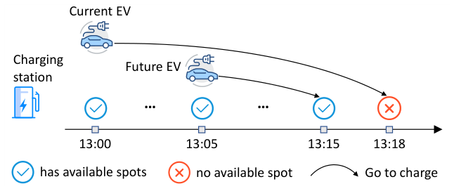
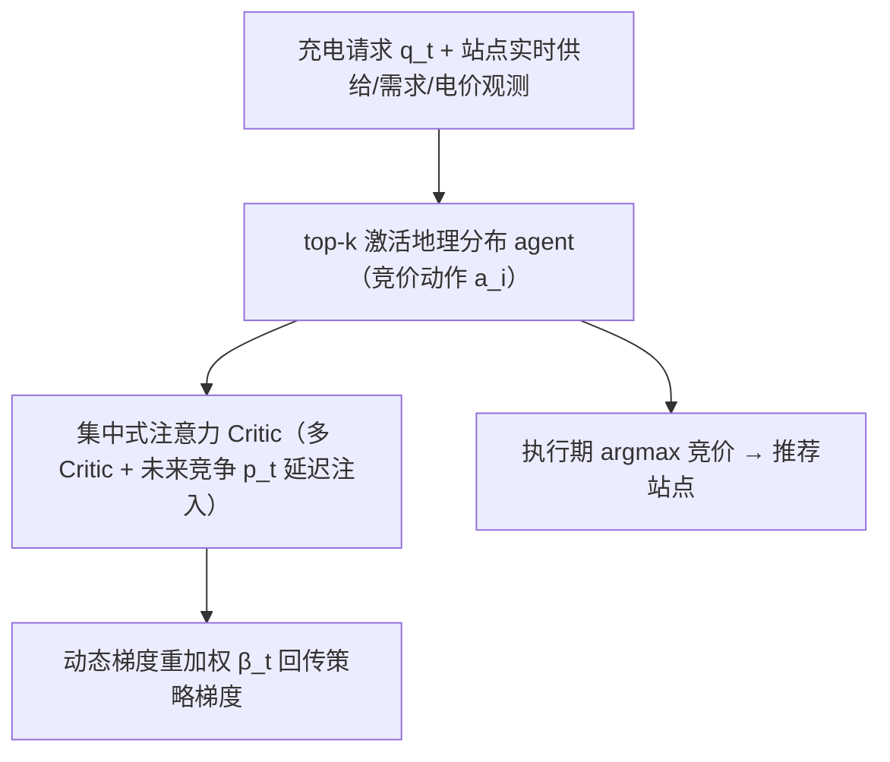
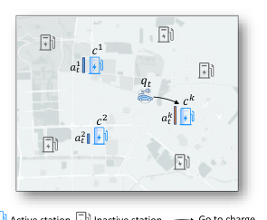

# Intelligent Electric Vehicle Charging Recommendation Based on Multi-Agent Reinforcement Learning (基于多智能体强化学习的智能电动汽车充电推荐)

- **会议/期刊**: WWW 2021 (The Web Conference)
- **作者与机构**: Weijia Zhang, Hao Liu, Fan Wang, Tong Xu, Haoran Xin, Dejing Dou, Hui Xiong（中国科学技术大学 / 百度研究院商业智能实验室 / 百度 / 罗格斯大学）
- **推荐链路定位**: 召回（面向单个即时请求的候选充电站选择）+ 长期策略优化
- **研究方向**: 时空轨迹与 POI 本地生活推荐 / 强化学习与动态探索推荐
- **论文原文**: [https://arxiv.org/abs/2102.07359v1](https://arxiv.org/abs/2102.07359v1)
- **开源代码**: [https://github.com/Vvrep/MASTER-electric_vehicle_charging_recommendation](https://github.com/Vvrep/MASTER-electric_vehicle_charging_recommendation)

## TL;DR (1分钟核心速览)

痛点在于充电桩是**空间受限 + 时空需求失衡**的稀缺资源：贪心推荐（最近/最便宜）只看单步单目标，会把未来 EV 挤到同一站，造成额外等待与充电失败。作者把每个充电站当作一个独立 agent，构建 MARL 框架 Master：集中式注意力 Critic 协调地理分布 agent 的"竞价"决策、延迟访问策略把未来竞争信息只喂给训练期 Critic、多 Critic + 动态梯度重加权平衡三个发散目标。在北京/上海真实数据 + 自建仿真器上（非 Top-N 排序，而是端到端仿真指标），相比真实充电行为，MCWT 降低 51.4%/38.9%、MCP 降低 13.6%/16.2%、CFR 降低 96.5%/91.0%，日节省费用 16,219/12,497 元。

## Background & Motivation (背景与核心矛盾)

- **主流范式**: 充电站推荐此前以贪心策略为主——每步为当前 EV 挑"最近"或"top-$k$ 最近中最便宜"的站点，单一目标（多为最小化 CWT）。
- **前人局限**: 其一，忽略**空间受限容量**与**时空失衡需求**的长期矛盾，单步贪心从全局视角是次优的；其二，把每个 EV 建模为 agent 的 MARL 方案（如电动出租车派单）不适用——充电请求多为 ad-hoc、司机不重复出现，无法为单车学专属策略。
- **核心洞察 (Key Insight)**: 电池充电会占用车位数小时，因此**当前推荐会改变未来的可选集合**；把 agent 建在"站"而非"车"上，可使各 agent 的状态-动作空间与车辆数量解耦，天然可扩展且抗单点故障。
- **本文切入点**: 站级 agent + 集中训练/分散执行（CTDE），训练期用未来竞争信息"事后诸葛"，执行期只看自身观测即时出价。

<figure class="paper-figure" markdown="span">
  <figcaption>图1：EV 之间未来潜在充电竞争的示例。最后一个可用充电车位被未来 EV 占用，导致当前 EV 产生额外 CWT。</figcaption>
</figure>

## Method (核心方法设计)

### 1. 整体框架 (Overall Architecture)

以"一天"为一个 episode，充电请求 $q_t$按真实时间$T_t$依次到达。对每个$q_t$只激活 top-$k$最近站点$C^a_t$参与竞价，其余站点 inactive；每个激活 agent 依据观测$o^t_i$（站点编号、当前可用桩数、未来 15 分钟周边需求、充电功率、ETA、下一时刻电价）输出标量出价$a^t_i=\pi_i(o^t_i)$，$q_t$被推荐给$\arg\max_i a^t_i$的站点。奖励采用**惰性结算**：请求完成时才回填$r_{cwt},r_{cp}$，并按完成时刻落在$(T_t,T_{t+j}]$内的所有请求累计折扣回报$R_{t:t+j}$。训练时 Critic 可见全体激活 agent 状态、联合动作与未来竞争向量$p_t$，执行时完全去中心化、无需未来信息。

<figure class="paper-figure" markdown="span">
  <figcaption>图3：(a) 活跃智能体的去中心化执行。充电请求将被推荐给具有最高动作“出价”的活跃充电站。(b) Master 的中心化训练、去中心化执行过程。</figcaption>
</figure>

### 2. 关键设计拆解 (Key Designs)

1. **集中式注意力 Critic（用置换不变的注意力替代全状态拼接）**: MADDPG 类方法把全部 agent 的 $s_t,u_t$拼进 Critic，在千级站点下维数爆炸。本文只对激活集$C^a_t$做注意力聚合：$e^t_i=\mathbf{v}^{\top}\tanh(\mathbf{W}_a[o^t_i\oplus a^t_i\oplus p^t_i])$，$\alpha^t_i=\mathrm{softmax}_i(e^t_i)$，$x_t=\mathrm{ReLU}(\mathbf{W}_c\sum_{i\in C^a_t}\alpha^t_i[o^t_i\oplus a^t_i\oplus p^t_i])$；Critic$Q(x_t)$ 再把梯度回传各 actor。由于每步激活站点集合不同，注意力的置换不变性正好消除"候选集变动"导致的输入顺序敏感性，使跨站协同（满站请求外溢到空闲站）可学。
2. **延迟访问策略（把未来竞争信息只注入训练期）**: 未来到达的 EV 不可预知，但其对当前决策的影响真实存在（图 1 的"最后一个空位被未来车占走"）。作者在 $T_t$之后每$d=30$分钟采样各站可用桩数序列$I^t_i$（扣除$q_t$自身影响，负值表示排队车辆数），经$p^t_i=\mathrm{ReLU}(\mathbf{W}_p I^t_i)$ 编成竞争向量，**推迟到该 transition 完整可得后才写入回放池**，并作为 Critic 输入的增强项。这样"事后信息"只提升 Critic 的信用分配质量，不污染在线执行。
3. **多 Critic + 动态梯度重加权**: 静态加权求和 $r=\lambda r_{cwt}+(1-\lambda)r_{cp}$会因两奖励分布尺度/流形差异（图 4）导致收敛不同步。作者预训练两个单目标最优策略/ Critic，定义差距比$g^{cwt}_t=\frac{Q^{*}_{cwt}(x_t)-Q_{cwt}(x_t)}{Q^{*}_{cwt}(x_t)}$（$g^{cp}_t$同理），再用 Boltzmann 软最大化得$\beta_t=\frac{\exp(g^{cwt}_t/\sigma)}{\exp(g^{cwt}_t/\sigma)+\exp(g^{cp}_t/\sigma)}$，$\sigma=0.2$；actor 梯度为$\nabla_{\theta_i}J=\mathbb{E}[\beta_t\nabla\pi_i\nabla_{a_i}Q_{cwt}+(1-\beta_t)\nabla\pi_i\nabla_{a_i}Q_{cp}]$。直觉：差距大＝该目标欠拟合，自动加大步长，把两目标拉回同步收敛。

4. **训练目标与开销**: 两个 Critic 各自最小化 TD 误差 $L(\theta_Q)=\mathbb{E}[(Q(x_t)-y_t)^2]$，$y_t=R_{t:t+j}+\gamma^{(T_{t+j}-T_t)}Q'(x_{t+j})$，$\gamma=0.99$，软更新$\tau=0.001$；所有 agent 共享 actor/critic 参数（避免千级网络）。执行期仅需一次三层的 MLP 前向（隐层 64），无需负采样、无候选全库打分，时延极低。

## Experimental Setup & Evaluation Protocol (实验设置与评估协议)

| 数据集 | #Stations | #Supply Records | #Requests | 说明 |
| :--- | :---: | :---: | :---: | :--- |
| Beijing | 596 | 38,620,800 | 152,889 | 2019-05-18~07-01，1km² 栅格聚合未来 15min 需求 |
| Shanghai | 367 | 23,781,600 | 87,142 | 同上，供需来自公开 App 实时传感器 |

- **数据划分**: 按**全局时间戳切分**——前连续 28 天训练、随后 3 天验证、最后 14 天测试（严格防穿越）。
- **评估协议**: **非传统 Top-N 排序**，而是把所有请求灌入 EV 充电仿真器（FCFS 排队）跑端到端指标：MCWT（行程+排队分钟）、MCP（元/kWh）、TSF（相对真实行为日均节省费用）、CFR（接受推荐但充电失败比例）。这一协议同时刻画了排序质量与资源竞争的外部性，比采样/全库排序更贴近真实系统。
- **基线与超参**: 9 个基线——Real（真实行为）、Random、Greedy-N、Greedy-P-5/P-10、集中式 CDQN/CPPO、多智能体 IDDPG/MADDPG，外加消融变体 Master-ATT；各 RL 算法均训练 60 轮取验证最优；$d=30$min、$\sigma=0.2$、学习率$5\times10^{-4}$、batch 32、回放池 1000。

## Key Experimental Results (实验关键数据)

### 1. 主实验对比 (Main Results)

| 方法 | 北京 MCWT↓ | MCP↓ | TSF↑ | CFR↓ | 上海 MCWT↓ | MCP↓ | TSF↑ | CFR↓ |
| :--- | :---: | :---: | :---: | :---: | :---: | :---: | :---: | :---: |
| Real | 21.51 | 1.749 | - | 25.9% | 19.31 | 1.787 | - | 16.7% |
| Greedy-N | 20.27 | 1.791 | -2527 | 31.3% | 14.44 | 1.838 | -1252 | 16.9% |
| Greedy-P-10 | 26.03 | 1.424 | 14059 | 39.9% | 19.60 | 1.357 | 15649 | 16.5% |
| CDQN | 19.24 | 1.598 | 9683 | 7.4% | 20.74 | 1.686 | 4650 | 6.5% |
| CPPO | 17.67 | 1.639 | 6707 | 5.3% | 18.84 | 1.750 | 1918 | 4.6% |
| IDDPG | 13.26 | 1.583 | 11349 | 2.2% | 14.02 | 1.562 | 9720 | 2.6% |
| MADDPG | 14.01 | 1.570 | 12033 | 4.7% | 13.63 | 1.553 | 10209 | 2.8% |
| Master-ATT | 11.30 | 1.562 | 12661 | 1.8% | 12.24 | 1.548 | 10630 | 2.2% |
| **Master** | **10.46** | **1.512** | **16219** | **0.9%** | **11.80** | **1.497** | **12497** | **1.5%** |
| Improv. vs Real | 51.4% | 13.6% | - | 96.5% | 38.9% | 16.2% | - | 91.0% |

### 2. 消融实验 (Ablation Study)

原文消融以图 6 柱状图给出（未列数值表），下表按"移除模块 → 主导退化指标"整理，并附主表中与 `noCP+noMC` 等价变体 Master-ATT 的实测值：

| 变体 | 移除的模块 | 主要退化指标 | 北京（MCWT/MCP/TSF/CFR） |
| :--- | :--- | :--- | :---: |
| Master-ATT (≈noCP+noMC) | 竞争信息 + 多 Critic | MCWT、CFR、TSF 全面退化 | 11.30 / 1.562 / 12661 / 1.8% |
| noATT | 注意力 Critic（各 agent 独立） | MCWT 退化最大 | 劣于 Master |
| noCP | 未来竞争向量 $p^t_i$ | MCWT 显著退化 | 劣于 Master |
| noMC | 多 Critic（改为奖励平均） | MCP、TSF 退化最大 | ≈ Master-ATT |
| **Master** | — | — | **10.46 / 1.512 / 16219 / 0.9%** |

### 3. 关键实验发现 (Key Findings)

1. **agent 建在"站"上比"车"上更划算**：集中式 CDQN/CPPO 的 MCWT 反而劣于 Greedy-N（19.24/17.67 vs 20.27 仅微弱领先，上海甚至 20.74 差于 Greedy-N 14.44），而站级 MARL 的 IDDPG 直接降到 13.26，说明千级联合动作空间是集中式方案的真正瓶颈；Master 再在 IDDPG 上叠加注意力协同与竞争感知，MCWT 进一步降 21.1%、CFR 降 59.1%。
2. **单目标极致的代价是外部性**：Greedy-P-10 拿到全场最优 MCP（1.424/1.357）与高 TSF，但 CFR 高达 39.9%/16.5%、MCWT 26.03/19.60；Master 在北京 TSF（16219）反超 Greedy-P-10（14059），正是因为 CFR 从 39.9% 压到 0.9%——失败的请求无法兑现任何电费节省，"降低失败率"本身即是最强的省钱手段。
3. **多目标重加权解决的是收敛不同步而非最终权重**：静态加权时 CP 奖励分布更集中（图 4），前期收敛快，CWT 差距比长期落后；自适应策略在 CWT 落后时自动提高其权重，最终 $\beta_t\to 0.5$实现同步收敛（图 8）。另在 top-$k$敏感性上，$k=20$时 (MCWT, MCP)=(9.56, 1.603)，$k=$ 全站时 (11.73, 1.437)，印证两目标最优解本就越走越远，扩大候选只会用等待换价格。

## Highlights & Limitations (亮点、对比与审稿批判)

- **与代表作对比**: 对比 Greedy 系列（单步单目标、无长期规划）与 CDQN/CPPO（集中式全局控制，状态动作空间爆炸），Master 的关键差异是**agent 粒度从"车/全局"换成"站"**；对比 MADDPG（Critic 吃全状态联合动作），差异是用**置换不变注意力 + top-$k$ 激活**把 Critic 输入压缩到与站点总数无关；对比 IDDPG（完全独立），差异是 Critic 侧共享协同信号。此外还多了一个前人未处理的维度：**把未来竞争作为训练期特权信息**。
- **可迁移亮点**: ①"延迟访问 / 特权信息只进 Critic"这一 CTDE 范式可直接迁移到配送调度、网约车派单、共享单车再平衡等任何"当下决策改变未来供给"的时空推荐；②用"目标专属最优策略的差距比 + Boltzmann"做动态损失加权，比静态调参在多目标精排（CTR/CVR/时长）中同样可用。
- **审稿级局限批判**: ①**评估完全依赖自建仿真器**，需求到达、排队与用户接受率均由模拟规则生成，缺乏线上 A/B 或真实接受日志校验，CFR 从 25.9% 降到 0.9% 这类量级提升更像是仿真假设的产物；②**奖励与目标强耦合且需预训练**：多 Critic 要先各自预训练单目标最优网络来算 $g_t$，训练成本翻倍，超参$\sigma$、$d$、$k$ 均靠网格搜索，泛化到新城市需重调；③**缺乏个性化**：请求特征仅位置与时间，未建模司机 SOC、剩余里程与价格敏感度，本质仍是"系统级最优"而非"用户级最优"。

## Rating (四维评分)

- **方法创新性 (Novelty)**: ⭐⭐⭐⭐ （站级 MARL + 注意力 Critic + 未来竞争延迟注入三者组合首次用于充电推荐，思路清晰但各组件本身均为已有技术的精巧拼装）
- **评估协议与实验扎实度 (Protocol & Experiments)**: ⭐⭐⭐ （两城真实供需数据、9 个基线、四指标全面，但纯仿真闭环、消融仅以柱状图呈现且未给数值，缺显著性检验）
- **写作与数学规范度 (Clarity & Rigor)**: ⭐⭐⭐⭐ （问题定义、MARL 五要素、算法伪码与三条技术挑战一一对应，符号一致；差距比 $g_t$ 的收敛性论证被放到附录，正文略欠严谨）
- **工业落地与复现价值 (Industrial & Practical Value)**: ⭐⭐⭐⭐ （代码与仿真器开源，执行期仅一次 MLP 前向、去中心化且容错，但依赖全城实时桩位传感数据与离线预训练，冷启动新城市成本较高）

