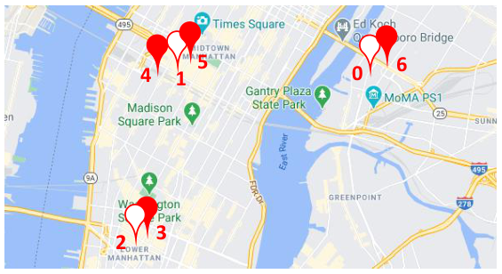
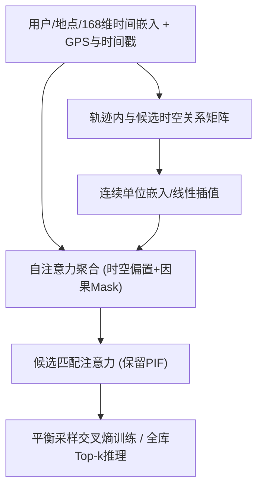
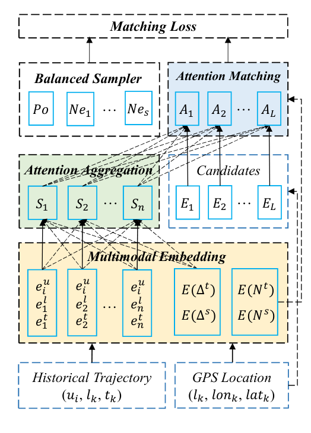

# STAN: Spatio-Temporal Attention Network for Next Location Recommendation (面向下一地点推荐的时空注意力网络)

- **会议/期刊**: WWW 2021
- **作者与机构**: Yingtao Luo (University of Washington)；Qiang Liu (CASIA/UCAS)；Zhaocheng Liu (Renmin University of China)
- **推荐链路定位**: 召回
- **研究方向**: 时空轨迹与POI本地生活推荐 / 序列与会话推荐
- **论文原文**: [https://arxiv.org/abs/2102.04095v1](https://arxiv.org/abs/2102.04095v1)
- **开源代码**: [https://github.com/yingtaoluo/Spatial-Temporal-Attention-Network-for-POI-](https://github.com/yingtaoluo/Spatial-Temporal-Attention-Network-for-POI-)

## TL;DR (1分钟核心速览)

本文针对下一POI推荐中非相邻地点/非连续访问相关性、层级网格离散化损失距离、PIF被注意力归一化抹平三个痛点，提出时空双注意力STAN：用全轨迹相对时空矩阵注入自注意力，先聚合再匹配，并以平衡负采样训练。在Gowalla/TKY/SIN/NYC上采用按用户留一式的全库Top-k Recall@5/10评估，较GeoSAN等SOTA提升9.12%–17.04%。

## Background & Motivation (背景与核心矛盾)

- **主流范式**: 下一POI推荐由RNN/自注意力序列模型主导；STRNN、Time-LSTM、STGN用相邻访问的时空间隔，GeoSAN用层级网格+自注意力做轨迹内交互。
- **前人局限**: 多数模型只建模“当前步与下一步”或连续访问的间隔，难以利用几天前、空间较远但功能相关的餐馆/商场关系；层级网格只聚合邻近格子，无法感知精确GPS距离。
- **核心洞察 (Key Insight)**: 用户移动规律更多由**功能相关、时空非连续**的访问决定；重复访问频率（PIF）是强先验，但RNN记忆压缩与softmax归一化会把它弱化。
- **本文切入点**: 将轨迹内所有签到两两相对时间/距离与候选-历史时空关系显式注入两层注意力，并用“先聚合全部签到、再逐候选匹配”的结构保留PIF。

<figure class="paper-figure" markdown="span">
  <figcaption>图1：一个轨迹示例，展示非连续访问与非相邻地点之间的关系。地图展示了访问地点的空间分布，这些地点以0至6的数字命名。时间线展示了从周五到周一的访问地点时间分布。实心标记表示餐馆。空心标记0、1、2分别表示家、工作场所和购物中心。餐馆3、4、5和6功能相关，但在时间上不连续且在空间上相距较远。</figcaption>
</figure>

## Method (核心方法设计)

### 1. 整体框架 (Overall Architecture)

STAN把每个签到表示为 $e_r=e_u+e_l+e_t$，其中时间按周内168小时离散以保留周期。由GPS与时间戳构造轨迹内空间/时间关系矩阵$\Delta^s,\Delta^t$和候选-历史矩阵$N^s,N^t$，经连续单位嵌入或线性插值得到稠密时空偏置。自注意力聚合层以因果Mask更新每个历史签到；匹配层再将全部更新后的签到与$L$个候选逐一匹配，保留PIF。训练用1正$s=10$负的平衡采样器，推理时直接对全库$L$ 打分取Top-k。

<figure class="paper-figure" markdown="span">
  <figcaption>图2：所提出的STAN模型架构。</figcaption>
</figure>

### 2. 关键设计拆解 (Key Designs)

1. **连续时空关系嵌入替代网格离散化**：痛点在于网格只表达邻接、不表达距离。STAN对 $\Delta^t_{ij}=|t_i-t_j|$、$\Delta^s_{ij}=\mathrm{Haversine}(GPS_i,GPS_j)$使用单位嵌入$e_{\Delta^t_{ij}}=\Delta^t_{ij}\times e_{\Delta t}$（空间同理），也给出上下界插值近似。这样既稠密又保留精确间隔，缓解时空矩阵稀疏与距离不敏感问题。
2. **双层注意力聚合+匹配以保留PIF**：第一层计算 $S(u)=(M\odot softmax((QK^T+E(\Delta))/\sqrt{d}))V$，让任意两个签到点对点交互；第二层计算$A(u)=Sum(softmax((E(l)S(u)^T+E(N))/\sqrt{d}))$。由于所有历史签到表示均参与候选匹配，重复访问可在匹配中持续加权，而非被压成单一向量。
3. **平衡采样器与推理开销**：普通交叉熵需对 $L-1$个负例求和，二分类采样又浪费大量未标注候选。STAN每步采样$s=10$个负例，损失为$\mathcal{L}=-\sum_i\sum_{m'}[\log\sigma(a_k)+\sum_{j\in\mathcal{S},j\ne k}\log(1-\sigma(a_j))]$。推理时去掉采样器，对全库$L$直接排序；匹配层复杂度约$O(Lnd)$，大城市库仍是主要开销。

## Experimental Setup & Evaluation Protocol (实验设置与评估协议)

- **数据集与预处理**: 使用原始GPS签到，按各基线协议预处理，未额外执行统一`5-core`过滤：

| 数据集 | #Users | #Items | #Interactions | 稀疏度/密度 | 特征/场景说明 |
| :--- | :---: | :---: | :---: | :---: | :--- |
| Gowalla | 53,008 | 121,944 | 3,302,414 | 0.0511% | 全球LBS签到，地点极稀疏 |
| TKY | 2,245 | 7,872 | 447,571 | 2.53% | 东京POI轨迹 |
| SIN | 2,032 | 3,662 | 179,721 | 2.42% | 新加坡POI轨迹 |
| NYC | 1,064 | 5,136 | 147,939 | 2.71% | 纽约POI轨迹 |

- **数据划分与防穿越 (Splitting Strategy)**: 按用户留一式时间切分：用户 $m$个签到中，训练用前$m-3$序列预测中间标签，验证用前$m-2$预测第$m-1$，测试用前$m-1$预测第$m$；严格不使用未来签到。
- **排名评测协议 (Ranking Protocol)**: 无偏`Full-Ranking`：评估阶段丢弃平衡采样器，直接对全部 $L$个地点候选做Top-k排序，报告Recall@5/@10；训练负采样为随机平衡采样，$s=10$。
- **对比基线与超参设置**: 对比RNN类STRNN/DeepMove/STGN/ARNN/LSTPM、自注意力类TiSASRec/GeoSAN。嵌入维度 $d=50$（Gowalla为10），Adam学习率0.003，dropout 0.2，最大序列长100；10次运行均值，t-test$p=0.01$，误差小于$5e-5$。

## Key Experimental Results (实验关键数据)

### 1. 主实验对比 (Main Results)

| 方法 | Gowalla R@5 | R@10 | TKY R@5 | R@10 | SIN R@5 | R@10 | NYC R@5 | R@10 |
| :--- | ---: | ---: | ---: | ---: | ---: | ---: | ---: | ---: |
| STRNN | 0.1664 | 0.2567 | 0.1836 | 0.2791 | 0.1791 | 0.2016 | 0.2365 | 0.2802 |
| DeepMove | 0.1959 | 0.2699 | 0.2684 | 0.3509 | 0.2389 | 0.3155 | 0.3268 | 0.4014 |
| STGN | 0.1528 | 0.2422 | 0.1940 | 0.2710 | 0.2292 | 0.2727 | 0.2439 | 0.3015 |
| ARNN | 0.1810 | 0.2745 | 0.1852 | 0.2696 | 0.1817 | 0.2538 | 0.1970 | 0.3483 |
| LSTPM | 0.2015 | 0.2701 | 0.2568 | 0.3310 | 0.2579 | 0.3327 | 0.2791 | 0.3564 |
| TiSASRec | 0.2411 | 0.3546 | 0.3031 | 0.3693 | 0.2963 | 0.3753 | 0.3664 | 0.5020 |
| GeoSAN | 0.2764 | 0.3645 | 0.2957 | 0.3740 | 0.3397 | 0.3943 | 0.4006 | 0.5267 |
| **STAN** | **0.3016** | **0.3998** | **0.3461** | **0.4264** | **0.3751** | **0.4301** | **0.4669** | **0.5962** |
| **Improv.% vs SOTA** | **+9.12%** | **+9.68%** | **+17.04%** | **+14.01%** | **+10.42%** | **+9.08%** | **+16.55%** | **+13.20%** |

### 2. 消融实验 (Ablation Study)

| 变体 | Gowalla R@10 | TKY R@10 | SIN R@10 | NYC R@10 |
| :--- | ---: | ---: | ---: | ---: |
| STAN | **0.3998** | **0.4264** | **0.4301** | **0.5962** |
| −TIM−BS | 0.3718 | 0.3819 | 0.3873 | 0.5245 |
| −SIM−BS | 0.3729 | 0.3865 | 0.3901 | 0.5299 |
| −TIM | 0.3925 | 0.4099 | 0.4176 | 0.5814 |
| −SIM | 0.3908 | 0.4141 | 0.4165 | 0.5860 |
| −ALL | 0.3531 | 0.3660 | 0.3776 | 0.5094 |

### 3. 关键实验发现 (Key Findings)

1. **平衡采样器是第一增益源**：Gowalla上 `−ALL` 的R@5仅0.2645，较完整STAN 0.3016下降12.3%；`−TIM`加回BS后R@10为0.3925，比`−TIM−BS`的0.3718高5.6%，NYC更高10.8%。
2. **显式时空间隔对非连续关系有效**：移除空间或时间均使R@10下降；`−SIM−BS`在Gowalla为0.3729，而`−ALL`仅0.3531，说明空间距离注入带来约5.6%的R@10增益。
3. **PIF与全签到匹配优于GeoSAN**：STAN在Gowalla R@10为0.3998 vs GeoSAN 0.3645（+9.68%），NYC 0.5962 vs 0.5267（+13.20%），验证“先聚合全部签到、再候选匹配”更能利用重复访问。

## Highlights & Limitations (亮点、对比与审稿批判)

- **与代表作对比 (vs. Prior Work)**: GeoSAN虽用自注意力，但依赖网格离散空间且不显式建模时间/距离；TiSASRec注入时间间隔但无空间与PIF；LSTPM偏RNN短期聚合，难覆盖长周期非连续关系。STAN的核心差异是把**任意签到对**的显式时空关系同时用于聚合和匹配。
- **可迁移亮点**: ①用连续单位嵌入/插值表达离散时间、距离间隔，可迁移到LBS、短视频观看间隔等场景；②双层“先聚合再全候选匹配”结构可保留物品频率先验，适用于重复消费推荐。
- **审稿级局限批判**: 推理需对全库 $L$个候选做匹配，城市级POI库下$O(Lnd)$ 开销偏大；评测仅Recall@k，未报告NDCG/MRR或冷启动/长尾分桶，且数据集较旧、预处理随基线而异，跨论文复现实验需谨慎。

## Rating (四维评分)

- **方法创新性 (Novelty)**: ⭐⭐⭐⭐ （首次将全轨迹显式时空关系矩阵与双层注意力结合，并针对性保留PIF，思路清晰且可视化支撑充分）
- **评估协议与实验扎实度 (Protocol & Experiments)**: ⭐⭐⭐⭐ （四个真实数据集、全库Ranking、t-test与完整消融/稳定性实验较扎实，但仅Recall指标且缺分桶分析）
- **写作与数学规范度 (Clarity & Rigor)**: ⭐⭐⭐⭐ （框架与公式简洁，注意力与时空矩阵定义清楚，但部分实现细节和复杂度分析略简化）
- **工业落地与复现价值 (Industrial & Practical Value)**: ⭐⭐⭐⭐ （代码开源、结构易复现，适合POI召回；但大候选集匹配延迟与线上特征工程仍需优化）

