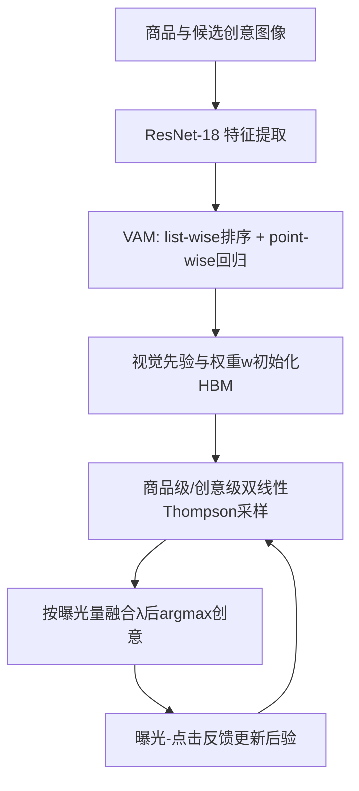
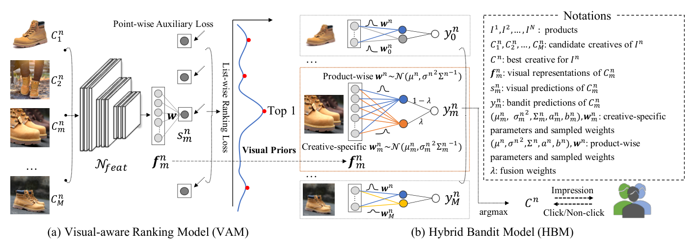

# A Hybrid Bandit Model with Visual Priors for Creative Ranking in Display Advertising (带视觉先验的混合Bandit模型用于展示广告创意排序)

- **会议/期刊**: WWW 2021
- **作者与机构**: Shiyao Wang, Qi Liu, Tiezheng Ge, Defu Lian, Zhiqiang Zhang；Alibaba Group / USTC
- **推荐链路定位**: 重排 / 在线创意选择
- **研究方向**: 强化学习与动态探索推荐 / 多模态推荐、冷启动推荐
- **论文原文**: [https://arxiv.org/abs/2102.04033v2](https://arxiv.org/abs/2102.04033v2)
- **开源代码**: [GitHub 仓库](https://github.com/alimama-creative/A_Hybrid_Bandit_Model_with_Visual_Priors_for_Creative_Ranking.git)

## TL;DR (1分钟核心速览)

本文针对展示广告创意生命周期短、点击稀疏带来的冷启动与探索-利用困境：VAM用list-wise排序学习视觉吸引力先验，HBM以商品级与创意级双线性Thompson采样在线校正。CreativeRanking随机日志回放协议下，sCTR达3.320%，较最强神经基线提升2.56%，Regret降低5.91%。

## Background & Motivation (背景与核心矛盾)

- **主流范式**: 创意排序可建模为多臂Bandit，常用ε-greedy、Thompson Sampling、UCB；视觉CTR模型则用CNN提取图片特征做离线排序。
- **前人局限**: 传统Bandit无内容先验，冷启动期只能随机探索；视觉模型多为确定性贪心排序，不建模不确定性，且深度网络在线更新代价高。更关键的是，共享线性Bandit参数无法同时适配不同商品品类与创意特有属性。
- **核心洞察 (Key Insight)**: 创意视觉外观蕴含可迁移的吸引力先验；曝光量少时商品级共享参数更可靠，曝光充分后创意级特有参数更重要，融合权重应随曝光量自适应变化。
- **本文切入点**: 用VAM学习视觉先验并热启动HBM，再用商品级/创意级混合贝叶斯线性Bandit在线更新后验。

## Method (核心方法设计)

### 1. 整体框架 (Overall Architecture)

输入同一商品的 $M$个候选创意图像。ResNet-18 提取$f_{nm}$，VAM用list-wise top-1交叉熵与point-wise L2回归联合训练，输出吸引力分数，并用其线性层权重初始化HBM先验。HBM为每个商品和每个创意分别维护Normal-Inverse-Gamma后验，Thompson采样得到$w_n,w_{nm}$，按曝光量自适应融合后对候选取argmax；曝光点击后仅更新被选商品/创意的后验。VAM离线学习，在线只做低维贝叶斯回归。

<figure class="paper-figure" markdown="span">
  <figcaption>图4：（彩色效果更佳）所提出的带视觉先验的Hybrid Bandit Model的整体框架。它接收若干候选创意（左侧一列所示），并尝试通过Visual-aware Ranking Model (VAM)和Hybrid Bandit Model (HBM)找到最具吸引力的创意。(a) VAM旨在开发一个CNN模型，可根据创意的视觉内容对其进行评估。(b) 根据视觉先验，HBM旨在估计后验并校正排序策略。</figcaption>
</figure>

### 2. 关键设计拆解 (Key Designs)

1. **VAM：list-wise视觉吸引力排序**：痛点在于pointwise回归只拟合单图CTR、pairwise margin只约束相对次序；本文把同一商品候选的top-1概率建模为 $p_{nm}=\frac{e^{s_{nm}}}{\sum_i e^{s_{ni}}}$，以温度$T$缩放CTR标签分布并对齐交叉熵$\mathcal{L}^{rank}_n=-\sum_m y^{rank}_{nm}\log p_{nm}$。这直接优化“每个曝光只展示一个创意”的场景；再用point-wise L2损失约束输出数值尺度，稳定后续Bandit先验。对曝光不足CTR，采用Beta-Binomial平滑$\hat{\mathrm{CTR}}_{nm}=\frac{clicks+\alpha}{impressions+\alpha+\beta}$，并按$\log(impressions)$ 加权采样降噪。

2. **HBM：商品级/创意级混合Thompson Bandit**：共享线性模型难以表达品类差异与创意特有设计；HBM为商品和创意分别维护后验，预测为 $y_{nm}=(1-\lambda)f_{nm}^{T}w_n+\lambda f_{nm}^{T}w_{nm}$，其中$\lambda=(1+e^{(-imp(I_n)+\theta_2)/\theta_1})^{-1}$。曝光少时$\lambda$小，依赖商品级共享知识；曝光充分后$\lambda$增大，转向创意级特有参数。先验均值$\mu_0$初始化为VAM权重，后验均值按$\mu^{(t)}=\Sigma^{(t)-1}(\Sigma_0\mu_0+F^Ty)$ 更新，Thompson采样天然平衡探索与利用。

3. **训练目标、负采样与推理效率**：总损失为 $\mathcal{L}_n=\mathcal{L}^{rank}_n+\gamma\mathcal{L}^{reg}_n$，论文取$\gamma=0.5$；无负采样，每个商品的全部候选构成一个list。在线阶段CNN特征可离线预计算，HBM仅对低维特征做贝叶斯回归与采样，计算远低于在线微调CNN；但每个商品/创意维护独立后验，参数内存随商品与创意数增长。

## Experimental Setup & Evaluation Protocol (实验设置与评估协议)

- **数据集与预处理**: CreativeRanking来自阿里展示广告32天日志，采用随机日志策略，并仅保留候选创意共同曝光且重叠5–14天的生命周期，覆盖冷启动到相对稳定阶段。

| 数据集 | #Products/Entities | #Creatives/Arms | #Interactions | 候选/属性 | 场景 |
| :--- | :---: | :---: | :---: | :---: | :--- |
| CreativeRanking | 500,827 | 1,707,733 | ≈215M impressions | 平均3.4个创意/商品，124类 | 广告创意排序 |
| Mushroom | 8,124 | 2动作 | 50,000轮 | 22个属性 | 标准Bandit评测 |

- **数据划分与防穿越**: CreativeRanking按商品随机划分为300,242训练、100,240验证、100,345测试；VAM只在训练商品上学习，HBM在验证/测试的未见商品与创意上模拟在线交互。
- **排名评测协议**: 非静态Full-Ranking，而是逐曝光序列回放：策略对候选打分并选一个创意，仅当选择与日志创意一致时才计入曝光、更新策略。指标为模拟CTR（sCTR）与归一化累积Regret；Mushroom按NeuralLinear协议交互50,000轮。
- **对比基线与超参**: 对比Uniform、ε-greedy、Thompson、UCB、LinUCB、VAM-Greedy、VAM-Thompson等。VAM用ImageNet预训练ResNet-18，SGD batch=64，lr从0.01降至1e-4，训练30 epoch；$\gamma=0.5$，$\theta_1=50,\theta_2=150$。论文未报告显著性检验。

## Key Experimental Results (实验关键数据)

### 1. 主实验对比 (Main Results)

Regret以Uniform=100归一化，越低越好；sCTR越高越好。下表保留代表性基线并突出本文最佳结果。

| 方法 | Mushroom Regret% | CreativeRanking Regret% | CreativeRanking sCTR% | sCTR Improv. |
| :--- | :---: | :---: | :---: | :---: |
| ε-Greedy | 52.99 | 87.22 | 3.166 | — |
| Thompson Sampling | 52.49 | 87.69 | 3.158 | — |
| UCB | 52.42 | 87.04 | 3.169 | — |
| LinUCB | 10.27 | 85.50 | 3.195 | — |
| VAM-Greedy | 6.68 | 84.11 | 3.219 | — |
| VAM-Thompson | 2.22 | 83.02 | 3.237 | — |
| VAM-Warmup (Ours) | — | 79.70 | 3.293 | +1.73% |
| **VAM-HBM (Ours)** | **1.93** | **78.11** | **3.320** | **+2.56%** |

相对最佳神经基线VAM-Thompson，VAM-HBM的sCTR提升2.56%，Regret降低5.91%；仅先验热启动的VAM-Warmup也已带来1.73%的sCTR增益，说明视觉先验在冷启动阶段有效。

### 2. 消融实验 (Ablation Study)

| 变体 | sCTR% | 相对Uniform提升 |
| :--- | :---: | :---: |
| Base（Uniform） | 2.950 | — |
| +Point-wise only | 3.140 | +6.4% |
| +List-wise only | 3.167 | +7.4% |
| +List-wise & Point-wise | 3.194 | +8.3% |
| +标签平滑 & 加权采样 | **3.219** | **+9.1%** |

额外排序损失对比中，VAM的3.219%优于Pairwise框架[34]的3.188%、Pairwise Hinge的3.170%、Aesthetic Ranking的3.167%与Triplet的3.115%。

### 3. 关键实验发现 (Key Findings)

1. **视觉先验显著缓解冷启动**：VAM-Greedy较ε-Greedy的sCTR由3.166%升至3.219%，而将VAM权重注入Bandit先验后，VAM-Warmup进一步达3.293%，说明“先验热启动”比单纯贪心视觉排序更稳。
2. **混合Bandit优于单一共享Bandit**：VAM-HBM达到3.320% sCTR、78.11% Regret，较VAM-Thompson的3.237%/83.02%同时提升收益并降低后悔，验证商品级共享与创意级特化结合的价值。
3. **list-wise目标与噪声处理互补**：list-wise单独带来+7.4%提升，高于point-wise的+6.4%；二者结合再叠加标签平滑与加权采样后总提升+9.1%，说明相对排序、绝对CTR尺度与稀疏曝光降噪缺一不可。

## Highlights & Limitations (亮点、对比与审稿批判)

- **与代表作对比 (vs. Prior Work)**: 相比PEAC等离线视觉创意排序，本文显式建模不确定性并支持在线后验更新；相比NeuralLinear的单共享线性头，本文引入商品级/创意级双线性与曝光自适应融合；相比context-free Bandit，本文用视觉内容做冷启动先验。
- **可迁移亮点**: list-wise top-1概率加point-wise辅助回归适合“一组候选只出一个结果”的创意/封面/主图选择；用监督模型权重初始化Bandit先验，可迁移到新品冷启动与广告素材探索。
- **审稿级局限批判**: 离线sCTR回放仅在策略选中日志动作时更新，仍受日志策略与选择偏差影响，且缺少真实在线A/B与显著性检验；每商品/每创意独立维护贝叶斯后验在工业级商品与创意规模下内存和更新开销较高，且方法主要利用图像，未充分建模用户、上下文与文本价格等信息。

## Rating (四维评分)

- **方法创新性 (Novelty)**: ⭐⭐⭐⭐ （视觉list-wise先验与商品/创意双线性Thompson Bandit的组合较自然，冷启动热启动机制有明确增量）
- **评估协议与实验扎实度 (Protocol & Experiments)**: ⭐⭐⭐⭐ （自建大规模CreativeRanking并补充Mushroom，消融完整；但离线回放与缺少显著性检验限制说服力）
- **写作与数学规范度 (Clarity & Rigor)**: ⭐⭐⭐⭐ （VAM损失、HBM后验与融合权重定义清晰，公式与算法流程完整）
- **工业落地与复现价值 (Industrial & Practical Value)**: ⭐⭐⭐⭐ （问题来自阿里真实广告场景，代码数据公开；但全量后验维护与在线工程成本仍需压缩）

