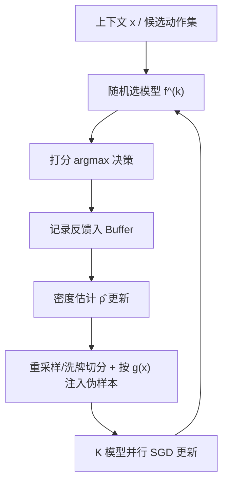
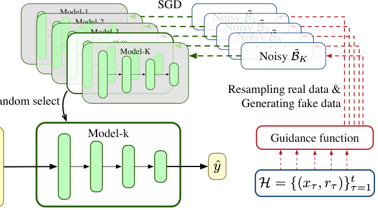

# GuideBoot: Guided Bootstrap for Deep Contextual Bandits in Online Advertising (在线广告深度上下文老虎机的引导式自助采样)

- **会议/期刊**: WWW 2021 (The Web Conference)
- **作者与机构**: Feiyang Pan, Haoming Li, Xiang Ao, Qing He (中科院计算所/UCAS)；Wei Wang, Yanrong Kang, Ao Tan (腾讯)
- **推荐链路定位**: 精排（广告出价/CTR 决策）与探索策略
- **研究方向**: 强化学习与动态探索推荐 / 冷启动与长尾推荐
- **论文原文**: [论文原文链接](https://arxiv.org/abs/2107.08383v1)
- **开源代码**: 暂未开源

## TL;DR (1分钟核心速览)

深度上下文老虎机面临两难：贝叶斯方法能提供有原则的探索引导，却在深度非线性下推断不可解；非贝叶斯 bootstrap 可配深度网络但探索无引导，易退化为贪心。GuideBoot 在每次 bootstrap 重采样后，按预测不确定性反比概率注入伪标签样本 $(x,0)/(x,1)$，训练$K$个奖励模型，推理时随机选一取$\arg\max$。理论上可视为带信息先验 Beta 的 Thompson Sampling 非参近似。在腾讯广告仿真上平均奖励较最优基线提升约 3%–6%。

## Background & Motivation (背景与核心矛盾)

- **主流范式**: 探索/利用 (E&E) 的两条路线——贝叶斯 (LinUCB、TS-BLR) 以贝叶斯后验刻画不确定性引导探索；非贝叶斯 (ε-greedy、Bootstrap、Giro) 以多模型自助采样近似不确定性。
- **前人局限**: ①贝叶斯推断在深度非线性奖励函数下不可解，且 UCB 的 $O(d^2)$、TS 的$O(d^3)$ 在线推断代价高昂；②vanilla bootstrap 仅贪婪地拟合重采样子集，缺乏显式引导，「冷启动广告连续 50 次未点击则均值方差恒为 0」——策略永久放弃该广告。
- **核心洞察 (Key Insight)**: 统计上「bootstrap 分布等价于非信息先验的近似后验」，因此只需在重采样数据中按不确定性权重注入伪样本，即可把非信息先验「抬升」为信息先验，获得与 Thompson Sampling 同阶的不确定性传播。
- **本文切入点**: 用数据先验（伪样本）替代参数先验（正则项），在保持深度模型可训练性的同时注入显式探索引导。

## Method (核心方法设计)

### 1. 整体框架 (Overall Architecture)

GuideBoot 维护 $K$个独立奖励模型。推理阶段极轻：随机抽取一个模型$f^{(k)}$对候选打分并取$a_t=\arg\max_a f^{(k)}(x_{t,a})$，其计算复杂度与单个前馈网络相同，把昂贵的「不确定性估计」全部前置到训练阶段。训练阶段：对第$k$个模型从经验回放池做$b$-out-of-$t$自助重采样得$\mathcal{B}_k$，对每个样本按引导函数$g(x)$概率生成伪样本$(x,0)/(x,1)$，得到混合集$\tilde{\mathcal{B}}_k$，再并行做一步梯度下降。在线版本以「在线 buffer 洗牌切分 + 伪样本注入」替代全历史重采样。

<figure class="paper-figure" markdown="span">
  <figcaption>图 1：GuideBoot 的推理与训练。实线为推理时的前向传播，使用 𝐾 个模型中的一个模型。虚线为训练过程，包括每个模型的数据生成过程（红色虚线）以及训练每个模型的反向传播（绿色虚线）。</figcaption>
</figure>

### 2. 关键设计拆解 (Key Designs)

1. **不确定性引导函数 (Guidance Function)**：痛点——固定比例注入伪样本（Giro）无法区分熟悉与陌生上下文。本文令引导概率反比于输入密度：$g(x)=\alpha/\hat{\rho}(x)$，其中$\hat{\rho}(x)$为未归一化密度估计；对多类别字段采用调和平均$\hat{\rho}(x)=\big[\sum_{j=1}^{J}\text{Count}^{-1}(x_j)\big]^{-1}$。直觉：曝光越多的广告$g$越小、越接近纯 bootstrap；冷门广告$g$ 大、伪样本多、方差被撑开，从而获得探索机会。

2. **信息先验的贝叶斯等价**：对单臂 Bernoulli 且 $n_s$次成功/$n$次曝光，Beta$(\alpha,\alpha)$后验均值为$\frac{\alpha+n_s}{2\alpha+n}$；若在自助重采样后对每条样本以$\alpha/n$概率追加伪奖励 0 与 1，得到估计量均值同样为$\frac{\alpha+n_s}{2\alpha+n}$、方差渐近一致。故$g(a)=\alpha/\text{Count}(a)$ 是实现 Beta 先验 TS 的非参手段；关键是把伪样本生成放在重采样**之后**，避免污染经验池，才能支持经验回放与流式训练。

3. **训练目标、伪样本与在线推理**：损失为混合集上的负对数似然 $\mathcal{L}=-\sum_{(x,r)\in\tilde{\mathcal{B}}_k}\big[r\log f^{(k)}(x)+(1-r)\log(1-f^{(k)}(x))\big]$；采样策略为 BLB 自助重采样（有放回）+ 伪样本，无需显式负采样。在线版以 shuffle-and-split 在$c$条流式样本的 buffer 上切$n$个 mini-batch，$K$ 个模型共享 buffer 但各自独立生成伪样本，实现仅依赖近期数据的随机梯度更新。

## Experimental Setup & Evaluation Protocol (实验设置与评估协议)

- **数据集与预处理**（腾讯广告日志仿真，黑盒用户模型给出真实 CTR）：

| 数据集 | #Steps | #Ads | 候选数/步 | 上下文特征 | 广告特征 |
| :--- | :---: | :---: | :---: | :---: | :---: |
| Tencent Ads A (展示广告) | 4.5M | 8.9K | 250~450 | 4.2K (13 字段) | 12K (12 字段) |
| Tencent Ads B (信息流) | 14.7M | 6.5K | 100~200 | 4.3K (13 字段) | 9.4K (12 字段) |
| 合成任务 | 20K steps | 25 动作 | 25 | 3 类别字段 | — |

- **数据划分与防穿越**: 仿真按时间步顺序流式推进，不存在随机划分；合成任务为 100 个随机环境（系数 $\sim U(-0.25,0.25)$）各跑 50 次。
- **评估协议**: 采用**累积平均奖励 / 平均标准化 regret**（非排序指标），广告任务报告 10 个随机种子的 reward 均值与标准差（表内括号），模拟器保证策略所见增益与真实黑盒一致。
- **对比基线与超参**: 合成任务对比 ε-greedy、ε-greedy(decay)、GLM-UCB、TS-BLR、Bootstrap、OBB、Giro；广告任务对比 Deep-UCB1、Deep-TS-Beta、MC-Dropout 等深度基线。奖励网络 Embedding 维度 8，两层 128 维隐层，Adam + Log-Loss；所有 bootstrap 类方法 $K=5$，GuideBoot$\alpha=1$（合成）/ 计数式引导（广告）；Giro 在广告任务上因大$\alpha$失效，网格搜索后取$\alpha=0.01$。

## Key Experimental Results (实验关键数据)

### 1. 主实验对比 (Main Results)

**Tencent Ads（经验回放设置，10 seeds 平均值，括号内为标准差）**：

| Method | Ads A reward | Ads B reward |
| :--- | :---: | :---: |
| ε-greedy ($\epsilon$=0.1) | 0.0248 (0.0010) | 0.0225 (0.0003) |
| ε-greedy (decay) | 0.0260 (0.0009) | 0.0231 (0.0006) |
| Deep-UCB1 | 0.0222 (0.0005) | 0.0220 (0.0002) |
| Deep-TS-Beta | 0.0262 (0.0007) | 0.0238 (0.0002) |
| MC-Dropout | 0.0245 (0.0010) | 0.0221 (0.0006) |
| Bootstrap | 0.0264 (0.0010) | 0.0239 (0.0003) |
| Giro | 0.0249 (0.0012) | 0.0230 (0.0003) |
| **GuideBoot** | **0.0280** (0.0006) | **0.0248** (0.0003) |
| Improv. | **+6.1%** | **+3.8%** |

**Tencent Ads（在线流式设置）**：

| Method | Ads A reward | Ads B reward |
| :--- | :---: | :---: |
| ε-greedy (decay) | 0.0293 (0.0012) | 0.0261 (0.0002) |
| Deep-UCB1 | 0.0243 (0.0004) | 0.0237 (0.0001) |
| Deep-TS-Beta | 0.0295 (0.0004) | 0.0266 (0.0001) |
| MC-Dropout | 0.0297 (0.0010) | 0.0258 (0.0002) |
| OBB | 0.0302 (0.0009) | 0.0262 (0.0002) |
| **Online GuideBoot** | **0.0317** (0.0004) | **0.0270** (0.0002) |
| Improv. | **+5.0%** | **+3.1%** |

### 2. 消融实验 (Ablation Study)

合成 Bernoulli 任务上对「引导来源」的组件消融（平均 regret，越低越好，50 次运行）：

| 变体 | 重采样来源 | 伪样本策略 | 相对 regret 表现 |
| :--- | :---: | :---: | :---: |
| Vanilla Bootstrap | 全历史 | 无 | 差（近乎退化贪心） |
| Giro | 扰动历史 | 固定比例 $\alpha$ | 中等，优于 vanilla |
| OBB | 流式数据 | Poisson 重复采样 | 在线版中显著劣化 |
| **GuideBoot** | 全历史 | 不确定性引导 $g(x)$ | **最优** |
| **Online GuideBoot** | 流式 buffer | shuffle-split + $g(x)$ | 接近全历史版，远优于 OBB |

### 3. 关键实验发现 (Key Findings)

1. **引导是核心增量，而非伪样本本身**：vanilla Bootstrap 在 Ads A 仅 0.0264，注入**固定比例**伪样本的 Giro 反而降到 0.0249（因 $\alpha=0.01$过小无效、过大过探索），而按$g(x)=\alpha/\hat{\rho}(x)$ 引导的 GuideBoot 升至 0.0280，说明「不确定性与伪样本量成正比」这一配比才是增益来源。
2. **非平稳性决定在线 vs 回放谁更优**：合成任务（平稳环境）中 GuideBoot 回放版 regret 最低；但广告日志分布漂移，在线版 Ads A 达 0.0317，反超回放版 0.0280，证明仅学近期样本可快速适应分布漂移，Online GuideBoot 相对 OBB 提升 5.0%。
3. **贝叶斯引导系数需谨慎，粗放 UCB 会过探索**：Deep-UCB1 因 $\sqrt{\log(t)}$ 探索系数持续增长，在两个仿真上均垫底（0.0222 / 0.0243），显著劣于计数式 Deep-TS-Beta（0.0262 / 0.0295），说明探索预算应随曝光量而非全局步数收敛。

## Highlights & Limitations (亮点、对比与审稿批判)

- **与代表作对比 (vs. Prior Work)**: 对比 TS-BLR/GLM-UCB，本文把后验推断转为数据先验注入，兼容任意深度网络且推理零额外开销；对比 Giro，本文以不确定性反比自适应控制伪样本量，而非固定 $\alpha$；对比 OBB，本文用 shuffle-and-split 在 buffer 上高效近似重采样，无需全历史。
- **可迁移亮点**: ①「伪样本生成放在重采样之后、不写回 buffer」的工程技巧，可迁移到任意在线增量训练与长尾扶持场景；②用 Count/调和平均密度构造探索权重的做法，可直接用于冷启动新物料流量分配。
- **审稿级局限批判**: ①理论等价仅在单臂 Bernoulli + Beta 先验下严格成立，深度多字段上下文仅为类比论证，缺乏 regret 界；②广告实验完全依赖腾讯内部离线仿真（黑盒用户模型不可复现），无公开数据集与线上 A/B，外部可复现性受限；③引导函数中的调和平均密度对高基数特征（如 ad_ID）敏感，$\alpha$与$K$ 的敏感性分析缺失。

## Rating (四维评分)

- **方法创新性 (Novelty)**: ⭐⭐⭐⭐ （数据先验替代参数先验、伪样本置于重采样之后的构造巧妙，且有 Beta-TS 的非参等价推导支撑，但整体仍是 bootstrap 家族的自然延伸）
- **评估协议与实验扎实度 (Protocol & Experiments)**: ⭐⭐⭐ （合成 + 双千万级广告仿真、10 seeds 与标准差报告扎实，但缺少公开数据集、显著性检验与超参敏感性分析）
- **写作与数学规范度 (Clarity & Rigor)**: ⭐⭐⭐⭐ （引导函数与 Beta 后验均值的推导清晰直观，算法伪代码完整，深度场景的理论推广略显跳跃）
- **工业落地与复现价值 (Industrial & Practical Value)**: ⭐⭐⭐⭐ （推理等价单模型前向、K 模型可并行、在线版仅需小 buffer，工程代价极低；但代码未开源、仿真环境无法复现）

