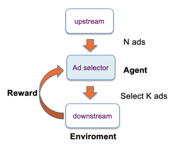
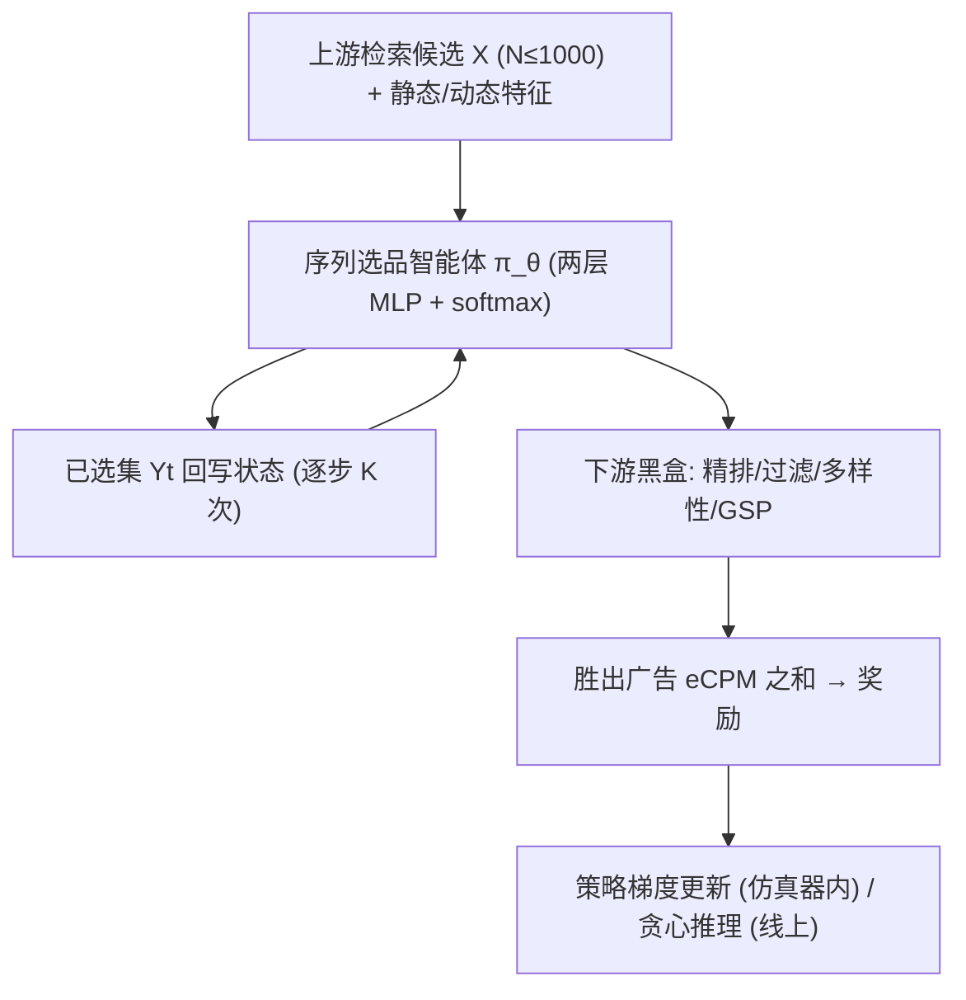
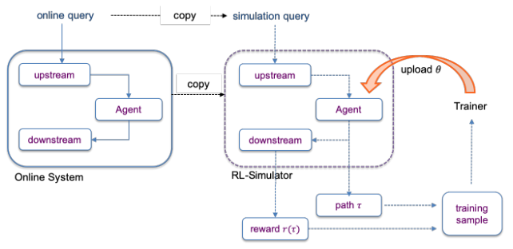

# Optimizing AD Pruning of Sponsored Search with Reinforcement Learning (基于强化学习的赞助搜索广告剪枝优化)

- **会议/期刊**: WWW 2021（arXiv 预印本 2020-08，arXiv:2008.02014v1）
- **作者与机构**: Yijiang Lian、Zhijie Chen、Xin Pei、Shuang Li、Yifei Wang 等，百度（Baidu）赞助搜索团队
- **推荐链路定位**: 召回/粗排（上游剪枝，级联至精排与 GSP 拍卖）
- **研究方向**: 强化学习与动态探索推荐 / 多任务学习与列表级重排（粗精排级联一致性）
- **论文原文**: [https://arxiv.org/abs/2008.02014v1](https://arxiv.org/abs/2008.02014v1)
- **开源代码**: 暂未开源（工业系统内实现，含私有仿真器）

## TL;DR (1分钟核心速览)

工业赞助搜索的广告候选在"创意 × 样式"展开时呈指数膨胀（1 query 可达 $10^5$ 量级），必须在进入精排前剪枝，但传统剪枝按 `eCTR×bid` 排序，完全无视下游的黑名单、多样性过滤与拍卖机制，选出的广告大量被后置环节淘汰。本文把下游整体当作黑盒环境，用无模型强化学习训练一个序列选品智能体（N=1000 中选 K≤100），以最终胜出广告的 eCPM 之和为奖励、用对数奖励塑形与策略梯度优化。百度线上长期 A/B 显示 CTR +2.21%、SHOW +1.27%、CPM +1.95%（相对 `eCTR*bid` 基线）。

## Background & Motivation (背景与核心矛盾)

- **主流范式**: 赞助搜索链路为关键词匹配 → 广告检索 → 精排+拍卖；候选在检索阶段按 `关键词→单元→创意→样式` 多级倒排索引逐层相乘膨胀，因此必须在"创意已确定、样式未展开"的位置划线剪枝。
- **前人局限**: 其一，规则式剪枝（按 eCTR×bid 或 eCTR×bid×展示概率 srq 排序取 Top-K）无法刻画下游的黑名单、质量与多样性过滤，选出的候选被大量丢弃；其二，此时候选尚缺样式信息，CTR 估计本身不精确，规则与真实收益的目标错位；其三，该问题是 NP-hard 的组合优化，且下游模型迭代频繁，手工规则无法随之适配。
- **核心洞察 (Key Insight)**: 既然下游复杂且快速变化，就不必（也无法）显式建模它——只需把"下游最终给出的 eCPM"当作可探测的奖励信号，让上游选择策略通过试错自动对齐下游，形成"从下游适配视角做系统级优化"的闭环。
- **本文切入点**: 将 Top-K 选取重构为逐步的序列决策（MDP），用策略梯度直接最大化端到端收益，并用离线仿真器规避在线探索的商业风险。

<figure class="paper-figure" markdown="span">
  <figcaption>图5：在我们的问题中，智能体是广告选择器，下游是环境。</figcaption>
</figure>

## Method (核心方法设计)

### 1. 整体框架 (Overall Architecture)

上游检索给出候选集 $X=\{x_1,\dots,x_N\}$；当选数$|X|>K$时触发智能体，智能体在$K$步内每步从"未选集$X_t$"中选出一个广告移入"已选集$Y_t$"，策略$\pi_\theta(a_t|s_t)$由两层全连接网络对全体未选候选打分后经 softmax 归一化得到。选满$K$条后整条队列送入下游（精排、过滤、GSP 拍卖），下游胜出集合$Z$ 的 eCPM 之和作为整回合奖励回传，用于策略梯度的离线更新；推理时改用贪心 argmax 以零探索代价上线。

### 2. 关键设计拆解 (Key Designs)

1. **序列式 Top-K 子集选择 MDP（把组合优化拆成可学习的逐步决策）**：若一次性对 N 个候选做独立打分排序，就无法建模"已选广告之间的相互影响"（同一广告主重复、多样性塌缩）。本文将状态定义为 $s_t=(X_t,Y_t)$，动作为从$X_t$中取一条，奖励为整回合 eCPM 之和$r(\tau)=\sum_{i=1}^{M}\text{eCPM}_{z_i}$，从而把集合级目标转化为$\max_\theta \mathbb{E}_{\tau\sim\pi_\theta}[r(\tau)]$；动态特征（"同广告主是否已被选"、"同广告主累计 eCPM"）正是把上文选择结果编码进状态，使模型能自发学出广告主维度的多样性。

2. **奖励塑形 + 对数平滑（解决"一回合仅一个奖励"的信用分配）**：序列有 $K$步却只有一个终端奖励，均分奖励会让梯度极度低效且高方差。作者按 eCPM 贡献做塑形：被展示广告$z\in Z$得$\log(1+\text{eCPM}_z)$，未被展示者得$0$；对数变换压缩 eCPM 的长尾差异以进一步降方差。直觉上，这等价于把"谁真正赢下拍卖"这一稀疏信号逐动作摊派，使策略迅速远离"高分但必被下游过滤"的候选。

3. **训练目标、探索与推理效率**：总目标与梯度为 $\nabla_\theta L(\theta)=\mathbb{E}_{\tau\sim\pi_\theta}\big[\nabla_\theta\log\pi_\theta(a_t|s_t)\,r(\tau)\big]$，用 Adam（$\alpha{=}0.99,\beta{=}0.999$，lr$10^{-4}$）更新；训练时按概率分布采样探索、每 query 从决策路径采样 50 个状态，推理时取最大概率项。为避免真机探索伤害收入，作者克隆线上系统构建仿真环境，形成"线上流量复制 → 仿真上游/下游产生$\langle q,\tau_q,r(\tau_q)\rangle$ 日志 → 离线训练 → 近实时推回仿真器"的解耦架构；上线前须通过仿真 eCPM 与少量真实流量 CPM 双重验证。

<figure class="paper-figure" markdown="span">
  <figcaption>图7：使用模拟器的训练架构。</figcaption>
</figure>

## Experimental Setup & Evaluation Protocol (实验设置与评估协议)

- **数据与环境**: 无公开数据集，全部实验在百度赞助搜索真实系统与克隆仿真器上完成；配置如下：

| 项目 | 取值 | 说明 |
| :--- | :---: | :--- |
| 候选上限 $N$ | 1000 | 上游检索返回的创意级候选 |
| 选数 $K$| ≤100 | 仅在$|X|>K$ 时剪枝 |
| 触发比例 | 约 1/6 流量 | 候选超限的 query 才走智能体 |
| 网络/特征 | 2 层 FC，8 维特征 | 6 静态（eCTR、query-ad 相关性、bid、预训练 query/ad 向量、强样式兼容）+ 2 动态（同广告主已选、同广告主累计 eCPM） |
| 训练超参 | batch 128，路径内采样 50 状态，lr $10^{-4}$，Adam | 网格搜索确定 |

- **数据划分与防穿越**: 非离线划分；采用在线长期 A/B 测试（流量级随机分流），训练样本由线上日志按时间滚动拼接，避免未来信息泄漏。
- **排名评测协议**: 不适用离线 Full-Ranking / Sampled Ranking；评价指标为系统级线上指标——每千次搜索点击数 CTR、每千次搜索展示数 SHOW、每千次搜索收入 CPM，均相对基线报告百分比变化。
- **对比基线与超参**: 两个工业在用规则基线 `eCTR*bid`（期望扣费）与 `eCTR*bid*srq`（乘 30 天累计展示概率近似）；未报告显著性检验与置信区间。

## Key Experimental Results (实验关键数据)

### 1. 主实验对比 (Main Results)

| 方法 | CTR Δ | SHOW Δ | CPM Δ |
| :--- | :---: | :---: | :---: |
| `eCTR*bid`（规则基线） | +2.21% | +1.27% | **+1.95%** |
| `eCTR*bid*srq`（规则基线） | +1.11% | +1.17% | +0.99% |

### 2. 收敛性与先验注入消融 (Ablation)

| 训练步数 / 变体 | CTR | SHOW | CPM |
| :--- | :---: | :---: | :---: |
| 1 步（近似随机策略） | -2.90% | -1.68% | -11.20% |
| 500k | -0.13% | +0.47% | +0.54% |
| 1000k | +1.81% | +1.03% | +1.30% |
| 1500k | +2.02% | +1.21% | +1.61% |
| 2000k | **+2.23%** | +1.26% | +1.93% |
| 2500k | +2.21% | **+1.27%** | **+1.95%** |
| + 同广告主选数上限先验 | ≈持平 | ≈持平 | ≈持平（选择耗时省约 10%） |

### 3. 关键实验发现 (Key Findings)

1. **奖励对齐比打分精度更值钱**：仅训练 1 步的智能体 CPM 为 -11.20%，说明"未对齐下游"的策略会系统性选错；而 2000k 步后 CPM 提升 1.93%，证明收益主要来自与下游过滤/拍卖的一致性，而非更强的 CTR 预估。
2. **SHOW 与 CTR 同向提升，排除了"少展示换高 CTR"的虚假增益**：SHOW +1.27% 表明被选广告更多能存活到最终展示（广告供给稳定），CTR +2.21% 说明新展示广告更被用户接受，二者共同支撑 CPM +1.95% 的真实增量。
3. **智能体刻意偏离规则 Top 榜仍获益**：对 `eCTR*bid` 的 Top-110 候选召回率仅约 0.67 而非 1，即约 1/3 的高分候选被主动放弃，恰是这些"规则高分但下游必被过滤/挤占"的候选造成了规则解的天花板。

## Highlights & Limitations (亮点、对比与审稿批判)

- **与代表作对比**: 与 DCN/传统精排类工作（在给定候选集内提升排序质量）不同，本文优化的是"候选集内容"本身；与 RL-based 竞价（如 Real-Time Bidding 的出价策略）不同，本文决策对象是子集选择；相比 Listwise Re-ranking 工作，本文的独特点是把下游整体当作不可见黑盒，仅靠终端 eCPM 奖励做端到端适配，可直接套用于任意"粗排→精排"级联。
- **可迁移亮点**: (1) 用"下游黑盒 + 终端业务指标为奖励"的训练范式替代不可导的级联一致性建模，适用于召回-精排、粗排-重排的任意相邻两级；(2) 同广告主选数上限等业务先验以硬约束方式注入策略，可在几乎不损收益的前提下砍掉约 10% 的决策耗时。
- **审稿级局限批判**: (1) 评估仅依赖单一工业系统的在线 A/B，无公开数据集、无重复实验、无显著性检验与置信区间，且基线只有两条规则式方法，缺少与监督式 learning-to-rank 的对照，可复现性与说服力受限；(2) 奖励塑形中的对数平滑与"未展示即 0"是启发式设计，缺乏理论依据；策略梯度未做 off-policy 修正与方差控制（无 baseline/critic），K 步序列推理在最坏情况下带来额外排序延迟，且仿真器与线上分布漂移的风险未被量化。

## Rating (四维评分)

- **方法创新性 (Novelty)**: ⭐⭐⭐⭐ （首次从"下游自适应"视角把广告剪枝建模为序列 MDP，黑盒奖励 + 塑形机制简洁有效，但 PG 本身属常规工具）
- **评估协议与实验扎实度 (Protocol & Experiments)**: ⭐⭐⭐ （真实线上长期 A/B 有说服力，但无公开数据、无显著性检验、基线仅 2 条、缺监督式对照）
- **写作与数学规范度 (Clarity & Rigor)**: ⭐⭐⭐ （MDP 与奖励定义清晰，但符号较简、缺少复杂度与方差分析，部分表述停留在工程描述）
- **工业落地与复现价值 (Industrial & Practical Value)**: ⭐⭐⭐⭐ （已在百度全量上线并复用至其他产品，仿真器+双重验证流程极具工程参考价值，可惜无开源代码）

