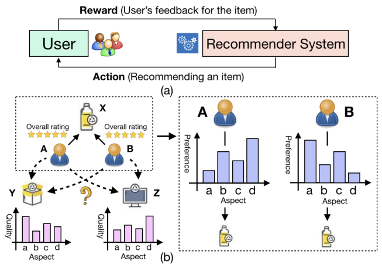
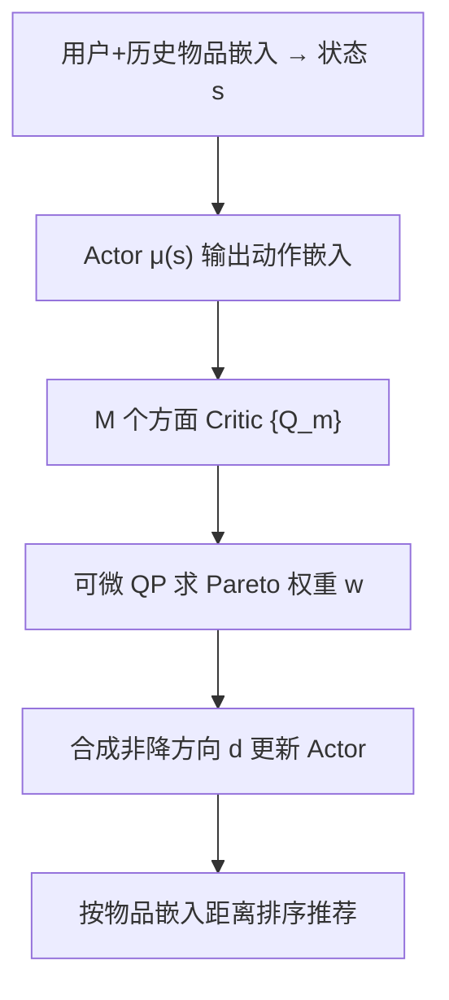

# Reinforcement Recommendation with User Multi-aspect Preference (用户多方面偏好的强化推荐)

- **会议/期刊**: WWW 2021
- **作者与机构**: Xu Chen, Yali Du, Long Xia, Jun Wang（中国人民大学高瓴人工智能学院、UCL、York University）
- **推荐链路定位**: 精排（RL 策略端到端学习）
- **研究方向**: 强化学习与动态探索推荐 / 多任务学习与列表级重排
- **论文原文**: [论文原文链接](https://discovery.ucl.ac.uk/10130485/1/3442381.3449846.pdf)
- **开源代码**: 暂未开源

## TL;DR (1分钟核心速览)

传统 RL 推荐把用户反馈压成单一标量 reward（总体评分/0-1 点击），无法刻画用户在物品多方面维度上的细粒度偏好，更无法处理维度间相互冲突。本文在 DPG 框架内为每个方面配备独立 critic、共享同一 actor，并引入 Pareto 优化动态求解 Q 函数聚合权重，同时用可微 QP 实现、理论推导梯度偏差上界并设计权重复用机制矫正。在 RateBeer/BeerAdvocate/TripAdvisor 模拟环境下，F1@5 相对最强基线提升 4.4%–9.5%，NDCG@5 提升 7.1%–8.0%。

## Background & Motivation (背景与核心矛盾)

- **主流范式**: 把推荐视为 agent-用户环境交互的 RL 问题，用 DQN/DPG 学习最大化长期累计 reward 的策略；现有工作聚焦更好的 agent 架构或更逼真的用户模拟器。
- **前人局限**: (1) reward 被压成单一标量，不同偏好用户（如 A 爱环境、B 爱价格）却打同样总分，无法区分——见下图；统一的 reward 也无法为特定方面提供足够优化信号。(2) 多方面维度本质冲突（大房间↔低价格），简单加权平均无法保证每个 Q 都被单调提升，网格搜权重在 $M$维方面上代价$O(d^{M-1})$。
- **核心洞察 (Key Insight)**: 多方面偏好构成多目标优化 (MOOP)，合理最优解应是帕累托有效（无其他策略可同时提升所有方面累计 reward），且该聚合权重应随时间动态调整。
- **本文切入点**: 在 DPG 上植入 Pareto 优化——多 critic（每方面一个）+ 单 actor，用可微 QP 动态求权重，使策略沿所有 Q 非降方向更新。

<figure class="paper-figure" markdown="span">
  <figcaption>图1：(a) 将推荐建模为强化学习问题。(b) 一个带有用户方面级偏好的推荐玩具示例。A 和 B 都喜欢物品 X（即给其打 5 星），但他们的具体偏好差异很大。A 更感兴趣方面 d，而 B 更关注方面 a。仅基于总体评分，系统无法很好地将这些用户与候选物品（如 Y 和 Z）匹配，因为这些物品在不同方面的质量差异很大。</figcaption>
</figure>

## Method (核心方法设计)

### 1. 整体框架 (Overall Architecture)

模型基于 DPG actor-critic。状态由用户嵌入与历史交互物品嵌入求和得到，actor $\mu(s)$将状态确定性地映射到动作（连续嵌入），M 个方面各配一个 critic 预估方面级 Q 值。训练时先按当前策略生成轨迹入 replay buffer 更新各 critic；再从 Q 函数对 actor 参数的梯度中解出 Pareto 权重$w$；合成方向更新 actor；监督正则项作为一个伪 Q 函数参与 Pareto 求解。推理时按候选物品嵌入与$\mu(s)$ 输出的距离排序，取最近者推荐。

### 2. 关键设计拆解 (Key Designs)

1. **多方面 Critic（把标量 reward 拆成向量）**: 为每方面各学一个 critic，缓解单值 reward 无法区分用户细粒度偏好。$\arg\min_{\phi_m}\sum_{i}(y_{i,m}-Q_m(s_i,a_i|\phi_m))^2$，其中$y_{i,m}=r_{i,m}+\gamma Q_m(s_{i+1},\mu(s_{i+1})|\phi'_m)$。直觉：各自建模避免不同方面尺度/量级互相污染；且 per-aspect Q 值还能当推荐解释（Q 最大方面即推荐理由）。

2. **Pareto 有效 Actor（动态权重取代网格搜）**: 直接平均/固定权重无法保证各 Q 单调提升且需 $d^{M-1}$次搜索。本文令$\ell(\theta)=-\sum_m w_m\sum_i Q_m(s_i,\mu(s_i|\theta))$，权重由如下 QP 求得：
$$\min_w \Big\|\sum_{m=1}^{M} w_m \nabla_\theta \sum_i Q_m(s_i,\mu(s_i|\theta))\Big\|_2^2,\quad \text{s.t.}\ \sum_m w_m=1,\ w_m\ge 0$$
可得更新方向 $d=\sum_m w_m\nabla_\theta\sum_i Q_m$满足$d^\top\nabla_\theta\sum_i Q_m\ge 0,\forall m$，即 Pareto 非降方向。理论上权重只需各 Q 的梯度即可求，故 Pareto 优化可无缝嵌入 DPG。

3. **权重复用 + 梯度偏差矫正 + 监督正则**: 证明引入动态权重后 mini-batch 梯度有偏，上界 $G\le X_{m^*}Y\frac{\sqrt{d}}{\sqrt{Z}}$（$Z$为 batch size，$X,Y$为 Q/策略梯度范数界）。据此设计 weight-reuse：容器$\mathcal{W}$缓存历史$w$，若现成$w^*$对当前 batch 仍是 Pareto 非降方向则直接复用（此时$G=0$），否则解 QP 并入库。监督正则$L(\theta)=\sum_i y_i\log\sigma(q_o^\top\mu(s_i|\theta))+(1-y_i)\log(1-\sigma(q_o^\top\mu(s_i|\theta)))$视为伪 Q 函数赋额外权重$\tilde w$参与同一 QP，避免直接加 penalty 破坏式 (5) 约束，也避免交替优化的方向偏移。总更新$d=\frac{1}{Z}\sum_i (\sum_m w_m p_{i,m}+\tilde w\tilde p_i)$，$p_{i,m}=\nabla_a Q_m\nabla_\theta\mu$。无需负采样损失设计，训练负样本来自轨迹回放。

## Experimental Setup & Evaluation Protocol (实验设置与评估协议)

- **数据集与预处理**: RateBeer（啤酒，5 方面：外观/香气/口感/味道+总体）、BeerAdvocate（啤酒，5 方面）、TripAdvisor（酒店，7 方面：服务/清洁/性价比/睡眠/房间/位置+总体），评分缩放至 $[1,10]$。

| 数据集 | #Users | #Items | #Interactions | 稀疏度/密度 | 特征/场景说明 |
| :--- | :---: | :---: | :---: | :---: | :--- |
| RateBeer | 6717 | 20453 | 2,345,477 | 1.70% | 稠密，含 5 个方面评分 |
| BeerAdvocate | 10701 | 14228 | 1,386,424 | 0.91% | 中等规模 5 方面 |
| TripAdvisor | 1657 | 5206 | 28,578 | 0.33% | 小规模稀疏，7 方面 |

- **数据划分与防穿越 (Splitting Strategy)**: 按用户交互时间排序，间隔超过阈值后切分会话以减少噪声会话；每用户最后 30% 会话作测试集，其余训练。
- **排名评测协议 (Ranking Protocol)**: 采用与真实用户交互做环境模拟（reward simulator 为两层 MLP，RMSE 约 0.96 / 0.96 / 0.91），session 内基于 episode 的命中评测（近 Top-5），**非** Full-Ranking，指标体系为 F1@5、NDCG@5 和 Cum-Reward（各方面累计期望 reward）。
- **对比基线与超参设置**: BPR、NCF、EFM（可解释 MF）、MATF（多方向张量分解）、GRU4Rec（序列）、DRR（RL 单 reward 基线）。SGD 学习率 $\{0.0001,0.001,0.01,0.1\}$，batch size$\{32,\dots,1024\}$，$\gamma\in\{0.1,0.3,0.5,0.7,0.9\}$，复用容器$L\in[1,5]$。

## Key Experimental Results (实验关键数据)

### 1. 主实验对比 (Main Results)

| 数据集 | 方法 | F1@5 | NDCG@5 | Cum-Rew OV |
| :--- | :--- | :---: | :---: | :---: |
| RateBeer | NCF (最优基线) | **0.246** | **0.547** | 377.24 |
| RateBeer | DRR (RL 基线) | 0.221 | 0.517 | 412.77 |
| RateBeer | **PDPG** | **0.258** | **0.586** | **428.25** |
| BeerAdv | EFM (最优基线) | 0.269 | 0.595 | 381.41 |
| BeerAdv | DRR | 0.254 | 0.572 | 389.72 |
| BeerAdv | **PDPG** | **0.281** | **0.651** | **424.55** |
| TripAd | EFM (最优基线) | 0.259 | 0.578 | 405.92 |
| TripAd | DRR | 0.226 | 0.551 | 439.31 |
| TripAd | **PDPG** | **0.283** | **0.619** | **473.69** |
| **Impr.** | | **+4.4%** | **+7.1%** | **+3.8%** |

（RateBeer 对最优基线 NCF 提升 +4.94%/+7.07%；BeerAdv 对 EFM 提升 +4.42%/+7.99%；TripAd 对 EFM 提升 +9.49%/+7.13%。）

### 2. 消融实验 (Ablation Study)

| 变体 | RateBeer F1/NDCG | BeerAdv F1/NDCG | TripAd F1/NDCG |
| :--- | :---: | :---: | :---: |
| PDPG(ran) 随机权重 | 0.252/0.551 | 0.269/0.604 | 0.205/0.456 |
| PDPG(ave) 平均权重 | 0.253/0.574 | 0.266/0.572 | 0.164/0.294 |
| PDPG(−reuse) 去掉权重复用 | 0.238/0.468 | 0.270/0.558 | 0.281/0.607 |
| PDPG(−super) 去掉监督正则 | 0.216/0.491 | 0.268/0.575 | 0.158/0.280 |
| PDPG(−Q) 去掉 Q 函数 | 0.243/0.559 | 0.266/0.598 | 0.251/0.567 |
| **PDPG** | **0.258/0.586** | **0.281/0.651** | **0.283/0.619** |

### 3. 关键实验发现 (Key Findings)

1. **固定权重陷入数据依赖陷阱**: 随机/平均权重在 TripAd 上崩溃（0.456/0.294 vs PDPG 0.619/0.283），说明最优权重随数据集与方面分布剧烈变化；引入 Pareto 优化后无论何种数据都稳定达成最优，验证"动态调整 + 全部 Q 非降"设计的必要性。
2. **权重复用是防偏差的关键**——并非 Pareto 本身好：在 RateBeer 上 PDPG(−reuse) 仅 0.238/0.468，甚至劣于 PDPG(ave) 的 0.574，恰说明 Theorem 2 偏差真实存在；复用机制在 3 个数据集上把 NDCG@5 从 0.468/0.558/0.607 拉回 0.586/0.651/0.619。
3. **稀疏性决定正则强度**: TripAd 最稀疏，最优正则重要度升至 ~0.9；RateBeer/BeerAdv 则 ~0.1–0.3 即够，因 Q 函数在稀疏场景严重欠训练，需要监督信号"托底"，否则 PDPG(−super) 在 TripAd 下跌至 0.158/0.280。

## Highlights & Limitations (亮点、对比与审稿批判)

- **与代表作对比 (vs. Prior Work)**: 相比 DRR（DPG+单 reward），本文把 reward 向量化并提供 Pareto 可微解；相比 EFM/MATF（矩阵分解/张量加权），本文显式处理方面间冲突并优化长期累计期望；相比既有 MOOP-RL 工作（Thompson 启发式多目标 DQN），本文首次在超大动作空间 DPG 上下文完成理论偏差分析与矫正。
- **可迁移亮点**: (1) 把"多方向加权集合"作为可微 QP 处理的范式可直接搬到多目标精排（点击/停留/转化）；(2) weight-reuse 容器"复用旧权重换取无偏梯度"的思路可迁移到任何动态权重训练场景（如 GradNorm）、成本极低。
- **审稿级局限批判**: (1) 全部实验依赖 reward simulator，且仿真器用训练/验证集学 RMSE~0.96 仍可能积累真实反馈偏差，缺线上 A/B 证据；(2) Pareto 权重依赖每步 QP 求解，$M$ 增大时在线开销与容器缓存管理复杂度上升未充分分析；(3) 评测聚焦 session 内 Top-5 命中，未覆盖 Full-Ranking 与冷启动物品场景。

## Rating (四维评分)

- **方法创新性 (Novelty)**: ⭐⭐⭐⭐ （首次将 Pareto 优化可微嵌入 DPG 处理方面级冲突 reward，并配套梯度偏差分析与矫正，机制新颖且理论完整）
- **评估协议与实验扎实度 (Protocol & Experiments)**: ⭐⭐⭐ （三数据集消融/超参覆盖完整，但依赖模拟环境、仅 session 内排序，欠缺 Full-Ranking/线上验证与显著性检验）
- **写作与数学规范度 (Clarity & Rigor)**: ⭐⭐⭐⭐ （问题定义、QP 与 KKT 推导清晰，梯度偏差上界证明完整，附伪代码；偏好向量约束写死略显机械）
- **工业落地与复现价值 (Industrial & Practical Value)**: ⭐⭐⭐（DPG+多 critic 思路易工程化，但每步 QP 与权重容器带来额外训练开销，无开源代码降低复现性价比）

