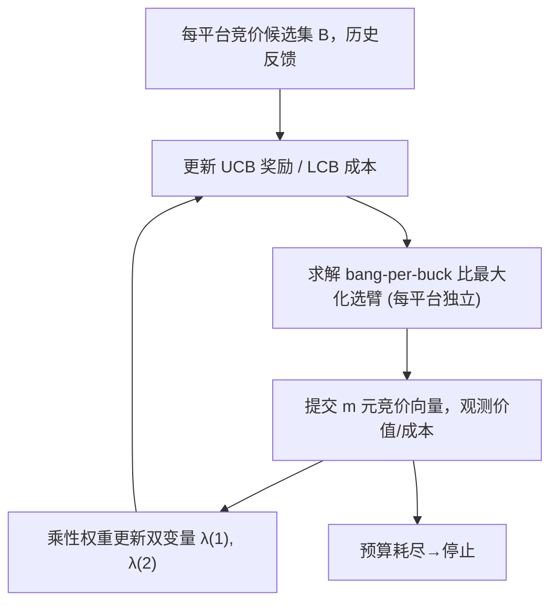

# Stochastic Bandits for Multi-platform Budget Optimization in Online Advertising (在线广告跨平台预算优化的随机赌博机方法)

- **会议/期刊**: WWW 2021
- **作者与机构**: Vashist Avadhanula, Riccardo Colini-Baldeschi, Okke Schrijvers (Facebook Core Data Science); Stefano Leonardi (Sapienza Univ.); Karthik Abinav Sankararaman (Facebook AI Applied Research)
- **推荐链路定位**: 在线竞价与跨平台预算分配（广告投放阶段）
- **研究方向**: 强化学习与动态探索推荐 / 工业架构与可信
- **论文原文**: [https://arxiv.org/abs/2103.10246v2](https://arxiv.org/abs/2103.10246v2)
- **开源代码**: 暂未开源

## TL;DR (1分钟核心速览)

广告主需将单一预算 $B$跨$m$个平台（竞价规则各异、胜率/价值未知）分配投放。本文把问题重构为**组合动作的 Bandits with Knapsacks**，将"$n^m$个竞价向量"压缩为可多项式求解的**每平台单独选臂 + 一击比（bang-per-buck）最大化**算子，避免组合爆炸与每步 LP 舍入。离散竞价空间取得 regret$O(OPT\sqrt{mn/B}+\sqrt{mnOPT})$，连续空间经$\epsilon$-网格离散达$\tilde{O}(m^{1/3}\min\{B^{2/3},(mT)^{2/3}\})$，并给出近乎匹配的下界。在含 10 平台 3 广告主的真实工业日志上，$B\ll T$ 场景 reward 显著高于 UCB 与 LuekerLearn 基线，且预算全程均匀耗尽。

## Background & Motivation (背景与核心矛盾)

- **主流范式**: 单平台预算管理已成熟——一类靠 bid shading/pacing multiplier（如 Balseiro 系），一类靠 Bandits with Knapsacks (BwK, Badanidiyuru et al.) 的原始-对偶算法学习价值并控预算。
- **前人局限**: (1) 多平台场景下竞价组合呈 $n^m$指数爆炸，Sankararaman–Slivkins (SemibwK-RRS) 虽推广到组合动作，但需每轮调用$O((mn)^2)$的舍入子程序不可摊销，且 regret 为$O(\sqrt{T})$而非$\sqrt{OPT}$，在广告实际$OPT\ll T$区制失效。(2) 广告主对跨平台用户转化价值未知，且各平台竞价、竞争强度、价格分布互异，静态/上下文赌博机建模要么需 delayed reward 假设，要么需$B=\Theta(T)$的大预算假设，与实际$B\ll T$ 相悖。
- **核心洞察 (Key Insight)**: 当多平台竞价集合是**分区拟阵 (partition matroid)** 特例时，最优臂搜索可解耦为每平台独立选臂，则可绕开舍入、直接对"价值 UCB / 成本 LCB"比值做有理函数优化；且用 $\sqrt{OPT}$替代$\sqrt{T}$ 才能刻画小预算区制。
- **本文切入点**: 用两资源（真实预算 $B$与轮次资源$B/T$）的原始-对偶 BwK 算法 + 打一比选臂 + 连续空间$\epsilon$-网格离散，得到近最优 regret 与均匀 pacing。

## Method (核心方法设计)

### 1. 整体框架 (Overall Architecture)

每轮 $t$竞价引擎对各平台$i\in[m]$提交竞价向量$b_t=\{b_t(i)\}$，平台$i$执行二价拍卖：若$b_t(i)\ge p_t(i)$（临界价）则胜出、付$p_t(i)$、观测价值$v_t(i)$。算法维护每平台每个竞价$b_j$的奖励 UCB$\bar v^{\text{UCB}}_{ij}$与成本 LCB$\bar c^{\text{LCB}}_{ij}$，在每轮求解"bang-per-buck 最大化"选臂子问题得到最优$m$-元组，据反馈更新置信界与两个对偶变量$\lambda_t(1),\lambda_t(2)$（乘性权重）。收尾时预算耗尽即停止（变量$\tau$）。整个流程只需多项式时间选臂，无舍入、无组合枚举，可直接嵌入毫秒级竞价引擎。

### 2. 关键设计拆解 (Key Designs)

1. **分区拟阵下的 Bang-per-Buck 选臂（绕开组合爆炸）**：痛点在于 $n^m$臂无法穷举，且 SemibwK-RRS 每步舍入不可摊销。本文利用约束$\sum_j \alpha_{ij}=1,\forall i$ 的分区结构，把选臂化为如下有理优化：
$$\max_{\alpha_{ij}\in\{0,1\}} \frac{\sum_{i\in[m]}\sum_{j\in[n]}\bar v^{\text{UCB}}_{ij}\alpha_{ij}}{\lambda_t(1)\sum_{i}\sum_{j}\bar c^{\text{LCB}}_{ij}\alpha_{ij}+\lambda_t(2)\frac{B}{T}}$$
因约束矩阵完全幺模 (totally unimodular)，该问题可多项式求解；等效于逐平台按"UCB/LCB 比"选最优竞价。直觉：把指数组合压缩成 $m$个独立比值排序，性能界只依赖$mn$而非$n^m$。

2. **连续竞价空间的 $\epsilon$-网格离散与误差控制**：真实竞价是$[p_0,1]$上连续值，若直接离散会引入额外损失。Lemma 4.1 证明相邻网格步进使 bang-per-buck 比下降不超过$\epsilon v_0/p_0^2$，故总离散误差仅$B\epsilon v_0/p_0^2$，代入$n=1/\epsilon$ 并平衡后得：
$$\tilde{O}\!\left(\frac{(mv_0)^{1/3}}{p_0^{2/3}}\min\!\left\{\left(\tfrac{Bv_0}{p_0}\right)^{2/3},(mT)^{2/3}\right\}\right)$$
这一分析将连续空间问题化归为可控误差的离散问题，是区别于纯离散算法的关键一步。

3. **训练目标、双资源约束与推理开销**：以 LP 上界 $\text{OPT}_{\text{LP}}$为基准（$\text{OPT}_{\text{LP}}\ge\text{OPT}$），用两资源——真实预算（成本$\sum_i p(i)\mathbb{I}[b(i)\ge p(i)]$）与轮次资源（每轮固定消耗$B/T$）——建模最多$T$轮。对偶变量乘性更新$\lambda_{t+1}(1)=\lambda_t(1)(1+\epsilon)^{c^{\text{LCB}}_{1,x_t}}$，学习率$\epsilon=\sqrt{\ln d/B}$。无需显式负采样；推理只需一次 LP/比值选臂，因可热启动上一轮解，$T$ 轮摊销后平均每轮常数步。

## Experimental Setup & Evaluation Protocol (实验设置与评估协议)

- **数据集与预处理**: 来自某大型互联网广告公司的真实竞价日志，含 10 个平台、3 个受预算约束的广告主；对每个广告主归一化后拟合临界价分布 $P$与价值分布$V$，实验时按分布逐步采样。

| 数据集 | #Platforms | #Advertisers | #Rounds $T$ | 区制 | 场景说明 |
| :--- | :---: | :---: | :---: | :---: | :--- |
| 工业投放日志 | 10 | 3 | $10^5$|$B\ll T$ | 多平台二价拍卖、预算受限 |

- **数据划分与防穿越 (Splitting Strategy)**: 采用**分布拟合 + 同步采样**模拟：从拟合的 $P,V$ 分布每轮重采样临界价与价值，无传统训练/测试划分，属在线仿真，天然无信息穿越。
- **排名评测协议 (Ranking Protocol)**: 非排序评测，而是**累计奖励/regret 对比**：以均值估价与价格上算得的 $\text{OPT}_{\text{LP}}$为参照上限，评价$T$步累计 reward 与预算耗尽时刻；预算$B$与平台数$m$ 均作自变量扫描。
- **对比基线与超参设置**: 基线三类——(1) SemibwK-RRS (Sankararaman–Slivkins)；(2) 忽略预算的朴素 UCB；(3) 多资源版 LuekerLearn（每平台一实例、按 $B_t/m$均分并允许未用预算转移）。竞价空间用$\epsilon$-双曲网格$\frac{1}{1+\epsilon\cdot\ell}$，$T=10^5$，每组 5 次独立运行取均值。

## Key Experimental Results (实验关键数据)

### 1. 主实验对比 (Main Results)

原文以图（Fig.2–4）呈现，此处按区制归纳相对 $\text{OPT}_{\text{LP}}$的表现（$T=10^5$）：

| 算法 | 大预算 $B\sim\Theta(T)$| 小预算$B\ll T$| 平台数大 ($m$ 增) | 平均停时（预算耗尽） |
| :--- | :---: | :---: | :---: | :---: |
| 本文算法 | 与 SOTA 相当 | **最优**（不早停） | **略优于 SOTA** | 接近 $T=10^5$（均匀耗尽） |
| SemiBwK-RRS | 相当 | 次优 | 相当/略逊 | 近 $T$ |
| Naive UCB | 相当 | 明显落后（早耗尽） | 落后 | 远小于 $T$ |
| LuekerLearn(多资源) | 相当 | 落后（早耗尽） | $m$小时追平 | 远小于$T$ |

### 2. 消融/区制扫描 (Regime Sweep)

| 扫描变量 | 观察 | 说明 |
| :--- | :--- | :--- |
| 预算 $B$ 增大 | 三算法 reward 趋同 | 大预算下差异消失，符合理论 |
| 平台数 $m$减小 | LuekerLearn 与本文差距消失 |$m$ 小则贪心式基线足够 |
| 平台数 $m$ 增大 | 本文略胜 SemiBwK-RRS | 理论未预言但经验成立 |
| 停时 vs 预算 | 仅本文/ SemibwK-RRS 跑满 $T$ | 基线很快耗尽预算 |

### 3. 关键实验发现 (Key Findings)

1. **小预算区制决定胜负**：当 $B\ll T$时朴素 UCB 与 LuekerLearn 因预算过早耗尽，累计 reward 显著低于本文；预算增大到$B\sim\Theta(T)$后三者趋同——与 regret 界$O(OPT\sqrt{mn/B})$对$B$ 的依赖一致。
2. **均匀 pacing 是工程验收硬指标**：Fig.4 显示基线在一个小时间比例内就耗尽预算，而本文算法全程均匀消耗至 $T=10^5$。广告主期望预算在整天平稳投放，故即便基线偶获更高 reward，其早停行为也使其不可部署。
3. **平台数缩放验证组合结构价值**：随 $m$增大，本文与 SemiBwK-RRS 的差距略有拉开且显著优于 LuekerLearn，印证 partition-matroid 解耦替代舍入子程序在$m$增大时更有效；而$m$ 小时差距消失说明增益主要来自多平台组合而非单平台学习。

## Highlights & Limitations (亮点、对比与审稿批判)

- **与代表作对比 (vs. Prior Work)**: 相较 Sankararaman–Slivkins (SemibwK-RRS) 的通用拟阵+每步舍入 $O((mn)^2)$，本文针对分区拟阵特例去掉舍入、把 regret 从$\sqrt{T}$降到$\sqrt{OPT}$；相较 Auer/Flajolet–Jaillet 的单平台连续竞价，本文扩展到$m$ 平台且**不需知道是否赢得拍卖**（仅需价值/成本反馈），更贴合真实系统的 checks-and-balances。
- **可迁移亮点**: (1) "指数组合臂 → 分区拟阵解耦为逐平台独立比值选臂"的技巧可迁移到多场景联合出价/多资源分配；(2) 双资源（真实预算 + 轮次预算）建模 + 热启动摊销 LP 的思路可直接用于毫秒级竞价引擎的 pacing 模块。
- **审稿级局限批判**: (1) 实验基于从分布**同步采样**的仿真数据而非线上 A/B，缺少真实竞价动态、跨平台相关性与延迟反馈的检验，结论的工程外推性受限；(2) 连续空间需已知 reserve 下界 $p_0$与$v_0$，且每轮仍解 LP，超参 ($\epsilon$,$C_{rad}$) 与网格选择敏感，理论$\tilde{O}$中隐藏的对$\log$项在超大$mn$ 时可能显现实开销。

## Rating (四维评分)

- **方法创新性 (Novelty)**: ⭐⭐⭐⭐ （用分区拟阵特例绕开舍入、以 $\sqrt{OPT}$ 刻画小预算区制，并配近乎匹配的下界，理论贡献扎实）
- **评估协议与实验扎实度 (Protocol & Experiments)**: ⭐⭐⭐ （真实工业日志 + 多区制扫描到位，但为分布拟合仿真、无线上 A/B 与显著性检验）
- **写作与数学规范度 (Clarity & Rigor)**: ⭐⭐⭐⭐ （regret 上/下界推导完整、定理清晰；LP 与双变量记号虽多但自洽）
- **工业落地与复现价值 (Industrial & Practical Value)**: ⭐⭐⭐⭐ （面向真实竞价引擎的均匀 pacing 与热启动摊销设计极具部署价值，惜无开源代码）

