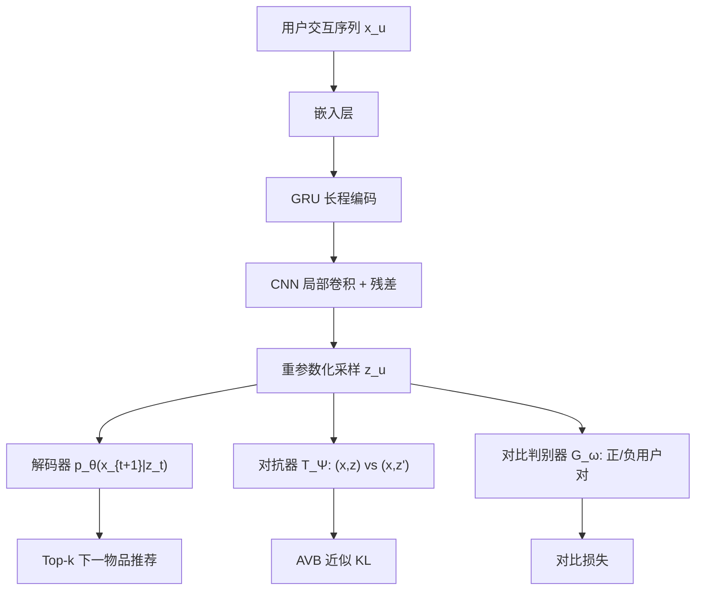
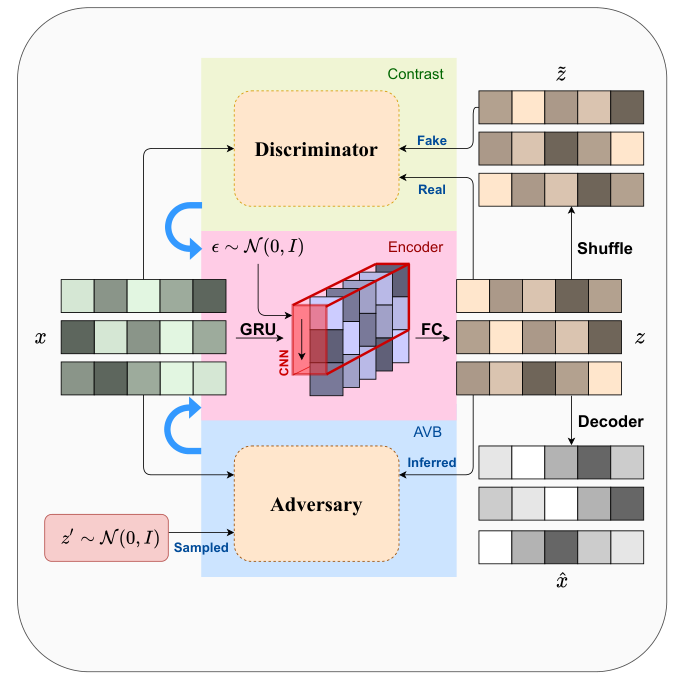

# Adversarial and Contrastive Variational Autoencoder for Sequential Recommendation (对抗与对比变分自编码器用于序列推荐)

- **会议/期刊**: WWW 2021 (The Web Conference)
- **作者与机构**: Zhe Xie, Chengxuan Liu, Yichi Zhang, Hongtao Lu, Dong Wang, Yue Ding；上海交通大学等
- **推荐链路定位**: 召回/排序（下一物品预测）
- **研究方向**: 序列与会话推荐 / 生成式推荐 / 自监督对比学习
- **论文原文**: [论文原文链接](https://arxiv.org/abs/2103.10693v1)
- **开源代码**: [ACVAE-PyTorch](https://github.com/ACVAE/ACVAE-PyTorch)

## TL;DR (1分钟核心速览)

针对SVAE隐变量后验表征弱、维度相关高、用户个性化不足的痛点，ACVAE在序列VAE中引入AVB对抗近似KL与用户级对比损失，并用GRU-CNN编码器同时捕捉长程依赖与局部转移；在4个数据集Top-k排序上相对SVAE最高提升约23.7% NDCG@5（ML-1m）。

## Background & Motivation (背景与核心矛盾)

- **主流范式**: 序列推荐以RNN/CNN/自注意力建模下一物品；VAE系SVAE用GRU编码用户序列、以多项分布解码，通过序列重构获得生成能力。
- **前人局限**: ①显式高斯KL假设使近似后验过于简单，隐变量各维高度相关，生成样本质量受限；②纯重构目标易忽略不同用户间的显著个性化差异，且GRU对相邻物品的局部转移不敏感。
- **核心洞察 (Key Insight)**: 作者用二维采样例子说明：KL相同的数据仍可能具有不同维度相关性，而判别器能区分“真实独立”与“虚假相关”；AVB的隐式KL可降低隐变量维度相关性。
- **本文切入点**: 以AVB替代显式KL、以对比损失约束用户隐变量区分度、以CNN补足局部序列模式。

## Method (核心方法设计)

### 1. 整体框架 (Overall Architecture)

输入用户交互序列 $\mathbf{x}_u$，经嵌入层后由GRU捕获长程依赖，再由带残差的CNN卷积层捕获相邻物品局部转移，全连接层输出隐变量$\mathbf{z}_{u,t}$；解码器以多项分布重构下一物品。与此同时，对抗器$T_\Psi$区分$(\mathbf{x}_u,\mathbf{z}_u)$与先验采样$(\mathbf{x}_u,\mathbf{z}')$，用于AVB近似KL；对比判别器$G_\omega$ 区分正用户对与跨用户负对，强化个性化。训练时对抗器与编码器/解码器交替优化，对比项与VAE目标联合优化。

<figure class="paper-figure" markdown="span">
  <figcaption>图 1：ACVAE 的结构。该模型在 VAE 的编码器中采用 CNN 层。(𝑥,𝑧) 和 (𝑥, ˜𝑧) 对被送入判别器，由其计算对比损失。(𝑥,𝑧) 和 (𝑥,𝑧′) 对被送入对抗器，由其计算近似 KL 散度。判别器和对抗器均可通过反向传播优化编码器的参数。</figcaption>
</figure>
*图1：ACVAE整体结构：RNN-CNN编码器、AVB对抗器与对比判别器共享隐变量。*

### 2. 关键设计拆解 (Key Designs)

1. **AVB对抗式近似KL（降低隐变量维度相关）**：痛点来自显式高斯KL无法惩罚维度相关。ACVAE训练判别器 $T_\Psi$区分后验对与先验对，最优判别器满足$T_\Psi^*(\mathbf{x}_u,\mathbf{z}_u)_t=\log q_\phi(\mathbf{z}_{u,t}|\mathbf{x}_{u,[1:t]})-\log p(\mathbf{z}_{u,t})$，再用其替代KL项：
   $\mathcal{L}_{\mathrm{AVB}}=\mathbb{E}_{\mathbf{x},\epsilon}[\log p_\theta(x_{u,t+1}|\mathbf{z}_\phi(\mathbf{x}_{u,[1:t]},\epsilon))-\alpha T_\Psi^*(\mathbf{x}_u,\mathbf{z}_\phi(\mathbf{x}_u,\epsilon)_t)]$。
   直觉：判别器能捕捉KL忽略的相关结构，使隐变量更独立、生成先验更灵活；作者用 $corr=\sum_i\sum_j c_{ij}^2$ 量化非对角相关，图4中AVB版本在四个数据集上均更低。
2. **用户级对比损失（强化个性化显著特征）**：纯重构目标可能把用户共性当成全部信息。定义正对 $(\mathbf{x}_u,\mathbf{z}_u)$与跨用户负对$(\mathbf{x}_u,\tilde{\mathbf{z}}_{u'})$，最小化
   $\mathcal{L}_{\omega,\phi}=-\sum_t[\mathbb{E}_{\mathbf{z}_u\sim Q_\phi}\log\sigma(G_\omega(\mathbf{x}_u,\mathbf{z}_u)_t)+\mathbb{E}_{\tilde{\mathbf{z}}_{u'}\sim Q_\phi(\cdot|\mathbf{x}_{u'})}\log(1-\sigma(G_\omega(\mathbf{x}_u,\tilde{\mathbf{z}}_{u'})_t))]$。
   直觉：迫使编码器把“该用户独有”的信息写入隐变量，而非仅重建流行物品。
3. **RNN-CNN编码器（补足局部转移）**：GRU输出 $h_{u,t}=\xi(\mathrm{GRU}_\phi(x_{u,t},h_{u,t-1}))$后，用垂直卷积核$\mathbf{f}_v\in\mathbb{R}^{m\times1}$在序列上卷积；零填充全部放在真实数据之前，避免第$t+1$个物品信息泄漏到第$t$ 步。直觉：CNN显式建模相邻物品的短程共现，与GRU长程依赖互补。

**训练目标、负采样与推理效率**：总目标为
$\max_{\phi,\theta,\omega}\sum_t\mathbb{E}_{\mathbf{x},\epsilon}[\log p_\theta(x_{u,t+1}|\mathbf{z}_\phi(\mathbf{x}_{u,[1:t]},\epsilon))-\alpha T_\Psi^*(\mathbf{x}_u,\mathbf{z}_\phi(\mathbf{x}_u,\epsilon)_t)-\beta\mathcal{L}_{\omega,\phi}(\mathbf{x}_u,\mathbf{z}_\phi(\mathbf{x}_u,\epsilon)_t)]$，
并最大化对抗器目标；二者交替更新。解码器对全物品做softmax，**免物品负采样**；对比负例来自其他用户隐变量。推理时编码历史序列、解码下一物品分布并取Top-k，隐变量64维、GRU 100维、嵌入128维，额外开销主要来自对抗训练。

## Experimental Setup & Evaluation Protocol (实验设置与评估协议)

- **数据集与预处理**: 评分>3视为正交互；过滤交互数<5的用户与物品；全部转为隐式反馈。

| 数据集 | #Users | #Items | #Interactions | 平均序列长度 | 稀疏度 |
| :--- | ---: | ---: | ---: | ---: | ---: |
| ML-latest | 604 | 7.4K | 46K | 76.2 | 98.9% |
| ML-1m | 6K | 3.5K | 580K | 95.3 | 97.3% |
| ML-10m | 69K | 10K | 4.7M | 67.8 | 99.3% |
| Yelp | 51K | 32K | 557K | 11.0 | 99.9% |

- **数据划分与防穿越 (Splitting Strategy)**: 按用户交互序列做 **8:2 比例划分**，前80%训练、后20%测试；以训练序列预测下一物品，属于时序切分而非Leave-One-Out。
- **排名评测协议 (Ranking Protocol)**: 原文称Top-k item recommendation，采用Recall@5/10/20、NDCG@5/10/20、MRR@5/10/20；**候选集构造与采样负例比例未明示**，按模型全物品softmax推断为全库排序，严格复现需作者补充协议。
- **对比基线与超参设置**: 基线含POP、FPMC、Caser、GRU4Rec+、BERT4Rec、CFGAN、Mult-VAE、SVAE；嵌入128、GRU 100、隐变量64，VAE用Adam $1e{-4}$，对抗/对比网络用SGD$5e{-4}$；$\alpha=0.05$、$\beta=0.5$为ML-1m最佳；**未报告显著性检验**。

## Key Experimental Results (实验关键数据)

### 1. 主实验对比 (Main Results)

ML-1m 上ACVAE全面最优（原文表2；其余数据集同趋势）：

| 方法 | R@5 | N@5 | R@10 | N@10 | R@20 | N@20 |
| :--- | ---: | ---: | ---: | ---: | ---: | ---: |
| POP | 0.024 | 0.077 | 0.043 | 0.076 | 0.088 | 0.087 |
| FPMC | 0.065 | 0.133 | 0.113 | 0.141 | 0.180 | 0.158 |
| Caser | 0.066 | 0.139 | 0.114 | 0.146 | 0.186 | 0.164 |
| GRU4Rec+ | 0.064 | 0.125 | 0.104 | 0.127 | 0.165 | 0.141 |
| BERT4Rec | 0.053 | 0.104 | 0.092 | 0.110 | 0.154 | 0.128 |
| CFGAN | 0.033 | 0.073 | 0.062 | 0.079 | 0.111 | 0.094 |
| Mult-VAE | 0.029 | 0.060 | 0.063 | 0.069 | 0.114 | 0.085 |
| SVAE | 0.077 | 0.152 | 0.129 | 0.157 | 0.207 | 0.176 |
| **ACVAE** | **0.095** | **0.188** | **0.158** | **0.192** | **0.244** | **0.212** |
| **Improv. vs SVAE** | **+23.4%** | **+23.7%** | **+22.5%** | **+22.3%** | **+17.9%** | **+20.5%** |

### 2. 消融实验 (Ablation Study)

原文图3以Recall@10曲线呈现（未给逐点数值），趋势可归纳为：

| 变体 | 图3曲线相对表现 | 归因 |
| :--- | :--- | :--- |
| w/o AVB | 四个数据集均最低 | 隐变量维度相关性升高，生成先验约束不足 |
| w/o Contrast | 低于完整模型 | 用户间隐变量区分度下降，个性化信息变弱 |
| w/o CNN | 低于完整模型，短序列Yelp更明显 | 丢失相邻物品局部转移 |
| ACVAE | 最高且最稳 | 三组件互补 |

### 3. 关键实验发现 (Key Findings)

1. **ML-1m上AVB+对比带来最大增益**：ACVAE相对最强基线SVAE的R@5从0.077升至0.095（+23.4%），N@5从0.152升至0.188（+23.7%），说明隐变量质量是序列VAE的关键瓶颈。
2. **中等规模数据集收益更显著**：ML-latest上R@20达0.145，较SVAE的0.120提升20.8%；而ML-10m上R@5仅从0.109升至0.112（+2.8%），大规模长序列下SVAE本身已很强，对抗/对比正则的边际收益收窄。
3. **短序列极稀疏场景仍获益但绝对值低**：Yelp上R@20为0.066 vs SVAE 0.057（+15.8%），绝对增益仅0.009；消融曲线显示CNN对短序列更重要，但极稀疏短序列仍是难点。

## Highlights & Limitations (亮点、对比与审稿批判)

- **与代表作对比 (vs. Prior Work)**: 与SVAE同属序列VAE，但SVAE仅用GRU+显式KL，ACVAE用AVB隐式KL+对比+CNN；ML-1m R@5 0.095 vs 0.077。与BERT4Rec相比，ACVAE仅单向、无全局自注意力，却以R@5 0.095 vs 0.053大幅领先，说明高质量隐变量比复杂序列编码器更关键。与Caser/GRU4Rec+等判别式模型相比，生成式重构+对抗正则带来更稳健的Top-k排序。
- **可迁移亮点**: AVB判别器可作为“灵活KL替代器”迁移到其他VAE召回；跨用户隐变量对比正则可用于增强生成式推荐的个性化；卷积零填充前置是避免序列标签泄漏的实用技巧。
- **审稿级局限批判**: ①对抗训练需交替优化 $T_\Psi$与编码器，训练不稳定且开销高于SVAE；②$\alpha,\beta$敏感（ML-1m最佳$\alpha=0.05,\beta=0.5$），且未报告显著性检验与完整候选集协议；③仅验证下一物品预测，未覆盖冷启动、长尾与线上A/B，跨用户负例可能偏易。

## Rating (四维评分)

- **方法创新性 (Novelty)**: ⭐⭐⭐⭐ （将AVB隐式KL与用户级对比损失同时引入序列VAE，动机例子与相关性分析有说服力）
- **评估协议与实验扎实度 (Protocol & Experiments)**: ⭐⭐⭐ （四个数据集、八个基线较完整，但候选集/采样协议未明示且无显著性检验）
- **写作与数学规范度 (Clarity & Rigor)**: ⭐⭐⭐⭐ （AVB推导与交替训练算法清晰，部分符号与公式排版略有不一致）
- **工业落地与复现价值 (Industrial & Practical Value)**: ⭐⭐⭐ （开源代码可复现，但对抗训练成本、超参敏感与推理额外开销限制大规模部署）

