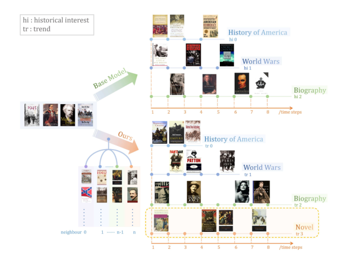
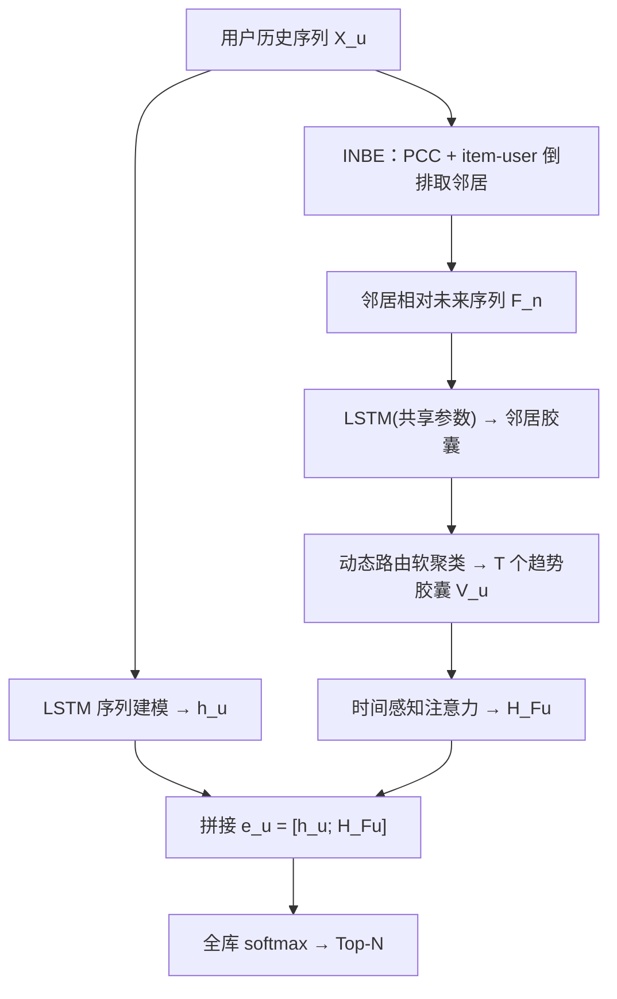

# Future-Aware Diverse Trends Framework for Recommendation (未来感知的多样化趋势推荐框架)

- **会议/期刊**: WWW 2021 (The Web Conference)
- **作者与机构**: Yujie Lu, Shengyu Zhang, Yingxuan Huang, Luyao Wang, Xinyao Yu, Zhou Zhao, Fei Wu（腾讯 / 浙江大学）
- **推荐链路定位**: 精排（用户表征 → Top-N 排序）
- **研究方向**: 序列与会话推荐 / 协同过滤与双塔召回
- **论文原文**: [https://arxiv.org/abs/2011.00422v2](https://arxiv.org/abs/2011.00422v2)
- **开源代码**: 暂未开源

## TL;DR (1分钟核心速览)

序列推荐只从"用户自己的历史"推未来偏好，遇到用户兴趣随时间演化、需要推荐"新鲜品类"时就会失效。本文提出 FAT：以目标的锚点物品从 item-user 倒排召回相似用户，截取其**该物品之后的相对未来行为**作为"未来序列"，再用**胶囊动态路由**把邻居未来行为软聚类成 $T$ 个趋势向量，配合**时间感知注意力**按预测时刻选择最相关的趋势，与 LSTM 历史表征拼接后全库 softmax 排序。在 Amazon Books/Steam/ML-1M 的 Full-Ranking 协议下，Recall@50 分别达 7.882 / 4.017 / 34.288，相对最强基线 ComiRec 提升 9.4% / 1.0% / 1.0%，Diversity@50 亦全面领先。

## Background & Motivation (背景与核心矛盾)

- **主流范式**: GRU4Rec/LSTM 类模型把用户历史序列压成**单一**定长向量；DIN/注意力类按目标物品调节权重；MIND/ComiRec 用胶囊路由把历史行为拆成**多兴趣**向量。三者输入都只有 $X_u$。
- **前人局限**: ①**时间演化缺失**——偏好是演进的，仅建模历史偏好无法刻画"接下来会喜欢什么新品类"；②**单向量压缩**——把多样化兴趣压成一个向量（Base/YouTubeDNN）或仅靠历史多兴趣（MIND/ComiRec），都无法引入"超出用户历史分布"的新鲜物品，推荐结果高度同质。
- **核心洞察 (Key Insight)**: 相似用户在未来会走相似的路。若用户 $u$与邻居$n$共同交互过锚点物品$s_{t'}$，那么$n$在$s_{t'}$**之后**的行为就可以视作$u$ 的"相对未来"，且这类未来天然是**多分支**的（不同邻居走向不同趋势）。
- **本文切入点**: 把"未来"从相似的他人序列里借过来（future-aware），并用多胶囊 + 时间注意力把借来的未来拆成多条趋势（diverse trends）。见 图 1：历史只含历史类书籍，趋势可推出科幻/艺术等历史序列中不存在的品类。

<figure class="paper-figure" markdown="span">
  <figcaption>图1：我们的模型与基础模型的示意图。左侧浅蓝色序列为用户点击的历史序列。右侧“History of America”等标签表示物品类别，下方黄色框突出显示的是新物品，其类别未在历史序列中出现，但可由趋势推断。</figcaption>
</figure>

## Method (核心方法设计)

### 1. 整体框架 (Overall Architecture)

FAT 由五段构成：①**序列建模层**（共享参数的 LSTM）分别编码用户历史 $X_u$得$\mathbf{h}_u$与邻居相对未来序列$F_n$得邻居表征；②**隐式邻居抽取器 (INBE)** 用 PCC 相似度 + item-user 倒排为每个用户构造邻居集合与相对未来序列；③**多样化趋势捕获层**把邻居未来行为视作 primary capsules，经 Neighbor-to-interest 动态路由聚成$T$个趋势胶囊$V_u=[\mathbf{v}_1,\dots,\mathbf{v}_T]$；④**时间感知注意力层**按时间差为$T$条趋势加权，得到未来趋势表征$\mathbf{H}_{F_u}$；⑤与$\mathbf{h}_u$ 拼接成最终用户向量，与物品向量内积后全库 softmax 输出 Top-N。

### 2. 关键设计拆解 (Key Designs)

1. **隐式邻居与相对未来序列 (INBE)**：没有显式社交关系，就用行为共现造邻居。以 PCC 计算用户相似度并线性映射到 $[0,1]$：

$$s_{ij}=\frac{\sum_{k\in I(i)\cap I(j)}(r_{ik}-\bar{r}_i)(r_{jk}-\bar{r}_j)}{\sqrt{\sum_{k}(r_{ik}-\bar{r}_i)^2}\sqrt{\sum_k (r_{jk}-\bar{r}_j)^2}},\quad f(s)=(s+1)/2$$

   随后以用户最后 $K$个物品$s_{t'}$为 key 从 item-user 倒排取回候选邻居，并截取其后行为：$F_u=\{s_i \in I_n \mid R(s_i)\ge R(s_{t'})\}$。直觉：共同交互过锚点描述"兴趣同源"，锚点之后的行为描述"兴趣将要往哪走"。为兼顾多样性又不过度失真，仅有单个共同物品的邻居只保留 20% 以下。

2. **Neighbor-to-interest 动态路由 (趋势解耦)**：单向量是瓶颈——把所有邻居压成一个向量会让不同动机相互抵消。作者改用胶囊路由做**软聚类**：

$$\hat{\mathbf{e}}_{j|i}=W_{ij}\mathbf{e}_i,\quad s_j=\sum_i c_{ij}\hat{\mathbf{e}}_{j|i},\quad c_{ij}=\frac{\exp(b_{ij})}{\sum_k \exp(b_{ik})},\quad \mathbf{v}_j=\frac{\lVert s_j\rVert^2}{1+\lVert s_j\rVert^2}\frac{s_j}{\lVert s_j\rVert}$$

   与图像路由的区别在于胶囊语义来自邻居序列而非局部特征，$b_{ij}$用历史序列建模得到而非随机初始化。耦合系数$c_{ij}$ 天然可解释：某条未来行为在哪条趋势上耦合系数最大，就归属该趋势（图 3 热力图显示用户的"历史/科学/艺术"三次后续交互分别落在不同胶囊上）。

3. **时间感知注意力与训练目标**：不同趋势的"时效"不同，用时间差作为注意力查询：$\mathbf{H}_{F_u}=\mathbf{t}_u\odot \mathrm{softmax}(\mathrm{pow}(\mathbf{T}_i,\mathbf{T}_{tr}))$，其中$\mathbf{T}_i$为预测时刻与目标物品交互时间，$\mathbf{T}_{tr}$为该趋势下物品的平均交互时间，$\mathbf{t}_u$为趋势表征。最终$\mathbf{e}_u=[\mathbf{h}_u;\mathbf{H}_{F_u}]$，目标为全物品 softmax 的极大似然：

$$\mathcal{L}=-\sum_{(i,u)}\log\frac{\exp(\mathbf{e}_u^{\top}\mathbf{e}_i)}{\sum_{v\in V}\exp(\mathbf{e}_u^{\top}\mathbf{e}_v)}$$

   论文未显式引入负采样（形式上为全库 softmax），推理为一次 DNN 前向 + ANN 检索；复杂度为序列层 $O(knd^2)$、胶囊层$O(nTr^2)$，作者建议用 momentum encoder 与轻量胶囊网络压到工业可接受量级。

## Experimental Setup & Evaluation Protocol (实验设置与评估协议)

- **数据集与预处理**:

| 数据集 | #Users | #Items | #Interactions | 过滤规则 |
| :--- | :---: | :---: | :---: | :--- |
| Amazon Books | 459,133 | 313,966 | 8,898,041 | 用户/物品均 ≥10 |
| Steam | 2,567,538 | 15,474 | 7,793,069 | 用户/物品均 ≥10 |
| MovieLens-1M | 6,040 | 3,416 | 999,611 | 用户 ≥10、物品 ≥3 |

- **数据划分与防穿越**: 按**比例划分** $8:1:1$（每用户），非标准 `Leave-One-Out`；当前样本用前$k$个行为预测第$k+1$ 个（prefix 建模）。评估时为用户**随机**抽取一个交互作为 target，其之前的交互作为历史——这与训练目标并不完全一致，属于该文评估协议的一个弱点。
- **排名评测协议**: 采用**全物品 softmax 概率排序**（文中明确"outputs the probabilities for all the items"，属 Full-Ranking 无偏排序），指标为 Recall@{20,50} 与 NDCG@{20,50}，Per-user 平均；多样性用基于类别的 intra-list Diversity@50。
- **对比基线与超参**: GRU4Rec、YouTubeDNN、MIND、ComiRec，以及消融用的 Base Model（FAT 去趋势模块的纯 LSTM）；默认 $K=1$、趋势数$T=6$、物品/用户 embedding 同维$d$，Adam 优化，TensorFlow + 4 GPU 分布式训练；未报告显著性检验。

## Key Experimental Results (实验关键数据)

### 1. 主实验对比 (Main Results)

Metrics@50（括号内为相对最强基线 ComiRec 的 `Improv.`）：

| Model | Amazon R@50 | Amazon N@50 | Steam R@50 | Steam N@50 | ML-1M R@50 | ML-1M N@50 |
| :--- | :---: | :---: | :---: | :---: | :---: | :---: |
| GRU4Rec | 5.328 | 7.075 | 3.415 | 4.224 | 33.233 | 33.636 |
| YouTubeDNN | 6.612 | 7.623 | 3.667 | 4.373 | 33.592 | 33.847 |
| MIND | 6.638 | 7.830 | 3.671 | 4.591 | 33.685 | 34.783 |
| ComiRec | 7.203 | 8.120 | 3.977 | 4.792 | 33.955 | 34.984 |
| Base Model (LSTM) | 4.872 | 6.721 | 3.217 | 4.123 | 33.315 | 33.132 |
| **FAT** | **7.882 (+9.4%)** | **8.882 (+9.4%)** | **4.017 (+1.0%)** | **4.954 (+3.4%)** | **34.288 (+1.0%)** | **35.166 (+0.5%)** |

Metrics@20 方面 FAT 同样领先（Amazon 4.923/6.612、ML-1M 25.016/26.502），但 **Steam Recall@20 为 3.428，略低于 ComiRec 的 3.464**——提升并非全指标一致。

### 2. 消融实验 (Ablation Study)

| 变体 | Amazon R@50 / N@50 | Steam R@50 / N@50 | ML-1M R@50 / N@50 |
| :--- | :---: | :---: | :---: |
| FAT ($T$=2) | 4.042 / 4.428 | 2.232 / 2.623 | 20.329 / 22.981 |
| FAT ($T$=4) | 5.993 / 6.728 | 3.017 / 3.693 | 27.981 / 28.989 |
| **FAT ($T$=6)** | **7.882 / 8.882** | **4.017 / 4.954** | **34.288 / 35.166** |
| FAT ($T$=8) | 6.982 / 7.842 | 3.107 / 4.125 | 31.973 / 32.887 |
| FAT ($K$=1) | 7.882 / 8.882 | 4.017 / 4.954 | 34.288 / 35.166 |
| **FAT ($K$=3)** | **8.512 / 9.343** | **5.431 / 5.735** | **35.890 / 36.192** |
| FAT ($K$=5) | 8.482 / 8.912 | 5.117 / 5.654 | 35.588 / 35.894 |
| Diversity@50: Base / MIND / ComiRec / **FAT** | 33.95 / 39.97 / 42.92 / **43.59** | 35.48 / 44.98 / 45.95 / **46.65** | 15.75 / 27.50 / 28.96 / **29.27** |

### 3. 关键实验发现 (Key Findings)

1. **趋势数是"匹配兴趣基数"的超参而非越多越好**：$T$从 4 增到 6，Amazon Recall@50 由 5.993 跃至 7.882（+31.5%），但$T=8$ 反降至 6.982（−11.4%），三数据集同构——说明过多胶囊把邻居未来切成冗余碎片，路由输入被稀释。
2. **极少锚点即可捕获趋势，多则边际递减**：$K$从 1→3 带来 Amazon R@50 7.882→8.512（+8.0%）、Steam 4.017→5.431（+35.2%），但$K$=3→5 时 Amazon NDCG 反从 9.343 跌到 8.912，验证"3 个锚点已足够刻画未来方向"，继续加锚点只是引入噪声邻居。
3. **趋势模块带来的是"新鲜度"而非仅"相似度"**：Diversity@50 上 FAT (43.59) 既超强基线 ComiRec (42.92)，更比同架构 Base (33.95) 高 28.4%，与 图 4 的召回分布一致——不同趋势胶囊召回明显不同的物品子集，说明增益来自跨品类的新物品召回，而非把已热门的历史同类物品排得更高。

## Highlights & Limitations (亮点、对比与审稿批判)

- **与代表作对比 (vs. Prior Work)**: 相比 MIND/ComiRec 的"多兴趣"，FAT 的多向量来自**他人的未来行为**而非本人历史，因而是外源、前瞻的；相比 RRN/DREAM 的序列动态建模，FAT 引入了跨用户的趋势先验；相比同期利用未来数据的工作（如 encoder-decoder 融合未来），FAT 不需要真实未来标签，而是用"邻居的相对未来"作为可得的替代信号。
- **可迁移亮点**: ①「以锚点物品为 key 的 item-user 倒排 + 时间戳截断」是一种极低成本的伪未来序列构造法，可直接迁移到短视频/电商的新品冷启动召回；②把邻居集合当胶囊做软聚类，为"多兴趣 + 可解释归因"提供了统一出口（耦合系数即解释）。
- **审稿级局限批判**: ①**潜在时间穿越**：$F_u=\{s_i \mid R(s_i)\ge R(s_{t'})\}$只设了下界，未把上界约束在"预测时刻"之内，邻居在预测时刻之后的行为会被当作已知未来使用，离线指标可能被系统性抬高；②**工程成本与稳定性**：每个用户需 PCC 近邻 + 邻居序列 LSTM 编码 + 动态路由，热门锚点物品的邻居集合可能爆炸，且$T$、$K$需按数据集调优（$T=6$、$K=3$ 均为人工选定），线上部署需额外邻居缓存与截断策略；③Steam Recall@20 未超 ComiRec，说明收益在稀疏/高噪声数据上并不稳健，且全文未报告显著性检验与随机种子方差。

## Rating (四维评分)

- **方法创新性 (Novelty)**: ⭐⭐⭐⭐ （"借他人未来 + 胶囊软聚类成多趋势"在 2021 年属新颖组合，但胶囊路由与时间注意力的算子本身借鉴 MIND，理论分析缺失）
- **评估协议与实验扎实度 (Protocol & Experiments)**: ⭐⭐⭐ （三数据集 + Full-Ranking + 趋势/锚点/多样性多维消融较完整，但随机 target 抽取与未来序列无时间上界使协议可信度打折，无显著性检验）
- **写作与数学规范度 (Clarity & Rigor)**: ⭐⭐⭐ （整体流程清晰、案例可视化到位，但注意力公式 $\mathrm{pow}(\cdot)$ 定义含糊、符号在正文与公式间不一致，复杂度分析仅一笔带过）
- **工业落地与复现价值 (Industrial & Practical Value)**: ⭐⭐⭐ （邻居构造与推理链路工程可行、可解释性强，但无开源代码、邻居缓存与两阶段编码开销较大，落地需较多改造）

