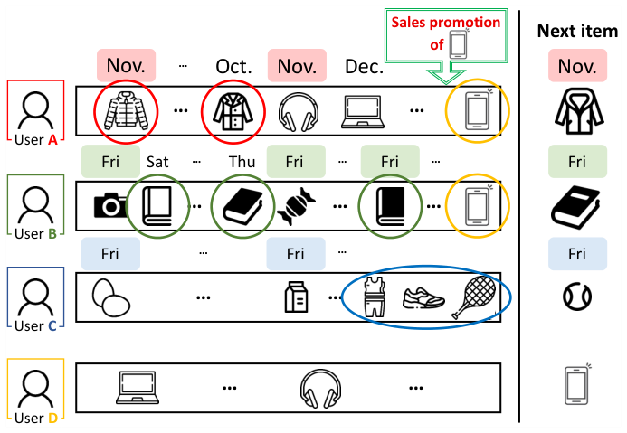
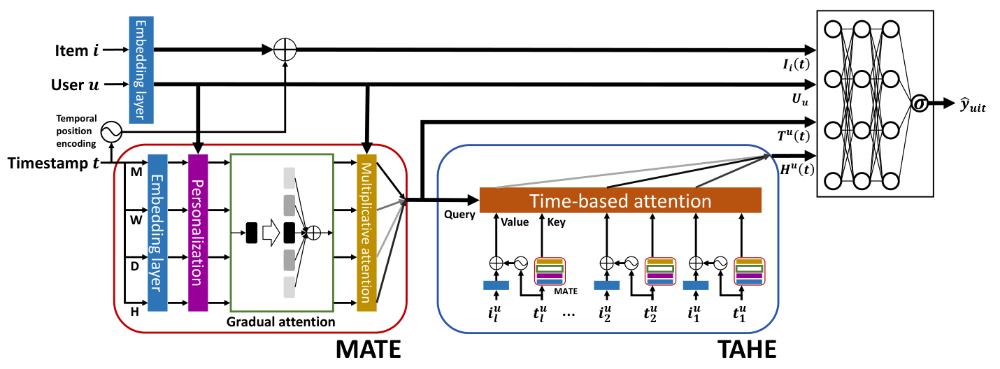
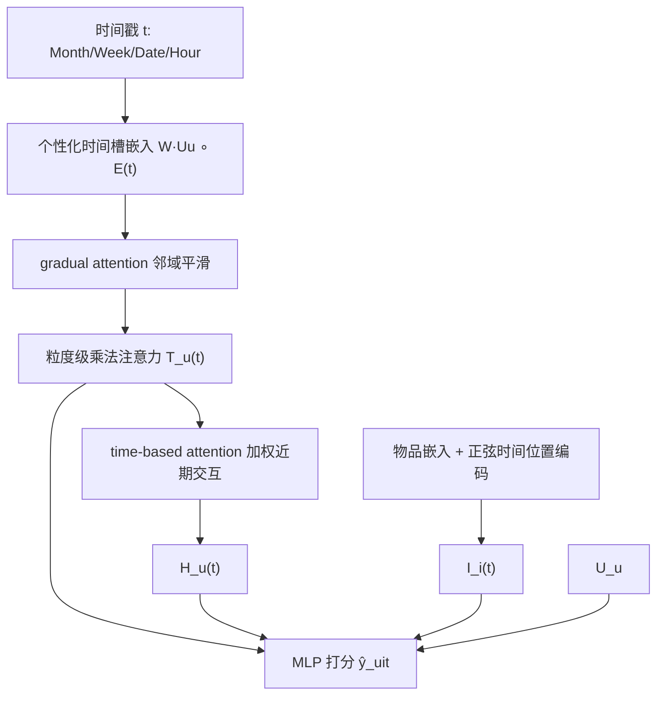

# Learning Heterogeneous Temporal Patterns of User Preference for Timely Recommendation (面向适时推荐的用户偏好异构时间模式学习)

- **会议/期刊**: The Web Conference (WWW) 2021
- **作者与机构**: Junsu Cho, Dongmin Hyun, SeongKu Kang, Hwanjo Yu (POSTECH)
- **推荐链路定位**: 精排（点式交互概率打分，含时机预测）
- **研究方向**: 序列与会话推荐 / CTR 特征交叉
- **论文原文**: [https://arxiv.org/abs/2104.14200v1](https://arxiv.org/abs/2104.14200v1)
- **开源代码**: 暂未开源

## TL;DR (1分钟核心速览)

现有时间感知推荐把时间当作**单一类型特征**与用户偏好做关联，无法同时刻画“周期性”与“演化性”两种异构时间模式。本文提出 TimelyRec：MATE 用个性化 + 渐进注意力编码月/周/日/时四个粒度并自适应融合，TAHE 用时间基注意力挑选与目标时刻周期相似的近期交互、并加正弦时间位置编码刻画物品流行趋势。在 LOO + 100 负采样（时机任务 300 负样本）协议下，MovieLens/Amazon Books/LastFM 上物品推荐 HR@10 相对最优基线提升 3.74%–14.71%，新提出的物品-时机推荐任务上最高提升 48.26%。

## Background & Motivation (背景与核心矛盾)

- **主流范式**: 一类工作（PITF、CoNCARS）把时间槽做张量分解或多粒度拼接以捕捉周期性；另一类（TimeLSTM、SLi-Rec、TiSASRec）用时间间隔门控或自注意力建模近期交互带来的偏好演化。
- **前人局限**: ① 周期性方法把月/周/日/时**平铺直叙地合并**，既忽略“同一时刻对不同用户意义不同”，也无法处理“略微偏离规律”的弱不规则行为；② 演化性方法只用时间**间隔**，不把时间与物品关联，因而看不到物品自身的流行趋势（如促销、上映），也不建模周期性。
- **核心洞察 (Key Insight)**: 周期性有三条独有性质——多粒度、弱不规则、强个性化；演化性有两类关键事件——用户近期交互与物品层面的时间趋势。二者必须由**两个独立编码器级联**分别处理，而非压成一个时间特征。
- **本文切入点**: 用“个性化时间槽嵌入 + 渐进注意力”解周期，用“以 MATE 输出为查询的时间基注意力 + 正弦位置编码”解演化。

<figure class="paper-figure" markdown="span">
  <figcaption>图1：用户购买序列示例。每种颜色的圆圈表示与对应用户下一物品相关的物品。</figcaption>
</figure>

## Method (核心方法设计)

### 1. 整体框架 (Overall Architecture)

输入三元组 $(u,i,t)$，输出$u$在$t$时刻与$i$交互的概率。MATE 先把时间戳$t$拆成 Month/DayOfWeek/Date/Hour 四粒度，各自与用户嵌入做 Hadamard 个性化，再用渐进注意力把邻近槽位按距离平滑聚合，最后以用户为查询对四粒度做乘法注意力加权得到$T_u(t)$。TAHE 以$T_u(t)$为查询，对用户最近$l$条交互的时间表示算余弦相似度，加权聚合成历史表示$H_u(t)$；同时把正弦时间位置编码加到物品嵌入上得到$I_i(t)$。四路表示拼接后经 MLP + sigmoid 打分，以 BCE 训练。

<figure class="paper-figure" markdown="span">
  <figcaption>图2：TimelyRec 的模型架构。M：月，W：星期几，D：日期，H：小时。</figcaption>
</figure>

### 2. 关键设计拆解 (Key Designs)

1. **多粒度个性化 + 渐进注意力 (MATE)**：痛点是 PITF 式拼接既无法个性化也不能容忍偏差。先做个性化 $E_{u}^{Month}(t)=(W_{Month}U_u)\circ E_{Month}(t)$（复用已有用户嵌入，**零额外用户参数**）；再构造邻域摘要$T'_{u}(t,j)=\frac{1}{2j+1}\sum_{n=-j}^{j}E_u(\Delta(t,n))$，用缩放点积注意力$a_i=\mathrm{softmax}\big(E_u(t)^\top T'_u(t,i)/\sqrt{d}\big)$在$i=0..r$ 上加权。物理直觉：越靠近目标槽位的时段权重天然更高，且权重随用户变化，等价于对“弱不规则”做可学习的软邻域平滑。
2. **时间基注意力 + 时间位置编码 (TAHE)**：痛点是近期交互不应等权，且物品热度本身有时序。相似度 $c_{uj}(t)=\frac{\cos(T_u(t),T_u(t_{uj}))+1}{2}\in[0,1]$，历史表示$H_u(t)=\sum_{j=1}^{l}c_{uj}(t)I_{i_{uj}}(t)$——**不做 softmax 归一化**，使“与目标时刻周期相似”的交互可独立贡献。物品表示用不可训练的正弦编码$I_i(t)=I_i+\alpha\,TE(t)$，$TE$以小时为单位（$t/3600$），可外推到未见时间戳并刻画物品流行趋势。
3. **训练目标、负采样与推理效率**：损失为 BCE，$\mathcal{L}=-\frac{1}{N}\sum_{(u,i,t)\in D}\big[y\log\hat{y}+(1-y)\log(1-\hat{y})\big]$，其中$\hat{y}_{uit}=\sigma(\mathrm{MLP}([U_u,I_i(t),T_u(t),H_u(t)]))$。每轮为每个正样本重采三类负例$(u,i^-,t)$、$(u,i,t^-)$、$(u,i^-,t^-)$，强制模型同时学会“何时推什么”与“什么时侯推”。推理仅需一次前向 MLP，无序列自回归解码；$l=5$、$d=32$，开销与 SASRec 同量级。

## Experimental Setup & Evaluation Protocol (实验设置与评估协议)

- **数据集与预处理**:

| 数据集 | #Users | #Items | #Interactions | 稀疏度/密度 | 特征/场景说明 |
| :--- | :---: | :---: | :---: | :---: | :--- |
| MovieLens | 866 | 3,548 | 289,170 | 9.4% | 35 个月，保留 ≥20 次交互且跨度 >6 个月的用户 |
| Amazon Books | 20,877 | 31,632 | 1,196,224 | 0.18% | 219 个月，保留跨度 ≥2 年、交互 ≥15 者；无小时字段 |
| LastFM | 238 | 4,994 | 6,390,568 | 539% | 104 个月，重复收听，保留跨度 ≥3 年、≥30 次交互 |

- **数据划分与防穿越**: 每用户 `Leave-One-Out`——最后一条交互作测试、倒数第二条作验证，其余训练；LastFM 因重复交互，取“被消费 ≥3 次物品的首次交互序列”中的最后一条为测试，验证之后的交互一律不入训练。
- **排名评测协议**: `Sampled Ranking`。物品推荐为 1 正 + 100 随机未见负样本排序；物品-时机推荐为 1 正 + 300 负（100 个 $(u,i^-,t)$、100 个$(u,i,t^-)$、100 个$(u,i^-,t^-)$，负时间戳限于正样本前 6 个月内且彼此至少相隔 1 小时）。指标 HR@1/5/10、NDCG@5/10。
- **对比基线与超参设置**: 基线含无时间信息的 LMF/SASRec/GRec，时间感知的 PITF 五个粒度变体、TimeLSTM、CoNCARS、NTF、SLi-Rec、TiSASRec。$d=32$，batch 256，Adam，网格搜索 lr/dropout/宽度/深度；$r$取各粒度槽数的约 20%（$r_M=2,r_W=1,r_D=6,r_H=5$），$l=5$；5 次重复取均值。

## Key Experimental Results (实验关键数据)

### 1. 主实验对比 (Main Results)

物品推荐（HR@10 / NDCG@10）：

| 数据集 | 指标 | LMF | PITF_all | TimeLSTM | SASRec | NTF | SLi-Rec | GRec | TiSASRec | **TimelyRec** | Improv.% |
| :--- | :--- | :---: | :---: | :---: | :---: | :---: | :---: | :---: | :---: | :---: | :---: |
| MovieLens | HR@10 | 0.5430 | 0.5564 | 0.5656 | 0.5413 | 0.5018 | 0.5681 | 0.5396 | 0.5598 | **0.6039** | 6.30% |
| MovieLens | NDCG@10 | 0.3100 | 0.3147 | 0.3400 | 0.3086 | 0.2870 | 0.3416 | 0.3197 | 0.3399 | **0.3696** | 8.18% |
| Amazon | HR@10 | 0.6322 | 0.6515 | 0.7134 | 0.6488 | 0.7364 | 0.7515 | 0.7077 | 0.7508 | **0.7796** | 3.74% |
| Amazon | NDCG@10 | 0.3658 | 0.3853 | 0.4778 | 0.4317 | 0.5188 | 0.5203 | 0.4645 | 0.5220 | **0.5599** | 7.26% |
| LastFM | HR@10 | 0.3967 | 0.3126 | 0.3563 | 0.3294 | 0.3092 | 0.3790 | 0.3596 | 0.4110 | **0.4714** | 14.71% |
| LastFM | NDCG@10 | 0.2096 | 0.1670 | 0.2014 | 0.1744 | 0.1810 | 0.2358 | 0.2020 | 0.2477 | **0.3125** | 26.16% |

物品-时机推荐（1 正 vs. 300 负）：

| 数据集 | 指标 | PITF_all | TimeLSTM | SLi-Rec | TiSASRec | **TimelyRec** | Improv.% |
| :--- | :--- | :---: | :---: | :---: | :---: | :---: | :---: |
| MovieLens | HR@10 | 0.2524 | 0.4192 | 0.3986 | 0.4263 | **0.4857** | 13.93% |
| MovieLens | NDCG@10 | 0.1253 | 0.2460 | 0.2360 | 0.2507 | **0.2858** | 13.99% |
| Amazon | HR@10 | 0.2017 | 0.2609 | 0.3039 | 0.3203 | **0.4749** | 48.26% |
| Amazon | NDCG@10 | 0.1061 | 0.1612 | 0.1994 | 0.2095 | **0.2577** | 23.00% |
| LastFM | HR@10 | 0.0697 | 0.1740 | 0.2210 | 0.2288 | **0.2664** | 16.40% |
| LastFM | NDCG@10 | 0.0295 | 0.0921 | 0.1281 | 0.1330 | **0.1838** | 38.23% |

### 2. 消融实验 (Ablation Study)

HR@10（物品推荐）三数据集对照：

| 变体 | MovieLens | Amazon | LastFM |
| :--- | :---: | :---: | :---: |
| TimelyRec 全模型 | **0.6039** | **0.7796** | **0.4714** |
| w/o Month 粒度 | 0.5760 | 0.7712 | 0.4471 |
| w/o Hour 粒度 | 0.5866 | – | 0.4227 |
| w/o 个性化 | 0.5716 | 0.7599 | 0.4445 |
| w/o 不规则建模（去邻域） | 0.5721 | 0.7608 | 0.3900 |
| 邻域改用普通 softmax | 0.5848 | 0.7679 | 0.4412 |
| 粒度权重改用 item 查询 | 0.5591 | 0.7325 | 0.3579 |
| w/o time-based attention | 0.5781 | 0.7628 | 0.4605 |
| w/o 正弦时间位置编码 | 0.5760 | 0.7708 | 0.4538 |
| w/o $T_u(t)$ 融合 | 0.5813 | 0.7577 | 0.4026 |
| w/o $H_u(t)$ 融合 | 0.5053 | 0.6738 | 0.3916 |

### 3. 关键实验发现 (Key Findings)

1. **时间增益集中体现在 LastFM**：该集重复收听密度最高（密度 539%），TiSASRec 的 HR@10 仅 0.4110，TimelyRec 达 0.4714（+14.71%），说明个性化周期建模对“习惯型重复消费”收益最大；而弱周期数据集（MovieLens）增益回落至 6.30%。
2. **周期与演化两条分支缺一不可，且演化分支更关键**：去掉 $H_u(t)$ 使 MovieLens HR@10 从 0.6039 崩到 0.5053（−16.3%），是全部消融中最大跌幅；去掉 Month 粒度也掉 4.6%，验证“多粒度不可粗暴合并”。
3. **普通 softmax 无法替代两个自研注意力**：邻域聚合换成 softmax 掉 0.5848 vs. 0.6039，time-based attention 换 softmax 掉 0.5781，且 LastFM 去掉不规则建模后暴跌到 0.3900；同时 PITF 各粒度变体最优者随数据集变化（MovieLens 最优 NDCG@10 为 PITF_H 0.3147，LastFM 为 PITF_D 0.1872），说明“哪个粒度重要”必须先验未知、只能学习得到。

## Highlights & Limitations (亮点、对比与审稿批判)

- **与代表作对比 (vs. Prior Work)**: 相比 PITF 的**单粒度张量分解 + 直接拼接**，本文把粒度权重交给用户条件化的乘法注意力，并额外建模弱不规则；相比 NTF 用 LSTM 拟合“未来月份嵌入”（训练时该嵌入未学习，存在穿越隐患），本文改用**不可训练的正弦时间编码**，任意时刻可用；相比 TiSASRec/SLi-Rec 只看**交互间隔**，本文以 MATE 输出为查询度量“时刻相似性”，把周期性与演化性真正打通，并额外惩罚时间维负例。
- **可迁移亮点**: ① 以“(目标时刻表征的余弦相似度 +1)/2 作非归一化权重”聚合历史，可直接移植到跨域/多场景下“相似上下文加权”；② 用正弦位置编码表达物品的时间位次，天然支持新时间戳与冷启动物品。
- **审稿级局限批判**: ① 评估只用 100/300 负样本的 `Sampled Ranking`，未做全库排序，且 LastFM 仅 238 用户，统计显著性存疑；② 时机任务的负时间戳采样规则（前 6 个月、间隔 ≥1 小时）为启发式，可能放大时间分支优势；③ 渐进注意力以固定均值核平滑，$r$与$l$ 虽不敏感但缺乏自适应终止；④ 未报告训练/推理时延与线上 A/B，工业价值仍待验证。

## Rating (四维评分)

- **方法创新性 (Novelty)**: ⭐⭐⭐⭐ （首次显式定义周期性/演化性两侧的细粒度性质并各配一个专属注意力，非简单堆叠）
- **评估协议与实验扎实度 (Protocol & Experiments)**: ⭐⭐⭐⭐ （新增物品-时机任务与三类负例训练协议颇有价值，但仅采样排序、数据集偏小、无显著性检验）
- **写作与数学规范度 (Clarity & Rigor)**: ⭐⭐⭐⭐ （公式与符号清晰、注意力可视化与热力图佐证直觉，复杂度与参数增量分析略缺）
- **工业落地与复现价值 (Industrial & Practical Value)**: ⭐⭐⭐⭐ （个性化零额外参数、推理单次 MLP，易嵌入现有精排；遗憾未开源、无时延与线上指标）

