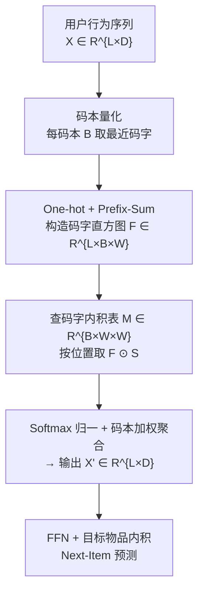
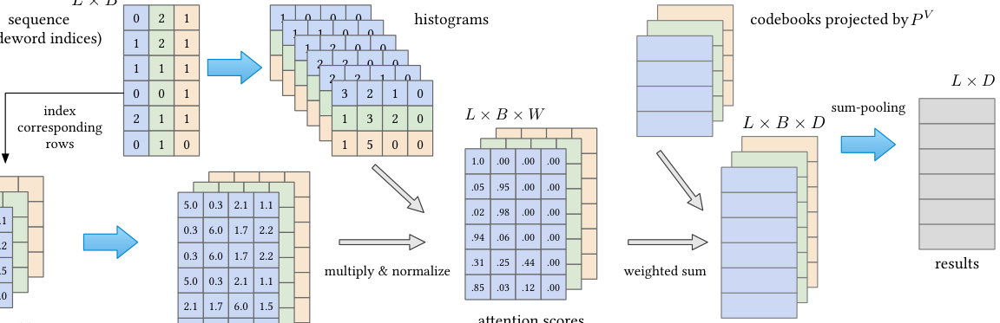

# Linear-Time Self Attention with Codeword Histogram for Efficient Recommendation (基于码字直方图的线性时间自注意力推荐模型)

- **会议/期刊**: WWW 2021（The Web Conference）
- **作者与机构**: Yongji Wu, Defu Lian, Neil Zhenqiang Gong（Duke University / USTC）; Lu Yin, Mingyang Yin, Jingren Zhou, Hongxia Yang（Alibaba Group）
- **推荐链路定位**: 召回 / 精排用户序列编码（Next-Item Prediction 端到端 Transformer）
- **研究方向**: 序列与会话推荐（sequential_rec）/ CTR 特征交叉与高效网络（ctr_feature_interaction）
- **论文原文**: [https://arxiv.org/abs/2105.14068v1](https://arxiv.org/abs/2105.14068v1)
- **开源代码**: [https://github.com/libertyeagle/LISA](https://github.com/libertyeagle/LISA)

## TL;DR (1分钟核心速览)

自注意力在序列推荐中效果卓越，但 $O(L^2D)$的复杂度阻碍长序列建模；稀疏注意力（LSH/排序/聚类）虽降复杂度，却会裁剪感受野丢失关键信息，且在短序列上额外分桶开销可能更慢。本文提出 **LISA**：借鉴向量量化思想，用$B$个可学习码本将序列元素量化为码字索引，以 **可微码字直方图** 代替重复的内积计算，在保持 **Full-Context 注意力** 的同时将复杂度降至$O(LB W D)$。在 Alibaba、ML-1M、ML-25M、Video Games 上配合 Leave-One-Out + 100 负采样协议，相对 SOTA 高效注意力基线 HR@10 最高提升 **8.78%**，NDCG@10 最高提升 **7.29%**，推理速度最高快 **57×**，峰值内存相比 Transformer 降至约 **1.3%**。

## Background & Motivation (背景与核心矛盾)

- **主流范式**: SASRec 式的 Transformer 自注意力已成为序列推荐标配；加速主流分两派——稀疏注意力（Reformer 的 LSH 分桶、Sinkhorn 可微排序、Routing/Clustered 聚类）与低秩近似（Linformer 长度维投影）。
- **前人局限一**: 稀疏注意力只为每个 query 保留一个子集 key，直接截断感受野，关键物品信息丢失；更棘手的是 LSH/排序/聚类的 **分桶开销** 本身仍是 $O(L^2)$ 级，短序列（如 128）上 Reformer 反而比 Transformer 慢 **7.6×**。
- **前人局限二**: Linformer 的低秩投影作用于长度维，**无法套用因果掩码（Casual Masking）**，双向注意力在推荐 next-item 任务上带来显著掉点（本文实验亦佐证）。
- **核心洞察 (Key Insight)**: 自注意力本质是对序列做加权池化，权重只与 query 和 key 的内积相关，是一个 **Maximum Inner Product Search (MIPS)** 问题；而 MIPS 中向量量化（Product Quantization）恰好能"合并相同码字的内积，只对 $BW \ll L$ 个码字计算一次"。
- **本文切入点**: 用 LightRec 式码本对每条行为做硬量化，整条序列压成 **每码本的码字直方图**，注意力从"对 $L$个 token"变为"对$BW$ 个码字"，实现线性复杂度 + 完全注意力。

## Method (核心方法设计)

### 1. 整体框架 (Overall Architecture)

输入为用户历史行为序列 $X\in\mathbb{R}^{L\times D}$；先经预训练/联合训练码本量化：每个物品在$B$个码本中各取最近码字，得到离散索引$\{w_i^b\}_{b=1}^{B}$。注意力阶段对每个码本$b$，用 **一热编码 + 前缀和 (Prefix-Sum)** 为该位置$i$构造码字直方图$F_{i,b,\cdot}\in\mathbb{R}^{W}$，再据此在$W\times W$的"码字内积表"中查表加权聚合$\sum_w F_{i,b,w}\exp(\langle q_i,c_w\rangle)c_w$；$B$个码本结果相加即多头式输出。输出接 FFN + 目标物品内积做 Next-Item 预测。训练采用联合训练（也支持从普通 Transformer 迁移码本），推理用查表替换$O(LD)$内积，用户状态可用固定长直方图$O(BW)$ 表示，支持动态在线推荐。

**图3：LISA（单向模式）工作流程**

<figure class="paper-figure" markdown="span">
  <figcaption>图3：LISA（单向模式）的工作流程。序列中各条目的码字索引作为输入，用于索引内积表，并在每个位置计算各码本的码字直方图。直方图与从表中提取的内积逐元素相乘，然后归一化得到注意力分数，用于计算投影码本的加权平均。本例使用三个码本，每个包含四个码字。</figcaption>
</figure>

### 2. 关键设计拆解 (Key Designs)

1. **码字直方图复用：从 $O(L^2D)$到$O(LBWD)$**：单码本情形，原式为$v'=\sum_i\exp(q^\top x_i)x_i/\sum_i\exp(q^\top x_i)$，而$x_i=c_{w_i}$只取$W$个值，故可合并为$v'=\sum_{w\in\Omega_X} f_w\exp(q^\top c_w)c_w/\sum_{w\in\Omega_X} f_w\exp(q^\top c_w)$，同一码字只算一次内积。直觉：这等价于 Product Quantization 在 MIPS 上"跳过同一质心的重复计算"。

2. **多码本拆分 + 因果版本的前缀和**：多码本加法组合会破坏共享，故将查询内积近似为同码本项 $c^b_{w_i^b}{}^\top c^b_{w'}$，各码本按"多头"独立注意力；因果掩码下用 one-hot 张量沿序列做前缀和$F_{i,:,:}=\sum_{j=1}^{i}E_{j,:,:}$，得到位置$i$ 的因果直方图：
   $$x'_i=\sum_{b=1}^{B}\frac{\sum_{w'=1}^{W}F_{i,b,w'}\exp\!\big((P_Qc^b_{w_i^b})^\top(P_Kc^b_{w'})\big)P_Vc^b_{w'}}{\sum_{w'=1}^{W}F_{i,b,w'}\exp\!\big((P_Qc^b_{w_i^b})^\top(P_Kc^b_{w'})\big)}$$
   前缀和可由并行算法在 $O(\log L)$ 内完成，且不像 Linformer 受到序列长度约束。

3. **两种效率变体 + 训练目标**：**LISA-Soft** 用 $\mathrm{softmax}(\mathrm{sim})$ 软化码字分配（不再可压码本索引，目标物品用原 embedding）；**LISA-Mini** 序列侧用小码本（如 $B\!\times\!W=128/256$）、目标物品侧保留大码本，实现$O(BW)$ 推理同时保持压缩。损失函数沿用 SASRec 的 BCE（内积偏好分），无需负采样优化；一次训练可预训练码本迁移到 LISA-Base 且性能几乎不变（Table 6 一致或略升），说明 LISA 确实逼近了点积注意力。

## Experimental Setup & Evaluation Protocol (实验设置与评估协议)

- **数据集与预处理**（严格按 SASRec 的 `5-core` 过滤，评分仅取存在性作为隐式反馈，`Leave-One-Out` 划分）：

| 数据集 | #Users | #Items | #Interactions | 稀疏度/密度 | 特征/场景说明 |
| :--- | :---: | :---: | :---: | :---: | :--- |
| Alibaba | 99,979 | 80,000 | 25M | ~0.4% | 电商点击日志 2019.09–2020.09，长序列 |
| ML-1M | 6,040 | 3,416 | 1M | ~4.8% | 电影评分，稠密场景 |
| Video Games | 59,766 | 33,487 | 0.5M | ~0.06% | Amazon 评论，**极稀疏**、平均仅 8.8 长 |
| ML-25M | 162,541 | 32,720 | 25M | ~0.5% | 大规模电影点击 |

- **数据划分与防穿越**: `Leave-One-Out`（每用户最后一条作测试，前序作训练）；因果掩码由模型结构与单向注意力保证。
- **排名评测协议**: `Sample Ranking`，每用户随机采 **100 个未交互负样本** 与正样本混排，按 HR@{5,10} 与 NDCG@{5,10} 打分；不采用 Full-Ranking，存在一定乐观偏差。
- **对比基线与超参设置**: vanilla Transformer（Transformer-SASRec）、Linformer、Reformer (LSH-1/4)、Sinkhorn (32/64)、Routing (32/64)、Clustered (100/200)。统一 $d=128$、dropout 0.1、Adam lr 1e-3、batch 128、最多 200 epoch，LISA-Base 采用$B=8$、$W=128$(ML-1M)/256(其余)。基线超参按原文取值，不做显著性检验修正。

## Key Experimental Results (实验关键数据)

### 1. 主实验对比 (Main Results)

**表 3（节选核心列，Alibaba / ML-1M / Video Games；粗体为高效基线中最优及 LISA 变体中的最优）**

| Method | Alibaba HR@10 | Alibaba NDCG@10 | ML-1M HR@10 | ML-1M NDCG@10 | Video Games HR@10 | Video Games NDCG@10 |
| :--- | :---: | :---: | :---: | :---: | :---: | :---: |
| Transformer (SASRec) | 0.7569 | 0.5843 | 0.7914 | 0.5725 | 0.6583 | 0.4680 |
| Linformer | 0.4929 | 0.3360 | 0.5704 | 0.3394 | 0.5671 | 0.3937 |
| Reformer (LSH-1) | 0.7212 | 0.5513 | **0.7806** | **0.5590** | 0.6694 | 0.4771 |
| Sinkhorn (64) | 0.7289 | 0.5629 | **0.7844** | **0.5656** | 0.6541 | 0.4605 |
| Routing (32) | 0.6724 | 0.5106 | 0.7704 | 0.5537 | 0.6657 | 0.4750 |
| Clustered (100) | 0.6941 | 0.5266 | 0.7697 | 0.5492 | 0.6642 | 0.4734 |
| **LISA-Base** | **0.7702** | **0.5798** | **0.7962** | **0.5740** | **0.7338** | **0.5157** |
| **LISA-Soft** | **0.7622** | **0.5732** | 0.7887 | 0.5587 | 0.7035 | 0.4944 |
| **LISA-Mini** | 0.7559 | 0.5511 | 0.7886 | 0.5644 | 0.7102 | 0.4881 |

**表 4（ML-25M；同口径）**

| Method | HR@5 | NDCG@5 | HR@10 | NDCG@10 |
| :--- | :---: | :---: | :---: | :---: |
| Transformer | 0.9338 | 0.8073 | **0.9752** | 0.8209 |
| Reformer (LSH-1) | 0.9214 | 0.7847 | 0.9694 | 0.8005 |
| Sinkhorn (64) | 0.9161 | 0.7820 | 0.9649 | 0.7980 |
| Routing (64) | 0.9215 | 0.7890 | 0.9685 | 0.8044 |
| Clustered (100) | 0.9215 | 0.7830 | 0.9700 | 0.7989 |
| **LISA-Base** | **0.9254** | **0.7933** | 0.9713 | **0.8083** |
| **LISA-Soft** | **0.9269** | **0.7964** | 0.9710 | **0.8109** |
| **LISA-Mini** | 0.9243 | 0.7900 | 0.9701 | 0.8050 |

### 2. 消融/变体实验 (Ablation Study)

原文未设单独的表格式消融，而是用变体方式拆解 LISA 各改动的增益（表 2 + 表 3/4 对比）：

| 组件/设置 | 含义 | Alibaba HR@10 | Video Games HR@10 | 压缩比（Alibaba） |
| :--- | :--- | :---: | :---: | :---: |
| LISA-Base | 硬分配 + 大码本（$BW$=1024/2048） | 0.7702 | **0.7338** | 18.45×–24.26× |
| w/o 大码本 → LISA-Mini | 序列侧小码本 $BW$=128 | 0.7559 | 0.7102 | **18.45×** |
| w/o 硬分配 → LISA-Soft | 软化码字分配 | **0.7622** | 0.7035 | 不压缩 |
| w/o LISA（baseline 最佳） | 稀疏注意力最佳基线 | 0.7289 | 0.6694 | — |

### 3. 关键实验发现 (Key Findings)

1. **Full-Context 优于稀疏感受野**：LISA-Base 在所有四个数据集上超过最强高效注意力基线，相对最佳基线 HR@10 提升 **8.78%**、NDCG@10 提升 **7.29%**；在 Alibaba 与 ML-25M 上甚至 **超过 vanilla Transformer**，印证"码本聚合 $\approx$ 全上下文注意力 + 去冗余"的效果。
2. **极稀疏/短序列场景 LISA 优势最大**：Video Games（平均长度仅 8.8）上 LISA-Base 相比 Transformer HR@10 提升 **11.5%**（0.6583→0.7338），说明由 $B$ 个码本"独立池化再相加"可起到 **隐式去噪** 作用；而软分配的 LISA-Soft 在此稍逊色（0.7035），暗示硬分配在稀疏数据上更鲁棒。
3. **小码本即可支撑效率化**：LISA-Soft 仅用 16 码字（较 Base 少 **94%** 码字）仍在 HR@10/NDCG@10 上较最佳基线平均提升 **2.46%/1.16%**；效率侧在 $D=1024$、16K 序列下 LISA-128 比 Transformer **快 57×**，峰值内存占用降至 **1.3%**，在短序列 128 上还能比 Reformer **快 6.5×**，证明"查表式线性注意力"的端到端收益不是仅长序列才兑现。

## Highlights & Limitations (亮点、对比与审稿批判)

- **与代表作对比 (vs. Prior Work)**: 相比 Reformer/Sinkhorn/Routing 等稀疏注意力，LISA 做 **完全上下文** 而非裁剪感受野，且分桶开销从 $O(L^2)$ 降为无；相比 Linformer 长度维低秩投影，LISA 天然支持 **因果掩码**，且在短序列上不像 Reformer 出现 "比 Transformer 还慢" 的反常；相比 LightRec，LISA 把码本从"仅压缩 embedding"延伸到"压缩注意力权重计算"，是码本在序列建模中更彻底的复利应用。
- **可迁移亮点**: (i) **Query 侧码本 + Key 侧码本的分离**（LISA-Mini）可把"序列编码器压缩"与"物品表征精度"解耦；(ii) **Prefix-Sum 版直方图** 的思路可直接套到 Mamba/线性注意力/RetNet 等状态空间模型的在线推理，形成 $O(BWD)$ 的固定状态更新；(iii) LLM 推荐、时序用户序列召回等"长用户行为"场景可直接复用 LISA 作为编码器。
- **审稿级局限批判**: (i) 评估采用 **100 负采样** 而非 Full-Ranking，存在采样偏差，且 HR/NDCG 对长序列场景最优性的稳健性未做时间戳切分验证；(ii) 码本按数据集单独训练，**跨域/新物品** 迁移能力与超参 $B$、$W$ 的敏感性（Video Games 上大码本反而掉点）未给自适应选择策略；(iii) 多码本拆分把跨码本内积截断为同码本项，理论上限制了表示能力上限；实际中在 ML-25M、ML-1M 的 NDCG@5 上仍略低于 Transformer，长期序列位置编码缺失也是潜在天花板。

## Rating (四维评分)

- **方法创新性 (Novelty)**: ⭐⭐⭐⭐⭐ （把 MIPS/向量量化与因果自注意力用码字直方图+前缀和巧妙联姻，是"高效注意力 + 序列推荐"的一次真正机制级创新，而非调参或蒸馏）
- **评估协议与实验扎实度 (Protocol & Experiments)**: ⭐⭐⭐⭐ （4 数据集 + 8 个 SOTA 基线 + 效率/内存/在线/迁移/超参多维度实验齐全，但仅 100 负采样 Sampled Ranking，缺少 Full-Ranking 与显著性检验）
- **写作与数学规范度 (Clarity & Rigor)**: ⭐⭐⭐⭐⭐ （从单码本简单 case 逐级推到多码本+因果再推变体，复杂度 $O(LBWD)$、前缀和$O(\log L)$与查表内存$O(BW^2)$ 分析严谨，符号体系清晰）
- **工业落地与复现价值 (Industrial & Practical Value)**: ⭐⭐⭐⭐⭐ （代码开源，$O(BW)$用户状态存储 +$O(BWD)$ 单步推理对长短序列皆友好，已在阿里电商场景验证压缩比最高 24×，对线上精排/长行为序列召回具备直接复用价值）

