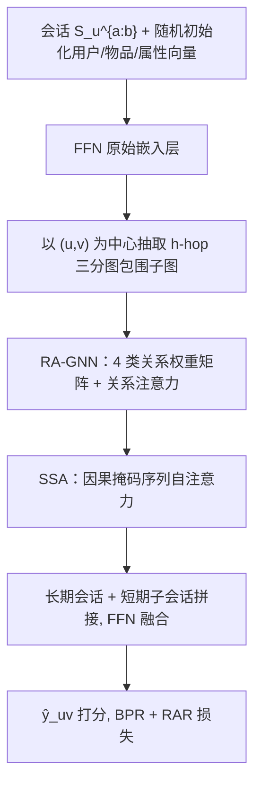
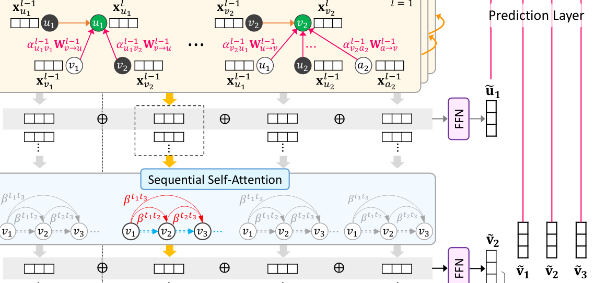
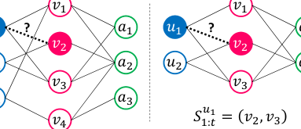

# RetaGNN: Relational Temporal Attentive Graph Neural Networks for Holistic Sequential Recommendation (面向整体序列推荐的关系时序注意力图神经网络)

- **会议/期刊**: The Web Conference (WWW) 2021
- **作者与机构**: Cheng Hsu, Cheng-Te Li（台湾成功大学数据科学研究所）
- **推荐链路定位**: 召回 / 端到端排序
- **研究方向**: 序列与会话推荐 / 图神经网络与知识图谱推荐
- **论文原文**: [https://arxiv.org/abs/2101.12457v1](https://arxiv.org/abs/2101.12457v1)
- **开源代码**: 暂未开源（论文中列出的 GitHub 链接均为 SASRec/HGN/HAM/HAN/GC-MC/IGMC 等基线仓库）

## TL;DR (1分钟核心速览)

现有 SOTA 序列推荐（SASRec/HGN/MA-GNN）均为**转导式**：节点嵌入绑定具体用户，新用户到来或跨域迁移必须重训。RetaGNN 将预测改写为「以 $(u,v)$为中心抽取$h$-hop 用户-物品-属性三分图包围子图$\to$用**关系级**（而非节点级）参数的关系注意力 GNN 编码$\to$ 序列自注意力注入时序」。在不依赖内容特征的条件下，一套参数同时覆盖常规、归纳、可迁移三种设定。MovieLens/Book-Crossing/Instagram 上 P@10 达 0.1704/0.0693/0.0692，相对最强基线 HGAN 分别提升 5.58%/29.53%/16.50%。

## Background & Motivation (背景与核心矛盾)

- **主流范式**: 序列推荐用自注意力（SASRec）、层次门控（HGN）、记忆网络（MA-GNN）建模长短期兴趣，但都要为每个用户学习专属嵌入，属转导式学习。
- **前人局限**: ① 新用户零交互、嵌入无从生成，只能重训；② 稀疏域（Book-Crossing 密度仅 $9\times10^{-4}$）下节点嵌入严重欠训练。
- **相邻工作的缺口**: 归纳式补全 IGMC/GCMC 能把 $(u,v)$ 局部子图映射为交互分数，但只做**静态**矩阵补全，既无会话内时序演化，也不区分高阶协同路径与属性路径的不同贡献权重。
- **核心洞察 (Key Insight)**: 若把可学习参数挂到**关系**（user$\to$item、item$\to$user、item$\to$attr、attr$\to$item 四种有向边型）而非节点或数据集上，参数就与节点身份天然解耦——新用户/新域只需重新抽子图，权重可直接复用。
- **本文切入点**: 关系参数化 GNN $+$包围子图采样$+$因果序列自注意力$+$ 关系感知正则，四者组合成"holistic SR"。

## Method (核心方法设计)

### 1. 整体框架 (Overall Architecture)

给定会话 $S_u^{a:b}$，先把所有用户/物品/属性值随机初始化为固定维度向量并经单隐层 FFN 得到 primitive embedding（刻意不用 one-hot，否则新节点无法嵌入）；随后在由全部会话构建的三分图上，以每个正样本对$(u,v)$为圆心做 BFS 抽取$h$-hop 包围子图；子图送入 RA-GNN 做关系注意力消息传递，得到节点表示；物品表示再按时间顺序送入带因果掩码的 SSA 层对齐时序；最后把整段会话（长期）与若干子会话（短期）的表示拼接，经 FFN 融合后与目标物品的 primitive 向量做内积打分，用 BPR + RAR 联合训练。

<figure class="paper-figure" markdown="span">
  <figcaption>图2：所提出的用于整体序列推荐的RetaGNN模型概览。输入会话 S𝑢</figcaption>
</figure>

### 2. 关键设计拆解 (Key Designs)

1. **关系参数化 RA-GNN（把参数从节点搬到边上）**：GAT/NGCF 的权重绑在节点或边上，遇到未见节点即失效。RetaGNN 改为每个关系 $r$一套$\mathbf{W}_r^l$，并用注意力区分邻居贡献：$\mathbf{x}_i^{l+1}=\mathbf{W}_o^l\mathbf{x}_i^l+\sum_{r\in\mathcal{R}}\sum_{v_j\in\Gamma_r(v_i)}\alpha_{ij}^l\mathbf{W}_r^l\mathbf{x}_j^l$，其中$\alpha_{ij}^l=\mathrm{softmax}\big(\rho(\mathbf{a}^{\top}[\mathbf{W}_o^l\mathbf{x}_i^l\oplus\mathbf{W}_r^l\mathbf{x}_j^l])\big)$ 且逐层独立。直觉：关系语义（"喜欢/被喜欢/拥有/从属"）跨用户、跨数据集稳定，因此是可迁移的"公理"，而节点身份是噪声源。

2. **包围子图 + 长短期双重分解**：预测 $u$是否交互$v$时只看$v$的$h$-hop 邻域，使计算量与全图规模解耦、且对新节点天然可算。进一步把会话切成长期$S_u^{a:b}$与$\pi$个长度为$\tau$的短期子会话，长期子图用$L_{lo}$层、短期用$L_{sh}$层，得到$\tilde{\mathbf{u}}=\mathrm{FFN}([\mathbf{u}^{[L]}\oplus\mathbf{u}_1^{[S]}\oplus\cdots\oplus\mathbf{u}_\pi^{[S]}])$（物品同理）。直觉：长期图覆盖更广但更噪，层数与子图规模需要解耦控制。

3. **训练目标、负采样与推理效率**：打分融合全局 MF 与序列项内积：$\hat{y}_{uv}=\tilde{\mathbf{u}}\cdot\mathbf{x}_v+\sum_{v_i\in S_u^{a:b}}\tilde{\mathbf{v}}_i\cdot\mathbf{x}_v$。损失为 BPR + 关系感知正则 RAR：
$\mathcal{J}=\sum_{\mathcal{D}}-\log\sigma(\hat{y}_{uv}-\hat{y}_{uv'})+\lambda\sum_{r\in\mathcal{R}}\sum_{l=1}^{L-1}\|\mathbf{W}_r^{l+1}-\mathbf{W}_r^{l}\|_F^2+\eta\|\Theta\|_F^2$。
负样本 $v'$为随机未交互物品（Uniform 均匀采样，非 hard negative）；RAR 约束同关系相邻层权重矩阵平滑，既保留关系知识又防止不同关系权重塌缩。推理时需为每个候选$(u,v)$ 抽子图，成本随会话长度与子图规模增长，无缓存机制。

<figure class="paper-figure" markdown="span">
  <figcaption>图3：三分图、包围子图以及用于预测用户 𝑢1 与物品 𝑣2 之间交互的路径的示例。</figcaption>
</figure>

## Experimental Setup & Evaluation Protocol (实验设置与评估协议)

- **数据集与预处理**: 移除无属性用户与交互数 $<4$的用户；MovieLens/Book-Crossing 的显式评分按 MKR 阈值（ML$\geq 4$、BC$\geq 9$）转隐式。

| 数据集 | #Users | #Items | #Interactions | 稀疏度/密度 | 特征/场景说明 |
| :--- | :---: | :---: | :---: | :---: | :--- |
| Instagram | 7,943 | 4,687 | 215,927 | 密度 5.8e-3 | 纽约/洛杉矶/伦敦三城签到 POI，32 类属性 |
| MovieLens-1M | 1,204 | 3,952 | 125,112 | 密度 2.63e-2 | 电影评分，20 类属性 |
| Book-Crossing | 52,406 | 41,264 | 1,856,747 | 密度 9e-4 | 图书评分，**无属性** |

- **数据划分与防穿越 (Splitting Strategy)**: 采用 **比例划分 6:2:2**（训练/验证/测试），每实验重复 10 次取均值；会话长度 $t=11$、预测未来物品数$g=3$。归纳设定下按用户随机切分$\mathcal{U}_{train}\cap\mathcal{U}_{test}=\varnothing$，训练用户占比取 70%/50%/30%；迁移设定下源/目标域的**用户集与物品集均不相交**。
- **排名评测协议 (Ranking Protocol)**: 指标 P@10 / R@10 / NDCG@10（$k=10$）。原文未显式声明候选集构造，按指标语义视为对候选物品整体排序；训练期负例为随机未交互物品（BPR 成对）。未报告显著性检验，仅称"显著优于"。
- **对比基线与超参设置**: 序列侧 SASRec、HGN、HAM、MA-GNN；图侧 HGAN（异质图注意力，三项任务均作强基线）、GCMC、IGMC（归纳/迁移可用）。嵌入维度 $d=32$，$L_{lo}=2$、$L_{sh}=3$、$h=2$、$\tau=4$、$\lambda=0.6$，Adam lr=1e-3、batch=32。

## Key Experimental Results (实验关键数据)

### 1. 主实验对比 (Main Results)

| 方法 | ML P@10 | ML N@10 | ML R@10 | BC P@10 | BC N@10 | BC R@10 | IG P@10 | IG N@10 | IG R@10 |
| :--- | :---: | :---: | :---: | :---: | :---: | :---: | :---: | :---: | :---: |
| SASRec | 0.1173 | 0.1272 | 0.1367 | 0.0272 | 0.0363 | 0.0216 | 0.0378 | 0.0347 | 0.0414 |
| HGN | 0.1273 | 0.1368 | 0.1194 | 0.0367 | 0.0392 | 0.0268 | 0.0492 | 0.0516 | 0.0426 |
| HAM | 0.1432 | 0.1354 | 0.1447 | 0.0326 | 0.0270 | 0.0628 | 0.0427 | 0.0425 | 0.0425 |
| MA-GNN | 0.1536 | 0.1497 | 0.1485 | 0.0512 | 0.0281 | 0.0454 | 0.0514 | 0.0534 | 0.0518 |
| GCMC | 0.1497 | 0.1432 | 0.1573 | 0.0453 | 0.0387 | 0.1432 | 0.0527 | 0.0554 | 0.0418 |
| IGMC | 0.1523 | 0.1488 | 0.1531 | 0.0482 | 0.0464 | 0.1356 | 0.0532 | 0.0543 | 0.0441 |
| HGAN | 0.1614 | 0.1594 | 0.1703 | 0.0535 | 0.0502 | 0.1493 | 0.0594 | 0.0619 | 0.0579 |
| **RetaGNN** | **0.1704** | **0.1691** | **0.1825** | **0.0693** | **0.0642** | **0.1555** | **0.0692** | **0.0703** | **0.0673** |
| Improv.% (vs HGAN) | +5.58 | +6.08 | +7.16 | +29.53 | +27.89 | +4.15 | +16.50 | +13.57 | +16.23 |

**归纳/迁移设定（节选）**：ISR 在训练用户 70%/50%/30% 三档下全部领先——30% 时 ML P@10：RetaGNN 0.1324 vs IGMC 0.1028 vs GCMC 0.0821；IG P@10：0.0525 vs 0.0318 vs 0.0305。TSR 六个跨域组合全胜，如 BC→IG P@10 0.0643（IGMC 0.0381、GCMC 0.0394）、IG→ML P@10 0.1684（IGMC 0.1473）。

### 2. 消融实验 (Ablation Study)

| 变体 | ML P@10 | ML N@10 | ML R@10 | BC P@10 | IG P@10 |
| :--- | :---: | :---: | :---: | :---: | :---: |
| w/o RA-GNN | 0.1368 | 0.1383 | 0.1425 | 0.0384 | 0.0507 |
| w/o 属性节点（退化为二分图） | 0.1593 | 0.1572 | 0.1704 | 0.0492 | 0.0604 |
| w/o RAR 正则项 | 0.1583 | 0.1589 | 0.1715 | 0.0468 | 0.0571 |
| w/o 关系注意力 $\alpha_{ij}^l$ | 0.1576 | 0.1528 | 0.1636 | 0.0405 | 0.0521 |
| w/o 序列自注意力 SSA | 0.1613 | 0.1625 | 0.1734 | 0.0536 | 0.0610 |
| w/o 短期子会话 | 0.1627 | 0.1642 | 0.1782 | 0.0538 | 0.0620 |
| w/o 长期会话 | 0.1635 | 0.1592 | 0.1723 | 0.0524 | 0.0567 |
| **Full RetaGNN** | **0.1704** | **0.1691** | **0.1825** | **0.0693** | **0.0692** |

### 3. 关键实验发现 (Key Findings)

1. **RA-GNN 是绝对主力，且"区分关系"比"堆层"更重要**：去掉 RA-GNN 后 ML P@10 从 0.1704 降至 0.1368（-19.7%）、BC 从 0.0693 降至 0.0384（-44.6%），降幅远超其他组件；而仅去掉关系注意力 $\alpha$ 也让 BC 掉到 0.0405，说明四种关系权重的差异化建模才是归纳能力的来源。
2. **越稀疏收益越大**：Book-Crossing（密度 9e-4）相对 HGAN 提升 29.53%，而 MovieLens（2.63e-2）仅 5.58%——稠密数据下基线靠节点嵌入已能拟合用户偏好，关系参数化子图模型的价值集中在长尾/稀疏场景。
3. **超参需要"适度"而非"更深"**：$h$从 2 增至 3/4 时 ML P@10 由 0.0693 降至 0.0672/0.0658，$(L_{lo},L_{sh})$从 (2,3) 增至 (3,3) 时 IG P@10 由 0.1704 降至 0.1592，$\lambda$ 在 0.6 处最优（图 5）——远端子图与过深堆叠都会引入噪声并触发过平滑。另外注意力热图（图 4）显示 Instagram 权重偏向近期时间步、MovieLens 趋于均匀，与"签到易受促销冲击、观影偏好稳定"的现实直觉一致，可作为可解释性证据。

## Highlights & Limitations (亮点、对比与审稿批判)

- **与代表作对比 (vs. Prior Work)**: 相比 SASRec/MA-GNN，本文不再为每个用户学专属嵌入，而是学跨域稳定的关系权重，因而能做归纳与迁移；相比 IGMC 同为子图映射，本文额外引入属性三元关系、关系级注意力与 SSA 时序建模；相比 HGAN 这类异质图注意力，本文把注意力作用在**关系**而非 meta-path 实例上，且显式约束层间权重平滑。
- **可迁移亮点**: ① "参数挂在关系上、预测挂在子图上"是解决严格冷启动召回的通用范式，可直接移植到双塔召回的新物品侧；② RAR 这种层间关系矩阵平滑正则可即插即用到任何 R-GCN/HGT 类模型，几乎零额外推理成本。
- **审稿级局限批判**: ① 每个 $(u,v)$ 对都要抽子图并跑多层 GNN，训练与在线打分开销随会话长度和子图节点数膨胀，论文既无复杂度分析也无延迟对比，工业可用性存疑；② 评测仅用 6:2:2 随机划分与 P/R/NDCG@10，未声明全库排序协议、未做时间戳切分、无显著性检验，且 Book-Crossing 无属性时属性路径失效导致绝对值极低（P@10 仅 0.069），三设定间的性能落差暴露出模型对属性侧信息的强依赖。

## Rating (四维评分)

- **方法创新性 (Novelty)**: ⭐⭐⭐⭐ （把可学习参数从节点迁到关系边型、并叠加子图采样，是归纳序列推荐的首个系统化方案，但 RA-GNN 本体与 R-GCN/GAT 差异有限，属组合式创新）
- **评估协议与实验扎实度 (Protocol & Experiments)**: ⭐⭐⭐ （三数据集覆盖常规/归纳/迁移三设定、消融完备，但划分单一、未声明全库排序与负采样细节、缺显著性检验与效率实验）
- **写作与数学规范度 (Clarity & Rigor)**: ⭐⭐⭐⭐ （RA-GNN、SSA、RAR 三处公式定义清晰、符号一致，长短期分解的层次数含义交代明确；但对子图规模与复杂度缺少定量刻画）
- **工业落地与复现价值 (Industrial & Practical Value)**: ⭐⭐⭐ （关系参数化 + RAR 思路易迁移，但代码未开源、逐对抽子图的推理开销与在线延迟未验证，落地前需自建子图缓存）

