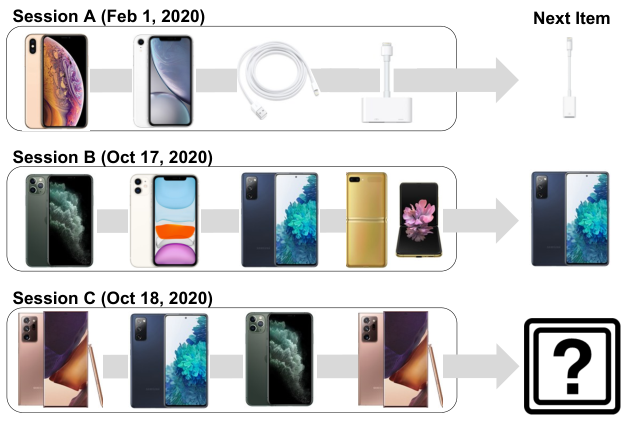
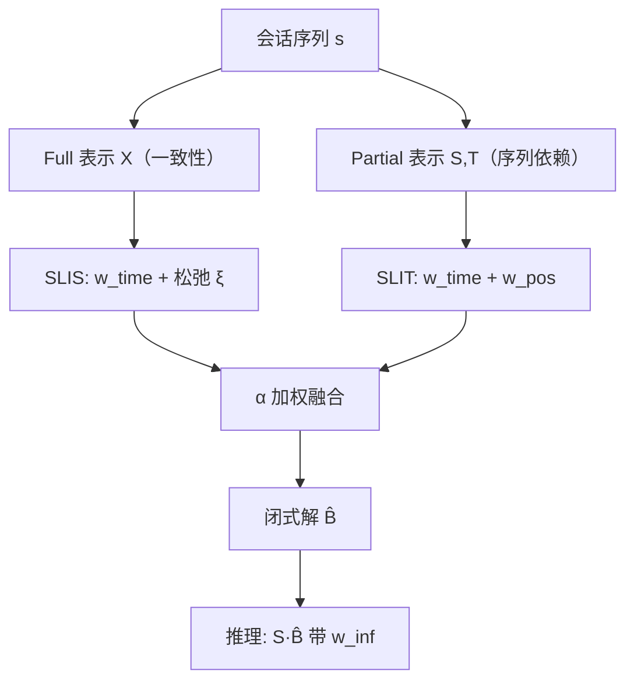
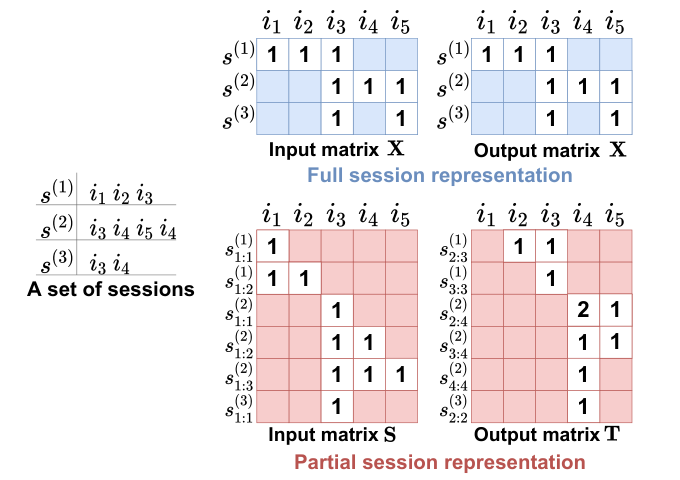

# Session-aware Linear Item-Item Models for Session-based Recommendation (会话感知的线性物品-物品推荐模型)

- **会议/期刊**: The Web Conference (WWW) 2021
- **作者与机构**: Minjin Choi, Jinhong Kim, Jongwuk Lee (成均馆大学)；Joonseok Lee (Google Research / 首尔大学)；Hyunjung Shim (延世大学)
- **推荐链路定位**: 召回（匿名会话 Next-Item 预测）
- **研究方向**: 序列与会话推荐 / 协同过滤（线性物品-物品模型）
- **论文原文**: [https://arxiv.org/abs/2103.16104v2](https://arxiv.org/abs/2103.16104v2)
- **开源代码**: [https://github.com/jin530/SLIST](https://github.com/jin530/SLIST)

## TL;DR (1分钟核心速览)

会话推荐长期被 DNN（GRU4Rec/SR-GNN）和邻域模型（SKNN/STAN）割裂式建模：前者只盯序列依赖、后者只看会话一致性，无单一模型跨数据集全面 SOTA，且 DNN 训练成本极高。本文提出 SLIST，把「会话一致性」与「序列依赖」拆成两个线性物品-物品模型 SLIS/SLIT，再以权重 $\alpha$ 融合，配合松弛对角约束（支持重复消费）、时间/位置双指数衰减，且**全程闭式解**。在 7 个基准上 `Full-Ranking`，HR@20 全数据集最优（NOWP 上相对 SOTA +9.76%），MRR@20 最高 +8.83%，训练比 SR-GNN 快 768×。

## Background & Motivation (背景与核心矛盾)

- **主流范式**: DNN 路线（GRU4Rec+/NARM/STAMP/SR-GNN）擅长序列依赖与会话一致性，邻域路线（SKNN/STAN）擅长一致性与可扩展性；线性路线（SLIM/EASE$^R$）在传统推荐上以闭式解取胜。
- **前人局限**: ①每个模型只优化会话的某几个属性，跨数据集表现方差极大——DNN 在 YC 上占优、邻域模型在 DIGI/RR/NOWP 上占优，**没有模型能在全部数据集上稳定领先**；②DNN 训练开销不可承受，邻域模型只用相邻会话，无法捕捉全局物品模式。
- **核心洞察 (Key Insight)**: 会话包含四种正交属性——会话一致性（主题连贯）、序列依赖（顺序性消费）、重复物品消费（同物品多次点击）、会话时效性（近期会话更反映当前兴趣）；而 EASE$^R$ 的闭式解证明了「加权 Gram 矩阵 + 对角惩罚」既能高效又能表达物品相似度。
- **本文切入点**: 用同一套线性物品-物品框架，把它扩展成能同时覆盖上述四种属性的**统一闭式解模型 SLIST**。

<figure class="paper-figure" markdown="span">
  <figcaption>图1：各种会话属性的示意图，即会话一致性、序列依赖性、重复物品消费和会话时效性。</figcaption>
</figure>

## Method (核心方法设计)

### 1. 整体框架 (Overall Architecture)

输入一条匿名会话 $s$，分别以两种表示喂入两个线性模型：**Full 表示**$X\in\mathbb{R}^{m\times n}$（会话内物品集合，用于 SLIS 建模一致性）与**Partial 表示**$S,T\in\mathbb{R}^{m'\times n}$（在时刻$t$切分为过去/未来子集，用于 SLIT 建模序列依赖）。两模型各带会话时效权重$\mathbf{w}_{time}$，SLIT 额外叠加位置衰减$\mathbf{w}_{pos}$。以比率$\alpha$加权融合后，通过求解加权 Gram 矩阵逆得到**闭式解**$\hat{\mathbf{B}}$；推理时对输入$S$施加推理衰减$\mathbf{w}_{inf}$，计算$\hat{\mathbf{T}}=S\hat{\mathbf{B}}$ 并对全物品排序。

### 2. 关键设计拆解 (Key Designs)

1. **SLIS：松弛对角约束 + 会话时效加权（解决重复消费与时效性）**：原 EASE$^R$强制$\text{diag}(\mathbf{B})=0$，导致无法预测「同物品再次被消费」，这在会话推荐中是致命缺陷。本文改用不等式约束$\text{diag}(\mathbf{B})\le\xi$，并将损失重加权：
$$\min_{\mathbf{B}}\ \|\mathbf{W}\odot(\mathbf{X}-\mathbf{X}\mathbf{B})\|_F^2+\lambda\|\mathbf{B}\|_F^2,\quad \text{s.t.}\ \text{diag}(\mathbf{B})\le\xi$$
其中 $\mathbf{W}=\mathbf{w}_{time}\mathbf{1}^\top$，$\mathbf{w}_{time}(s)=\exp\!\big(-\tfrac{t_{max}-t(s)}{\delta_{time}}\big)$。物理直觉：越近的会话 Gram 贡献越大；$\xi=0$退化为 EASE$^R$，$\xi=\infty$完全放开对角线，恰好覆盖重复消费。闭式解为$\hat{\mathbf{B}}=\mathbf{I}-\hat{\mathbf{P}}\cdot\text{diagMat}(\gamma)$，$\hat{\mathbf{P}}=(\mathbf{X}^\top\text{diagMat}(\mathbf{w}_{time}^2)\mathbf{X}+\lambda\mathbf{I})^{-1}$，$\gamma_j$由$\xi$ 决定。

2. **SLIT：Partial 表示 + 位置衰减（解决序列依赖）**：全会话集合丢失序关系。将一条会话按每个时刻 $t$展开成$|s|-1$ 条「过去→未来」对（图 2 所示），并加权：
$$\min_{\mathbf{B}}\ \|\mathbf{W}_{par}\odot(\mathbf{T}-\mathbf{S}\mathbf{B})\|_F^2+\lambda\|\mathbf{B}\|_F^2,\quad \hat{\mathbf{B}}=\hat{\mathbf{P}}'\,\mathbf{S}^\top\text{diagMat}(\mathbf{w}_{par}^2)\,\mathbf{T}$$
其中 $\mathbf{w}_{pos}(i,j,s)=\exp\!\big(-\tfrac{|p(i,s)-p(j,s)|}{\delta_{pos}}\big)$让越近的目标物品权重越高；由于$S\neq T$，自然免去平凡解，无需对角约束。

3. **统一目标、闭式解与推理效率**：融合式 $\alpha\|\mathbf{W}_{full}\odot(\mathbf{X}-\mathbf{X}\mathbf{B})\|_F^2+(1-\alpha)\|\mathbf{W}_{par}\odot(\mathbf{T}-\mathbf{S}\mathbf{B})\|_F^2+\lambda\|\mathbf{B}\|_F^2$ 仍可解析：
$$\hat{\mathbf{B}}=\mathbf{I}-\lambda\hat{\mathbf{P}}-(1-\alpha)\hat{\mathbf{P}}\mathbf{S}^\top\text{diagMat}(\mathbf{w}_{par}^2)(\mathbf{S}-\mathbf{T})$$
其中 $\hat{\mathbf{P}}=(\alpha\mathbf{X}^\top\text{diagMat}(\mathbf{w}_{full}^2)\mathbf{X}+(1-\alpha)\mathbf{S}^\top\text{diagMat}(\mathbf{w}_{par}^2)\mathbf{S}+\lambda\mathbf{I})^{-1}$。推理使用$\mathbf{w}_{inf}(i,s)=\exp(-(|s|-p(i,s))/\delta_{inf})$做时间衰减。复杂度随物品数$n$ 而非会话数增长，**CPU 可训、无需采样**。

<figure class="paper-figure" markdown="span">
  <figcaption>图2：两种会话表示的示例。在完整会话表示中，会话中的所有物品彼此关联；在部分会话表示中，物品之间存在序列相关性。</figcaption>
</figure>

## Experimental Setup & Evaluation Protocol (实验设置与评估协议)

- **数据集与预处理**: 丢弃只含 1 交互的会话，物品交互 `< 5` 过滤（`5-core`），统计如下（用户为匿名会话，故无 #Users）：

| 数据集 | #Sessions | #Items | #Actions | 平均会话长 | 场景 |
| :--- | :---: | :---: | :---: | :---: | :--- |
| YC-1/64 | 119,287 | 17,319 | 494,330 | 4.14 | 电商 |
| YC-1/4 | 1,939,891 | 30,638 | 7,909,307 | 4.08 | 电商（大规模） |
| DIGI1 | 188,807 | 43,105 | 916,370 | 4.85 | 电商 |
| YC | 1,375,128 | 28,582 | 5,426,961 | 3.95 | 电商（5-split） |
| DIGI5 | 41,755 | 32,137 | 203,488 | 4.86 | 电商（5-split） |
| RR | 59,962 | 31,968 | 212,182 | 3.54 | 电商（5-split） |
| NOWP | 27,005 | 75,169 | 271,177 | 10.04 | 音乐流媒体（5-split） |

- **数据划分与防穿越 (Splitting Strategy)**: 采用 `U` 全局时间戳切分——测试用会话数据最后 $N$天，训练集最后$N$ 天作验证集，杜绝未来泄漏。
- **排名评测协议 (Ranking Protocol)**: 迭代揭示（Iterative Revealing）方式逐步暴露会话物品，采用无偏 `Full-Ranking`（对全部物品排序），报告 HR@20 / MRR@20 / Recall@20 / MAP@20。
- **对比基线与超参设置**: 4 类共 8 基线——MC (SR)、邻域 (SKNN, STAN)、线性 (SEASE$^R$)、DNN (GRU4Rec+, NARM, STAMP, SR-GNN)。$\alpha\in\{0.2,0.4,0.6,0.8\}$，$\delta_{pos},\delta_{inf}\in\{0.125,\dots,8\}$，$\delta_{time}\in\{1,\dots,256\}$。

## Key Experimental Results (实验关键数据)

### 1. 主实验对比 (Main Results)

（单元格为 `HR@20 / MRR@20`，**粗体**为各列最优，`Improv.` 相对最优基线）

| 模型 | YC-1/4 | DIGI1 | DIGI5 | RR | NOWP |
| :--- | :---: | :---: | :---: | :---: | :---: |
| SKNN | .6329/.2496 | .4846/.1736 | .4748/.1714 | .5788/.3370 | .2450/.0687 |
| STAN | .6846/.2829 | .5121/.1851 | .4800/**.1828** | .5938/**.3638** | .2414/.0871 |
| SEASE$^R$ | .5550/.1984 | .3906/.1099 | .3531/.1004 | .2727/.1032 | .2088/.0625 |
| GRU4Rec+ | .6940/.2942 | .5097/.1750 | .4639/.1644 | .5669/.3237 | .2261/.1076 |
| NARM | .7079/.2996 | .4979/.1585 | .4188/.1392 | .5549/.3196 | .1849/.0894 |
| SR-GNN | .7118/**.3180** | .4904/.1654 | .4158/.1436 | .5433/.3066 | .2113/.0935 |
| **SLIST** | **.7175**/.3161 | **.5291**/**.1886** | **.5005**/.1827 | **.6020**/.3512 | **.2689**/**.1137** |
| **Improv.%** | **+0.80**/-0.60 | **+3.32**/**+1.89** | **+4.27**/+1.04 | **+1.38**/-1.51 | **+9.76**/**+8.83** |

### 2. 消融实验 (Ablation Study)

| 配置 | YC-1/4 HR@20 | YC-1/4 MRR@20 | DIGI1 HR@20 | DIGI1 MRR@20 |
| :--- | :---: | :---: | :---: | :---: |
| SLIST (full) | 0.7175 | 0.3161 | 0.5291 | 0.1886 |
| w/o $w_{time}$ | 0.7096 | 0.3115 | 0.5253 | 0.1880 |
| w/o $w_{pos}$ | 0.7004 | 0.3031 | 0.5202 | 0.1855 |
| w/o $w_{inf}$ | 0.6841 | 0.2753 | 0.5145 | 0.1820 |
| w/o $w_{pos},w_{time}$ | 0.6675 | 0.2693 | 0.5055 | 0.1789 |
| w/o all | 0.6626 | 0.2671 | 0.5025 | 0.1786 |

### 3. 关键实验发现 (Key Findings)

1. **松弛对角约束是重复消费的命门**：SEASE$^R$因强制$\text{diag}{=}0$在会话场景全面崩盘（YC-1/4 HR 仅 .5550），SLIS 的$\xi$-松弛使之回升至 .7175；NOWP 会话最长（10.04）且重复点击多，SLIST 在此斩获 +9.76% HR，反证该机制的针对性。
2. **权重优先级为 $w_{inf}>w_{pos}>w_{time}$**：去除$w_{inf}$ 使 YC-1/4 MRR 从 .3161 掉至 .2753（-12.9%），三项全去掉则降 18.35%；但 DIGI1 上仅降 5.59%，说明序列依赖主导的 YC 更依赖衰减权重、一致性主导的 DIGI 更吃相似度。
3. **超线性可扩展性**：YC-1/4 上 SLIST 训练 241.9s（CPU），SR-GNN 需 185862.5s（GPU），**768× 加速**；且训练会话从 5%→100% 时 SLIST 仅 202.7→241.9s，几乎不随样本量增长。$\alpha$敏感性验证设计哲学：YC-1/4 最优$\alpha{=}0.2$（序列主导），DIGI1 最优$\alpha{=}0.8$（一致性主导）。

## Highlights & Limitations (亮点、对比与审稿批判)

- **与代表作对比 (vs. Prior Work)**: 对比 SEASE$^R$（同样闭式解但死守对角约束，重复消费不可用）、SR-GNN（图神经建模序列依赖但训练慢、长会话易过拟合）、STAN（邻域一致性强但只用相邻会话）；SLIST 用单框架一次性覆盖多属性并保留闭式解的工业级效率。
- **可迁移亮点**: ①**松弛对角约束**可改造任意线性/矩阵分解召回模型以适配「重复消费」场景（音乐、短视频、复购电商）；②**加权 Gram 矩阵闭式解**思路可迁移到多场景/多行为的线性融合；③时间/位置双指数衰减可作为任何会话模型的轻量 baseline 权重初始化。
- **审稿级局限批判**: ①线性模型对极长会话（>5）建模弱，YC-1/4 长会话上被 SR-GNN 反超，缺乏针对长程依赖的补偿机制；②需显式构造并求逆 $n\times n$物品相似度矩阵$\mathbf{B}$，物品数爆炸（$>10^5$）时内存与求逆开销不可忽略，论文未给出近似方案；③MRR@20 在 YC-1/4 与 RR 上仍略逊（-0.60%/-1.51%），未做显著性检验（$p$ 值）佐证差异来源。

## Rating (四维评分)

- **方法创新性 (Novelty)**: ⭐⭐⭐⭐ （将线性 item-item 从传统 CF 迁移到会话推荐，松弛对角约束 + 多视角闭式融合设计精巧，但属组合式创新）
- **评估协议与实验扎实度 (Protocol & Experiments)**: ⭐⭐⭐⭐ （7 数据集、4 指标、Full-Ranking 无偏评测、消融完整；扣分在显著性检验缺失与 MRR 落后原因未深究）
- **写作与数学规范度 (Clarity & Rigor)**: ⭐⭐⭐⭐ （KKT 推导与闭式解在附录给出，四属性动机清晰；符号略繁复）
- **工业落地与复现价值 (Industrial & Practical Value)**: ⭐⭐⭐⭐⭐ （768× 加速、CPU 可训、代码完全开源，可直接替换会话召回基线）

