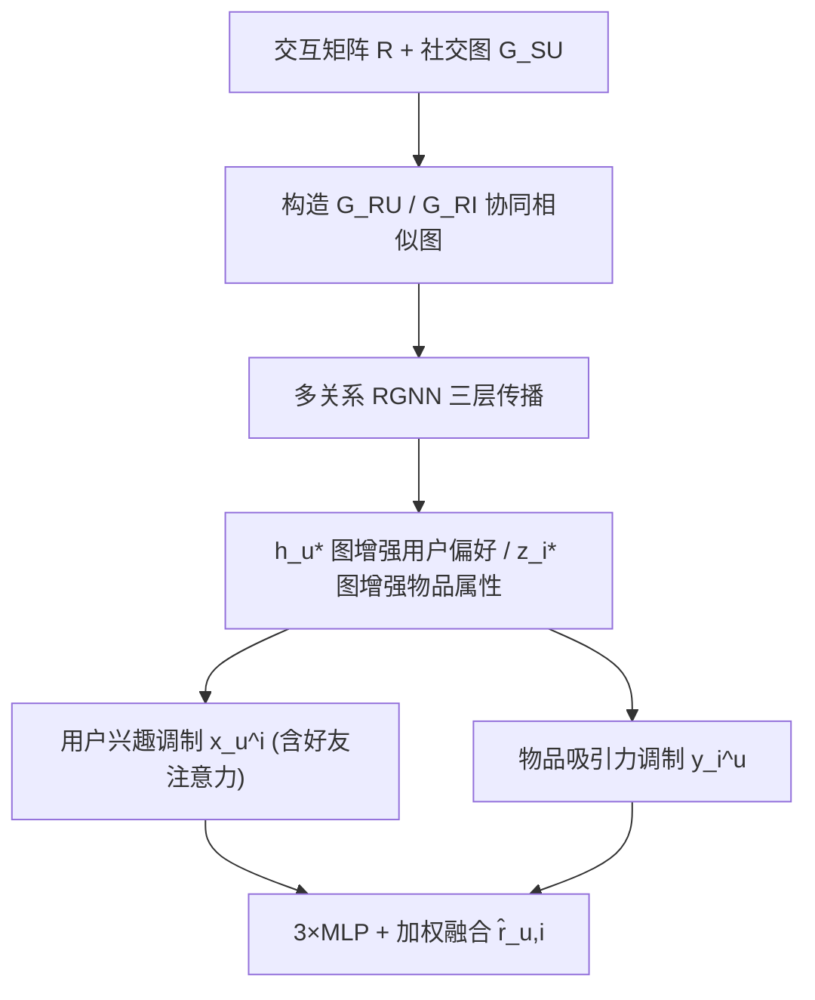

# Dual Side Deep Context-aware Modulation for Social Recommendation (双深度上下文感知调制的社交推荐)

- **会议/期刊**: WWW 2021 (The Web Conference)
- **作者与机构**: Bairan Fu, Wenming Zhang, Guangneng Hu, Xinyu Dai, Shujian Huang, Jiajun Chen（南京大学；香港科技大学）
- **推荐链路定位**: 召回（Top-K 排序 / 端到端匹配打分）
- **研究方向**: 社交与群组推荐 / 图神经网络与知识图谱推荐
- **论文原文**: [https://arxiv.org/abs/2103.08976v1](https://arxiv.org/abs/2103.08976v1)
- **开源代码**: [Drone-Banks/DICER-WWW-2021](https://github.com/Drone-Banks/DICER-WWW-2021)

## TL;DR (1分钟核心速览)

现有社交推荐在建模用户兴趣时只用"候选物品"作为浅层上下文去聚合好友信息，且完全忽略"物品对目标用户的吸引力"也需要关系增强的上下文。DICER 先用社交图 + 两个协同相似图（用户-用户、物品-物品）做多关系 RGNN 传播，再把图增强后的用户/物品表征当作"深度上下文"，通过 max-pooling 调制从历史交互中抽取最相关信息，得到双向的**用户兴趣**与**物品吸引力**。在 Ciao / Epinion 的 Recall@10、NDCG@10 上较 DiffNet++ 平均相对提升 9.59% / 3.21%。

## Background & Motivation (背景与核心矛盾)

- **主流范式**: 以 DiffNet++、DANSER、SAMN 为代表的 GNN 社交推荐，把社交图/交互图上的高阶邻居聚合进用户与物品嵌入，再与候选物品做上下文注意力加权。
- **前人局限一（用户侧）**: 好友兴趣只在"候选物品"这一个上下文下聚合，候选物品交互稀疏时（Ciao 物品平均仅 2.6 条评分）好友信息严重受限，大量噪声被等价聚合。
- **前人局限二（物品侧）**: 物品吸引力几乎无人建模；DANSER 只以"目标用户"为上下文，忽略了「物品的历史消费者若恰是目标用户的好友/协同相似用户，则该物品更具吸引力」这一强信号。
- **核心洞察 (Key Insight)**: 上下文不应停留在 0 阶节点，而应是**图增强后的高阶表征**——物品的协同相似邻居集合扩展了"用户兴趣相关"的语义范围，用户的社交+相似邻居集合扩展了"物品吸引力相关"的语义范围。
- **本文切入点**: 把高阶关系学习到的 $\mathbf{h}_u^\star$、$\mathbf{z}_i^\star$ 作为深度上下文，用逐维调制（element-wise modulation + max-pool）从原始交互序列中"筛"出对应信息。

## Method (核心方法设计)

### 1. 整体框架 (Overall Architecture)

输入为交互矩阵 $\mathbf{R}$与社交图$G_{SU}$；先从交互共现中派生用户协同相似图$G_{RU}$与物品协同相似图$G_{RI}$。三条 RGNN 分别传播得到用户的社交/相似表征与物品的相似表征（用户侧两路相加融合），逐层拼接为图增强偏好$\mathbf{h}_u^\star$与图增强属性$\mathbf{z}_i^\star$。随后进入双向深度上下文调制：以$\mathbf{z}_i^\star$为上下文扫描用户历史物品得兴趣$\mathbf{x}_u^i$（含好友注意力聚合），以$\mathbf{h}_u^\star$为上下文扫描物品历史消费者得吸引力$\mathbf{y}_i^u$。最后三个 MLP 分别输出偏好匹配、兴趣匹配、吸引力匹配分数并加权求和。

**图 2** 给出了完整的四模块数据流：原始输入与图构造 → RGNN → 双向深度上下文调制 → 输出层。

### 2. 关键设计拆解 (Key Designs)

1. **协同相似图构造 + 多关系 RGNN**：痛点是用社交图单源信息不足、且 GCN 等权聚合噪声大。定义 $s_{u,v}=\frac{|R_I(u)\cap R_I(v)|}{\sqrt{|R_I(u)|\cdot|R_I(v)|}}$，超过阈值$\eta=0.1$ 连边（物品同理）。RGNN 沿 NGCF 的逐维交互聚合：

$$\mathbf{z}_i^{l+1}=\sigma\Big(\sum_{j\in N_I(i)}\big(W_1^I\mathbf{z}_i^{l}+W_2^I(\mathbf{z}_i^{l}\odot\mathbf{z}_j^{l})\big)\Big),\quad \mathbf{h}_u^{l}=\mathbf{h}_u^{S,l}+\mathbf{h}_u^{R,l}$$

用户侧社交路与相似路**相加**融合（作者实测优于拼接），最终 $\mathbf{h}_u^{\star}=\Vert_{l=0}^{3}\mathbf{h}_u^{l}$。直觉：$\odot$ 项让相似度高的邻居贡献更大，相似图补充了社交图稀疏（关系密度仅 0.08%~0.21%）的不足。

2. **深度上下文调制的双向设计**：痛点在于"只用候选物品/目标用户做上下文"维度太窄。用户侧以 $\mathbf{z}_i^\star$ 为上下文，对用户评分过的每个物品做逐维乘积并 max-pool：

$$\mathbf{m}_u^{i}=\text{MP}_{j\in R_I(u)}\big(\mathbf{z}_j^{\star}\odot\mathbf{z}_i^{\star}\big),\qquad \mathbf{x}_u^{i}=\mathbf{m}_u^{i}+\sum_{f\in F_U(u)}\alpha_{u,f}\mathbf{m}_f^{i}$$

其中 $\alpha_{u,f}=\text{softmax}\big((\mathbf{m}_u^{i})^{\top}\mathbf{m}_f^{i}\big)$，权重随候选物品变化。物品侧对称地以$\mathbf{h}_u^\star$为上下文扫描$R_U(i)$：$\mathbf{y}_i^{u}=\text{MP}_{v\in R_U(i)}(\mathbf{h}_v^{\star}\odot\mathbf{h}_u^{\star})$。物理直觉：max-pool 相当于逐维"取最相似的那一维证据"，比 softmax 注意力更不易被众多弱相关邻居稀释（消融中 attn 版掉点显著）。

3. **训练目标与推理开销**：三路打分 $\hat{r}_{u,i}=\lambda_1 r^{O}_{ui}+\lambda_2 r^{U}_{ui}+\lambda_3 r^{I}_{ui}$，$\lambda_k=1/3$；损失为标准交叉熵$\mathcal{L}=-\sum_{(u,i)}[r_{u,i}\log\hat{r}_{u,i}+(1-r_{u,i})\log(1-\hat{r}_{u,i})]$。**负采样**：每轮迭代为每个用户随机采 8 个伪负样本（每轮重采，弱信号），无难负样本挖掘。超参$d=64$、RGNN 层数 3、lr=0.001、batch=4096。推理时调制依赖候选物品与用户历史，属 on-the-fly 计算，需缓存$\mathbf{h}^\star/\mathbf{z}^\star$ 与历史池化结果。

## Experimental Setup & Evaluation Protocol (实验设置与评估协议)

- **数据集与预处理**（两个真实社交点评站点，隐式反馈：只要有评分即置 1）：

| 数据集 | #Users | #Items | #Interactions | 密度 | 特征/场景说明 |
| :--- | :---: | :---: | :---: | :---: | :--- |
| Ciao | 7,375 | 106,797 | 282,650 | 0.0359% | 物品极稀疏（均 2.6 评/物），社交关系 111,781 |
| Epinion | 20,608 | 23,585 | 454,002 | 0.0934% | 用户更多、物品更密，社交关系 351,486 |

- **数据划分与防穿越**: 采用 **随机比例划分 80% / 10% / 10%**（train/valid/test），未做全局时间戳切分；论文未声明 `5-core` 过滤，保留了长尾物品。
- **排名评测协议**: 报告 Recall@K 与 NDCG@K（K=5/10/15）。**注意**：原文未明确说明是 Full-Ranking 还是 Sampled Ranking（仅说明训练期每用户采 8 负例），也未给出候选集规模，这是复现时的主要歧义点。
- **对比基线与超参**: 8 个基线分四组——CF（BPR、FM）、社交 MF（TrustMF、TrustSVD）、深度 CF（NCF、NGCF）、深度社交（SAMN、DiffNet++）。统一 $d=64$、3 层传播、$\eta=0.1$、LeakyReLU slope 0.2，基线参数均调至最优；未报告显著性检验。

## Key Experimental Results (实验关键数据)

### 1. 主实验对比 (Main Results)

| 模型 | Ciao R@5 | Ciao R@10 | Ciao N@10 | Epinion R@5 | Epinion R@10 | Epinion N@10 | 平均 RI |
| :--- | :---: | :---: | :---: | :---: | :---: | :---: | :---: |
| BPR | 0.1782 | 0.2143 | 0.1720 | 0.1616 | 0.2264 | 0.1484 | +42.84% / +44.06% |
| TrustSVD | 0.2159 | 0.2698 | 0.2056 | 0.1927 | 0.2623 | 0.1712 | +17.53% / +24.31% |
| NCF | 0.1840 | 0.2268 | 0.1773 | 0.1834 | 0.2624 | 0.1675 | +37.62% / +26.28% |
| NGCF | 0.2330 | 0.2821 | 0.2212 | 0.2099 | 0.2918 | 0.1908 | +10.53% / +11.80% |
| SAMN | 0.2322 | 0.2836 | 0.2205 | 0.2206 | 0.3055 | 0.1996 | +10.40% / +6.89% |
| DiffNet++ | 0.2330 | 0.2844 | 0.2226 | 0.2298 | 0.3183 | 0.2055 | +9.59% / +3.21% |
| **DICER** | **0.2554** | **0.3151** | **0.2437** | **0.2370** | **0.3269** | **0.2134** | — |

### 2. 消融实验 (Ablation Study, Ciao)

| 变体 | R@5 | R@10 | N@5 | N@10 | 说明 |
| :--- | :---: | :---: | :---: | :---: | :--- |
| DICER-α | 0.2307 | 0.2842 | 0.2030 | 0.2193 | 去掉物品相似上下文 |
| DICER-β | 0.2340 | 0.2928 | 0.2066 | 0.2251 | 去掉用户相似上下文 |
| DICER-μ | 0.2401 | 0.2945 | 0.2108 | 0.2289 | 去掉社交上下文 |
| DICER-α&β&μ | 0.2187 | 0.2733 | 0.1918 | 0.2093 | 退化为浅层上下文 |
| DICER-attn | 0.2150 | 0.2688 | 0.1875 | 0.2054 | 调制换成注意力 |
| DICER-embed | 0.1823 | 0.2190 | 0.1610 | 0.1718 | 完全去掉 GNN |
| DICER-GAT | 0.2498 | 0.3077 | 0.2182 | 0.2369 | GNN 换成 GAT |
| **DICER** | **0.2554** | **0.3151** | **0.2243** | **0.2437** | 完整模型 |

### 3. 关键实验发现 (Key Findings)

1. **物品侧信息比用户侧更关键**：去掉物品吸引力 $\mathbf{y}_i^u$平均掉 NDCG 5.14% / Recall 5.79%，而去掉用户兴趣$\mathbf{x}_u^i$ 仅掉 3.53% / 4.54%——说明「历史消费者与目标用户的关系一致性」是被前人长期忽略的高价值信号。
2. **上下文需要"多关系叠加"而非"单一候选"**：DICER-α&β&μ（退化为仅候选物品/目标用户）R@10 从 0.3151 跌至 0.2733，跌幅 13.3%，甚至低于 NGCF 的 0.2821；三个关系单独移除的损失（0.2733→0.2842/0.2928/0.2945）显示物品相似关系 α 贡献最大。
3. **调制算子优于注意力、RGNN 优于 GAT**：把 modulation 换成 attention 掉 14.7% R@10（0.3151→0.2688），说明 max-pool 的"逐维取最相似证据"比加权平均更抗噪；RGNN 换 GAT 掉 2.3%（0.3151→0.3077），而完全去掉 GNN 掉 30.5%，证明高阶传播本身是收益主源。层数 1→3 单调提升（R@10 0.3074→0.3151），4D 拼接后维度 64 为性价比拐点。

## Highlights & Limitations (亮点、对比与审稿批判)

- **与代表作对比**: 相比 SAMN（好友注意力只在候选物品上下文下加权）与 DiffNet++（社交影响 + 兴趣扩散双通道，但仍是"节点级"聚合、无物品吸引力），DICER 的本质差别是把**高阶图表征当作查询上下文**去反向检索交互历史，并把物品侧吸引力对称补齐——这一"双向 + 图增强上下文"的组合是其主要增量。
- **可迁移亮点**: (i) 用 max-pool 的逐维 element-wise 调制替代 softmax 注意力做历史筛选，可低成本迁移到 DIN/DIEN 类序列召回与 CTR 模型；(ii) 由交互共现派生协同相似图作为社交图的补图，缓解社交边稀疏，适用于任何社交/关注场景。
- **审稿级局限批判**: ① 评测协议未交代候选集构造与是否全库排序，且无显著性检验、无时间切分，随机划分存在未来信息泄漏风险，Ciao 上 10 万物品仅 28 万交互的长尾分布下指标可信度打折；② 调制需对每个 (用户, 候选物品) 实时池化历史，训练与在线推理成本随历史长度线性增长，论文未给复杂度或时延分析；③ 三路打分权重被硬定为 1/3，未做敏感性分析，$\eta=0.1$ 的相似阈值同样缺少实验支撑。

## Rating (四维评分)

- **方法创新性 (Novelty)**: ⭐⭐⭐⭐ （"图增强表征作为深度上下文反向调制历史"的视角清晰，物品侧关系增强吸引力为首创，但仍是 NGCF 聚合 + pooling 调制的工程化组合）
- **评估协议与实验扎实度 (Protocol & Experiments)**: ⭐⭐⭐ （两个真实数据集 + 8 基线与三层消融较完整，但随机划分、候选集协议不明、无显著性检验与方差报告）
- **写作与数学规范度 (Clarity & Rigor)**: ⭐⭐⭐⭐ （公式与模块对应清楚、符号表完备，但融合函数/超参选择多为经验陈述，缺少复杂度与理论分析）
- **工业落地与复现价值 (Industrial & Practical Value)**: ⭐⭐⭐⭐ （代码开源、结构简单可插拔；但逐候选实时池化与相似图全量构造在千万级用户上需额外工程优化）

