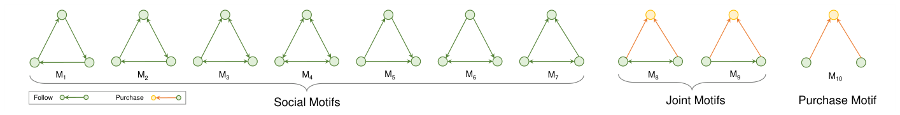
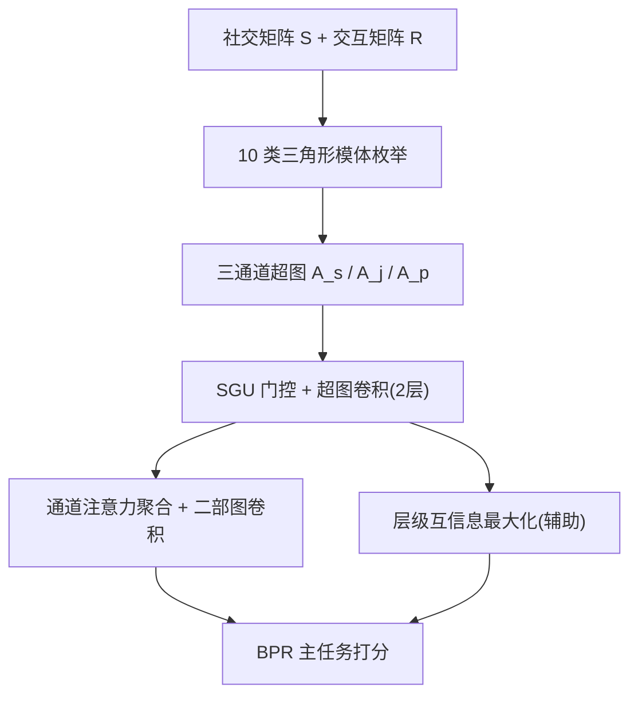

# Self-Supervised Multi-Channel Hypergraph Convolutional Network for Social Recommendation (自监督多通道超图卷积社交推荐)

- **会议/期刊**: WWW 2021
- **作者与机构**: Junliang Yu, Hongzhi Yin, Jundong Li, Qinyong Wang, Nguyen Quoc Viet Hung, Xiangliang Zhang（昆士兰大学、弗吉尼亚大学、KAUST 等）
- **推荐链路定位**: 召回（用户/物品表征学习 + Top-K 排序）
- **研究方向**: 社交与群组推荐 / 自监督对比学习与交互去噪
- **论文原文**: [https://arxiv.org/abs/2101.06448v4](https://arxiv.org/abs/2101.06448v4)
- **开源代码**: [https://github.com/Coder-Yu/RecQ](https://github.com/Coder-Yu/RecQ)

## TL;DR (1分钟核心速览)

现有社交推荐只把用户关系建成成对边，无法刻画"互为好友且买过同一物品"这类高阶关系模式。本文用 10 个三角形模体（motif）把社交图与用户-物品图对齐，诱导出社交/联合/购买三个超图，各通道独立做超图卷积并经自门控与注意力聚合；再用"用户—子超图—超图"层级互信息最大化作为自监督辅助任务，补回聚合过程中被抹平的结构信息。在 LastFM/Douban/Yelp 上采用**全库 Full-Ranking** 评估，NDCG@10 相对最强基线提升 4.29%–21.27%，冷启动子集上自监督再带来最高 18.12% 增益。

## Background & Motivation (背景与核心矛盾)

- **主流范式**: GraphRec、DiffNet++ 等 GNN 社交推荐把用户-用户、用户-物品交互视为成对简单图，堆叠 $k$层图卷积以聚合$k$ 跳邻居。
- **前人局限**: 其一，多层 GNN 只能表达"友情的传递性"这种长程依赖，无法形式化"互为好友 + 共同购买"这类**三元组语义模式**；其二，仅存的超图工作（HMF、LBSN2Vec、DHCF）要么是混合模型未刻画高阶社交结构，要么超边构造不实用导致关联矩阵过密、过平滑。
- **核心洞察 (Key Insight)**: 社交网络普遍存在三元闭包，三角形模体天然对应不同强度的社交纽带——共同好友弱于"好友+共同购买"，而"非好友但共同购买"是纯隐式高阶关系，三者应被分开编码而非一锅炖。
- **本文切入点**: 以模体实例为超边构造多通道超图，并用自监督信号显式保留各通道的高阶连通性，弥补注意力聚合造成的信息损失。

<figure class="paper-figure" markdown="span">
  <figcaption>图 2：本工作使用的三角形模体。绿色圆圈表示用户，黄色圆圈表示物品。</figcaption>
</figure>

## Method (核心方法设计)

### 1. 整体框架 (Overall Architecture)

输入为非对称社交矩阵 $\boldsymbol{S}\in\mathbb{R}^{m\times m}$与交互矩阵$\boldsymbol{R}\in\mathbb{R}^{m\times n}$。首先在异构网络上枚举三角形模体，按社交（M1–M7）、联合（M8–M9）、购买（M10）三组语义生成三个模体诱导邻接矩阵$\boldsymbol{A}_{s},\boldsymbol{A}_{j},\boldsymbol{A}_{p}$；每个通道先用自门控单元（SGU）对共享基嵌入做特征级重加权，再执行简化的超图卷积；三通道输出经注意力加权得综合用户表征，同时并联一路用户-物品二部图卷积补充物品侧信息。训练侧以 BPR 为主任务，以层级互信息最大化为辅助任务联合优化，推理时直接内积全库排序。

### 2. 关键设计拆解 (Key Designs)

1. **模体诱导超图与矩阵化构造（把超边枚举变成稀疏乘）**：直接为每个三角形建一条超边需存 $|\mathcal{E}|$级关联矩阵（LastFM 就有 19,385 个社交三角形），代价不可接受。作者令$\boldsymbol{B}=\boldsymbol{S}\odot\boldsymbol{S}^{\top}$（互关）、$\boldsymbol{U}=\boldsymbol{S}-\boldsymbol{B}$（单向关注），用$\boldsymbol{X}\boldsymbol{Y}\odot\boldsymbol{Z}$形式的稀疏矩阵乘直接算出模体邻接矩阵，并证明$\sum_{k=1}^{7}\boldsymbol{A}_{M_k}=\boldsymbol{H}_{s}\boldsymbol{H}_{s}^{\top}$，于是超图卷积退化为$\boldsymbol{P}^{(l+1)}_{c}=\hat{\boldsymbol{D}}_{c}^{-1}\boldsymbol{A}_{c}\boldsymbol{P}^{(l)}_{c}$，其中$\boldsymbol{A}_{s}=\sum_{k=1}^{7}\boldsymbol{A}_{M_k}$、$\boldsymbol{A}_{j}=\boldsymbol{A}_{M_8}+\boldsymbol{A}_{M_9}$、$\boldsymbol{A}_{p}=\boldsymbol{A}_{M_{10}}-\boldsymbol{A}_{j}$（去冗余）。直觉上，$\boldsymbol{A}_{c}$ 的元素即"两用户共同出现的模体实例数"，天然是高阶关系强度。
2. **自门控预过滤 + 通道注意力聚合（控制信息流）**：三通道若共享同一基嵌入，弱相关通道会被强行拉平。SGU 以乘性跳连实现特征维度重加权：$\boldsymbol{P}^{(0)}_{c}=\boldsymbol{P}^{(0)}\odot\sigma(\boldsymbol{P}^{(0)}\boldsymbol{W}^{c}_{g}+\boldsymbol{b}^{c}_{g})$；随后$\alpha_{c}=\mathrm{softmax}\big(\boldsymbol{a}^{\top}\boldsymbol{W}_{att}\boldsymbol{p}^{*}_{c}\big)$，$\boldsymbol{p}^{*}=\sum_{c}\alpha_{c}\boldsymbol{p}^{*}_{c}$。门控约束每个通道"注入多少基信息"，注意力则在用户粒度决定"该信哪类高阶关系"。
3. **层级互信息最大化自监督 + 损失**：聚合会混叠不同分布通道的信息，故构造"用户节点 ← 用户中心子超图 ← 全局超图"层级。子超图表征用置换不变的度加权读出 $\boldsymbol{z}^{c}_{u}=\boldsymbol{P}_{c}\boldsymbol{a}^{c}_{u}/\mathrm{sum}(\boldsymbol{a}^{c}_{u})$，全局表征$\boldsymbol{h}^{c}=\mathrm{AvgPool}(\boldsymbol{Z}^{c})$；负样本由行列双向 shuffle 生成$\tilde{\boldsymbol{Z}}^{c}$。损失用 pairwise ranking 版 InfoNCE（比点积 InfoNCE 更契合排序任务）：$\mathcal{L}_{s}=-\sum_{c}\sum_{u}\big[\log\sigma(f_D(\boldsymbol{p}^{c}_{u},\boldsymbol{z}^{c}_{u})-f_D(\boldsymbol{p}^{c}_{u},\tilde{\boldsymbol{z}}^{c}_{u}))+\log\sigma(f_D(\boldsymbol{z}^{c}_{u},\boldsymbol{h}^{c})-f_D(\tilde{\boldsymbol{z}}^{c}_{u},\boldsymbol{h}^{c}))\big]$，总目标$\mathcal{L}=\mathcal{L}_{r}+\beta\mathcal{L}_{s}$。局部 MI 直接最大化（用户最关心自身邻域），全局 MI 以子超图为中介间接最大化，比 DGI 的 node-graph 粗粒度 MI 保留更多结构。负采样为 BPR 的均匀随机负例，无额外 hard negative；模型参数约$(m+n+8d)d$，传播开销$O(|\boldsymbol{A}^{+}|dL)$，与 LightGCN 同级。

## Experimental Setup & Evaluation Protocol (实验设置与评估协议)

- **数据集与预处理**: Douban 显式评分保留 $\ge 4$ 并二值化为 1；未报告 k-core 过滤。

| 数据集 | #Users | #Items | #Interactions | 稀疏度/密度 | 特征/场景说明 |
| :--- | :---: | :---: | :---: | :---: | :--- |
| LastFM | 1,892 | 17,632 | 92,834 | 0.28% | 音乐社交，25,434 条有向社交边 |
| Douban | 2,848 | 39,586 | 894,887 | 0.79% | 图书/电影评分 + 社交 |
| Yelp | 19,539 | 21,266 | 450,884 | 0.11% | 本地商户，864,157 条社交边，最稀疏 |

- **数据划分与防穿越 (Splitting Strategy)**: **5 折交叉验证**，报告均值；未做时间戳切分（社交推荐经典设定，存在弱穿越风险）。
- **排名评测协议 (Ranking Protocol)**: **Full-Ranking 全库排序**（对全部候选物品打分，非采样负例），指标 Precision@10 / Recall@10 / NDCG@10，评估无偏。
- **对比基线与超参设置**: 6 个基线（BPR、SBPR、LightGCN、GraphRec、DiffNet++、DHCF），覆盖 MF 与 GNN 两类；$d=50$、$\lambda=0.001$、batch=2000、Adam，网格搜索调参；自监督权重$\beta=0.01$、层数$L=2$。

## Key Experimental Results (实验关键数据)

### 1. 主实验对比 (Main Results)

| Model | LastFM P@10 | LastFM N@10 | Douban P@10 | Douban N@10 | Yelp P@10 | Yelp N@10 |
| :--- | :---: | :---: | :---: | :---: | :---: | :---: |
| BPR | 16.556% | 0.19943 | 15.673% | 0.17476 | 2.002% | 0.03840 |
| SBPR | 16.893% | 0.20516 | 15.993% | 0.17821 | 2.192% | 0.04314 |
| GraphRec | 17.385% | 0.21173 | 17.021% | 0.19051 | 2.323% | 0.04653 |
| DiffNet++ | 18.485% | 0.22310 | 17.532% | 0.19701 | 2.480% | 0.04833 |
| DHCF | 16.877% | 0.20744 | 16.871% | 0.18655 | 2.298% | 0.04700 |
| LightGCN | 19.205% | 0.23392 | 17.780% | 0.19881 | 2.586% | 0.04998 |
| MHCN | 19.625% | 0.23834 | 18.283% | 0.20694 | 2.751% | 0.05356 |
| **S²-MHCN** | **20.052%** | **0.24395** | **18.506%** | **0.21038** | **3.003%** | **0.06061** |
| Improv.% | +4.41% | +4.29% | +4.08% | +5.82% | +16.13% | +21.27% |

冷启动子集（交互 < 20 的用户，N@10 / R@10）：LastFM 上 S²-MHCN 0.19138 / 24.431%（较最佳基线 +19.38% / +14.35%）；Douban 0.07113 / 10.632%（+5.11% / +22.14%）；Yelp 0.05143 / 7.881%（+15.70% / +12.26%）。

### 2. 消融实验 (Ablation Study)

| 变体 | LastFM | Douban | Yelp | 结论 |
| :--- | :---: | :---: | :---: | :--- |
| 移除 Social 通道 | 小幅↓ | 小幅↓ | 小幅↓ | 显式社交边噪声大，贡献最小 |
| 移除 Joint 通道 | 中幅↓ | 中幅↓ | 中幅↓ | 介于两者之间 |
| 移除 Purchase 通道 | 大幅↓ | 大幅↓ | 大幅↓ | 掉至 LightGCN 水平，为主导通道 |
| MHCN（无自监督） | 基准 | 基准 | 基准 | 已全面超越基线 |
| + 仅 Local MIM | 次优 | 次优 | 次优 | 局部 MI 是增益主要来源 |
| + 仅 Global MIM | 优于 DGI | 优于 DGI | 优于 DGI | 单独作用有限 |
| + DGI（node-graph MI） | 几乎无增益 | 常低于基准 | 常低于基准 | 粗粒度 MI 不适配 |
| **+ 层级 MIM（完整）** | **最优** | **最优** | **最优** | 层级设计最合理 |

### 3. 关键实验发现 (Key Findings)

1. **稀疏度决定增益幅度**：Yelp 密度仅 0.11%，NDCG@10 相对提升 21.27%，而密度 0.79% 的 Douban 仅 5.82%——说明将成对关系升级为模体级高阶关系，本质是在补足交互信号缺失。
2. **自监督在冷启动上价值翻倍**：MHCN→S²-MHCN 在常规任务平均提升约 5.39%，在冷启动子集平均提升约 9.44%（Yelp 冷启动 NDCG +18.12%），验证"结构信息作为免费监督"对少交互用户尤其关键。
3. **通道重要性排序揭示社交边噪声**：注意力可视化显示 Purchase 通道权重最高，Social 通道对大多数 LastFM 用户影响微弱；移除 Purchase 后模型回落到 LightGCN 水平，说明"共同购买"才是可靠的高阶纽带，纯好友关系需经模体过滤才有用。

## Highlights & Limitations (亮点、对比与审稿批判)

- **与代表作对比 (vs. Prior Work)**: 相比 DiffNet++ 等多层 GNN，本文用超边一次性表达三元语义而非依赖 $k$ 跳传递；相比 DHCF 的超图协同过滤，本文超边由模体结构而非实体类型生成，避免关联矩阵过密与过平滑；相比 DGI 的 node-graph MI，层级 MI 在细粒度上保结构，实验中 DGI 几乎无法带来增益。
- **可迁移亮点**: ① 模体邻接矩阵的稀疏矩阵乘构造法（$\boldsymbol{X}\boldsymbol{Y}\odot\boldsymbol{Z}$ 范式）可迁移到任何需要枚举高阶子图/超边的场景；② "用户—邻域—全局"层级 MI 辅助任务可无缝挂到任意 GNN 召回模型上作为正则项。
- **审稿级局限批判**: ① 仅建模三角形模体（1 层超边），更高阶闭环（4-模体）未覆盖，且社交图被裁剪为"参与模体的边"，孤立/弱连接用户被丢弃；② 未做全局时间戳切分，5 折随机划分下社交边可能穿越未来信息；③ $\beta$ 极敏感（0.01 峰值，增大即退化），且深度超过 2 层迅速过平滑，实际部署需逐数据集调参。

## Rating (四维评分)

- **方法创新性 (Novelty)**: ⭐⭐⭐⭐ （模体诱导超图 + 层级互信息辅助任务是干净的两点增量，且给出矩阵化等价推导，理论支撑扎实）
- **评估协议与实验扎实度 (Protocol & Experiments)**: ⭐⭐⭐⭐ （Full-Ranking 无偏评估、常规+冷启动双赛道、6 基线齐全，但缺少时间切分与显著性检验、消融仅以柱状图呈现无具体数值）
- **写作与数学规范度 (Clarity & Rigor)**: ⭐⭐⭐⭐ （超图卷积简化、复杂度与参数量分析清晰，公式符号自洽；动机图与模体定义直观）
- **工业落地与复现价值 (Industrial & Practical Value)**: ⭐⭐⭐⭐ （开源代码可用、参数量与 LightGCN 同级、无需超边物化；但注意力与门控引入 $O(md^{2})$ 开销，社交图稠密时模体枚举需预处理）

