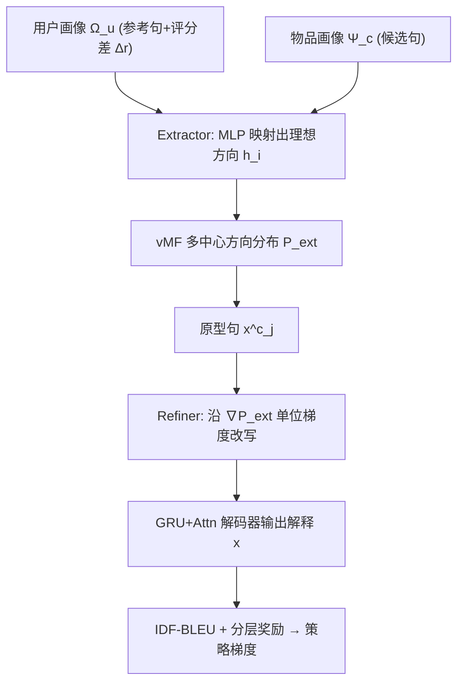
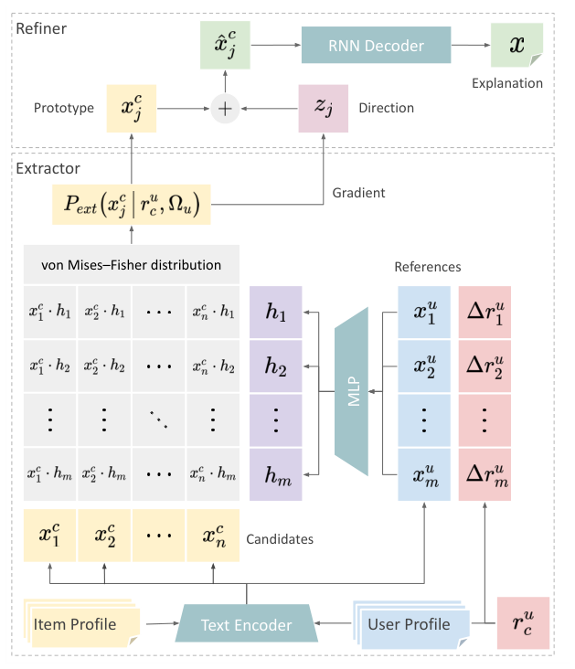

# Comparative Explanations of Recommendations (推荐结果的比较式解释生成)

- **会议/期刊**: WWW 2022 (The ACM Web Conference)
- **作者与机构**: Aobo Yang, Nan Wang, Renqin Cai, Hongbo Deng, Hongning Wang（University of Virginia；Alibaba Group）
- **推荐链路定位**: 推荐列表展示层的解释生成（不改变排序，只解释排序）
- **研究方向**: 对话推荐与智能体仿真（可解释推荐理由生成） / 生成式推荐
- **论文原文**: [https://arxiv.org/abs/2111.00670v3](https://arxiv.org/abs/2111.00670v3)
- **开源代码**: 暂未开源

## TL;DR (1分钟核心速览)

现有可解释推荐把每个物品的解释**逐点独立生成**，既不考虑列表内其他物品，又因 MLE 训练倾向输出“the hotel is good”这类通用短句，用户读完仍无法感知 A>B>C 的排序。本文提出 CompExp：先从物品评论中按“评分差方向”抽取原型句（vMF 方向分布），再用提取器梯度方向改写该句，并以新度量 IDF-BLEU 构造分层奖励做端到端策略梯度训练。在 RateBeer / TripAdvisor 上 IDF-BLEU-1 达 32.36 / 21.35（较 SAER 分别 +1.8% / **+30.4%**），重复率 seq_rep_2 降低 74.4%，人工评测有用性投票 43.79% 显著领先。

## Background & Motivation (背景与核心矛盾)

- **主流范式**: 可解释推荐分两支——抽取式（NARRE 用注意力挑评论句、CARP 用胶囊网络）与生成式（NRT 多任务共享隐空间、SAER 做情感对齐、DualPC 做对偶正则），均以用户评论为监督源。
- **前人局限 (1)**: 解释**逐点独立生成**。如图 1 所示，仅把 Hotel C 的解释换成"the hotel is good and the pool is good"，三家酒店的排序感知立即崩塌——单条低质解释会污染整个列表的可比性。
- **前人局限 (2)**: 神经文本生成的**通用性缺陷**。MLE + 贪心解码偏好全局高频词，产出短、重复、无区分度的句子；而 BLEU 本身的 brevity penalty 又以"最匹配参考长度"为基准，进一步奖励短句与通用词。
- **核心洞察 (Key Insight)**: 若把**用户画像 $\Omega_u$作为统一锚点**，让每个推荐物品的解释都相对同一组"参考句 + 评分差$\Delta r_{ui}$"生成，则解释之间的可比性自然涌现（A>B、C<B 蕴含 A>C）。
- **本文切入点**: 用"抽取保证忠实性、改写保证信息量"的两段式生成，并把评价指标直接写进训练目标。

## Method (核心方法设计)

### 1. 整体框架 (Overall Architecture)

给定待解释物品 $c$（物品画像$\Psi_c$为其评论句集合）、目标用户$u$（画像$\Omega_u=\{(\boldsymbol{x}_{ui}, r_{ui})\}$）与系统给出的评分$r_{uc}$，模型建模生成过程$P(\boldsymbol{x}|u,c,r_{uc})=\sum_{\boldsymbol{x}^c_j\in\Psi_c}P_{\text{ref}}(\boldsymbol{x}|\boldsymbol{x}^c_j,r_{uc},\Omega_u)P_{\text{ext}}(\boldsymbol{x}^c_j|r_{uc},\Omega_u)$：抽取器把每条参考句与评分差编码成"理想解释方向"，用 von Mises–Fisher 分布为该方向下的候选句打分；改写器沿抽取器概率的梯度方向推动原型句向量，再由 GRU+Attention 解码成自然语言；最后用 IDF-BLEU 与分层内在奖励做策略梯度端到端微调。

<figure class="paper-figure" markdown="span">
  <figcaption>图2：CompExp 的 extract-and-refine 模型架构。提取器从物品 𝑐 的画像中抽取一个候选句子，作为解释生成的原型；精炼器对该句子进行改写，以优化比较性解释所期望的质量指标。</figcaption>
</figure>

### 2. 关键设计拆解 (Key Designs)

1. **方向性抽取器 (Directional Extractor)**：痛点是把"比较"变成可计算的量。作者将参考句嵌入与评分差嵌入拼接送入 MLP，得到理想比较解释向量 $\boldsymbol{h}_i=f(\boldsymbol{x}_{ui},\Delta r_{ui})$，并在余弦空间用 vMF 分布聚合所有参考句的投票：
$P_{\text{ext}}(\boldsymbol{x}^c_j|r_{uc},\Omega_u)\propto\sum_{\boldsymbol{x}_{ui}\in\Omega_u}C_p(\kappa)e^{\kappa\cos(\boldsymbol{x}^c_j,\boldsymbol{h}_i)}$直觉：$\Delta r_{ui}<0$时方向被推离参考句语义，抽取器自动选出"更负面"的候选句；$\kappa$ 控制分布尖锐度，训练中作为探索强度的旋钮。

2. **梯度式改写器 (Gradient Refiner)**：痛点是改写不能"跑题"。作者不求新分布，而是取抽取概率对句向量的梯度作为上升最快的改写方向，归一化为单位步长：
$\boldsymbol{z}_j=\nabla_{\boldsymbol{x}^c_j}P_{\text{ext}}\propto\sum_i e^{\kappa\cos(\boldsymbol{x}^c_j,\boldsymbol{h}_i)}\left[\frac{\boldsymbol{h}_i}{\|\boldsymbol{x}^c_j\|\|\boldsymbol{h}_i\|}-\frac{\cos(\boldsymbol{x}^c_j,\boldsymbol{h}_i)\boldsymbol{x}^c_j}{\|\boldsymbol{x}^c_j\|^2}\right],\ \hat{\boldsymbol{x}}^c_j=\boldsymbol{x}^c_j+\boldsymbol{z}_j/\|\boldsymbol{z}_j\|$
固定步长既是保真约束（只润色、不重写事实），又让改写"恰好达到抽取器无法再判优"的临界点。

3. **IDF-BLEU 度量与分层奖励**：痛点直指 BLEU 两大偏差。三项改造——(i) 用平均参考长度替换 best-match 长度得 $BP_{len}=e^{\min(1-l_r/l_x,0)}$；(ii) 用词级 IDF（以句子频率计算，n-gram 取组成词最大 IDF）重加权裁剪精度$p_n=\frac{\sum_{g_n\in x}\text{IDF}(g_n)\cdot\text{Count}_{clip}(g_n)}{\sum_{g_n\in x}\text{IDF}(g_n)\cdot\text{Count}(g_n)}$；(iii) 增设 IDF 简洁惩罚$BP_{IDF}=e^{\min(1-d_r/d_x,0)}$，惩罚"不含稀有词"的句子。训练目标为$\max_\Theta J=\mathbb{E}_{x\sim P}[\pi(x|u,c)]$，并加两项内在奖励：抽取器用$\pi_{ext}=\text{IDF-BLEU}(x^c_j)$，改写器用**裁剪召回**$\pi_{ref}=\exp(\sum_n w_n\log a_n)$，$a_n$ 只统计同时出现在参考句中的 n-gram，防止"照抄整句"。
最终策略梯度为 $\nabla_\Theta J\approx[\lambda_1\pi+\lambda_2\pi_{ref}]\nabla\log P_{\text{ref}}+[\lambda_3\pi+\lambda_4\pi_{ext}]\nabla\log P_{\text{ext}}$；训练分两段：抽取器做负对数似然预训练，改写器用"同物品内最相似句"人工配对做语言模型预训练，再联合微调，并用 Monte-Carlo 多次采样均值作 baseline 降方差。推理为免负采样、逐物品贪心解码，单条解释一次前向。

## Experimental Setup & Evaluation Protocol (实验设置与评估协议)

| 数据集 | #Users | #Items | #Reviews | 评分范围 | 特征/场景说明 |
| :--- | :---: | :---: | :---: | :---: | :--- |
| RateBeer | 6,566 | 19,876 | 2,236,278 | 0–20 | 整条评论按句切分，句级标注整体评分（overall opinion） |
| TripAdvisor | 4,954 | 4,493 | 287,879 | 1–5 | 按 service/room/location/value/cleanliness 五方面用 bootstrapping 归句并赋方面评分 |

- **数据划分与防穿越**: 采用 Recursive filtering（同 MTER/SAER 设定）缓解稀疏；句级 train/test 切分，但原文未给出显式时间戳或 Leave-One-Out 说明，属**弱防穿越**设定。
- **排名评测协议**: **非排名评测**。本文不涉及 Full-Ranking 或 Sampled Ranking，因为它直接**用真实评分 $r_{uc}$ 作为推荐分**以剥离推荐器噪声；解释质量用 IDF-BLEU/BLEU、平均句长、IDF/word、rep/l、seq_rep_2、Feature P/R 衡量，另加 Amazon MTurk 人工评测。
- **对比基线**: 抽取式 NARRE；生成式 NRT、SAER；自家族消融 CompExp-Ext / -Pretrain / -BLEU；人工写作句作参照 Human。GRU 编码器、$\kappa$与$\lambda_{1..4}$为超参，最优值以$p<0.05$ 显著性标出。

## Key Experimental Results (实验关键数据)

### 1. 主实验对比 (Main Results)

| RateBeer | IDF-BLEU-1 | IDF-BLEU-2 | IDF-BLEU-4 | BLEU-4 | Avg Len | IDF/word | seq_rep_2↓ | Feat-P | Feat-R |
| :--- | :---: | :---: | :---: | :---: | :---: | :---: | :---: | :---: | :---: |
| Human | / | / | / | / | 11.13 | 2.45 | 0.0015 | / | / |
| NARRE | 17.00 | 5.18 | 1.29 | 3.58 | 11.50 | 2.43 | 0.0013 | 0.2217 | 0.0722 |
| NRT | 30.38 | 16.30 | 5.80 | 10.03 | 10.43 | 2.09 | 0.0240 | 0.4563 | 0.1320 |
| SAER | 31.79 | 16.02 | 5.71 | 10.59 | 10.71 | 1.93 | 0.0223 | **0.4751** | 0.1347 |
| CompExp-Ext | 24.86 | 11.72 | 2.99 | 5.98 | 12.10 | 2.36 | 0.0010 | 0.3092 | 0.0929 |
| CompExp-Pretrain | 27.59 | 13.44 | 4.19 | 7.95 | 10.55 | 2.07 | 0.0381 | 0.3922 | 0.1123 |
| CompExp-BLEU | 23.20 | 14.55 | 4.70 | **11.62** | 7.09 | 1.83 | **0.0006** | 0.4025 | 0.1173 |
| **CompExp** | **32.36** | **19.55** | **6.95** | 11.41 | 10.52 | 2.16 | 0.0057 | 0.4796 | **0.1383** |
| Improv. vs best baseline | +1.8% | +22.0% | +21.7% | — | — | — | −74.4% | — | +2.7% |

| TripAdvisor | IDF-BLEU-1 | IDF-BLEU-2 | IDF-BLEU-4 | BLEU-4 | Avg Len | IDF/word | seq_rep_2↓ | Feat-P | Feat-R |
| :--- | :---: | :---: | :---: | :---: | :---: | :---: | :---: | :---: | :---: |
| SAER | 16.37 | 7.65 | **2.35** | **4.94** | 10.08 | 1.71 | 0.0141 | 0.3178 | **0.1961** |
| NRT | 16.19 | 7.50 | 2.48 | 5.11 | 10.22 | 1.81 | 0.0135 | 0.2939 | 0.1866 |
| CompExp-Pretrain | 14.50 | 6.11 | 1.99 | 4.32 | 10.79 | 1.92 | 0.0250 | 0.2736 | 0.1597 |
| **CompExp** | **21.35** | **8.01** | 2.16 | 4.16 | 13.35 | **2.12** | **0.0053** | 0.3155 | 0.1930 |
| Improv. vs best baseline | **+30.4%** | +4.7% | −8.1% | — | — | — | −60.7% | — | — |

### 2. 消融实验 (Ablation Study)

| 变体 | RateBeer IDF-BLEU-1 | -2 | -4 | TripAdvisor IDF-BLEU-1 | Avg Len (RB) |
| :--- | :---: | :---: | :---: | :---: | :---: |
| CompExp-Ext（仅抽取） | 24.86 | 11.72 | 2.99 | 13.52 | 12.10 |
| CompExp-Pretrain（无联合训练） | 27.59 | 13.44 | 4.19 | 14.50 | 10.55 |
| CompExp-BLEU（换回 BLEU 度量） | 23.20 | 14.55 | 4.70 | 17.04 | 7.09 |
| **CompExp（完整）** | **32.36** | **19.55** | **6.95** | **21.35** | 10.52 |

### 3. 关键实验发现 (Key Findings)

1. **端到端策略梯度贡献最大**：从 CompExp-Pretrain 到完整模型，RateBeer IDF-BLEU-1 由 27.59 升至 32.36（+17.3%），TripAdvisor 由 14.50 飙至 21.35（**+47.2%**），说明分层奖励（尤其裁剪召回对改写器的约束）是防止"跑题式生成"的关键阀门。
2. **BLEU 会"训练出"短而通用的解释**：CompExp-BLEU 在 BLEU-4 上拿到全场最高 11.62，但平均句长暴跌至 7.09（人类 11.13）、IDF/word 仅 1.83、Feature P 从 0.4796 掉到 0.4025——直接优化 BLEU 等于奖励"短句+高频词"，反向印证了 IDF-BLEU 的必要性。
3. **比较性可被量化验证**：对输入评分加高斯噪声后，IDF-BLEU/BLEU 单调下降（图 3a），证明同一用户同一物品集在不同评分下确实生成不同解释；而改用 NCF 预测评分后指标变化 <5%（图 3b），说明真实推荐器的噪声不会破坏该机制。人工侧，CompExp 有用性投票 43.79% > SAER 37.27% > NRT 35.61% > NARRE 30.61%；排序感知一致率 57.27% 略高于 SAER 56.25% / NRT 53.14%，但远低于人类解释的 72.29%，说明"比较性"仍有明显上升空间。IDF-BLEU 与人工判断的 Cohen's $\kappa$（0.3452/0.3396/0.3152）显著优于 BLEU（0.2936/0.3114/0.2814，$p<0.01$）。

## Highlights & Limitations (亮点、对比与审稿批判)

- **与代表作对比**: NARRE 只做注意力选句、受限于既有评论质量；NRT/SAER 虽能生成，但**逐点独立**且无稀疏词激励，SAER 的情感对齐只保证单条解释与评分一致、不保证跨物品可比。CompExp 的本质差别是把"参考句+评分差"当锚点，使可比性成为生成的**结构性副产品**而非事后约束。
- **可迁移亮点**: (i) 用"目标指标构造分层内在奖励 + 裁剪召回"约束两段式流水线的自由度，可直接搬到检索摘要、多模态解释生成；(ii) 以**梯度方向 + 单位步长**实现"最小改写"，是低算力约束下的可控编辑范式。
- **审稿级局限批判**: (i) **评估协议薄弱**——直接用 ground-truth 评分替代推荐分，且句级切分未交代时间戳/防穿越，缺失标准化排名评测，离线结论与线上排序场景存在 gap；(ii) **排序感知一致率仅 57%**（人类 72%），且 TripAdvisor 上 IDF-BLEU-4/BLEU-4 反被 SAER 超越，说明长 n-gram 与短句场景下优势不稳；两段式 + 多次 Monte-Carlo 采样的训练开销与在线逐物品生成延迟也未量化，工业部署成本存疑。

## Rating (四维评分)

- **方法创新性 (Novelty)**: ⭐⭐⭐⭐ （把"比较性"编码为 vMF 方向分布 + 梯度改写，问题定义本身即新方向，但组件级技术多为已有模块的组合）
- **评估协议与实验扎实度 (Protocol & Experiments)**: ⭐⭐⭐ （双数据集 + 660/200 份人工评测与 $\kappa$ 检验较扎实，但以真值评分替代推荐分、缺排名级评测与防穿越说明）
- **写作与数学规范度 (Clarity & Rigor)**: ⭐⭐⭐⭐ （生成过程分解与 IDF-BLEU 三项改造推导清晰，梯度闭式解给出完整表达式；$\lambda$、$\kappa$ 的敏感性分析略欠）
- **工业落地与复现价值 (Industrial & Practical Value)**: ⭐⭐⭐ （抽取器可单独作为低延迟方案上线，但无开源代码、改写器依赖策略梯度训练，复现与线上延迟控制成本较高）

